本期二十一项研究介绍本体构建、自博弈、视觉表示、缓存管理、科学发现、交互世界、Agent 工作流与高效模型。

## 1. LOM：构建、对齐与推理共用本体结构

**LOM** · v1 首次提交 2026-03-11。[Unifying Ontology Construction and Semantic Alignment for Deterministic Enterprise Reasoning at Scale](https://arxiv.org/abs/2604.09608v1) 连接本体构建、语义对齐与图推理。LOM-4B 本体补全准确率为 88.8%；推理得分在摘要与正文中出现 94% 和 95% 两种表述，统计口径不清，不能据此推断企业数据治理的一般水平。

CAR 流水线先从原始数据构建领域本体，再用图感知编码器与强化学习对齐生成，最后在拓扑、节点属性与关系类型上执行推理。构建出的逻辑空间即使内部可推演，也仍可能继承抽取错误或不完整规则；确定性执行不等于所有输入事实正确。

## 2. Vision Banana：把理解任务输出为 RGB 图像

**Vision Banana** · v1 首次提交 2026-04-22。[Image Generators are Generalist Vision Learners](https://arxiv.org/abs/2604.20329v1) 将分割、深度等输出编码成 RGB 图像，以指令微调探索生成式视觉预训练的理解能力。具体比较仍需分别核对数据集、零样本条件与专用模型。

Cityscapes 的零样本迁移 mIoU 为 0.699，SAM 3 为 0.652；但 SA-Co/Gold 上 Vision Banana 的 pmF1 为 0.540，低于 DINO-X 的 0.552，且前者仅抽取五百个查询。这里零样本指未在这些基准的训练切分上训练，并不是没有视觉任务微调。

## 3. SGS

自博弈训练 · v1 首次提交 2026-04-22 · [Scaling Self-Play with Self-Guidance](https://arxiv.org/abs/2604.20209v1) · [全文](https://arxiv.org/html/2604.20209v1)

Self-Guided Self-Play 增加 Guide 角色，对合成子问题的自然程度及其对未解决目标的帮助评分，以抑制出题者靠畸形难题获取奖励。作者在 Lean4 形式化证明中报告，不到 80 轮便超过最强 RL 基线的拟合渐近解题率。

7B 模型经过 200 轮训练后，累计解决的问题数超过 671B 模型的 pass@4 结果。这是长时间自博弈与固定采样预算的比较，不能解释为同等计算成本下的小模型普遍胜过大模型。[实验与比较口径见第 4 节](https://arxiv.org/html/2604.20209v1#S4)。

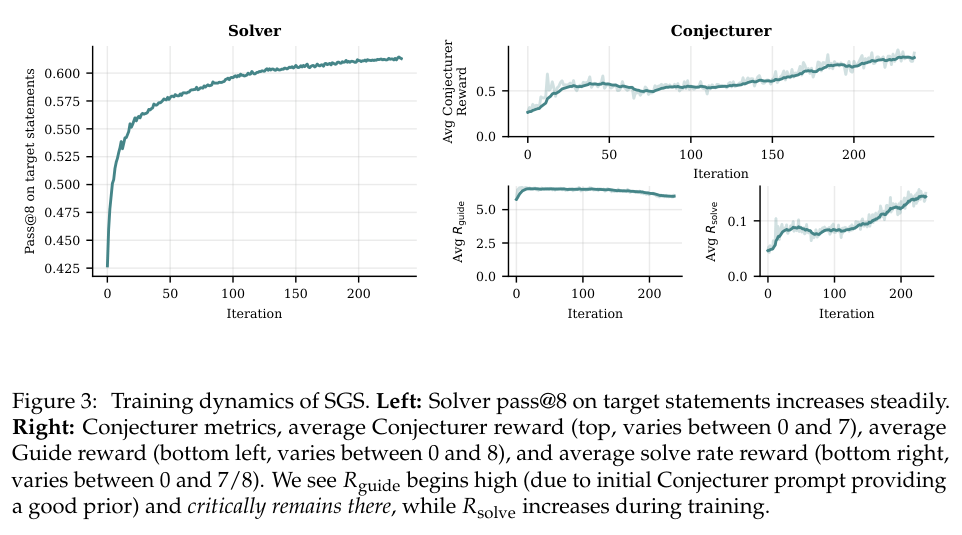

*图｜Bailey, Luke 等，[Figure 3（PDF 第 7 页）](https://arxiv.org/pdf/2604.20209v1#page=7)，[CC BY 4.0](http://creativecommons.org/licenses/by/4.0/)。裁剪自原文。*

## 4. Neural Garbage Collection

推理记忆管理 · v1 首次提交 2026-04-20 · [Neural Garbage Collection: Learning to Forget while Learning to Reason](https://arxiv.org/abs/2604.18002v1) · [全文](https://arxiv.org/html/2604.18002v1)

NGC 让模型间歇选择淘汰的 KV cache 条目，再在剩余记忆上继续推理。推理 token 与淘汰决策共同作为强化学习动作，训练信号来自最终任务结果。

在 Countdown、AMC、AIME 上，作者报告峰值缓存压缩约 2–3 倍时仍维持接近全缓存上界的准确率，并优于所比较的淘汰基线。该结果支持受限任务中的学习式记忆管理，无法保证任意长上下文服务都能无损压缩。[实验见第 5 节](https://arxiv.org/html/2604.18002v1#S5)。

## 5. 科学智能体会利用证据吗

科学推理评测 · v1 首次提交 2026-04-20 · [AI scientists produce results without reasoning scientifically](https://arxiv.org/abs/2604.18805v1) · [全文](https://arxiv.org/html/2604.18805v1)

该研究覆盖八类科学领域与超过 25,000 次运行，将最终分数与过程行为分别检查。测试包含三个基础模型及 ReAct、结构化工具调用两种框架，任务从工作流执行延伸至假设检验。

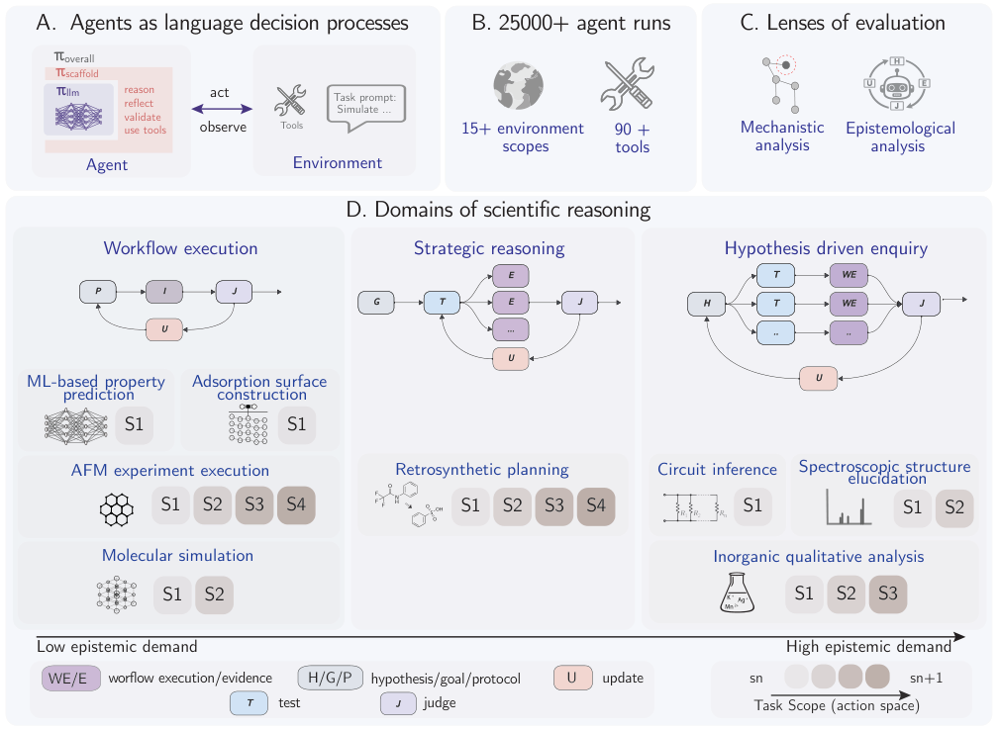

*图 1｜Martiño Ríos-García 等，[v1 Figure 1，PDF 第 4 页](https://arxiv.org/pdf/2604.18805v1#page=4)，[CC BY 4.0](https://creativecommons.org/licenses/by/4.0/)。裁剪自原文。*

按作者的轨迹标注规则，68% 的轨迹出现取得证据后未使用的行为，26% 出现反驳推动的信念修正。过程分析包括模型辅助标注，比例依赖其操作定义，不能当作对所有科研工具的永久判断。结果提示，最终产物验收需要与证据使用、假设更新的审查配合。[分析见原文结果部分](https://arxiv.org/html/2604.18805v1)。

## 6. Hyperloop：以循环层和矩阵残差节省参数

Hyperloop 将网络拆为开头、中段和结尾，只循环复用中段；每轮之后加入 hyper-connection，将单条残差流扩展为矩阵残差流。它针对参数存储受限的部署，把更深计算与较小权重体积分开。

*图｜Zeitoun, Abbas 等，[Figure 1（PDF 第 3 页）](https://arxiv.org/pdf/2604.21254v1#page=3)，[CC BY 4.0](http://creativecommons.org/licenses/by/4.0/)。裁剪自原文。*

约 135.7M 参数模型训练 12.5B token 后，困惑度为 14.40，238M 普通 Transformer 为 14.65；训练到 100B token 时则为 12.19 对 12.15，优势不再成立但仍接近。节省约四成参数没有省掉循环计算，模型尺寸、有效深度、训练 token 和实际延迟需要分别比较。

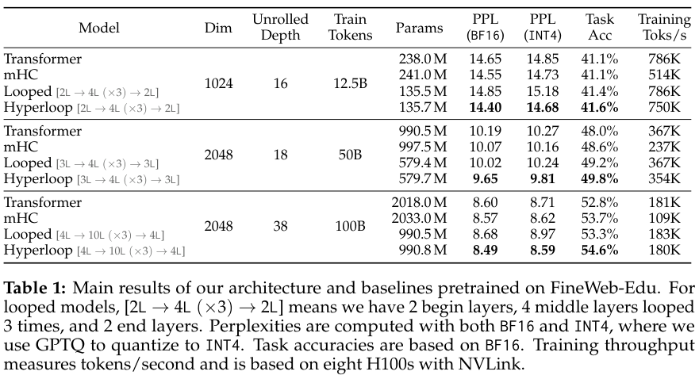

*图｜Zeitoun, Abbas 等，[Table 1（PDF 第 5 页）](https://arxiv.org/pdf/2604.21254v1#page=5)，[CC BY 4.0](http://creativecommons.org/licenses/by/4.0/)。裁剪自原文。*

[Hyperloop Transformers](https://arxiv.org/abs/2604.21254v1) · v1。

## 7. SimpleTES：扩展反馈循环，而不只增加候选数量

SimpleTES 将并行探索、基于反馈的修订与局部选择组合起来，用 verifier、仿真器或任务分数驱动科学问题求解。成功轨迹还可用于后训练，学习怎样利用下一轮反馈。

六领域二十一项问题中，作者报告 LASSO 实现加速超过两倍、量子线路路由门开销降低 24.5%，并找到更好的 Erdős 最小重叠构造。这些分别是不同任务的指标，不能平均成统一科学发现成功率；改进受目标函数、执行验证与搜索预算支配，也不自动验证问题定义之外的科学意义。

[Evaluation-driven Scaling for Scientific Discovery](https://arxiv.org/abs/2604.19341v1) · v1。

[Figure 1（原文）](https://arxiv.org/pdf/2604.19341v1#page=4)。

## 8. WorldMark：统一场景和动作，再比较世界模型

WorldMark 将 WASD 式移动与转向映射到不同模型的原生控制接口，以相同场景、动作序列和评价流程比较六种交互视频模型。五百项案例覆盖第一、第三人称、真实与风格化场景，分别检查画质、控制对齐和世界一致性。

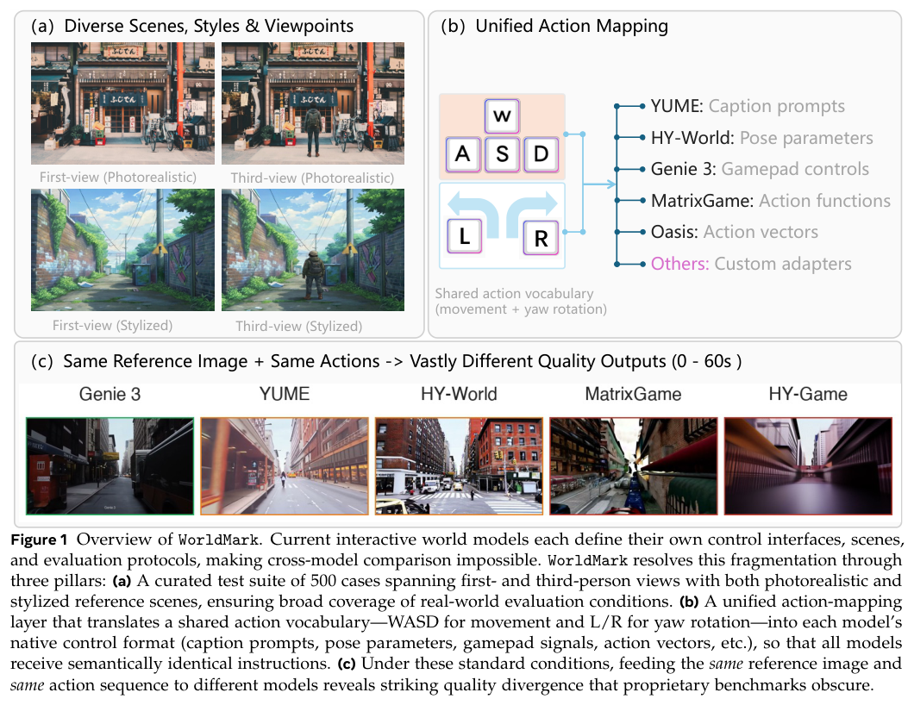

*图｜Xu, Xiaojie 等，[Figure 1（PDF 第 2 页）](https://arxiv.org/pdf/2604.21686v1#page=2)，[CC BY 4.0](http://creativecommons.org/licenses/by/4.0/)。裁剪自原文。*

第一人称真实场景中，YUME 1.5 的美学分为 56.94，Genie 3 为 45.58；状态一致性则是 5.344 对 6.416，排序相反。第三人称仅比较原生支持它的三种模型。统一动作语义改善可比性，但适配器对运动速度与转角的校准、视觉估计误差和指标尺度仍会影响排名。

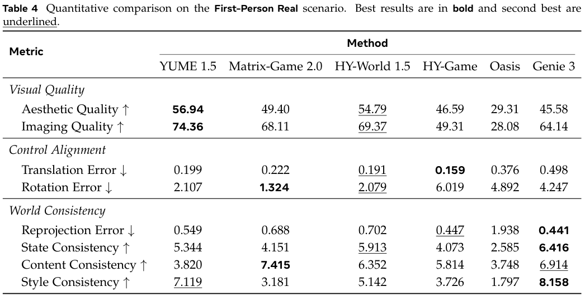

*图｜Xu, Xiaojie 等，[Table 4（PDF 第 9 页）](https://arxiv.org/pdf/2604.21686v1#page=9)，[CC BY 4.0](http://creativecommons.org/licenses/by/4.0/)。裁剪自原文。*

[WorldMark: A Unified Benchmark Suite for Interactive Video World Models](https://arxiv.org/abs/2604.21686v1) · v1。

## 9. GrandCode：把解题、测例与总结接到多 Agent RL

GrandCode 将假设提出、代码求解、测试生成和总结模块协同训练，再在测试时进行在线强化学习。Agentic GRPO 处理多阶段轨迹的延迟奖励与离策略漂移，使解题策略能根据执行结果继续更新。

作者报告在 2026 年 3 月的 Codeforces 1087、1088、1089 三场实时竞赛均获第一。这说明特定系统与赛制下的竞赛编程能力很强，但名次同时包含多 Agent 编排、执行测试和测试时训练的投入；三场排名不能单独证明基础模型、同成本单次生成或所有软件工程任务都超过人类。

[GrandCode: Achieving Grandmaster Level in Competitive Programming via Agentic Reinforcement Learning](https://arxiv.org/abs/2604.02721v1) · v1。

[Figure 1（原文）](https://arxiv.org/pdf/2604.02721v1#page=1)。

## 10. ClawBench：在真实网站上评测日常工作流

ClawBench 的 153 项任务覆盖 144 个实际平台和十五类用途，要求读取用户文档、跨多步页面操作并准确填表。轻量拦截层只阻止最后一次提交请求，保留生产网站的动态界面与流程复杂性。

七种前沿模型均只能完成部分任务，例如 Claude Sonnet 4.6 为 33.3%。这一结果衡量从信息提取到操作的整条工作流，不能等同于单次点击或网页问答准确率。真实网站变化使重复评测更难对齐；最终提交被拦截也意味着没有检验提交之后的业务系统状态。

[ClawBench: Can AI Agents Complete Everyday Online Tasks?](https://arxiv.org/abs/2604.08523v1) · v1。

[Figure 1（原文）](https://arxiv.org/pdf/2604.08523v1#page=1)。

## 11. Video-MME-v2：成组判分暴露视频推理的不一致

Video-MME-v2 从多点视觉信息聚合、时间动态到复杂多模态推理递进设计问题，并用成组非线性评分要求相关问题回答一致、推理链连贯。数据制作包含十二位标注者、五十位审阅者与多轮质量检查。

Gemini-3-Pro 的 Non-Lin Score 在含音频等辅助信息设置为 49.4，去除后为 38.2；Qwen3.5-27B-Think 为 31.4。这里的分数要求跨问题一致，不能与逐题平均准确率互换。部分模型开启思考在有字幕时获益、纯视觉时反而退化，说明文字线索和视觉时间建模的作用需要分开分析。

[Video-MME-v2: Towards the Next Stage in Benchmarks for Comprehensive Video Understanding](https://arxiv.org/abs/2604.05015v1) · v1。

[Figure 1（原文）](https://arxiv.org/pdf/2604.05015v1#page=3)。

## 12. WildDet3D：让单图三维检测接受多种提示与深度

WildDet3D 统一文本、点击和二维框提示，并在推理时接收可选深度信息。训练集由已有二维标注生成候选三维框，再经人工检查，形成超过百万图像、约 1.35 万类别的开放场景数据。

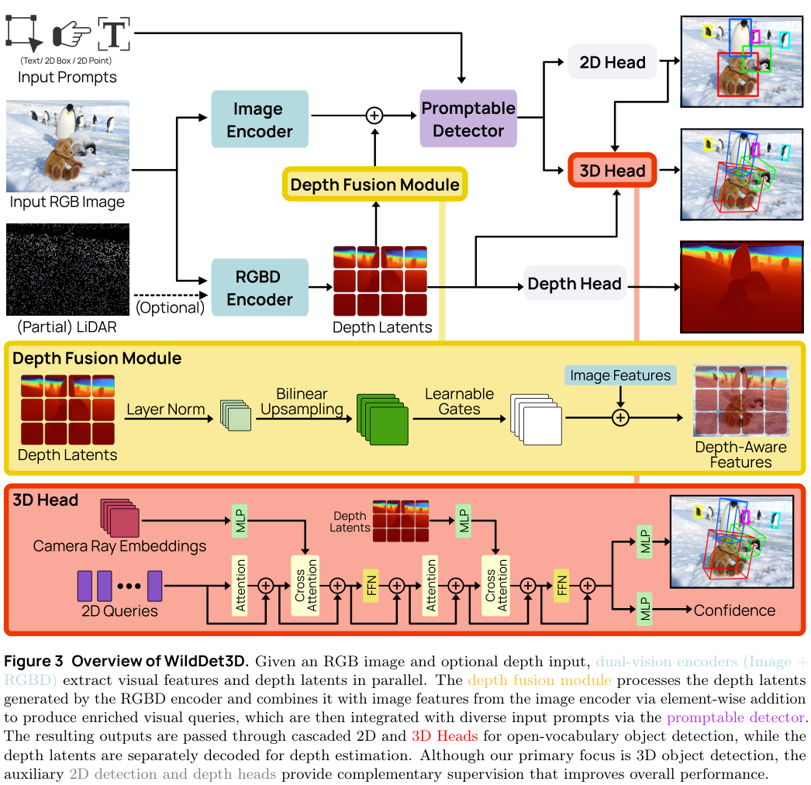

*图｜Huang, Weikai 等，[Figure 3（PDF 第 4 页）](https://arxiv.org/pdf/2604.08626v1#page=4)，[CC BY 4.0](http://creativecommons.org/licenses/by/4.0/)。裁剪自原文。*

WildDet3D-Bench 上，文本与框提示的 AP3D 分别为 22.6、24.8；Omni3D 为 34.2、36.4。额外深度使多个设置平均增加 20.7 AP，但这改变了可用输入条件，不能作为纯 RGB 模型的无条件提升。Argoverse 2 与 ScanNet 的 ODS 又是另一指标，跨数据集数字不可直接排序。

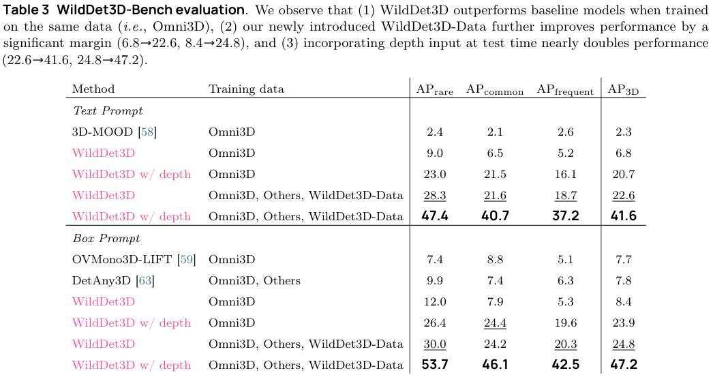

*图｜Huang, Weikai 等，[Table 3（PDF 第 15 页）](https://arxiv.org/pdf/2604.08626v1#page=15)，[CC BY 4.0](http://creativecommons.org/licenses/by/4.0/)。裁剪自原文。*

[WildDet3D: Scaling Promptable 3D Detection in the Wild](https://arxiv.org/abs/2604.08626v1) · v1。

## 13. CARLA-Air：将城市交通与无人机放进同一物理进程

CARLA-Air 在同一 Unreal Engine 进程中合入 CARLA 地面场景与 AirSim 多旋翼动态，共用物理时钟和渲染管线，并保留两者原生 Python API 及 ROS 2 接口。相同 tick 可同步采集最多十八种传感模态。

论文以空地协作、导航、感知数据采集与策略训练工作负载展示统一基础设施。功能对照强调共享进程、传感器和接口兼容，没有给出一个可替代所有仿真器的任务成功率。物理同步是实现条件，真实飞行的气动、感知噪声与跨域迁移仍需另外验证。

[CARLA-Air: Fly Drones Inside a CARLA World -- A Unified Infrastructure for Air-Ground Embodied Intelligence](https://arxiv.org/abs/2603.28032v1) · v1。

[Figure 1（原文）](https://arxiv.org/pdf/2603.28032v1#page=1)。

## 14. AgentSPEX：用显式工作流描述 Agent 控制流

AgentSPEX 用带类型的步骤、分支、循环、并行和模块定义工作流，将状态与控制流从自由提示中显式提取出来。运行时支持检查点、重放与验证，图形编辑器则同步呈现图与工作流文件，方便修改局部步骤。

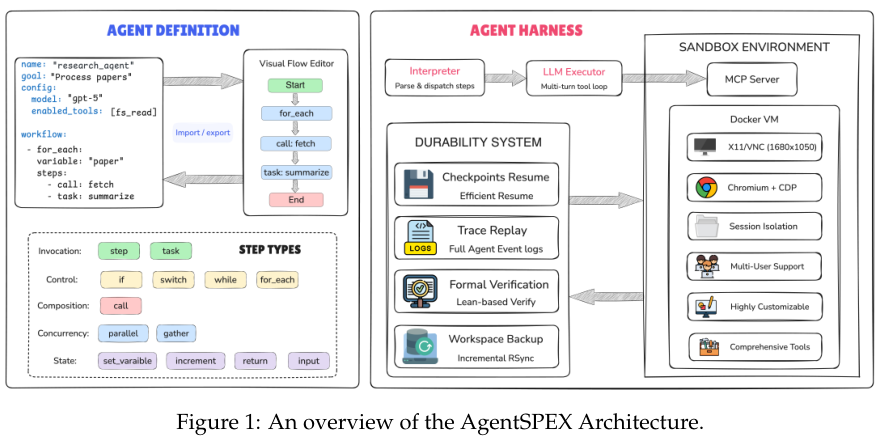

*图｜Wang, Pengcheng 等，[Figure 1（PDF 第 2 页）](https://arxiv.org/pdf/2604.13346v1#page=2)，[CC BY 4.0](http://creativecommons.org/licenses/by/4.0/)。裁剪自原文。*

GPT-5 的 SciBench 为 90.61%，ReAct 为 87.79%；ELAIPBench 为 43.70% 对 33.80%。SWE-bench Verified 上两个 Claude 版本的平均为 77.10%，mini-SWE-agent 为 76.20%。不同任务用了不同模型和人工编写的工作流，成绩不单独证明语法设计的因果收益；显式流程也仍需验证工具执行和语义正确性。

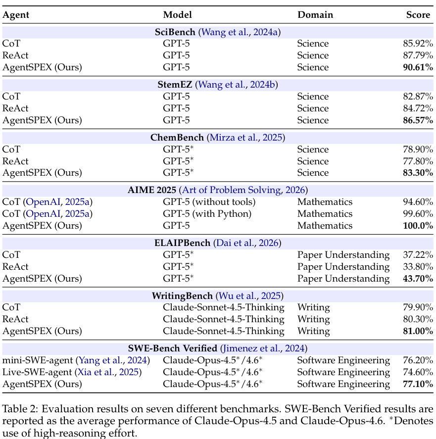

*图｜Wang, Pengcheng 等，[Table 2（PDF 第 7 页）](https://arxiv.org/pdf/2604.13346v1#page=7)，[CC BY 4.0](http://creativecommons.org/licenses/by/4.0/)。裁剪自原文。*

[AgentSPEX: An Agent SPecification and EXecution Language](https://arxiv.org/abs/2604.13346v1) · v1。

## 15. GameWorld：用游戏内部状态检验交互结果

GameWorld 将三十四个浏览器游戏整理为一百七十项任务，既测试直接键鼠操作，也测试经确定性解析器执行的语义动作。每项任务从序列化游戏状态判定结果，使目标完成与文字叙述分开。

十八个模型—接口组合的实验显示，最强 Agent 与人类仍有明显距离；重复整套评测还检查了波动、上下文记忆、实时交互与无效动作。语义接口可降低低层操作难度，却改变了 Agent 面对的控制问题，因此不能把两类接口得分直接当成同一种基础视觉能力。

[GameWorld: Towards Standardized and Verifiable Evaluation of Multimodal Game Agents](https://arxiv.org/abs/2604.07429v1) · v1。

[Figure 1（原文）](https://arxiv.org/pdf/2604.07429v1#page=1)。

## 16. Deep Neural Lesion：少量权重位扰动暴露模型脆弱性

Deep Neural Lesion 研究无需训练数据和迭代优化的参数脆弱性检测，分析少量关键符号位变化如何破坏网络行为。另一个变体允许一次前后向计算，检查在额外信息下损伤程度的变化。

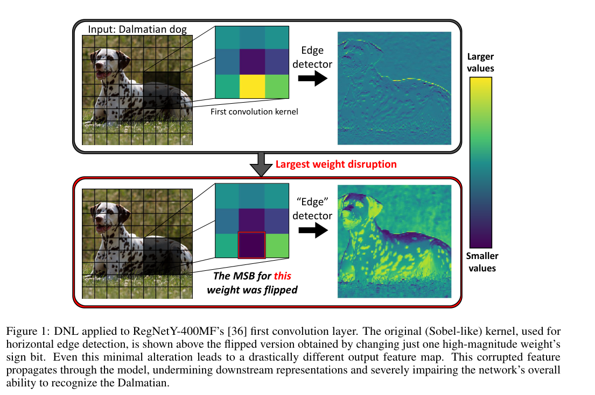

*图｜Galil, Ido 等，[Figure 1（PDF 第 2 页）](https://arxiv.org/pdf/2502.07408v1#page=2)，[CC BY 4.0](http://creativecommons.org/licenses/by/4.0/)。裁剪自原文。*

ImageNet 的 ResNet50 实验中，仅两个符号位改变就造成极大的准确率下降；作者报告相对下降 99.8%，并发现保护一小部分脆弱位能减轻损伤。结论针对攻击者可修改权重位的威胁模型，不等于普通推理输入就能触发同样效果，也不是所有模型的统一最坏情况界。

[No Data, No Optimization: A Lightweight Method To Disrupt Neural Networks With Sign-Flips](https://arxiv.org/abs/2502.07408v1) · v1。

## 17. Agent-World：让任务发现与能力诊断共同驱动训练

Agent-World 先从真实服务主题挖掘数据库和可执行工具，生成带验证器、难度可控的任务，再根据 Agent 的失败诊断合成针对性训练任务。多环境 RL 与自演化课程联动，使环境覆盖与策略能力一起变化。

τ2-Bench 平均分中，8B 版本为 61.8，14B 为 65.4，高于各自 Qwen3 对照的 26.2、32.4；但 GPT-5.2 High 为 80.2，仍更高。论文覆盖二十三项评测，部分使用采样子集，不能把局部领先写成全部指标最强；环境多样性、合成教师与训练轮次共同影响收益。

[Agent-World: Scaling Real-World Environment Synthesis for Evolving General Agent Intelligence](https://arxiv.org/abs/2604.18292v1) · v1。

[Figure 1（原文）](https://arxiv.org/pdf/2604.18292v1#page=2)。

## 18. Qwen3.5-Omni：以 Thinker–Talker 组织长时音视频交互

Qwen3.5-Omni 的 Thinker 与 Talker 均采用混合注意力 MoE，统一处理文字、图像、音频与视频。ARIA 动态对齐文字和语音单位，缓解流式语音中两种 tokenizer 速率不匹配；时间标识将不同模态锚定到共同时间轴。

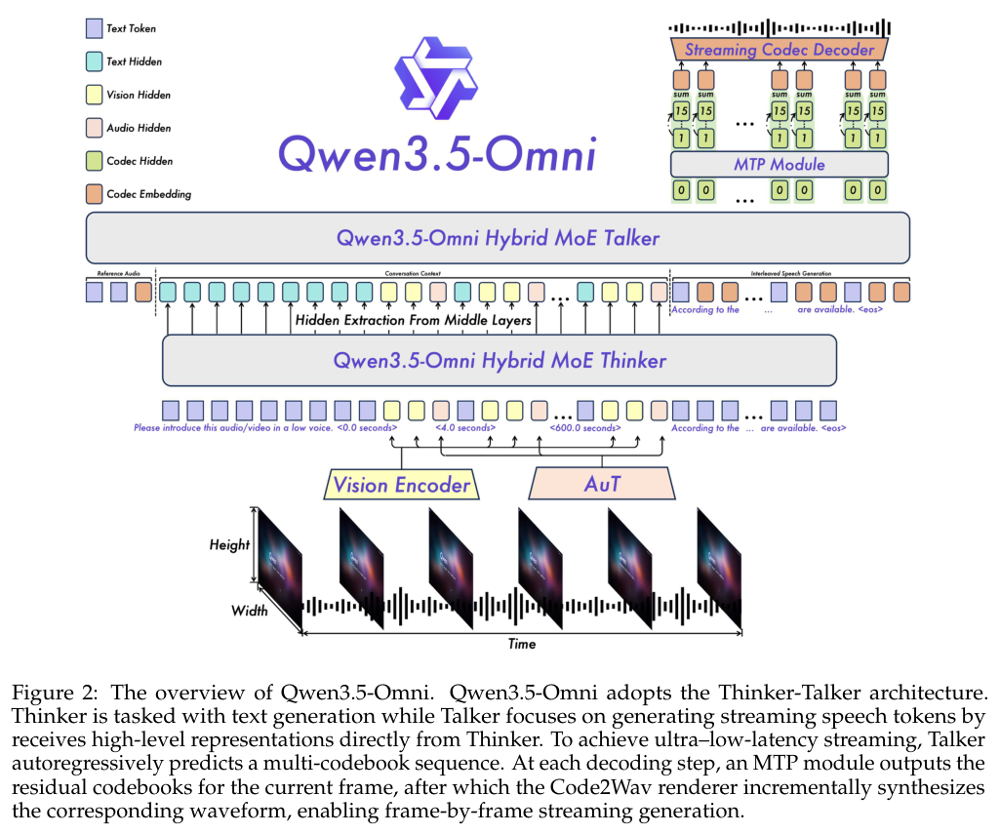

*图｜Qwen Team 等，[Figure 2（PDF 第 3 页）](https://arxiv.org/pdf/2604.15804v1#page=3)，[CC BY 4.0](http://creativecommons.org/licenses/by/4.0/)。裁剪自原文。*

DailyOmni 上 Plus 为 84.6，Gemini-3.1 Pro 为 82.7；但 Video-MME 含音频设置为 83.7 对 89.0，存在落后项。报告覆盖 215 项音频与音视频子任务，并展示 256K 上下文、十小时以上音频和每秒一帧的四百秒 720p 视频输入。上述时长是在特定采样与压缩条件下的容量，不代表逐帧理解或任意负载实时处理；不同音频理解、生成和视觉基准也不应合为单一准确率。

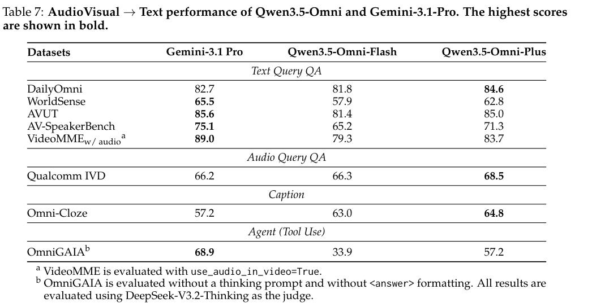

*图｜Qwen Team 等，[Table 7（PDF 第 13 页）](https://arxiv.org/pdf/2604.15804v1#page=13)，[CC BY 4.0](http://creativecommons.org/licenses/by/4.0/)。裁剪自原文。*

[Qwen3.5-Omni Technical Report](https://arxiv.org/abs/2604.15804v1) · v1。

## 19. DataMosaic：为多模态分析选择可验证的中间结构

DataMosaic 将原始文本、表格和图像按任务转成表、图或树，再进行分步推理和中间结果验证。多 Agent 分解问题、选择结构、抽取数据、执行操作与复查，使结论能回到显式数据对象和操作轨迹。

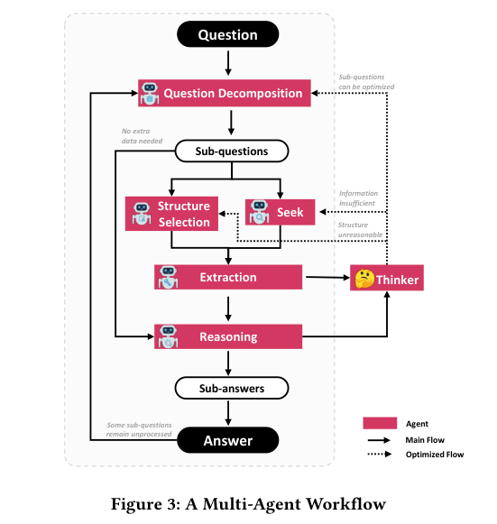

*图｜Zhang, Zhengxuan 等，[Figure 3（PDF 第 4 页）](https://arxiv.org/pdf/2504.10036v1#page=4)，[CC BY 4.0](http://creativecommons.org/licenses/by/4.0/)。裁剪自原文。*

论文主要以框架、示例和操作分类说明这条路线，展示结构转换如何帮助计算关系路径或处理混合数据，尚未建立大规模统一性能比较。显式结构便于发现错误，却不能保证抽取的事实本来就对；抽取质量、操作执行和最终答案应分别检查。

[DataMosaic: Explainable and Verifiable Multi-Modal Data Analytics through Extract-Reason-Verify](https://arxiv.org/abs/2504.10036v1) · v1。

## 20. Fast-dLLM：用近似缓存与置信度并行解码加速扩散语言模型

Fast-dLLM 为双向扩散模型引入块级近似 KV 缓存，并只并行接受置信度超过阈值的 token，减少条件独立近似破坏 token 依赖的问题。方法不重新训练基础模型，将缓存复用和并行决策联合用于推理。

LLaDA-Instruct 的五样例 GSM8K、生成长度 256 下，吞吐从 6.7 到 54.4 token/s，约 8.1 倍；准确率由 79.3 到 78.5。摘要最高 27.6 倍来自其他具体配置，不能代替这组结果。相近质量不是逐输入数学等价，批量、长度、硬件和接受阈值都影响实际速度。

[Fast-dLLM: Training-free Acceleration of Diffusion LLM by Enabling KV Cache and Parallel Decoding](https://arxiv.org/abs/2505.22618v1) · v1。

[Figure 1（原文）](https://arxiv.org/pdf/2505.22618v1#page=2)。

相关资源：[DeepSeek-V4 Preview 官方发布说明](https://deepseek.com/en/news/v4-preview/)。

## 21. MetaAgent：用有限状态机组织角色、检查和回退

MetaAgent 从一类任务的描述出发，自动设计角色、状态和转移条件。每个状态包含执行 Agent、条件检查者与接收结果的监听者；检查失败时可以留在当前状态修正，也可以退回先前状态。构建阶段再合并冗余状态，减少无效的信息传递，形成可复用于同类问题的工作流。

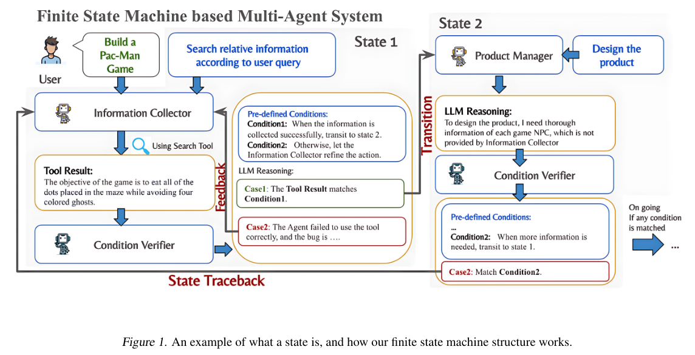

*图｜Yaolun Zhang、Xiaogeng Liu、Chaowei Xiao，MetaAgent，ICML 2025，PMLR 267。[Figure 1，https://raw.githubusercontent.com/mlresearch/v267/main/assets/zhang25bc/zhang25bc.pdf 第 3 页](https://raw.githubusercontent.com/mlresearch/v267/main/assets/zhang25bc/zhang25bc.pdf#page=3) · [论文](https://proceedings.mlr.press/v267/zhang25bc.html) · [CC BY 4.0](https://creativecommons.org/licenses/by/4.0/)。裁剪自原文。*

主要实验使用 GPT-4o、温度 0，并提供代码解释器和搜索工具。ML Bench 的五项任务上，MetaAgent 的平均归一化得分为 0.83，高于 SPP 的 0.16，但低于专门面向数据分析的 Data Interpreter 的 0.86。软件开发的五项任务中，检查点平均通过比例为 0.85，MetaGPT 为 0.35；不过 Brick breaker 单项为 0.50 对 0.75，自动设计并非每个任务都领先。

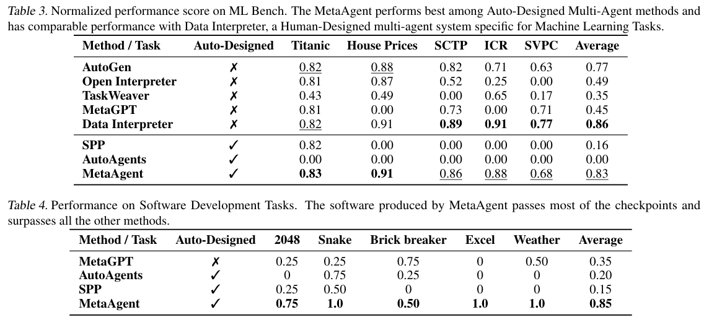

*表｜Yaolun Zhang、Xiaogeng Liu、Chaowei Xiao，MetaAgent，ICML 2025，PMLR 267。[Tables 3–4，https://raw.githubusercontent.com/mlresearch/v267/main/assets/zhang25bc/zhang25bc.pdf 第 8 页](https://raw.githubusercontent.com/mlresearch/v267/main/assets/zhang25bc/zhang25bc.pdf#page=8) · [论文](https://proceedings.mlr.press/v267/zhang25bc.html) · [CC BY 4.0](https://creativecommons.org/licenses/by/4.0/)。裁剪自原文。*

这些结果支持把条件检查和回退写进协作结构，但归一化模型得分、检查点通过比例和完整软件交付成功率是不同指标。工具、模型与任务分布也共同影响比较，不能只把收益归因于使用了有限状态机。

[MetaAgent: Automatically Constructing Multi-Agent Systems Based on Finite State Machines](https://proceedings.mlr.press/v267/zhang25bc.html) · ICML 2025，PMLR 267:75667–75694 · [arXiv v1（2025-07-30）](https://arxiv.org/abs/2507.22606v1)。
