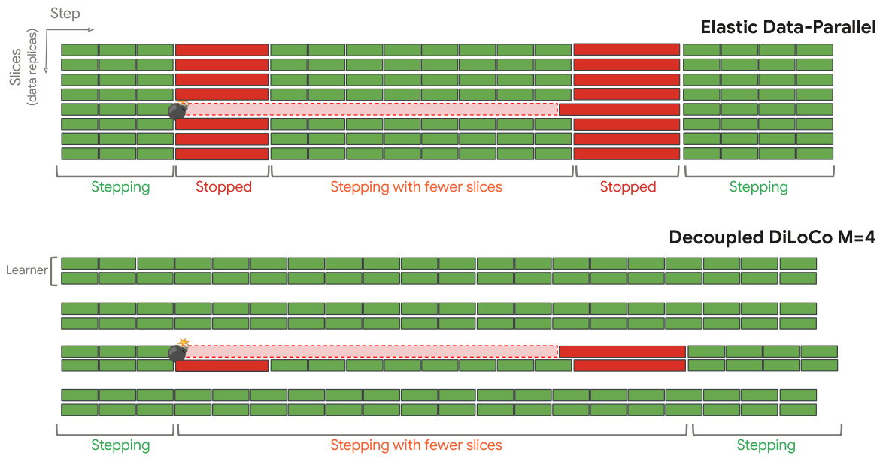

长期智能体和分布式训练都需要在状态变化、信息不完整时继续推进。本期分别讨论结构化记忆、异步训练与本体公理识别。

本文补录 **2026 年 4 月 27 日的推荐日报清单**，于 10 月 29 日核对公开来源。推荐日期不等于论文提交或发表日期，以下固定引用 **v1**。数字为作者报告，本站未独立复现。

## StructMem

结构化记忆 · v1 首次提交 2026-04-23 · [StructMem: Structured Memory for Long-Horizon Behavior in LLMs](https://arxiv.org/abs/2604.21748v1) · [全文](https://arxiv.org/html/2604.21748v1)

StructMem 用时间锚定组织事件的不同视角，再周期性整合相关事件，保留孤立事实容易丢失的先后顺序与关联。LoCoMo 实验使用 gpt-4o-mini 骨干和 text-embedding-3-small，以模型裁判评估问答，并测量记忆构建的 token、调用与耗时。

作者报告时间与多跳推理改善、构建开销降低。不同任务和基线的变化不宜压成单一提升比例；该框架也尚缺显式冲突消解与记忆更新机制，长期事实变化仍可能产生不一致。[设置与局限见第 4 节及 Limitations](https://arxiv.org/html/2604.21748v1#S4)。

## Decoupled DiLoCo

分布式预训练 · v1 首次提交 2026-04-23 · [Decoupled DiLoCo for Resilient Distributed Pre-training](https://arxiv.org/abs/2604.21428v1) · [全文](https://arxiv.org/html/2604.21428v1)

多个 learner 独立进行局部优化，将参数片段异步送至同步器；最小参与数量、弹性等待窗口与按 token 加权合并，帮助限制故障或拖尾节点的影响。

*图 1｜Arthur Douillard、Keith Rush、Yani Donchev 等，[v1 Figure 1，PDF 第 2 页](https://arxiv.org/pdf/2604.21428v1#page=2)，[CC BY 4.0](https://creativecommons.org/licenses/by/4.0/)。裁剪自原文。*

作者在故障模拟中报告全局停机为零，含 120 万和 240 万模拟芯片的设置。它们属于模拟故障规模，不能当成同规模真实集群部署；模型质量实验另涵盖文本、视觉、稠密和 MoE 设置。[实验见原文](https://arxiv.org/html/2604.21428v1)。

## OntoAxiom

本体公理识别 · v1 首次提交 2025-12-05 · [Ontology Learning with LLMs: A Benchmark Study on Axiom Identification](https://arxiv.org/abs/2512.05594v1) · [全文](https://arxiv.org/html/2512.05594v1)

基准包含九个本体、17,118 个三元组和 2,771 条公理，比较 12 个模型与不同提示设置。逐类询问公理的 AbA 方法总体优于一次询问全部公理；subclass 公理在 FOAF 与 music 本体的 F1 分别为 0.642 和 0.218。

这种领域差异支持将模型用于提出候选公理，再由专家检查。该文来自 2025 年，是本期推荐的背景阅读，不能写成 4 月 27 日新发表的研究。

## 其他公开研究入口

以下仅核对历史 v1 题名、提交日期与链接，未复核全部实验。

- [Towards Operational Data Analytics Chatbots -- Virtual Knowledge Graph is All You Need](https://arxiv.org/abs/2506.22267v1) · v1 首次提交 2025-06-27。
- [There Will Be a Scientific Theory of Deep Learning](https://arxiv.org/abs/2604.21691v1) · v1 首次提交 2026-04-23。
- [Seeing Fast and Slow: Learning the Flow of Time in Videos](https://arxiv.org/abs/2604.21931v1) · v1 首次提交 2026-04-23。
- [From Noise to Intent: Anchoring Generative VLA Policies with Residual Bridges](https://arxiv.org/abs/2604.21391v1) · v1 首次提交 2026-04-23。
- [Sapiens2](https://arxiv.org/abs/2604.21681v1) · v1 首次提交 2026-04-23。

本期共八篇入口，展开其中三篇。
