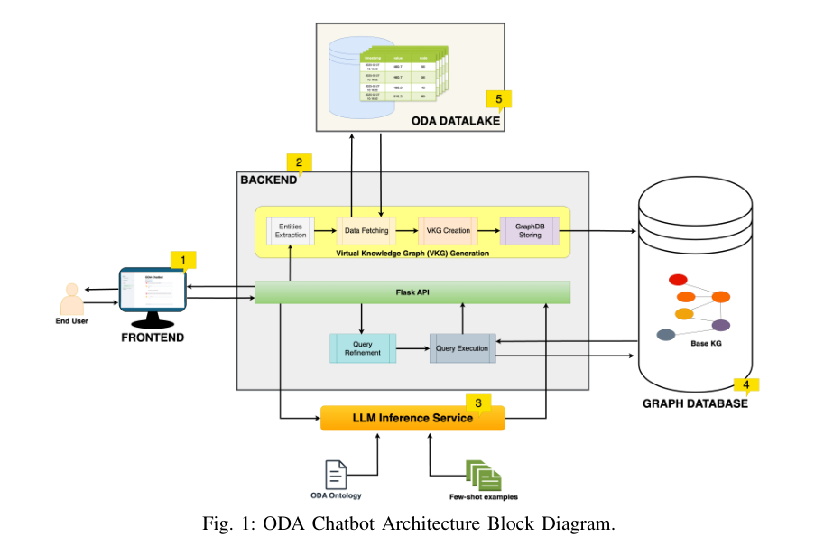
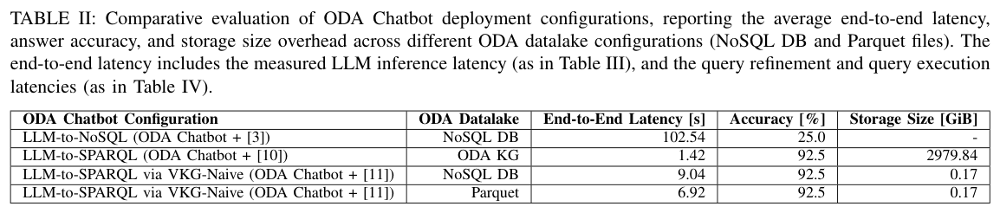
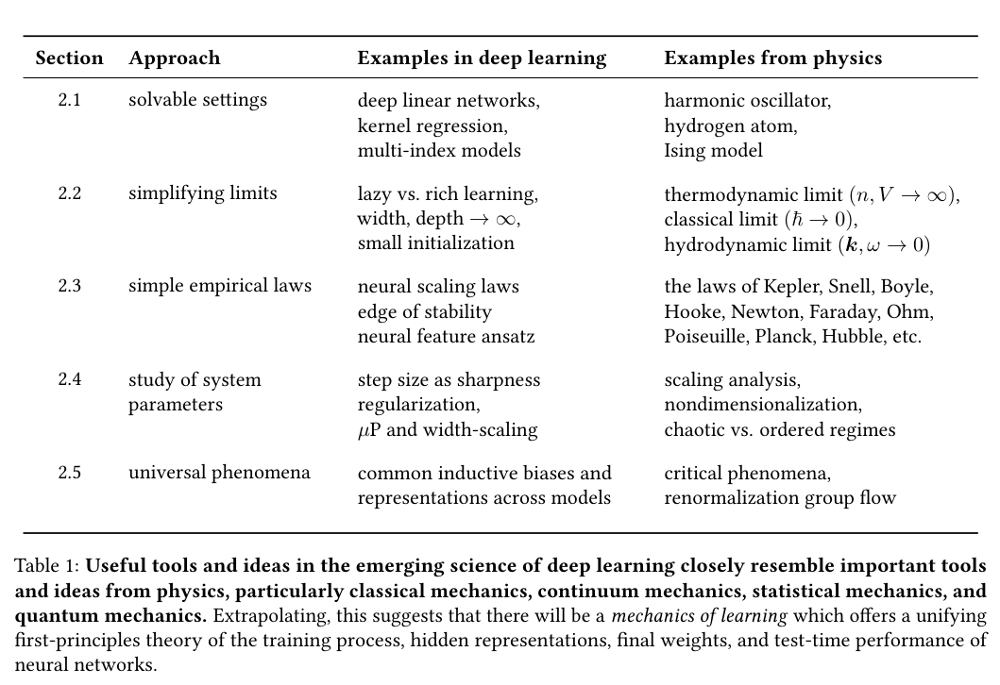
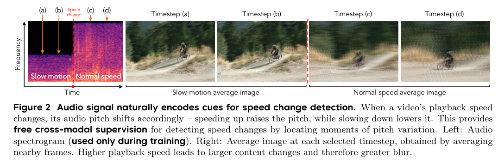
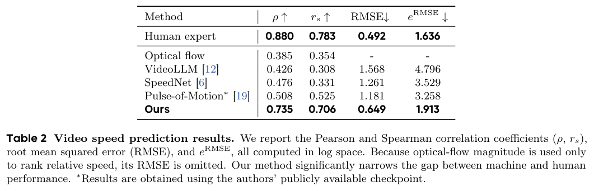
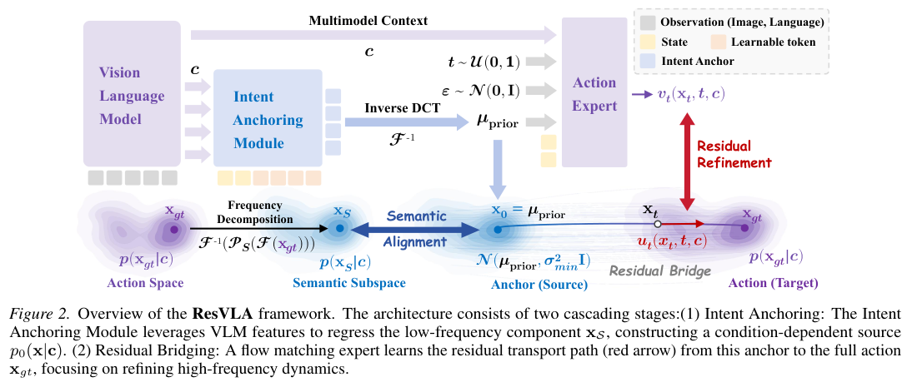
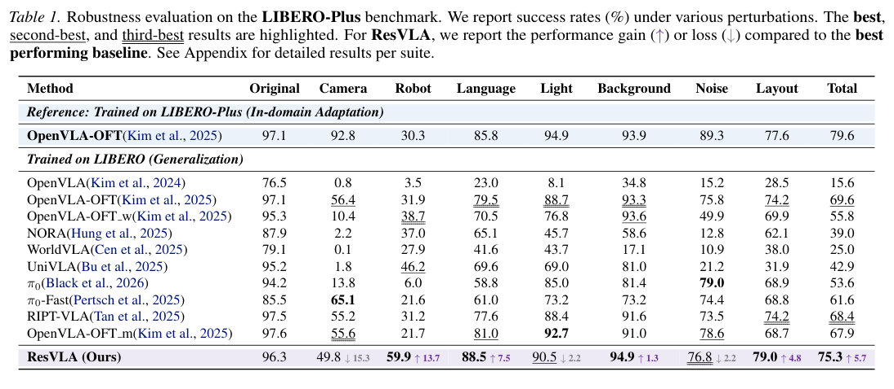
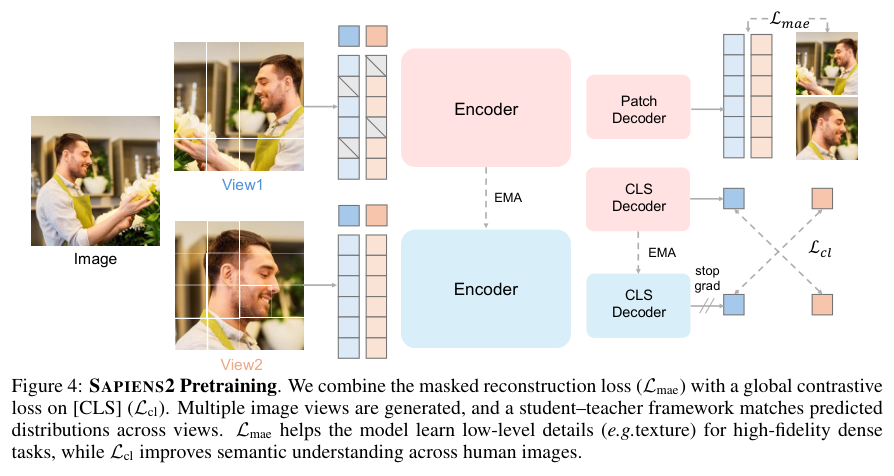
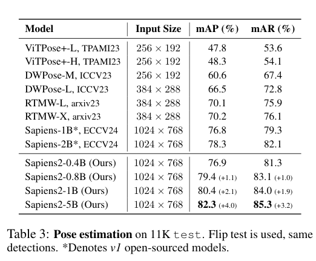
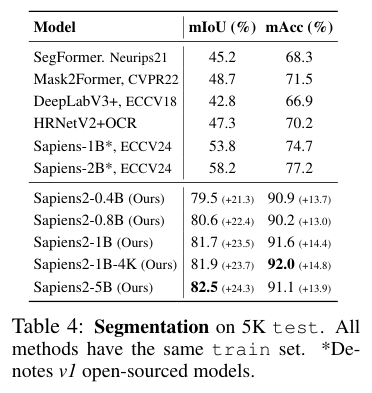

知识怎样进入查询，记忆怎样保留事件关系，视觉怎样理解时间与动作，本期从这些问题出发，介绍本体、分布式训练和人体视觉的八项研究。

## 1. OntoAxiom

本体公理识别 · v1 首次提交 2025-12-05 · [Ontology Learning with LLMs: A Benchmark Study on Axiom Identification](https://arxiv.org/abs/2512.05594v1) · [全文](https://arxiv.org/html/2512.05594v1)

基准包含九个本体、17,118 个三元组和 2,771 条公理，比较 12 个模型与不同提示设置。逐类询问公理的 AbA 方法总体优于一次询问全部公理；subclass 公理在 FOAF 与 music 本体的 F1 分别为 0.642 和 0.218。

这种领域差异支持将模型用于提出候选公理，再由专家检查。该文来自 2025 年，是本期推荐的背景阅读，不能写成 4 月 27 日新发表的研究。

## 2. ODA Chatbot：按问题临时构造遥测知识图谱

数据中心的设备、作业与传感器关系分散在时序数据源里，直接让模型编写 NoSQL 查询，往往难以正确拼接。ODA Chatbot 先把自然语言转成 SPARQL，再按查询所需实体和时间范围构造虚拟知识图谱；查询修正、图生成与执行分别承担不同职责。

*图｜Khan, Junaid Ahmed 等，[Figure 1（PDF 第 3 页）](https://arxiv.org/pdf/2506.22267v1#page=3)，[CC BY 4.0](http://creativecommons.org/licenses/by/4.0/)。裁剪自原文。*

实验使用 Marconi100 遥测、由 12 类模板生成的 100 个问题，以及单张 H100 上的 LLaMA 3.1 8B Instruct。Table II 中，直接 NoSQL 的回答准确率为 25.0%，SPARQL 图谱路线为 92.5%；按需建图将最大额外存储控制在约 0.17 GiB。作者另将此前配置的平均响应时间从 20.36 秒降到 3.03 秒，这包含推理服务与数据处理优化，不能全部归因于本体表示。

*图｜Khan, Junaid Ahmed 等，[Table II（PDF 第 7 页）](https://arxiv.org/pdf/2506.22267v1#page=7)，[CC BY 4.0](http://creativecommons.org/licenses/by/4.0/)。裁剪自原文。*

[Towards Operational Data Analytics Chatbots -- Virtual Knowledge Graph is All You Need](https://arxiv.org/abs/2506.22267v1) · v1。

## 3. StructMem

结构化记忆 · v1 首次提交 2026-04-23 · [StructMem: Structured Memory for Long-Horizon Behavior in LLMs](https://arxiv.org/abs/2604.21748v1) · [全文](https://arxiv.org/html/2604.21748v1)

StructMem 用时间锚定组织事件的不同视角，再周期性整合相关事件，保留孤立事实容易丢失的先后顺序与关联。LoCoMo 实验使用 gpt-4o-mini 骨干和 text-embedding-3-small，以模型裁判评估问答，并测量记忆构建的 token、调用与耗时。

作者报告时间与多跳推理改善、构建开销降低。不同任务和基线的变化不宜压成单一提升比例；该框架也尚缺显式冲突消解与记忆更新机制，长期事实变化仍可能产生不一致。[设置与局限见第 4 节及 Limitations](https://arxiv.org/html/2604.21748v1#S4)。

## 4. Decoupled DiLoCo

分布式预训练 · v1 首次提交 2026-04-23 · [Decoupled DiLoCo for Resilient Distributed Pre-training](https://arxiv.org/abs/2604.21428v1) · [全文](https://arxiv.org/html/2604.21428v1)

多个 learner 独立进行局部优化，将参数片段异步送至同步器；最小参与数量、弹性等待窗口与按 token 加权合并，帮助限制故障或拖尾节点的影响。

*图 1｜Arthur Douillard、Keith Rush、Yani Donchev 等，[v1 Figure 1，PDF 第 2 页](https://arxiv.org/pdf/2604.21428v1#page=2)，[CC BY 4.0](https://creativecommons.org/licenses/by/4.0/)。裁剪自原文。*

作者在故障模拟中报告全局停机为零，含 120 万和 240 万模拟芯片的设置。它们属于模拟故障规模，不能当成同规模真实集群部署；模型质量实验另涵盖文本、视觉、稠密和 MoE 设置。[实验见原文](https://arxiv.org/html/2604.21428v1)。

## 5. Learning Mechanics：深度学习理论应当预测什么

这篇观点论文把深度学习理论理解为对学习过程的力学描述：关注训练动态、隐藏表示、权重及性能的可测统计，而不是只证明某个网络具有表达能力。作者串联可解的理想化模型、可处理的极限、宏观规律、超参数理论和跨系统普遍行为五条研究线。

*图｜Simon, Jamie 等，[Table 1（PDF 第 6 页）](https://arxiv.org/pdf/2604.21691v1#page=6)，[CC BY 4.0](http://creativecommons.org/licenses/by/4.0/)。裁剪自原文。*

它强调能被实验否定的定量预测，并讨论这种路线怎样与统计学习、信息论和机制可解释性互补。文章的贡献是整理问题和研究方法，没有提出一个可与新模型准确率并排比较的统一成绩。使用这些理论时，需要检查理想化假设与实际网络、数据及训练规模之间的距离。

[There Will Be a Scientific Theory of Deep Learning](https://arxiv.org/abs/2604.21691v1) · v1。

## 6. Seeing Fast and Slow：从视频里学习时间流速

这项工作把播放速度当作可以感知和控制的视觉变量。模型利用视频中的多模态线索与时序结构，自监督学习速度变化检测和播放速度估计，再筛选慢动作素材，训练指定速度的视频生成与时间超分辨率模型。时间超分辨率同时处理低帧率和运动模糊，而不只是补中间帧。

*图｜Wu, Yen-Siang 等，[Figure 2（PDF 第 3 页）](https://arxiv.org/pdf/2604.21931v1#page=3)，[CC BY 4.0](http://creativecommons.org/licenses/by/4.0/)。裁剪自原文。*

在经人工复核的两秒片段测试中，速度变化检测准确率为 92.4%，Gemini 2.5 对照为 59.5%，光流基线为 80.4%。该数字对应变化是否发生在片段中间区域的检测协议，不能当作任意视频的绝对速度估计准确率。另一个生成实验使用合成模糊输入进行八倍时间上采样，清晰输入和模糊输入的结果也应分别阅读。

*图｜Wu, Yen-Siang 等，[Table 2（PDF 第 6 页）](https://arxiv.org/pdf/2604.21931v1#page=6)，[CC BY 4.0](http://creativecommons.org/licenses/by/4.0/)。裁剪自原文。*

[Seeing Fast and Slow: Learning the Flow of Time in Videos](https://arxiv.org/abs/2604.21931v1) · v1。

## 7. ResVLA：先确定动作意图，再生成局部修正

ResVLA 将机器人动作分解为确定性的低频意图与随机的高频残差。模型先预测全局动作锚点，再通过残差扩散桥细化局部动态，使生成过程围绕意图展开，减少从纯噪声开始同时学习目标和细节的负担。

*图｜Zhong, Yiming 等，[Figure 2（PDF 第 5 页）](https://arxiv.org/pdf/2604.21391v1#page=5)，[CC BY 4.0](http://creativecommons.org/licenses/by/4.0/)。裁剪自原文。*

在只用 LIBERO 训练、转到 LIBERO-Plus 扰动测试的设置中，Table 1 的总体成功率为 75.3%，所列最强泛化基线为 69.6%。机器人与语言扰动上有收益，但相机扰动的 49.8% 低于最佳对照 65.1%，不能称每类扰动都更强。普通 LIBERO 的四套件平均为 96.3%，也低于表中部分方法；稳健性改善与原分布最高分是两个问题。

*图｜Zhong, Yiming 等，[Table 1（PDF 第 7 页）](https://arxiv.org/pdf/2604.21391v1#page=7)，[CC BY 4.0](http://creativecommons.org/licenses/by/4.0/)。裁剪自原文。*

[From Noise to Intent: Anchoring Generative VLA Policies with Residual Bridges](https://arxiv.org/abs/2604.21391v1) · v1。

## 8. Sapiens2：兼顾人体细节和语义的高分辨率表示

Sapiens2 把遮挡图像重建与自蒸馏对比目标放在同一预训练流程，既保留人体密集预测所需的局部细节，也学习可用于检索和少样本任务的语义。模型规模从 0.4B 到 5B，使用约十亿张人体图像；高分辨率版本通过窗口注意力处理更大的空间上下文。

*图｜Khirodkar, Rawal 等，[Figure 4（PDF 第 5 页）](https://arxiv.org/pdf/2604.21681v1#page=5)，[CC BY 4.0](http://creativecommons.org/licenses/by/4.0/)。裁剪自原文。*

姿态估计的 11K 测试中，5B 版本为 82.3 mAP，第一代 2B 为 78.3；身体部位分割的 5K 测试中，对应 mIoU 为 82.5 和 58.2。两组差值分别是 4.0 与 24.3 个百分点，涉及模型、预训练和标注的共同变化。它们支持人体视觉任务上的进展，不能被当作单独改变训练目标的因果收益。

*图｜Khirodkar, Rawal 等，[Table 3（PDF 第 8 页）](https://arxiv.org/pdf/2604.21681v1#page=8)，[CC BY 4.0](http://creativecommons.org/licenses/by/4.0/)。裁剪自原文。*

*图｜Khirodkar, Rawal 等，[Table 4（PDF 第 8 页）](https://arxiv.org/pdf/2604.21681v1#page=8)，[CC BY 4.0](http://creativecommons.org/licenses/by/4.0/)。裁剪自原文。*

[Sapiens2](https://arxiv.org/abs/2604.21681v1) · v1。
