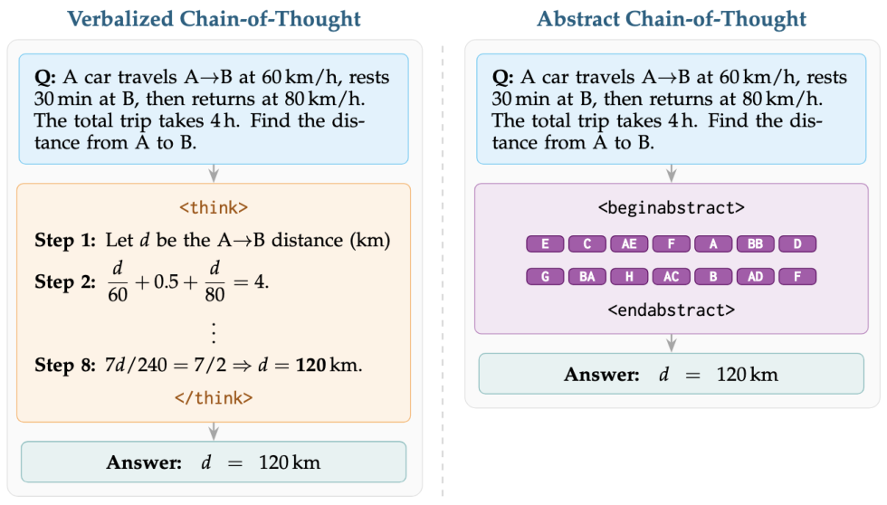

本期讨论两条效率路线，分别是训练更会使用工具的小模型，以及把自然语言推理压缩成抽象表示。机器人策略评测提供了应用端的参照。

本文补录 **2026 年 4 月 28 日的推荐日报清单**，于 10 月 29 日核对公开来源。推荐日期不等于论文提交或发表日期，以下固定引用 **v1**，不混入后续修订。数字为作者报告，本站未独立复现。

## AgenticQwen

工具模型训练 · v1 首次提交 2026-04-23 · [AgenticQwen: Training Small Agentic Language Models with Dual Data Flywheels for Industrial-Scale Tool Use](https://arxiv.org/abs/2604.21590v1) · [全文](https://arxiv.org/html/2604.21590v1)

推理飞轮利用错误扩展题目，智能体飞轮把线性任务扩展为多分支行为树，再结合多轮强化学习。作者在公开评测及工业搜索、数据分析系统中测试小模型能力。

这里不从摘要补写统一胜率。部署价值仍需结合工具集合、延迟、任务分布与数据筛选条件判断；多模型一致性过滤本身也有额外生成成本。

## Abstract-CoT

抽象推理表示 · v1 首次提交 2026-04-24 · [Thinking Without Words: Efficient Latent Reasoning with Abstract Chain-of-Thought](https://arxiv.org/abs/2604.22709v1) · [全文](https://arxiv.org/html/2604.22709v1)

模型通过预留词表生成短抽象 token 序列。训练先用带瓶颈的监督学习与自蒸馏热身，再用受约束解码的强化学习优化。

*图 1｜Keshav Ramji、Tahira Naseem、Ramón Fernandez Astudillo，[v1 Figure 1，PDF 第 2 页](https://arxiv.org/pdf/2604.22709v1#page=2)，[CC BY 4.0](https://creativecommons.org/licenses/by/4.0/)。裁剪自原文。*

| v1 报告的推理 token 压缩比 | 任务 |
|---|---|
| 10.4–11.6 倍 | MATH-500 |
| 1.9–2.2 倍 | AlpacaEval |
| 4.0–4.3 倍 | HotpotQA |

这些比值比较推理 token 数量，不能直接换算为同等幅度的端到端加速，也不是每项任务都减少 11.6 倍。[设置与结果见原文](https://arxiv.org/html/2604.22709v1)。

## dWorldEval

机器人策略评测 · v1 首次提交 2026-04-24 · [dWorldEval: Scalable Robotic Policy Evaluation via Discrete Diffusion World Model](https://arxiv.org/abs/2604.22152v1) · [全文](https://arxiv.org/html/2604.22152v1)

dWorldEval 用统一离散 token 表示视觉、语言与动作，预测未来观测和任务进度，借助稀疏关键帧记忆维持一致性。实验覆盖 LIBERO、RoboTwin 和真实机器人任务，并与其他世界模型评测方案比较。

作为评测代理，它仍需检查预测得分与真实执行之间的校准。世界模型中的成功不能直接充当现实部署保证。

## 其他公开研究入口

以下仅核对历史 v1 题名、提交日期与链接，未复核全部实验。较早的知识图谱论文属于本期推荐阅读。

- [Distill-SynthKG: Distilling Knowledge Graph Synthesis Workflow for Improved Coverage and Efficiency](https://arxiv.org/abs/2410.16597v1) · v1 首次提交 2024-10-22。
- [Knowledge Reasoning Language Model: Unifying Knowledge and Language for Inductive Knowledge Graph Reasoning](https://arxiv.org/abs/2510.13909v1) · v1 首次提交 2025-10-15。
- [Agentic World Modeling: Foundations, Capabilities, Laws, and Beyond](https://arxiv.org/abs/2604.22748v1) · v1 首次提交 2026-04-24。
- [Hyperloop Transformers](https://arxiv.org/abs/2604.21254v1) · v1 首次提交 2026-04-23。
- [GazeVLA: Learning Human Intention for Robotic Manipulation](https://arxiv.org/abs/2604.22615v1) · v1 首次提交 2026-04-24。

本期共八篇入口，展开其中三篇。
