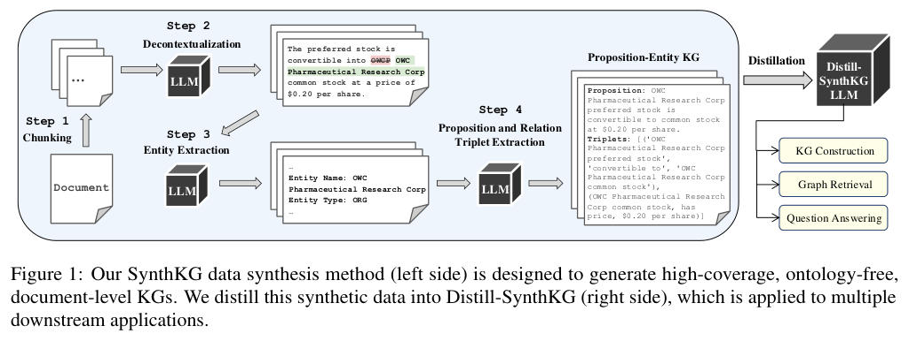
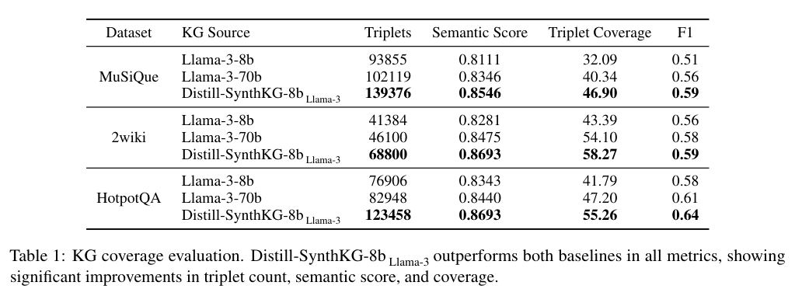
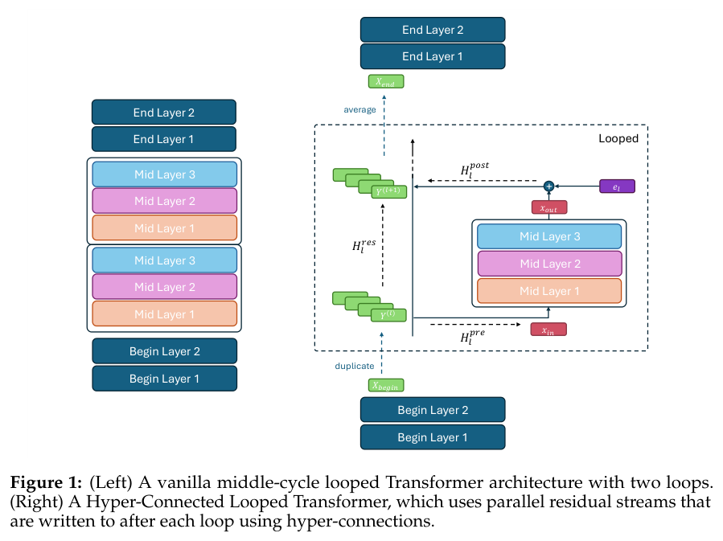
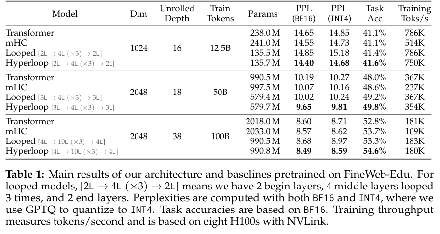
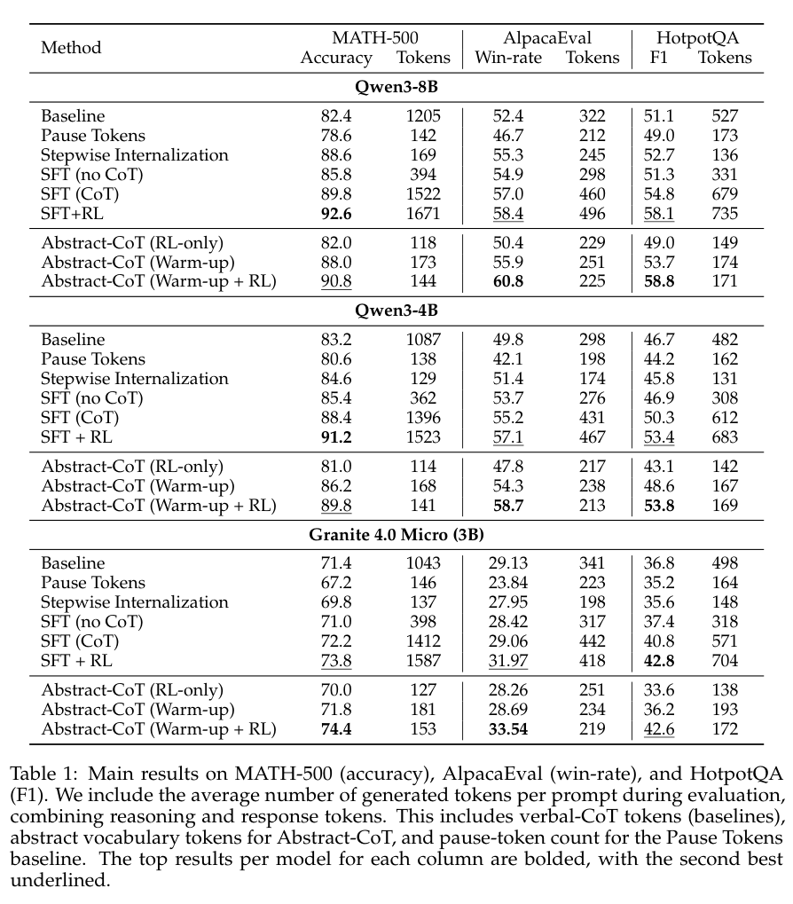

把多步建图蒸馏给小模型、循环复用网络层、压缩推理过程与借助人类意图学习动作，是本期几条不同的效率路线。世界模型综述与机器人评测则提供能力检验的参照。

## 1. Distill-SynthKG：把多步建图流程蒸馏给小模型

SynthKG 先用多步骤工作流，从整篇文档生成覆盖更充分、无需预先给定本体的知识图谱，再用文档—图谱对微调较小模型。Distill-SynthKG 把原本需要多次调用的过程变成单步生成，配套检索器沿命题与实体的连接寻找多跳证据。

*图｜Choubey, Prafulla Kumar 等，[Figure 1（PDF 第 3 页）](https://arxiv.org/pdf/2410.16597v1#page=3)，[CC BY 4.0](http://creativecommons.org/licenses/by/4.0/)。裁剪自原文。*

在 MuSiQue 的图谱覆盖评估中，8B 蒸馏模型的 triplet coverage 为 46.90，未蒸馏的 70B 对照为 40.34；对应图谱驱动检索的 Hits@2 为 53.35 与 48.64。覆盖、检索命中和最终问答是不同指标，增加三元组也不自动证明每条事实都正确。该文的首版来自 2024 年，这里讨论的是这条建图与蒸馏路线。

*图｜Choubey, Prafulla Kumar 等，[Table 1（PDF 第 7 页）](https://arxiv.org/pdf/2410.16597v1#page=7)，[CC BY 4.0](http://creativecommons.org/licenses/by/4.0/)。裁剪自原文。*

[Distill-SynthKG: Distilling Knowledge Graph Synthesis Workflow for Improved Coverage and Efficiency](https://arxiv.org/abs/2410.16597v1) · v1。

## 2. KRLM：让语言知识与图谱结构共同参与推理

KRLM 面向测试时出现新实体、甚至新关系的归纳知识图谱推理。它用专门的知识推理语言和 tokenizer 对齐图结构与语言表示，通过动态知识记忆协调模型已有知识与当前图上下文，最终的实体预测器把答案限制在图谱候选域内。

Table 1 将 12 个只换实体的数据集与 13 个实体、关系都变化的数据集分开汇总。KRLM 预训练与微调版本的 Hit@10 在前者为 0.738、0.751，在后者为 0.546、0.556；因此不能把微调结果称为零样本迁移。候选域约束能减少生成不存在实体的错误，但图内事实是否可靠、跨图概念是否同义仍是另一层问题。

[Knowledge Reasoning Language Model: Unifying Knowledge and Language for Inductive Knowledge Graph Reasoning](https://arxiv.org/abs/2510.13909v1) · v1。

[Figure 1（原文）](https://arxiv.org/pdf/2510.13909v1#page=2)。

## 3. Agentic World Modeling：预测、模拟与修订是三种能力

这篇综述用“能力层级 × 支配规律”组织世界模型：L1 预测局部下一步，L2 组合多步、受动作条件控制的模拟，L3 在新证据与预测冲突时修订自身模型；另一条轴区分物理、数字、社会与科学环境的规律。这样可以避免把视频连贯、软件状态模拟和科学发现混成同一种能力。

作者综合四百余项工作和一百多个代表系统，讨论各类环境的失败模式与面向决策的评估。文章提供分类和研究路线，没有一个证明 L3 系统已成熟的统一实验证据；多步画面看似合理，也不能替代动作后果、因果约束与模型修订是否有效的检查。

[Agentic World Modeling: Foundations, Capabilities, Laws, and Beyond](https://arxiv.org/abs/2604.22748v1) · v1。

[Figure 1（原文）](https://arxiv.org/pdf/2604.22748v1#page=2)。

## 4. Hyperloop Transformer：复用中间层，减少参数占用

Hyperloop 将网络分成开始、中间和结束三段，只有中间段反复循环，并在循环之间加入扩展残差流的 hyper-connections。目标是在接近的有效深度下复用参数，而不是单纯减少模型经历的计算层数，因而特别关注内存受限的部署。

*图｜Zeitoun, Abbas 等，[Figure 1（PDF 第 3 页）](https://arxiv.org/pdf/2604.21254v1#page=3)，[CC BY 4.0](http://creativecommons.org/licenses/by/4.0/)。裁剪自原文。*

FineWeb-Edu 上的多规模比较显示，约减少一半参数的循环架构仍可超过深度匹配的普通 Transformer 与 mHC 基线，优势在权重量化后也有保留。参数节省并不等于推理时间减半：循环次数、残差流数量和实际算子成本仍影响延迟。Table 1 的困惑度比较也应与训练 token 预算一起理解。

*图｜Zeitoun, Abbas 等，[Table 1（PDF 第 5 页）](https://arxiv.org/pdf/2604.21254v1#page=5)，[CC BY 4.0](http://creativecommons.org/licenses/by/4.0/)。裁剪自原文。*

[Hyperloop Transformers](https://arxiv.org/abs/2604.21254v1) · v1。

## 5. AgenticQwen

工具模型训练 · v1 首次提交 2026-04-23 · [AgenticQwen: Training Small Agentic Language Models with Dual Data Flywheels for Industrial-Scale Tool Use](https://arxiv.org/abs/2604.21590v1) · [全文](https://arxiv.org/html/2604.21590v1)

推理飞轮利用错误扩展题目，智能体飞轮把线性任务扩展为多分支行为树，再结合多轮强化学习。作者在公开评测及工业搜索、数据分析系统中测试小模型能力。

部署价值仍需结合工具集合、延迟、任务分布与数据筛选条件判断；多模型一致性过滤本身也有额外生成成本。

## 6. Abstract-CoT

抽象推理表示 · v1 首次提交 2026-04-24 · [Thinking Without Words: Efficient Latent Reasoning with Abstract Chain-of-Thought](https://arxiv.org/abs/2604.22709v1) · [全文](https://arxiv.org/html/2604.22709v1)

模型通过预留词表生成短抽象 token 序列。训练先用带瓶颈的监督学习与自蒸馏热身，再用受约束解码的强化学习优化。

*图 1｜Keshav Ramji、Tahira Naseem、Ramón Fernandez Astudillo，[v1 Figure 1，PDF 第 2 页](https://arxiv.org/pdf/2604.22709v1#page=2)，[CC BY 4.0](https://creativecommons.org/licenses/by/4.0/)。裁剪自原文。*

| v1 报告的推理 token 压缩比 | 任务 |
|---|---|
| 10.4–11.6 倍 | MATH-500 |
| 1.9–2.2 倍 | AlpacaEval |
| 4.0–4.3 倍 | HotpotQA |

这些比值比较推理 token 数量，不能直接换算为同等幅度的端到端加速，也不是每项任务都减少 11.6 倍。[设置与结果见原文](https://arxiv.org/html/2604.22709v1)。

*图｜Ramji, Keshav 等，[Table 1（PDF 第 8 页）](https://arxiv.org/pdf/2604.22709v1#page=8)，[CC BY 4.0](http://creativecommons.org/licenses/by/4.0/)。裁剪自原文。*

## 7. dWorldEval

机器人策略评测 · v1 首次提交 2026-04-24 · [dWorldEval: Scalable Robotic Policy Evaluation via Discrete Diffusion World Model](https://arxiv.org/abs/2604.22152v1) · [全文](https://arxiv.org/html/2604.22152v1)

dWorldEval 用统一离散 token 表示视觉、语言与动作，预测未来观测和任务进度，借助稀疏关键帧记忆维持一致性。实验覆盖 LIBERO、RoboTwin 和真实机器人任务，并与其他世界模型评测方案比较。

作为评测代理，它仍需检查预测得分与真实执行之间的校准。世界模型中的成功不能直接充当现实部署保证。

## 8. GazeVLA：用视线作为人类意图的中间表示

GazeVLA 从大规模第一视角人类视频中学习视线与动作的联系，再用较少的机器人和人类数据进行后训练。推理时，模型先预测意图位置，再生成动作，借助这种可观察的中间变量缩小人与机器人身体形态不同造成的迁移差距。

论文分别在 AV-ALOHA 仿真和真实机器人上比较基线，并测试长时、细粒度、少样本及扰动任务，报告意图—动作联合建模的收益。这里的无海量机器人示范不等于没有监督：视线与手部标注、数据有效性掩码和后训练数据共同提供了信号；人眼注视的位置也不总是下一步操作目标。

[GazeVLA: Learning Human Intention for Robotic Manipulation](https://arxiv.org/abs/2604.22615v1) · v1。

[Figure 1（原文）](https://arxiv.org/pdf/2604.22615v1#page=2)。
