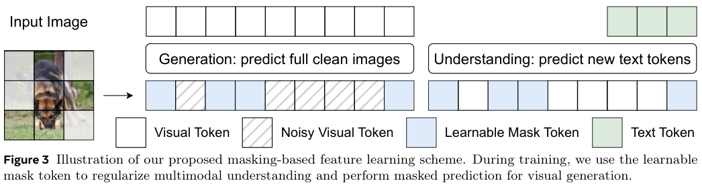
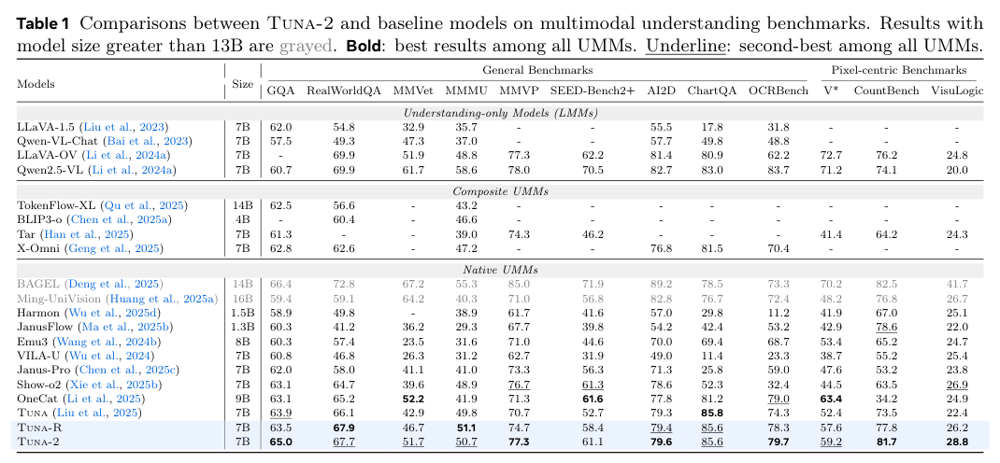
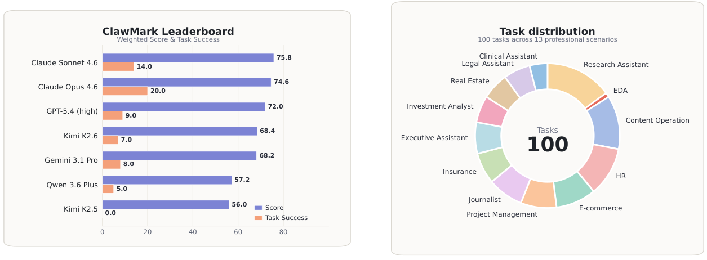
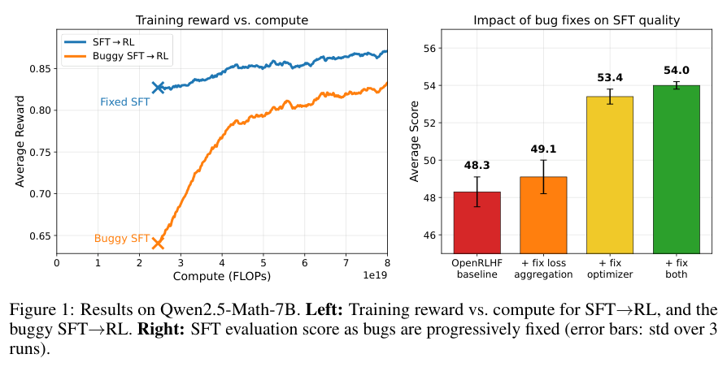
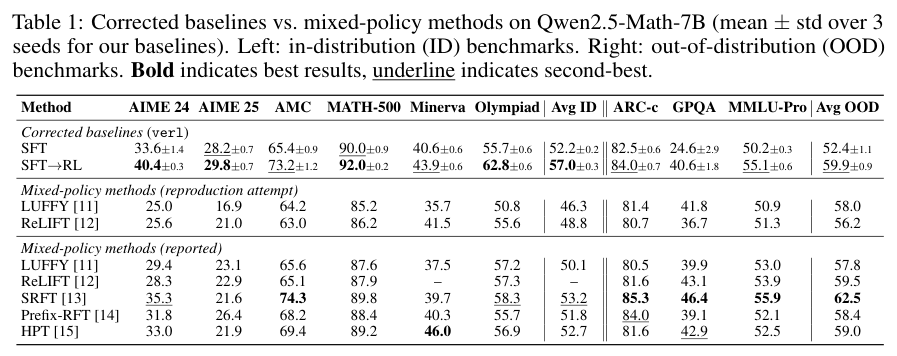

本期六项研究介绍像素空间多模态模型、三维视频约束、跨天工作评测、摘要注意力、训练基线与跨模态检索。

## 1. Tuna-2

多模态理解与生成 · v1 首次提交 2026-04-27 · [Tuna-2: Pixel Embeddings Beat Vision Encoders for Multimodal Understanding and Generation](https://arxiv.org/abs/2604.24763v1) · [全文](https://arxiv.org/html/2604.24763v1)

Tuna-2 通过简单图像 patch 嵌入处理视觉输入，让理解和生成共享像素空间训练路径，去掉独立的 VAE 或表征编码器。作者观察到，编码器版本早期收敛较快，无编码器设计在扩展训练规模后取得更强的细粒度理解表现。

该结论依赖论文中的模型、数据和训练规模，不能据此推断所有预训练视觉编码器都没有价值。

7B Tuna-2 在 ChartQA 为 85.6，Qwen2.5-VL-7B 为 83.0；RealWorldQA 却为 67.7 对 69.9。像素接口的优势与训练规模、任务类型有关，不能把一组细粒度任务的收益理解为全部视觉理解领先。

*图｜Liu, Zhiheng 等，[Figure 3（PDF 第 5 页）](https://arxiv.org/pdf/2604.24763v1#page=5)，[CC BY 4.0](http://creativecommons.org/licenses/by/4.0/)。裁剪自原文。*

*图｜Liu, Zhiheng 等，[Table 1（PDF 第 6 页）](https://arxiv.org/pdf/2604.24763v1#page=6)，[CC BY 4.0](http://creativecommons.org/licenses/by/4.0/)。裁剪自原文。*

## 2. World-R1

视频三维一致性 · v1 首次提交 2026-04-27 · [World-R1: Reinforcing 3D Constraints for Text-to-Video Generation](https://arxiv.org/abs/2604.24764v1) · [全文](https://arxiv.org/html/2604.24764v1)

World-R1 保持基础视频模型架构，以预训练三维模型和视觉语言模型提供反馈，通过 Flow-GRPO 系列优化方法约束几何一致性，并用周期性解耦训练平衡静态结构与动态流畅度。

作者报告几何一致性改善并保留视觉质量。奖励模型偏好的三维结构与真实物理规律仍是不同的验证对象，长期世界状态也需要另行检验。

3DGS 重建与重渲染的测试中，World-R1-Small 的 PSNR 为 27.63 dB，Wan2.1-T2V-1.3B 为 17.40 dB；Large 为 27.67 dB，但没有参加该文的通用 VBench 质量评价。这是特定生成视频的几何一致性代理指标，不是物理规律正确率。

## 3. ClawMark

跨天工作智能体评测 · v1 首次提交 2026-04-26 · [ClawMark: A Living-World Benchmark for Multi-Turn, Multi-Day, Multimodal Coworker Agents](https://arxiv.org/abs/2604.23781v1) · [全文](https://arxiv.org/html/2604.23781v1)

基准包含 13 类专业情境、100 项任务，覆盖文件、邮件、日历、知识库和表格五个有状态沙箱服务。1,537 个确定性检查器检查执行后的状态，评分不使用模型裁判。

*图 1｜Fanqing Meng、Lingxiao Du、Zijian Wu 等，[v1 Figure 1，PDF 第 3 页](https://arxiv.org/pdf/2604.23781v1#page=3)，[CC BY 4.0](https://creativecommons.org/licenses/by/4.0/)。裁剪自原文。*

七个系统在统一 OpenClaw harness 下按单次运行协议比较。最高加权分 75.8 来自 Claude Sonnet 4.6；最高严格任务成功率 20.0% 来自 Claude Opus 4.6，两项并非同一模型的成绩。

环境首次外生更新后表现下降，说明部分完成与跨天可靠性需要分别衡量。严格成功要求通过该任务全部检查器，不能用较高的部分加权分替代。[协议与结果见原文第 5 节](https://arxiv.org/html/2604.23781v1#S5)。

## 4. Kwai Summary Attention：以摘要 token 压缩远处历史

KSA 将较远上下文压缩到可学习的摘要 token，当前片段保留细节，历史按压缩比 k 继续增长，而非塞入一个固定大小状态。摘要与文本缓存以连续区域组织，减少环形缓冲区更新时的拷贝；它还能与 GQA、MLA 组合。

继续预训练配置中，Hybrid-KSA 在 RULER-128K 为 71.67，Full attention 为 65.86；但 GSM8K 为 79.50 对 82.75。实验还区分四千亿 token 从头训练和八百五十亿 token 继续训练。长程检索与短程知识不一定同时改善，O(n/k) 的历史缓存依然随长度增长，不能称为无限上下文或零质量损失。

[Kwai Summary Attention Technical Report](https://arxiv.org/abs/2604.24432v1) · v1。

[Figure 1（原文）](https://arxiv.org/pdf/2604.24432v1#page=1)。

## 5. SFT-then-RL：修正实现之后再比较训练配方

研究检查混合监督与强化学习方法的基线，发现 CPU 卸载优化器在梯度累积中丢失中间微批次，以及损失聚合权重错误。修正后重新评价顺序 SFT→RL，区分算法设计与实现造成的性能差距。

*图｜Limozin, Alexis 等，[Figure 1（PDF 第 1 页）](https://arxiv.org/pdf/2604.23747v1#page=1)，[CC BY 4.0](http://creativecommons.org/licenses/by/4.0/)。裁剪自原文。*

Qwen2.5-Math-7B 的六项数学均值为 57.0±0.3，报告中的 SRFT 为 53.2；三项分布外均值却为 59.9，对照 SRFT 为 62.5，并非所有评测都领先。小样本竞赛题用三十二次采样均值，其余用 Pass@1。论文既列复跑也列原报告成绩，不能把不同来源和不一致的实现条件混成完全受控比较。

*图｜Limozin, Alexis 等，[Table 1（PDF 第 4 页）](https://arxiv.org/pdf/2604.23747v1#page=4)，[CC BY 4.0](http://creativecommons.org/licenses/by/4.0/)。裁剪自原文。*

[SFT-then-RL Outperforms Mixed-Policy Methods for LLM Reasoning](https://arxiv.org/abs/2604.23747v1) · v1。

## 6. MMEB-V3：语义接近之后，还要检索到正确模态

MMEB-V3 同时覆盖文字、图像、视频、音频与 Agent 情境，并用 OmniSET 将同义内容组成跨模态等价组。这样可以让内容含义尽量保持一致，单独检查模型是否服从目标模态、查询方向和检索指令。

实验显示，模型经常取回语义相关但模态错误的内容，跨模态检索也存在明显方向不对称；加入目标模态指令的向量移动未必对准目标。结果支持将语义排名和模态约束分开评价，不代表共享嵌入完全无效；在混合索引中，显式模态过滤和任务专用校准仍有作用。

[MMEB-V3: Measuring the Performance Gaps of Omni-Modality Embedding Models](https://arxiv.org/abs/2604.23321v1) · v1。

[Figure 1（原文）](https://arxiv.org/pdf/2604.23321v1#page=4)。
