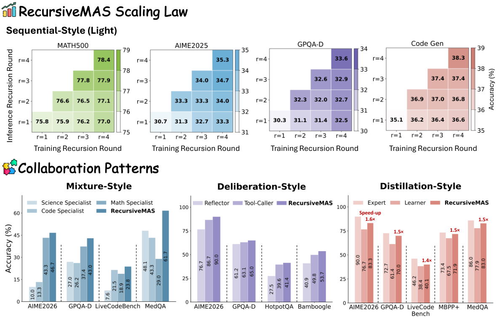

模型之外的结构也会影响结果。业务语义文档明确数据含义，递归协作组织潜状态计算，科研检索基准则分别检验文献定位与集合覆盖。

本文补录 **2026 年 4 月 30 日的推荐日报清单**，于 10 月 29 日核对公开来源。推荐日期不等于论文提交或发表日期，以下固定引用 **v1**。数字为作者报告，本站未独立复现。

## 显式语义层

数据分析问答 · v1 首次提交 2026-04-28 · [Semantic Layers for Reliable LLM-Powered Data Analytics: A Paired Benchmark of Accuracy and Hallucination Across Three Frontier Models](https://arxiv.org/abs/2604.25149v1) · [PDF](https://arxiv.org/pdf/2604.25149v1)

作者在 ClickHouse 的 Cleaned Contoso Retail 数据上，以 100 个自然语言问题对 Claude Opus 4.7、Claude Sonnet 4.6、GPT-5.4 做配对单次作答测试。两种条件分别提供仓库 schema，或再加入约 4KB 人工编写的指标、约定和消歧文档。

加入文档后准确率提高 17–23 个百分点，达到 67.7%–68.7%。该结果来自单一数据集和人工语义层，不能外推为任意数据库都会获得同样收益；它支持将业务含义显式提供给模型。

## RecursiveMAS

潜空间多智能体协作 · v1 首次提交 2026-04-28 · [Recursive Multi-Agent Systems](https://arxiv.org/abs/2604.25917v1) · [全文](https://arxiv.org/html/2604.25917v1)

RecursiveLink 在异构智能体之间传递潜状态，内外循环学习共同优化多轮递归。作者在四种协作模式、九个基准中报告平均准确率改善 8.3%，端到端推理加速 1.2–2.4 倍，token 使用减少 34.6%–75.6%。这里保留作者的汇总口径，不把区间当作任意系统替换后的收益承诺。

*图 1｜Xiyuan Yang 等，Recursive Multi-Agent Systems，[v1 Figure 1，PDF 第 1 页](https://arxiv.org/pdf/2604.25917v1#page=1)，[CC BY 4.0](https://creativecommons.org/licenses/by/4.0/)。已裁剪，保留完整上下两部分、坐标与图例，移除标题、作者栏、摘要、原图注及联系方式；未改动图内内容。*

原图上半部采用小于 1.5B 的轻量智能体，下半部采用 5–10B 智能体。两部分设置不同，应分别理解递归深度趋势和协作模式泛化，不能直接跨面板排名。

## AutoResearchBench

科研文献发现 · v1 首次提交 2026-04-28 · [AutoResearchBench: Benchmarking AI Agents on Complex Scientific Literature Discovery](https://arxiv.org/abs/2604.25256v1) · [全文](https://arxiv.org/html/2604.25256v1)

Deep Research 根据线索定位特定论文，Wide Research 收集满足条件的一组文献。按论文的 ReAct 基线协议，Claude Opus 4.6 在前者达到 9.39% 准确率，Gemini 3.1 Pro Preview 在后者达到 9.31% 集合 IoU。

它们分别来自不同模型，也不是同一种成功率。论文另列端到端系统的抽样测试，不能把两项数字描述成所有系统、所有协议的统一上限。科研回答是否流畅与检索是否覆盖关键文献需要分别验证。

## 其他公开研究入口

以下仅核对历史 v1 题名、提交日期与链接，未复核全部实验。

- [RADD: Retrieval-Augmented Discrete Diffusion for Multi-Modal Knowledge Graph Completion](https://arxiv.org/abs/2604.25693v1) · v1 首次提交 2026-04-28。
- [Toward Scalable Terminal Task Synthesis via Skill Graphs](https://arxiv.org/abs/2604.25727v1) · v1 首次提交 2026-04-28。
- [JURY-RL: Votes Propose, Proofs Dispose for Label-Free RLVR](https://arxiv.org/abs/2604.25419v1) · v1 首次提交 2026-04-28。
- [Scalable Inference Architectures for Compound AI Systems: A Production Deployment Study](https://arxiv.org/abs/2604.25724v1) · v1 首次提交 2026-04-28。
- [Medoid Prototype Alignment for Cross-Plant Unknown Attack Detection in Industrial Control Systems](https://arxiv.org/abs/2604.25544v1) · v1 首次提交 2026-04-28。

本期共八篇入口，展开其中三篇。外部原图保留 CC BY 4.0，不因本站页脚而增加非商业或相同方式共享限制。
