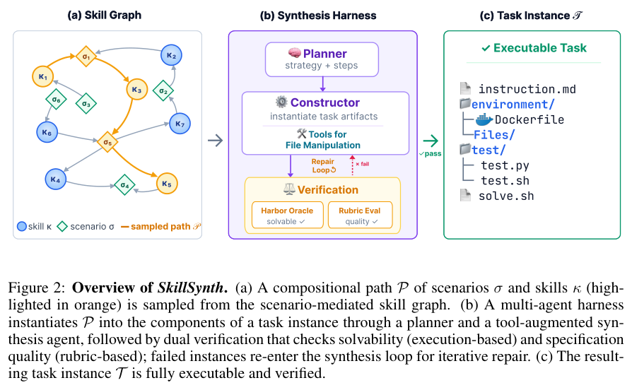
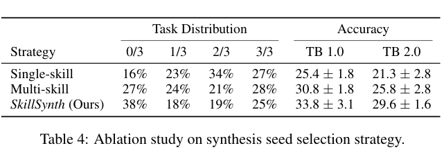
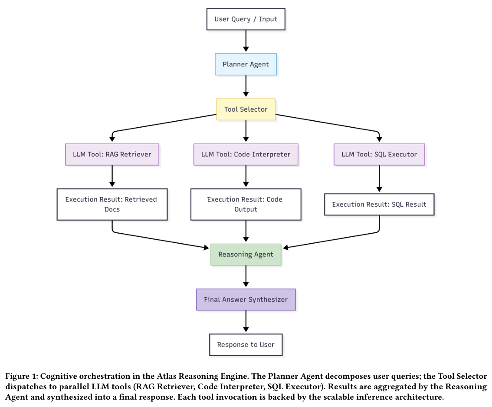
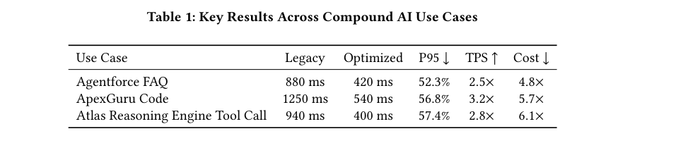
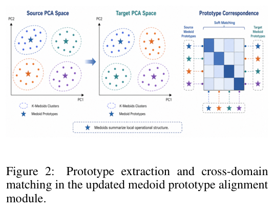
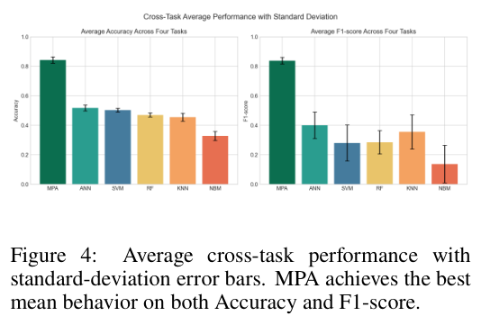

检索和精排、任务合成和验证、多模型调用和资源调度，都需要清楚的职责分工。本期介绍知识图谱、Agent 训练与协作、科研检索和跨工厂检测的八项研究。

## 1. RADD：把全图召回与候选精排分开

RADD 认为多模态知识图谱补全中的全局召回和局部消歧不应由同一个打分器包办。关系感知的图嵌入检索器先从全部实体中产生 Top-K 候选，也为训练提供蒸馏信号；条件离散去噪器随后只对候选身份进行生成式重排。

Table 2 在 DB15K、MKG-W、MKG-Y 上报告的 MRR 分别为 45.02、45.45、39.40，均采用百分制。DB15K 的结构-only 变体已达 41.17，说明收益不全来自图像与文本；完整模型进一步到 45.02。精排仍受第一阶段召回上限约束，正确实体没有进入候选表时，后续去噪不能把它找回来。

[RADD: Retrieval-Augmented Discrete Diffusion for Multi-Modal Knowledge Graph Completion](https://arxiv.org/abs/2604.25693v1) · v1。

[Figure 1（原文）](https://arxiv.org/pdf/2604.25693v1#page=1)。

## 2. 显式语义层

数据分析问答 · v1 首次提交 2026-04-28 · [Semantic Layers for Reliable LLM-Powered Data Analytics: A Paired Benchmark of Accuracy and Hallucination Across Three Frontier Models](https://arxiv.org/abs/2604.25149v1) · [PDF](https://arxiv.org/pdf/2604.25149v1)

作者在 ClickHouse 的 Cleaned Contoso Retail 数据上，以 100 个自然语言问题对 Claude Opus 4.7、Claude Sonnet 4.6、GPT-5.4 做配对单次作答测试。两种条件分别提供仓库 schema，或再加入约 4KB 人工编写的指标、约定和消歧文档。

加入文档后准确率提高 17–23 个百分点，达到 67.7%–68.7%。该结果来自单一数据集和人工语义层，不能外推为任意数据库都会获得同样收益；它支持将业务含义显式提供给模型。

## 3. RecursiveMAS

潜空间多智能体协作 · v1 首次提交 2026-04-28 · [Recursive Multi-Agent Systems](https://arxiv.org/abs/2604.25917v1) · [全文](https://arxiv.org/html/2604.25917v1)

RecursiveLink 在异构智能体之间传递潜状态，内外循环学习共同优化多轮递归。作者在四种协作模式、九个基准中报告平均准确率改善 8.3%，端到端推理加速 1.2–2.4 倍，token 使用减少 34.6%–75.6%。这里保留作者的汇总口径，不把区间当作任意系统替换后的收益承诺。

*图 1｜Xiyuan Yang 等，Recursive Multi-Agent Systems，[v1 Figure 1，PDF 第 1 页](https://arxiv.org/pdf/2604.25917v1#page=1)，[CC BY 4.0](https://creativecommons.org/licenses/by/4.0/)。裁剪自原文。*

原图上半部采用小于 1.5B 的轻量智能体，下半部采用 5–10B 智能体。两部分设置不同，应分别理解递归深度趋势和协作模式泛化，不能直接跨面板排名。

## 4. AutoResearchBench

科研文献发现 · v1 首次提交 2026-04-28 · [AutoResearchBench: Benchmarking AI Agents on Complex Scientific Literature Discovery](https://arxiv.org/abs/2604.25256v1) · [全文](https://arxiv.org/html/2604.25256v1)

Deep Research 根据线索定位特定论文，Wide Research 收集满足条件的一组文献。按论文的 ReAct 基线协议，Claude Opus 4.6 在前者达到 9.39% 准确率，Gemini 3.1 Pro Preview 在后者达到 9.31% 集合 IoU。

它们分别来自不同模型，也不是同一种成功率。论文另列端到端系统的抽样测试，不能把两项数字描述成所有系统、所有协议的统一上限。科研回答是否流畅与检索是否覆盖关键文献需要分别验证。

## 5. SkillSynth：沿技能图生成连贯的终端任务

SkillSynth 用场景节点连接命令行技能，把图上的路径当作工作流骨架，再由多 Agent 将其实现成指令、文件系统、容器环境、验证脚本和参考解。逆频率采样减少高频技能垄断路径，且排除同一路径中重复访问的场景与技能，以控制轨迹组合的多样性。

*图｜Fan, Zhiyuan 等，[Figure 2（PDF 第 2 页）](https://arxiv.org/pdf/2604.25727v1#page=2)，[CC BY 4.0](http://creativecommons.org/licenses/by/4.0/)。裁剪自原文。*

同一任务合成 harness 的种子策略消融中，SkillSynth、随机多技能组合、单技能任务训练后的 Terminal-Bench 2.0 成绩分别为 29.6±1.6、25.8±2.8、21.3±2.8，采用 Terminus 2 scaffold。它支持工作流顺序与技能依赖的价值；任务数量和难度分布也随生成策略变化，不能把差值直接当作单独增加图结构的纯因果效果。

*图｜Fan, Zhiyuan 等，[Table 4（PDF 第 8 页）](https://arxiv.org/pdf/2604.25727v1#page=8)，[CC BY 4.0](http://creativecommons.org/licenses/by/4.0/)。裁剪自原文。*

[Toward Scalable Terminal Task Synthesis via Skill Graphs](https://arxiv.org/abs/2604.25727v1) · v1。

## 6. JURY-RL：投票提出答案，证明决定正奖励

JURY-RL 将无人工答案标签的训练拆为两步：模型投票提出候选，Lean 验证通过后才给支持该候选的轨迹正奖励。验证无结论时，ResZero 放弃未经验证的多数答案，在剩余答案间分配零均值信号，避免错误共识被不断强化。

作者在三种骨干上使用 7,500 道 MATH 训练题。Table 1 中，Qwen2.5-7B 的跨任务汇总为 43.90，与有真值奖励的对照相同，但各任务并非同涨同跌；数学与代码采用的 avg@k 还随基准变化，不能把汇总叫作统一单次准确率。方法依赖问题能转成机器可检查形式，证明失败或超时也不等于候选答案一定错误。

[JURY-RL: Votes Propose, Proofs Dispose for Label-Free RLVR](https://arxiv.org/abs/2604.25419v1) · v1。

[Figure 1（原文）](https://arxiv.org/pdf/2604.25419v1#page=2)。

## 7. 复合 AI 推理服务：一起处理扇出、冷启动与异构扩缩容

这项 Salesforce 部署研究面向同时调用多个模型、检索器和工具的复合系统。模块化架构结合 serverless 执行、动态扩缩容与模型发布流程，重点处理一次 Agent 请求扇出成多个调用后，冷启动沿依赖链传播、不同组件负载不同步的问题。

*图｜S V, Srikanta Prasad 等，[Figure 1（PDF 第 3 页）](https://arxiv.org/pdf/2604.25724v1#page=3)，[CC BY 4.0](http://creativecommons.org/licenses/by/4.0/)。裁剪自原文。*

相对于先前静态部署，作者在所述生产案例中报告 P95 尾延迟降低超过 50%、吞吐最高提高 3.9 倍、费用减少 30%–40%。这些是 Agentforce、ApexGuru 等特定工作负载与基础设施的系统结果，不能当作任意云平台或单模型 API 的保证；平均延迟、尾延迟和吞吐也不能互相替换。

Table 1 的 Agentforce FAQ 案例将尾延迟从 880 毫秒降到 420 毫秒，吞吐为原来的 2.5 倍。费用一列以 4.8× 标注，而摘要使用节省 30%–40% 的口径，论文未给出两者的统一换算；这些费用数字不宜合并使用。

*图｜S V, Srikanta Prasad 等，[Table 1（PDF 第 5 页）](https://arxiv.org/pdf/2604.25724v1#page=5)，[CC BY 4.0](http://creativecommons.org/licenses/by/4.0/)。裁剪自原文。*

[Scalable Inference Architectures for Compound AI Systems: A Production Deployment Study](https://arxiv.org/abs/2604.25724v1) · v1。

## 8. Medoid Prototype Alignment：跨工厂检测未知攻击

工业控制流量高度依赖现场，把一个工厂训练的检测器直接搬到另一个工厂，容易把域差异误认为攻击。该方法先把异构流量映射到可比较的表示，再用真实样本 medoid 形成稳健原型，跨域对齐原型，同时保留源域判别能力并约束目标域预测。

*图｜Wang, Luyao 等，[Figure 2（PDF 第 3 页）](https://arxiv.org/pdf/2604.25544v1#page=3)，[CC0 1.0](http://creativecommons.org/publicdomain/zero/1.0/)。裁剪自原文。*

天然气与储水控制系统的四项未知攻击迁移任务中，平均准确率为 0.843、平均 F1 为 0.838。不同迁移方向仍有明显差异，平均数不能代表最困难现场；实验覆盖两个控制系统，也未证明面对任意新设备、协议和攻击分布都能稳定检测。

*图｜Wang, Luyao 等，[Figure 4（PDF 第 5 页）](https://arxiv.org/pdf/2604.25544v1#page=5)，[CC0 1.0](http://creativecommons.org/publicdomain/zero/1.0/)。裁剪自原文。*

[Medoid Prototype Alignment for Cross-Plant Unknown Attack Detection in Industrial Control Systems](https://arxiv.org/abs/2604.25544v1) · v1。
