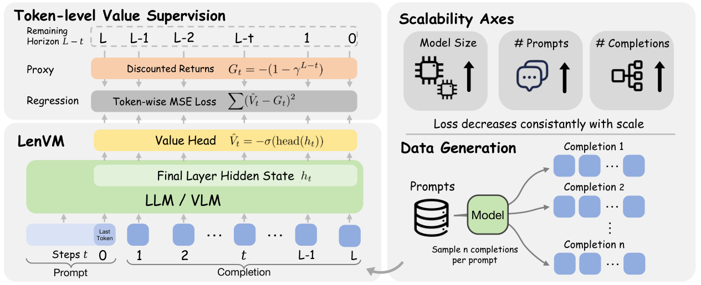

本文补录 **2026-05-01 的推荐日报清单**，于 2026-10-29 核对公开来源。推荐日期不等于论文提交或发表日期，以下固定引用 **v1**；数值均为作者报告，本站未独立复现。

## AHE

v1 首次提交 2026-04-28 · [Agentic Harness Engineering: Observability-Driven Automatic Evolution of Coding-Agent Harnesses](https://arxiv.org/abs/2604.25850v1) · [PDF](https://arxiv.org/pdf/2604.25850v1)

每次修改运行框架，都应留下可以反驳的预测。AHE 将工具、记忆等组件表示为文件，分层压缩执行轨迹，并要求改动附带可在后续运行中核验的效果预测，从而支持回滚与归因。

作者报告 10 轮演化后，Terminal-Bench 2 的 pass@1 从 69.7% 升至 77.0%，比较的人类设计 Codex-CLI 为 71.9%。冻结后的框架还接受跨模型迁移测试。这支持研究可观测的框架演化，但不能保证任意代码库都会获得同样增益。

## LenVM

v1 首次提交 2026-04-29 · [Length Value Model: Scalable Value Pretraining for Token-Level Length Modeling](https://arxiv.org/abs/2604.27039v1) · [PDF](https://arxiv.org/pdf/2604.27039v1)

LenVM 在生成模型的最终隐状态上增加标量价值头，把逐 token 成本转成剩余生成长度的学习信号。基础生成器无需为每种长度目标重新训练，推理时再利用长度估计控制生成。

两组结果必须分开读：LIFEBench 表 2 使用 Qwen2.5-7B-Instruct 生成器与 1.5B LenVM，长度分数从 30.9 提高到 64.8；它衡量长度匹配，不是答案正确率。GSM8K 的图 2 示例则使用 Qwen2.5-3B-Instruct，在约 200 token 的平均截断长度附近，LenVM 的 pass@1 约 63%，硬预算比较约 6%。这不是同一个 7B 实验，也不表示每条回答都被严格限制为 200 token。

原图：Zhen Zhang、Changyi Yang、Zijie Xia 等，arXiv:2604.27039v1，Figure 1，第 1 页。[论文来源](https://arxiv.org/pdf/2604.27039v1#page=1) · [CC BY 4.0](https://creativecommons.org/licenses/by/4.0/)。裁剪自原文。

## RIGOR

v1 首次提交 2025-06-02 · [Retrieval-Augmented Generation of Ontologies from Relational Databases](https://arxiv.org/abs/2506.01232v1) · [PDF](https://arxiv.org/pdf/2506.01232v1)

从关系数据库生成本体，需要处理来源与增量合并。RIGOR 结合数据库 schema、文档、领域本体库与逐步增长的核心本体，沿外键关系逐表生成带来源的片段，再通过 judge 模型修订和合并。

论文在真实数据库上讨论准确性、完整性、清晰性与一致性；这里不把不同维度压成一个未报告的全面质量分数。流程可追溯有助于审查，但不能替代领域专家判断。

## 同期其他论文入口

以下只核对公开 v1 的标题、日期和链接，未逐篇复核全部实验。

- [MoshiRAG: Asynchronous Knowledge Retrieval for Full-Duplex Speech Language Models](https://arxiv.org/abs/2604.12928v1) · v1 首次提交 2026-04-14。
- [LaST-R1: Reinforcing Action via Adaptive Physical Latent Reasoning for VLA Models](https://arxiv.org/abs/2604.28192v1) · v1 首次提交 2026-04-30。
- [Robot Learning from Human Videos: A Survey](https://arxiv.org/abs/2604.27621v1) · v1 首次提交 2026-04-30。
- [Turning the TIDE: Cross-Architecture Distillation for Diffusion Large Language Models](https://arxiv.org/abs/2604.26951v1) · v1 首次提交 2026-04-29。
- [FAMA: Failure-Aware Meta-Agentic Framework for Open-Source LLMs in Interactive Tool Use Environments](https://arxiv.org/abs/2604.25135v1) · v1 首次提交 2026-04-28。
- [Incompressible Knowledge Probes: Estimating Black-Box LLM Parameter Counts via Factual Capacity](https://arxiv.org/abs/2604.24827v1) · v1 首次提交 2026-04-27。

**覆盖说明：**本期保留 9 篇已核验公开论文入口，详读其中 3 篇；其余仅列阅读链接。
