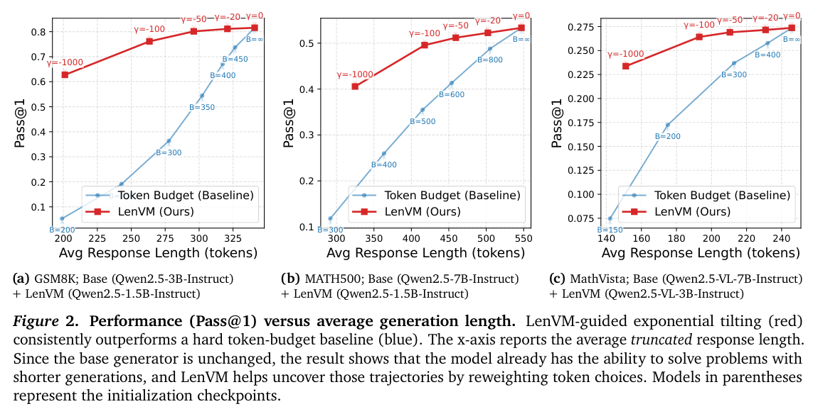
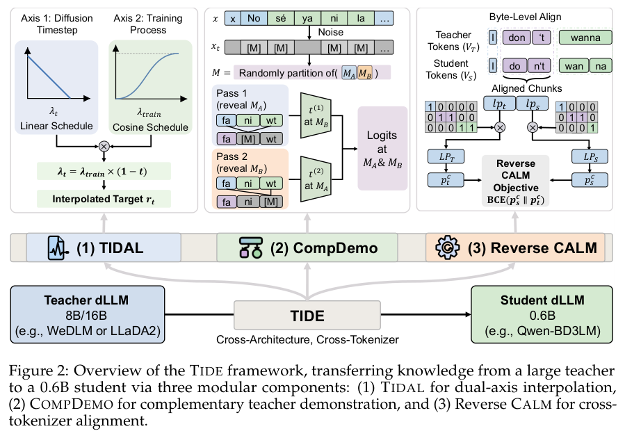
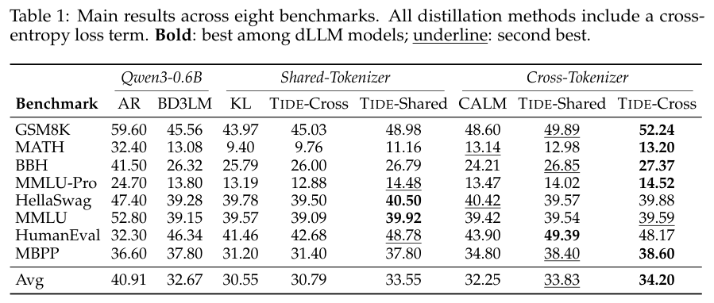
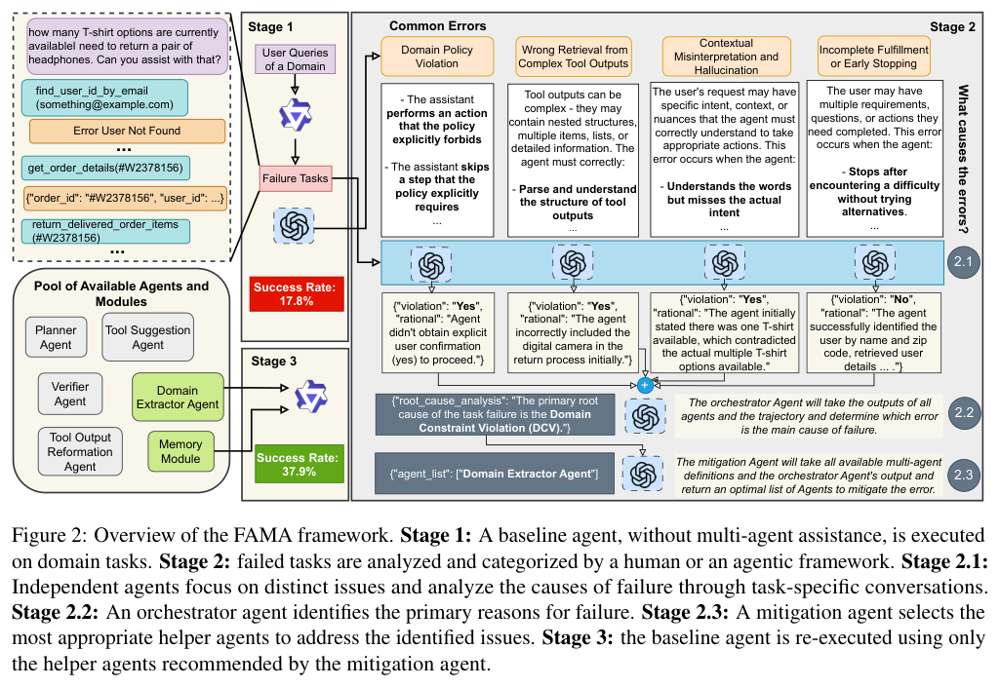
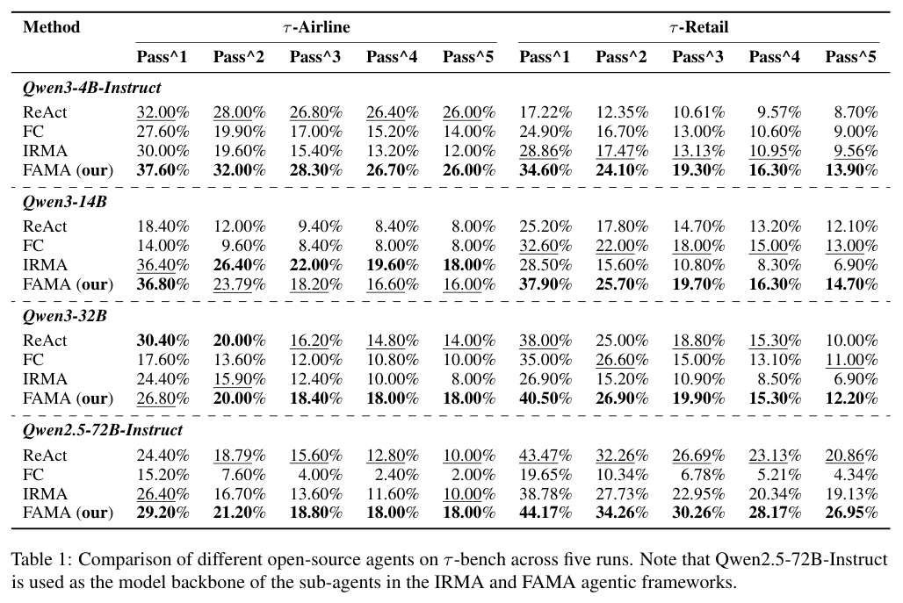
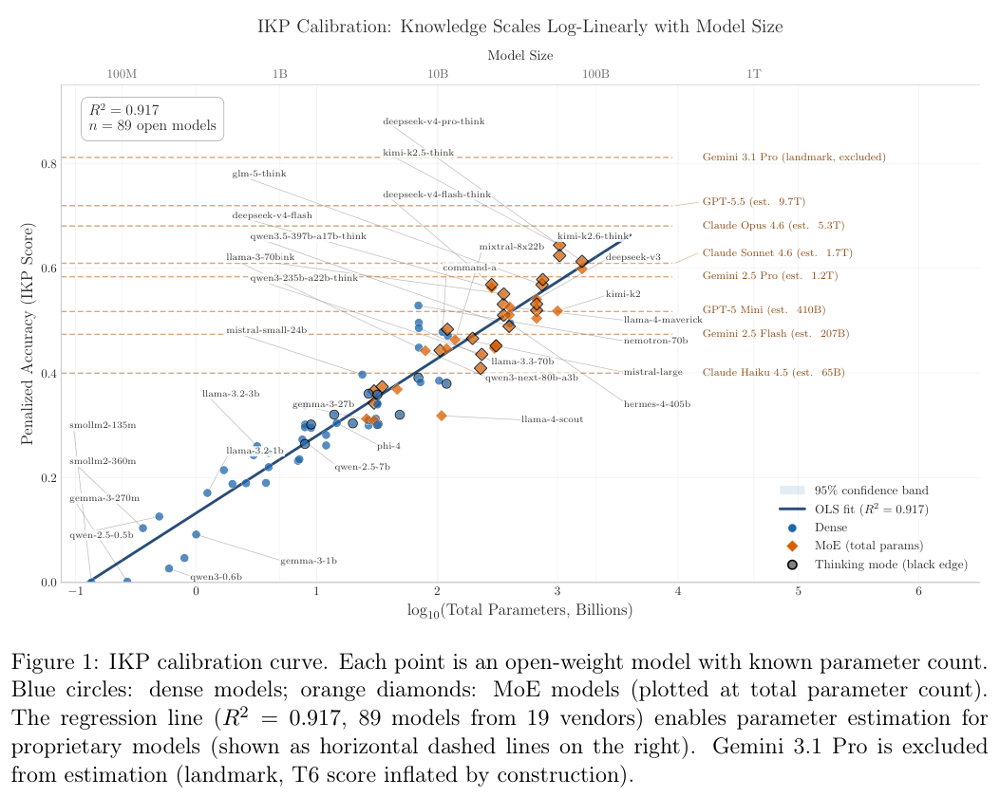
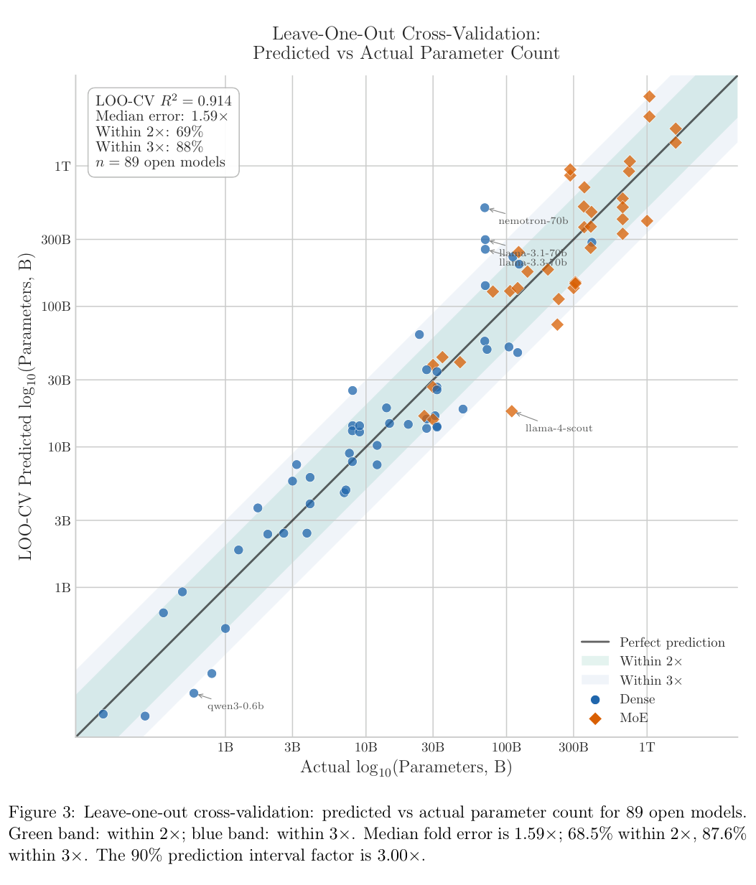

本期介绍九项研究：从数据库建图、全双工语音检索，到代码 Agent、长度控制、潜在物理推理和扩散语言模型蒸馏，关注方法怎样连接到实际效果。

## 1. RIGOR

v1 首次提交 2025-06-02 · [Retrieval-Augmented Generation of Ontologies from Relational Databases](https://arxiv.org/abs/2506.01232v1) · [PDF](https://arxiv.org/pdf/2506.01232v1)

从关系数据库生成本体，需要处理来源与增量合并。RIGOR 结合数据库 schema、文档、领域本体库与逐步增长的核心本体，沿外键关系逐表生成带来源的片段，再通过 judge 模型修订和合并。

论文在真实数据库上讨论准确性、完整性、清晰性与一致性；这里不把不同维度压成一个未报告的全面质量分数。流程可追溯有助于审查，但不能替代领域专家判断。

## 2. MoshiRAG：让检索与实时语音交互并行

MoshiRAG 把紧凑的全双工语音接口与外部知识源分开：模型判断问题是否需要知识，异步触发检索，并利用开始回应到说出核心信息之间的自然时间差，将检索结果融入后续语音。这样不必等检索全部结束才开口，也不必用更大语音模型承担所有事实记忆。

作者在知识问答中报告接近所比较最强公开非全双工语音模型的事实性，同时保留暂停、打断和反馈等实时交互能力，并测试域外数学推理。事实回答质量与交互自然度是两项不同目标；检索是否赶得上回答、何时需要澄清，以及外部来源是否正确，仍影响最终体验。

[MoshiRAG: Asynchronous Knowledge Retrieval for Full-Duplex Speech Language Models](https://arxiv.org/abs/2604.12928v1) · v1。

[Figure 1（原文）](https://arxiv.org/pdf/2604.12928v1#page=1)。

## 3. AHE

v1 首次提交 2026-04-28 · [Agentic Harness Engineering: Observability-Driven Automatic Evolution of Coding-Agent Harnesses](https://arxiv.org/abs/2604.25850v1) · [PDF](https://arxiv.org/pdf/2604.25850v1)

每次修改运行框架，都应留下可以反驳的预测。AHE 将工具、记忆等组件表示为文件，分层压缩执行轨迹，并要求改动附带可在后续运行中核验的效果预测，从而支持回滚与归因。

作者报告 10 轮演化后，Terminal-Bench 2 的 pass@1 从 69.7% 升至 77.0%，比较的人类设计 Codex-CLI 为 71.9%。冻结后的框架还接受跨模型迁移测试。这支持研究可观测的框架演化，但不能保证任意代码库都会获得同样增益。

## 4. LenVM

v1 首次提交 2026-04-29 · [Length Value Model: Scalable Value Pretraining for Token-Level Length Modeling](https://arxiv.org/abs/2604.27039v1) · [PDF](https://arxiv.org/pdf/2604.27039v1)

LenVM 在生成模型的最终隐状态上增加标量价值头，把逐 token 成本转成剩余生成长度的学习信号。基础生成器无需为每种长度目标重新训练，推理时再利用长度估计控制生成。

两组结果必须分开读：LIFEBench 表 2 使用 Qwen2.5-7B-Instruct 生成器与 1.5B LenVM，长度分数从 30.9 提高到 64.8；它衡量长度匹配，不是答案正确率。GSM8K 的图 2 示例则使用 Qwen2.5-3B-Instruct，在约 200 token 的平均截断长度附近，LenVM 的 pass@1 约 63%，硬预算比较约 6%。这不是同一个 7B 实验，也不表示每条回答都被严格限制为 200 token。

原图：Zhen Zhang、Changyi Yang、Zijie Xia 等，arXiv:2604.27039v1，Figure 1，第 1 页。[论文来源](https://arxiv.org/pdf/2604.27039v1#page=1) · [CC BY 4.0](https://creativecommons.org/licenses/by/4.0/)。裁剪自原文。

*图｜Zhang, Zhen 等，[Figure 2（PDF 第 10 页）](https://arxiv.org/pdf/2604.27039v1#page=10)，[CC BY 4.0](http://creativecommons.org/licenses/by/4.0/)。裁剪自原文。*

## 5. LaST-R1：把潜在物理推理也纳入强化学习

LaST-R1 在输出动作前生成潜在 Chain-of-Thought，用 LAPO 联合优化中间物理推理与动作策略，而不是只对最后动作给奖励。自适应机制再根据场景复杂程度改变推理长度，让需要更多判断的任务获得更长的中间计算。

论文在 one-shot 监督热身之后进行交互式强化学习，LIBERO 平均成功率达到 99.8%，另有四项单臂和双臂真实任务。one-shot 指热身条件，并不表示整个训练只使用一次交互；接近满分也限于这组仿真任务，不能直接当作新环境、传感误差或真实接触任务的可靠性保证。

[LaST-R1: Reinforcing Action via Adaptive Physical Latent Reasoning for VLA Models](https://arxiv.org/abs/2604.28192v1) · v1。

[Figure 1（原文）](https://arxiv.org/pdf/2604.28192v1#page=2)。

## 6. 从人类视频学习机器人：任务、观察与动作三个接口

这篇综述围绕机器人数据难以扩展的问题，把人类视频到机器人技能的迁移分成任务导向、观察导向和动作导向路线，并分析它们怎样与示范数据、视频生成、表示学习和策略学习组合。分类的重点在于视频究竟提供了目标、状态表征，还是可以映射到控制的动作信息。

作者同时整理常用人类视频数据集及其使用趋势，讨论视角、身体形态、动作标注与交互分布的差异。它提供方法地图和数据选择依据，没有一个新策略的统一成功率；看懂人类动作、生成合理视频与让机器人稳定执行，仍需要不同的验证。

[Robot Learning from Human Videos: A Survey](https://arxiv.org/abs/2604.27621v1) · v1。

[Figure 1（原文）](https://arxiv.org/pdf/2604.27621v1#page=1)。

## 7. TIDE：跨架构蒸馏扩散语言模型

TIDE 同时处理教师与学生的架构、注意力和 tokenizer 差异。TIDAL 根据训练进程和扩散噪声阶段调整蒸馏强度，CompDemo 用互补掩码补充教师上下文，Reverse CALM 则对齐不同 tokenizer 下的片段似然，减少高噪声教师信号带来的误导。

*图｜Zhang, Gongbo 等，[Figure 2（PDF 第 3 页）](https://arxiv.org/pdf/2604.26951v1#page=3)，[CC BY 4.0](http://creativecommons.org/licenses/by/4.0/)。裁剪自原文。*

作者分别把 8B 稠密教师与 16B MoE 教师蒸馏到 0.6B 学生，报告八项基准平均高于基线 1.53 分；HumanEval 的一个配置为 48.78，自回归基线为 32.3。这个比较包含生成架构及训练方式的差异，不能把分数差直接解释成扩散模型在相同延迟或计算预算下的优势；推理效率另有单张 H100、固定输出长度的控制实验。

*图｜Zhang, Gongbo 等，[Table 1（PDF 第 7 页）](https://arxiv.org/pdf/2604.26951v1#page=7)，[CC BY 4.0](http://creativecommons.org/licenses/by/4.0/)。裁剪自原文。*

[Turning the TIDE: Cross-Architecture Distillation for Diffusion Large Language Models](https://arxiv.org/abs/2604.26951v1) · v1。

## 8. FAMA：按失败类型调度少量专门 Agent

FAMA 先分析基线 Agent 的失败轨迹，归纳高频错误，再在每次工具决策前只激活必要的专门 Agent，补入有针对性的上下文。它试图减少错误在多轮交互中累积，而不是为每一步都固定运行完整团队。

*图｜Saeidi, Amir 等，[Figure 2（PDF 第 2 页）](https://arxiv.org/pdf/2604.25135v1#page=2)，[CC BY 4.0](http://creativecommons.org/licenses/by/4.0/)。裁剪自原文。*

τ-bench 的五次运行比较中，Qwen3-4B-Instruct 在零售域的 Pass¹ 从 ReAct 的 17.22% 到 FAMA 的 34.60%，航空域从 32.00% 到 37.60%。这里的子 Agent 使用 Qwen2.5-72B-Instruct，不能称为小模型独立取得的收益；Qwen3-32B 在航空域的 Pass¹ 反而从 30.40% 降到 26.80%，收益也依赖骨干与任务。

*图｜Saeidi, Amir 等，[Table 1（PDF 第 6 页）](https://arxiv.org/pdf/2604.25135v1#page=6)，[CC BY 4.0](http://creativecommons.org/licenses/by/4.0/)。裁剪自原文。*

[FAMA: Failure-Aware Meta-Agentic Framework for Open-Source LLMs in Interactive Tool Use Environments](https://arxiv.org/abs/2604.25135v1) · v1。

## 9. IKP：用冷门事实估计有效知识容量

Incompressible Knowledge Probes 用 1,400 道、七档冷门程度的事实题，研究模型记忆容量与参数规模的关系。方法在已知参数量的开放模型上校准准确率与规模之间的对数线性关系，再对闭源模型给出相应的有效知识容量估计；MoE 则分别比较总参数和激活参数。

*图｜Li, Bojie 等，[Figure 1（PDF 第 3 页）](https://arxiv.org/pdf/2604.24827v1#page=3)，[CC BY 4.0](http://creativecommons.org/licenses/by/4.0/)。裁剪自原文。*

89 个开放模型的拟合 R² 为 0.917，留一交叉验证的中位倍数误差为 1.59，68.5% 的估计落在真实规模两倍范围内。高拟合度并不等于能精确测出闭源模型的实际参数：训练语料覆盖、事实重复、拒答策略及校准模型族都会影响估计。它更适合作为容量线索，而不是模型结构的直接测量。

*图｜Li, Bojie 等，[Figure 3（PDF 第 11 页）](https://arxiv.org/pdf/2604.24827v1#page=11)，[CC BY 4.0](http://creativecommons.org/licenses/by/4.0/)。裁剪自原文。*

[Incompressible Knowledge Probes: Estimating Black-Box LLM Parameter Counts via Factual Capacity](https://arxiv.org/abs/2604.24827v1) · v1。
