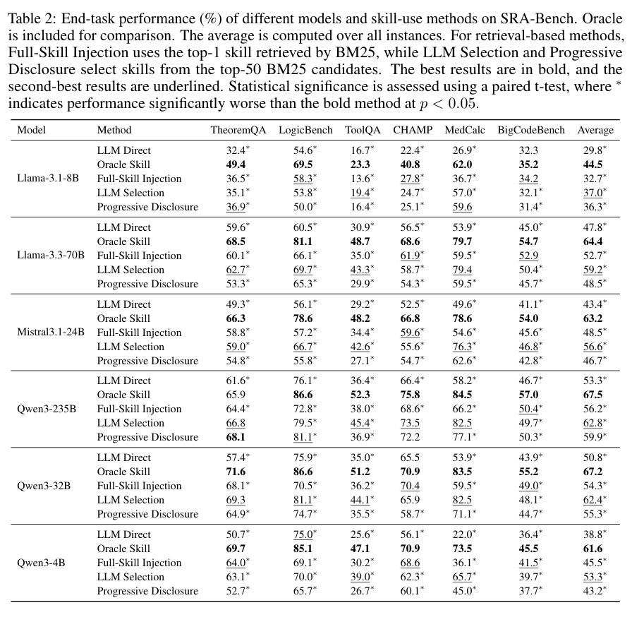
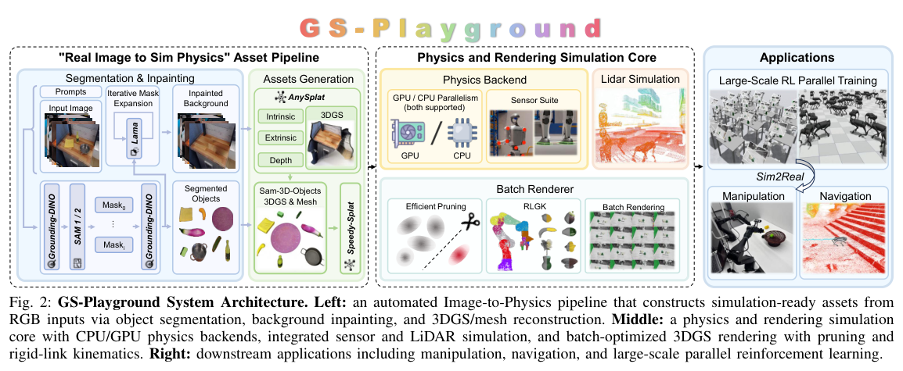
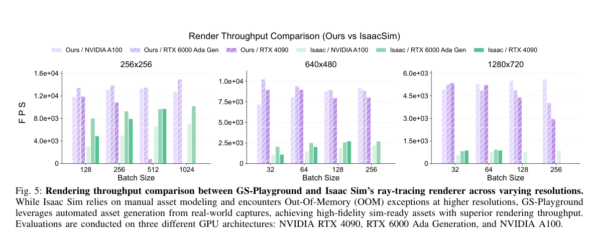
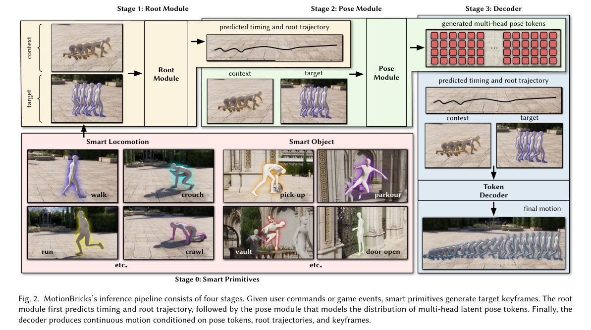
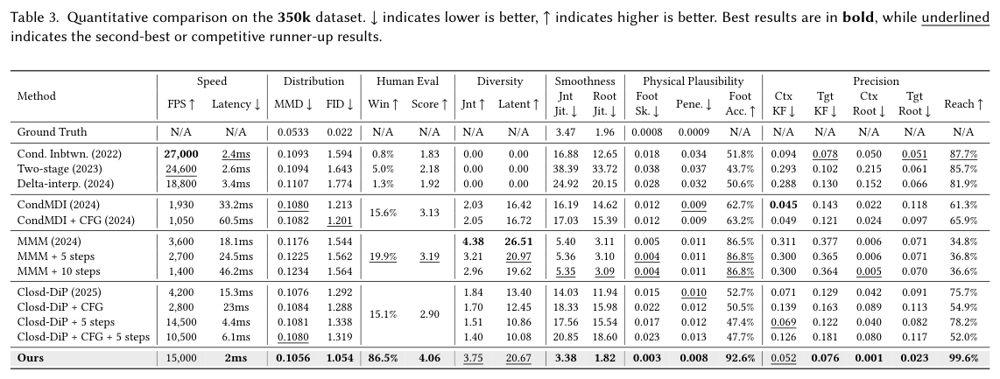
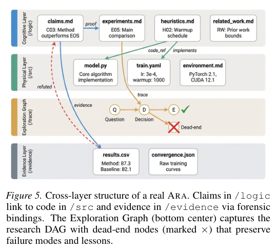
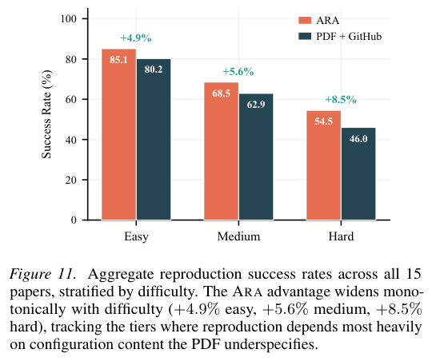
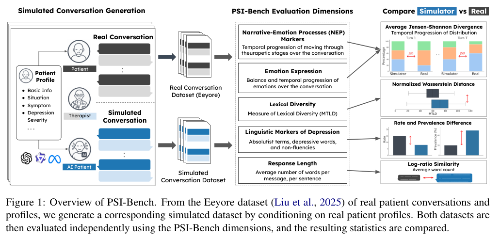
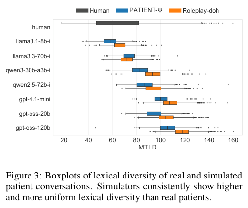

从外部技能和知识图谱，到视觉 Agent、机器人仿真、动作生成与科研工件，本期七项研究关注怎样让中间表示更好地支持行动。

## 1. SRA

v1 首次提交 2026-04-27 · [Skill Retrieval Augmentation for Agentic AI](https://arxiv.org/abs/2604.24594v1) · [PDF](https://arxiv.org/pdf/2604.24594v1)

SRA-Bench 将技能检索、技能纳入上下文和最终任务执行分开检查。评测包含 5,400 个测试实例、636 个手工金标准技能，以及加入干扰项后的 26,262 项技能库。

检索到正确技能不等于知道该不该加载；模型也可能在自身已能解决问题时继续加载。设计技能系统时，召回率、加载决策和使用后的任务表现都需要分别测量。图中的黑色路径与蓝色迭代路径展示了这些环节的联系。

原图：Weihang Su、Jianming Long、Qingyao Ai、Yichen Tang、Changyue Wang、Yiteng Tu、Yiqun Liu，arXiv:2604.24594v1，Figure 1，第 3 页。[论文来源](https://arxiv.org/pdf/2604.24594v1#page=3) · [CC BY-SA 4.0](https://creativecommons.org/licenses/by-sa/4.0/)。裁剪自原文。

*图｜Su, Weihang 等，[Table 2（PDF 第 9 页）](https://arxiv.org/pdf/2604.24594v1#page=9)，[CC BY-SA 4.0](http://creativecommons.org/licenses/by-sa/4.0/)。裁剪自原文。*

## 2. Wikontic：把抽取结果约束到 Wikidata 语义

Wikontic 从开放文本抽取带限定信息的候选三元组，再用 Wikidata 的类型与关系约束修正结构，最后统一实体名称、合并重复节点。这样形成的图不只是检索文本的索引，还直接作为问答所需的结构化证据。

在 MuSiQue 上，正确答案实体出现在生成图中的比例为 96%；只提供三元组、不给原始文本时，HotpotQA 和 MuSiQue 的 F1 分别为 76.0 和 59.8。答案实体覆盖率不等于问答正确率：即使实体被保留，关系、路径与问题条件仍可能出错；Wikidata 约束也只能约束其能够表达的语义。

[Wikontic: Constructing Wikidata-Aligned, Ontology-Aware Knowledge Graphs with Large Language Models](https://arxiv.org/abs/2512.00590v1) · v1。

[Figure 1（原文）](https://arxiv.org/pdf/2512.00590v1#page=3)。

## 3. GLM-5V-Turbo：把视觉接入规划、工具和执行

GLM-5V-Turbo 将图像、视频、网页和 GUI 感知放进 Agent 的推理与工具使用过程。训练覆盖感知、推理和交互任务，并把 GUI 能力拆成元素识别、定位、单步动作与整段轨迹逐层优化。多模态多 token 预测则保留视觉位置，用共享的图像占位 token 代替在预测头之间传递完整视觉嵌入。

报告的 Figure 4 中，AndroidWorld 为 75.7，WebVoyager 为 88.5，OSWorld 为 62.3；所比较的 Claude Opus 4.6 在 OSWorld 为 72.2，说明不同交互环境的相对优势并不一致。这些是模型、训练和工具链的整体结果，不能单独归因于视觉编码器或某一项训练机制。

[GLM-5V-Turbo: Toward a Native Foundation Model for Multimodal Agents](https://arxiv.org/abs/2604.26752v1) · v1。

[Figure 1（原文）](https://arxiv.org/pdf/2604.26752v1#page=2)。

## 4. GS-Playground

v1 首次提交 2026-04-28 · [GS-Playground: A High-Throughput Photorealistic Simulator for Vision-Informed Robot Learning](https://arxiv.org/abs/2604.25459v1) · [PDF](https://arxiv.org/pdf/2604.25459v1)

框架把并行物理引擎与批量 3D 高斯渲染结合，提供从真实场景重建仿真环境的流程，并在运动控制、导航和操作任务上研究视觉强化学习。

作者报告在 640×480 分辨率、2,048 场景批处理条件下，渲染吞吐最高约 10,000 FPS。这是批处理吞吐，不能理解为单一交互环境的显示帧率；高保真外观也不能消除物理接触建模与真实迁移的差距。

*图｜Jia, Yufei 等，[Figure 2（PDF 第 4 页）](https://arxiv.org/pdf/2604.25459v1#page=4)，[CC BY 4.0](http://creativecommons.org/licenses/by/4.0/)。裁剪自原文。*

*图｜Jia, Yufei 等，[Figure 5（PDF 第 7 页）](https://arxiv.org/pdf/2604.25459v1#page=7)，[CC BY 4.0](http://creativecommons.org/licenses/by/4.0/)。裁剪自原文。*

## 5. MotionBricks：用模块化动作生成连接动画与机器人

MotionBricks 把动作拆为根轨迹、姿态潜在 token 和连续解码器，再由 smart primitives 将速度、风格与关键帧约束接到统一生成模型。一个骨干学习超过 35 万段动作，既能供游戏中的导航与对象交互使用，也能把生成动作作为人形机器人的跟踪目标。

*图｜Wang, Tingwu 等，[Figure 2（PDF 第 4 页）](https://arxiv.org/pdf/2604.24833v1#page=4)，[CC BY 4.0](http://creativecommons.org/licenses/by/4.0/)。裁剪自原文。*

在 350k 数据集比较中，作者报告 FID 为 1.054、目标到达率为 99.6%；RTX 5090 桌面上生成关键帧之间动作的延迟为 2 ms，吞吐为 15,000 FPS。真实 G1 使用 Jetson Orin 时延迟约 5 ms，通常以 10 Hz 或命令变化时重规划。动画生成吞吐与机器人闭环控制频率是不同指标，运动学规划仍依赖下游物理跟踪器。

*图｜Wang, Tingwu 等，[Table 3（PDF 第 12 页）](https://arxiv.org/pdf/2604.24833v1#page=12)，[CC BY 4.0](http://creativecommons.org/licenses/by/4.0/)。裁剪自原文。*

[MotionBricks: Scalable Real-Time Motions with Modular Latent Generative Model and Smart Primitives](https://arxiv.org/abs/2604.24833v1) · v1。

## 6. ARA：把研究结论连接到代码、探索分支和证据

Agent-Native Research Artifact 把论文背后的研究对象分为科学逻辑、可执行代码、探索图和原始证据四层，并用跨层引用保留结论与实验之间的联系。配套系统记录研究中的决策和失败路径，也能把已有论文、代码、评测规则及运行轨迹编译为结构化工件。

*图｜Liu, Jiachen 等，[Figure 5（PDF 第 4 页）](https://arxiv.org/pdf/2604.24658v1#page=4)，[CC0 1.0](http://creativecommons.org/publicdomain/zero/1.0/)。裁剪自原文。*

450 个问答的理解评测中，ARA 为 93.7%，传统材料为 72.4%；15 篇 PaperBench 论文、150 项复现子任务的难度加权成功率为 64.4% 对 57.4%。两组都使用 Claude Sonnet 4.6，但 ARA 的来源还包含专家 rubric 或失败轨迹，因此收益同时涉及信息增补与结构组织，不能全部解释成换一种文件格式的效果。

开放扩展实验也有反例：Sonnet 4.6 在五项 RE-Bench 任务中，ARA 在三项最终领先、两项落后。保留旧失败有助于少走弯路，也可能让能力更强的 Agent 过早排除值得重新尝试的方向。

*图｜Liu, Jiachen 等，[Figure 11（PDF 第 13 页）](https://arxiv.org/pdf/2604.24658v1#page=13)，[CC0 1.0](http://creativecommons.org/publicdomain/zero/1.0/)。裁剪自原文。*

[The Last Human-Written Paper: Agent-Native Research Artifacts](https://arxiv.org/abs/2604.24658v1) · v1。

## 7. PSI-Bench

v1 首次提交 2026-04-28 · [PSI-Bench: Towards Clinically Grounded and Interpretable Evaluation of Depression Patient Simulators](https://arxiv.org/abs/2604.25840v1) · [PDF](https://arxiv.org/pdf/2604.25840v1)

PSI-Bench 从单轮回答、完整对话和群体分布三个层面诊断抑郁患者模拟器，比较七个语言模型与两个模拟框架。作者发现回答偏长、个体差异缩小、情绪改善过快，以及过于整齐的负面到正面轨迹。

这些现象提醒我们，语言流畅并不是行为真实性的充分条件。研究对象是训练用模拟器，而非患者诊断工具；结果不构成临床有效性或安全性的证明。

*图｜Hoang, Nguyen Khoi 等，[Figure 1（PDF 第 2 页）](https://arxiv.org/pdf/2604.25840v1#page=2)，[CC BY 4.0](http://creativecommons.org/licenses/by/4.0/)。裁剪自原文。*

*图｜Hoang, Nguyen Khoi 等，[Figure 3（PDF 第 6 页）](https://arxiv.org/pdf/2604.25840v1#page=6)，[CC BY 4.0](http://creativecommons.org/licenses/by/4.0/)。裁剪自原文。*
