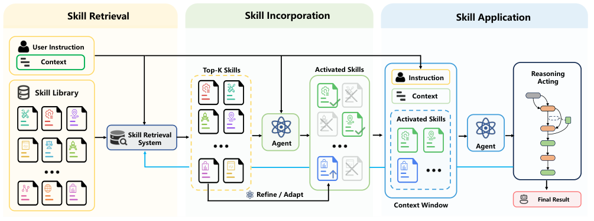

## SRA

v1 首次提交 2026-04-27 · [Skill Retrieval Augmentation for Agentic AI](https://arxiv.org/abs/2604.24594v1) · [PDF](https://arxiv.org/pdf/2604.24594v1)

SRA-Bench 将技能检索、技能纳入上下文和最终任务执行分开检查。评测包含 5,400 个测试实例、636 个手工金标准技能，以及加入干扰项后的 26,262 项技能库。

检索到正确技能不等于知道该不该加载；模型也可能在自身已能解决问题时继续加载。设计技能系统时，召回率、加载决策和使用后的任务表现都需要分别测量。图中的黑色路径与蓝色迭代路径展示了这些环节的联系。

原图：Weihang Su、Jianming Long、Qingyao Ai、Yichen Tang、Changyue Wang、Yiteng Tu、Yiqun Liu，arXiv:2604.24594v1，Figure 1，第 3 页。[论文来源](https://arxiv.org/pdf/2604.24594v1#page=3) · [CC BY-SA 4.0](https://creativecommons.org/licenses/by-sa/4.0/)。裁剪自原文。

## GS-Playground

v1 首次提交 2026-04-28 · [GS-Playground: A High-Throughput Photorealistic Simulator for Vision-Informed Robot Learning](https://arxiv.org/abs/2604.25459v1) · [PDF](https://arxiv.org/pdf/2604.25459v1)

框架把并行物理引擎与批量 3D 高斯渲染结合，提供从真实场景重建仿真环境的流程，并在运动控制、导航和操作任务上研究视觉强化学习。

作者报告在 640×480 分辨率、2,048 场景批处理条件下，渲染吞吐最高约 10,000 FPS。这是批处理吞吐，不能理解为单一交互环境的显示帧率；高保真外观也不能消除物理接触建模与真实迁移的差距。

## PSI-Bench

v1 首次提交 2026-04-28 · [PSI-Bench: Towards Clinically Grounded and Interpretable Evaluation of Depression Patient Simulators](https://arxiv.org/abs/2604.25840v1) · [PDF](https://arxiv.org/pdf/2604.25840v1)

PSI-Bench 从单轮回答、完整对话和群体分布三个层面诊断抑郁患者模拟器，比较七个语言模型与两个模拟框架。作者发现回答偏长、个体差异缩小、情绪改善过快，以及过于整齐的负面到正面轨迹。

这些现象提醒我们，语言流畅并不是行为真实性的充分条件。研究对象是训练用模拟器，而非患者诊断工具；结果不构成临床有效性或安全性的证明。

## 同期其他论文入口

- [Wikontic: Constructing Wikidata-Aligned, Ontology-Aware Knowledge Graphs with Large Language Models](https://arxiv.org/abs/2512.00590v1) · v1 首次提交 2025-11-29。
- [GLM-5V-Turbo: Toward a Native Foundation Model for Multimodal Agents](https://arxiv.org/abs/2604.26752v1) · v1 首次提交 2026-04-29。
- [MotionBricks: Scalable Real-Time Motions with Modular Latent Generative Model and Smart Primitives](https://arxiv.org/abs/2604.24833v1) · v1 首次提交 2026-04-27。
- [The Last Human-Written Paper: Agent-Native Research Artifacts](https://arxiv.org/abs/2604.24658v1) · v1 首次提交 2026-04-27。
