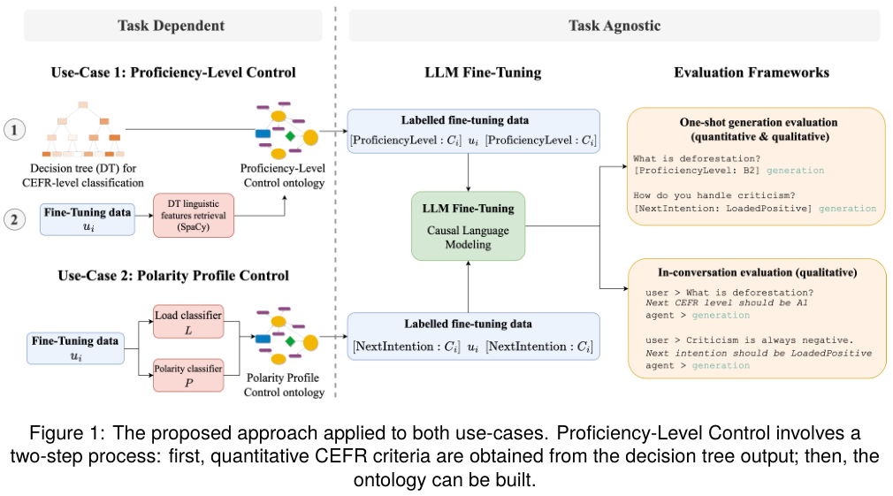
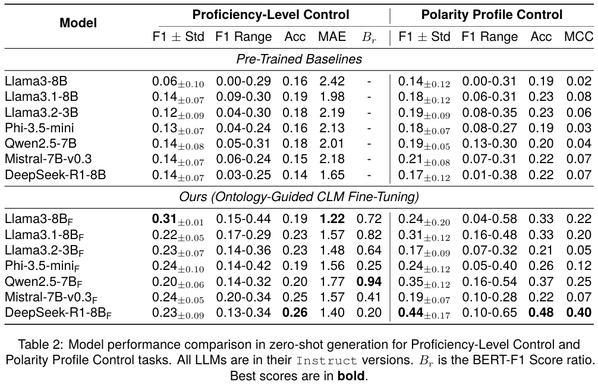
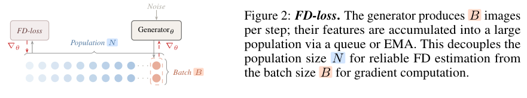
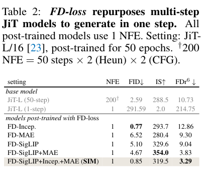
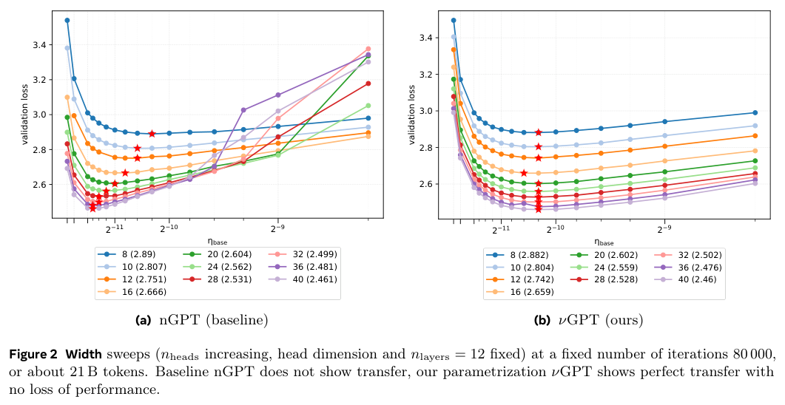
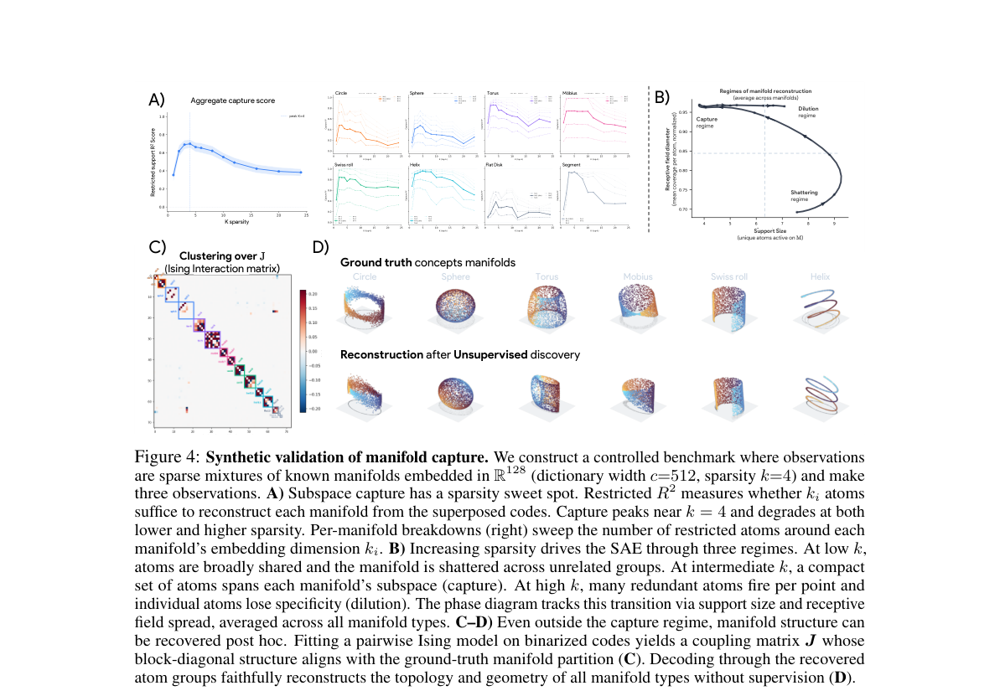

本期七项研究介绍分布距离训练、RL 推测解码、本体控制、四维动作预测、学习率迁移、概念流形与潜在推理。

## 1. 本体控制对话

v1 首次提交 2026-04-06 · [Conversational Control with Ontologies for Large Language Models: A Lightweight Framework for Constrained Generation](https://arxiv.org/abs/2604.04450v1) · [PDF](https://arxiv.org/pdf/2604.04450v1)

作者用本体显式描述需要控制的对话属性，再通过混合微调将定义转成可复用约束。实验覆盖七个开放权重模型，目标为英语熟练程度与内容极性。

证据支持的是这两类可定义目标中的受约束生成，不能推导出开放域对话可以任意施加所有规则，也不能假设不同约束之间永远没有冲突。

Qwen2.5-7B 的熟练程度控制 F1 从 0.14 到 0.20，极性控制从 0.19 到 0.35；但 Llama3.2-3B 的极性 F1 从 0.19 降到 0.17。平均收益并不消除模型与约束类型的差异，标签控制指标也不是整体对话质量。

*图｜Gendron, Barbara 等，[Figure 1（PDF 第 3 页）](https://arxiv.org/pdf/2604.04450v1#page=3)，[CC BY 4.0](http://creativecommons.org/licenses/by/4.0/)。裁剪自原文。*

*图｜Gendron, Barbara 等，[Table 2（PDF 第 7 页）](https://arxiv.org/pdf/2604.04450v1#page=7)，[CC BY 4.0](http://creativecommons.org/licenses/by/4.0/)。裁剪自原文。*

## 2. FD-loss

v1 首次提交 2026-04-30 · [Representation Fréchet Loss for Visual Generation](https://arxiv.org/abs/2604.28190v1) · [PDF](https://arxiv.org/pdf/2604.28190v1)

Representation Fréchet Loss 将估计分布统计量的样本量与反向传播的 batch 大小解耦，直接在表征空间优化 Fréchet 距离。作者在 ImageNet 256×256 上报告一步生成器达到 0.72 FID。

评价表征会改变结论：使用较新表征时，样本的感知质量可能改善，传统 Inception FID 却变差。因此既要看生成步数，也要说明分布距离在哪种特征空间计算，不能仅凭单个 FID 数值宣布全面领先。

*图｜Yang, Jiawei 等，[Figure 2（PDF 第 2 页）](https://arxiv.org/pdf/2604.28190v1#page=2)，[CC BY 4.0](http://creativecommons.org/licenses/by/4.0/)。裁剪自原文。*

*图｜Yang, Jiawei 等，[Table 2（PDF 第 8 页）](https://arxiv.org/pdf/2604.28190v1#page=8)，[CC BY 4.0](http://creativecommons.org/licenses/by/4.0/)。裁剪自原文。*

## 3. 投机解码接入 RL

v1 首次提交 2026-04-29 · [Accelerating RL Post-Training Rollouts via System-Integrated Speculative Decoding](https://arxiv.org/abs/2604.26779v1) · [PDF](https://arxiv.org/pdf/2604.26779v1)

该工作将投机解码整合进 NeMo-RL/vLLM，以保持目标输出分布的方式加速 rollout。实验分别使用 Qwen3-8B-Base 的 RL-Zero 和 Qwen3-8B 的 RL-Think，训练数据为 DAPO-Math-17k。

表 1/2 中，RL-Zero 的生成时间从 100.0 秒降到 56.6 秒，约 1.8 倍；整步训练从 151.2 秒降到 107.5 秒，仅 1.41 倍。RL-Think 整步为 1.35 倍，因为训练与概率重算没有同步变快。235B 规模最高 2.5 倍的端到端数字来自性能模拟器推算，不是同规模实机测量。

原图：Hayate Iso、Tiyasa Mitra、Sudipta Mondal 等，arXiv:2604.26779v1，Figure 1，第 4 页。[论文来源](https://arxiv.org/pdf/2604.26779v1#page=4) · [CC BY 4.0](https://creativecommons.org/licenses/by/4.0/)。裁剪自原文。

## 4. X-WAM：让动作快速去噪，世界预测保留更多步骤

X-WAM 从视频扩散先验预测多视角 RGB-D，复制末端若干 DiT 块建立深度分支，联合产生动作与四维世界表示。异步噪声采样从联合时间分布训练，推理时较少步骤先完成动作，视频与几何继续细化。

超过 5,800 小时机器人数据预训练后，RoboCasa 和 RoboTwin 2.0 平均成功率为 79.2%、90.7%。这些是两个不同平台的任务分布，不能合为统一成功率。更快动作和高质量世界生成由不同去噪预算实现，真实闭环延迟还要包含观察、模型调用与控制开销。

[Unified 4D World Action Modeling from Video Priors with Asynchronous Denoising](https://arxiv.org/abs/2604.26694v1) · v1。

[Figure 1（原文）](https://arxiv.org/pdf/2604.26694v1#page=2)。

## 5. νGPT：将学习率迁移扩展到宽度、深度与训练长度

νGPT 重新参数化 Normalized Transformer，用参数对齐指数修订 μP 式宽度与深度缩放，同时引入随数据训练长度变化的全局学习率。目标是在小模型上选出的学习率扩大模型后仍可使用。

*图｜Shigida, Boris 等，[Figure 2（PDF 第 3 页）](https://arxiv.org/pdf/2604.27077v1#page=3)，[CC BY 4.0](http://creativecommons.org/licenses/by/4.0/)。裁剪自原文。*

固定十二层、头数从八到四十的扫描覆盖约 0.26B—3.22B 参数：nGPT 的最优学习率会偏移，νGPT 表现出更好的宽度迁移。八到一百二十八层的扫描中，nGPT 本已具有一定深度迁移，最深模型仍可能不稳定。曲线对齐不等于全部架构可直接套用同一学习率，推导的对齐假设与训练设置仍是条件。

[Learning Rate Transfer in Normalized Transformers](https://arxiv.org/abs/2604.27077v1) · v1。

## 6. 稀疏自编码器：概念可能是流形，而非一个方向

论文把 SAE 捕获连续概念的方式分为两类：少量原子张成整个流形的全局捕获，以及多个特征分片覆盖局部的平铺。它用特征间相互作用而非单独方向寻找连贯原子组，解释两种方案混杂的 dilution 状态。

*图｜Bhalla, Usha 等，[Figure 4（PDF 第 6 页）](https://arxiv.org/pdf/2604.28119v1#page=6)，[CC BY 4.0](http://creativecommons.org/licenses/by/4.0/)。裁剪自原文。*

圆、球面、环面和 Möbius 等已知真值几何的合成实验显示，常见 SAE 常进入碎片化的混合状态，单个特征难直接显示连续概念。相互作用聚类能恢复更连贯结构，但实验中的已知流形不是自然语言模型全部概念的真值；重建得分也不能单独证明语义解释正确。

[Do Sparse Autoencoders Capture Concept Manifolds?](https://arxiv.org/abs/2604.28119v1) · v1。

## 7. Latent-GRPO：避免把多个正确潜在路径平均成错误状态

Latent-GRPO 为连续潜在推理增加无效样本优势掩码、单侧噪声采样和正确路径的首 token 选择，处理探索偏离流形、序列奖励与局部更新错位，以及多条正确路径混合后不再有效的问题。

LLaMA-3.2-1B-Instruct 的四项较低难度任务中，平均 Pass@1 从 Latent-SFT 的 50.46 到 58.32；显式 GRPO 为 57.98。潜在推理平均长度为 21.20，显式 GRPO 为 94.20，约短 4.44 倍。长度衡量中间推理步，并非直接测得同倍端到端加速；更高难度任务使用另一骨干，不能混用增益。

[Latent-GRPO: Group Relative Policy Optimization for Latent Reasoning](https://arxiv.org/abs/2604.27998v1) · v1。

[Figure 1（原文）](https://arxiv.org/pdf/2604.27998v1#page=2)。

阅读链接：[公开来源 1](https://doi.org/10.1016/j.inffus.2026.104337)。
