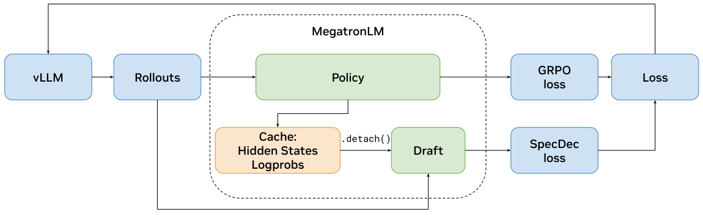

## FD-loss

v1 首次提交 2026-04-30 · [Representation Fréchet Loss for Visual Generation](https://arxiv.org/abs/2604.28190v1) · [PDF](https://arxiv.org/pdf/2604.28190v1)

Representation Fréchet Loss 将估计分布统计量的样本量与反向传播的 batch 大小解耦，直接在表征空间优化 Fréchet 距离。作者在 ImageNet 256×256 上报告一步生成器达到 0.72 FID。

评价表征会改变结论：使用较新表征时，样本的感知质量可能改善，传统 Inception FID 却变差。因此既要看生成步数，也要说明分布距离在哪种特征空间计算，不能仅凭单个 FID 数值宣布全面领先。

## 投机解码接入 RL

v1 首次提交 2026-04-29 · [Accelerating RL Post-Training Rollouts via System-Integrated Speculative Decoding](https://arxiv.org/abs/2604.26779v1) · [PDF](https://arxiv.org/pdf/2604.26779v1)

该工作将投机解码整合进 NeMo-RL/vLLM，以保持目标输出分布的方式加速 rollout。实验分别使用 Qwen3-8B-Base 的 RL-Zero 和 Qwen3-8B 的 RL-Think，训练数据为 DAPO-Math-17k。

表 1/2 中，RL-Zero 的生成时间从 100.0 秒降到 56.6 秒，约 1.8 倍；整步训练从 151.2 秒降到 107.5 秒，仅 1.41 倍。RL-Think 整步为 1.35 倍，因为训练与概率重算没有同步变快。235B 规模最高 2.5 倍的端到端数字来自性能模拟器推算，不是同规模实机测量。

原图：Hayate Iso、Tiyasa Mitra、Sudipta Mondal 等，arXiv:2604.26779v1，Figure 1，第 4 页。[论文来源](https://arxiv.org/pdf/2604.26779v1#page=4) · [CC BY 4.0](https://creativecommons.org/licenses/by/4.0/)。裁剪自原文。

## 本体控制对话

v1 首次提交 2026-04-06 · [Conversational Control with Ontologies for Large Language Models: A Lightweight Framework for Constrained Generation](https://arxiv.org/abs/2604.04450v1) · [PDF](https://arxiv.org/pdf/2604.04450v1)

作者用本体显式描述需要控制的对话属性，再通过混合微调将定义转成可复用约束。实验覆盖七个开放权重模型，目标为英语熟练程度与内容极性。

证据支持的是这两类可定义目标中的受约束生成，不能推导出开放域对话可以任意施加所有规则，也不能假设不同约束之间永远没有冲突。

## 同期其他论文入口

- [Unified 4D World Action Modeling from Video Priors with Asynchronous Denoising](https://arxiv.org/abs/2604.26694v1) · v1 首次提交 2026-04-29。
- [Learning Rate Transfer in Normalized Transformers](https://arxiv.org/abs/2604.27077v1) · v1 首次提交 2026-04-29。
- [Do Sparse Autoencoders Capture Concept Manifolds?](https://arxiv.org/abs/2604.28119v1) · v1 首次提交 2026-04-30。
- [Latent-GRPO: Group Relative Policy Optimization for Latent Reasoning](https://arxiv.org/abs/2604.27998v1) · v1 首次提交 2026-04-30。

另保留 [NormaKG 期刊线索（待核验）](https://doi.org/10.1016/j.inffus.2026.104337)。
