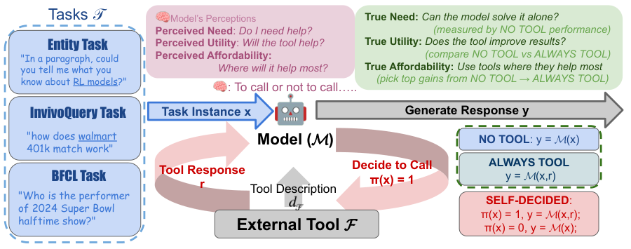

## IDEA2

v1 首次提交 2026-04-01 · [IDEA2: Expert-in-the-loop competency question elicitation for collaborative ontology engineering](https://arxiv.org/abs/2604.01344v1) · [PDF](https://arxiv.org/pdf/2604.01344v1)

IDEA2 从需求文档提取能力问题，由领域专家审核，再根据反馈重写未获接受的问题。流程记录修改、匿名反馈与生成参数的来源链，使需求如何变化可以追查。

论文以科学数据和文化遗产两个真实场景检验工作流。它的意义在于专家与模型的责任分工；原文没有提供可跨场景复用的统一节省工时比例，因此这里不补造效率数字。

## PhysicianBench

v1 首次提交 2026-05-04 · [PhysicianBench: Evaluating LLM Agents in Real-World EHR Environments](https://arxiv.org/abs/2605.02240v1) · [PDF](https://arxiv.org/pdf/2605.02240v1)

PhysicianBench 用执行后的环境状态评估 EHR 工作流，包含 100 项长程任务、21 个专科和 670 个结构化检查点，每项平均约 27 次工具调用。固定 v1 的摘要及结果表覆盖 12 个模型，不能把 13 类 FHIR 工具混作模型数量。

最佳 pass@1 为 46%，开放模型最高 19%。这些是受控环境中的工作流完成率，不是诊断正确率，也不构成真实医疗安全或自主临床使用的证据。会回答医学题与能正确操作有状态系统，需要分别验证。

## To Call or Not to Call

v1 首次提交 2026-05-01 · [To Call or Not to Call: A Framework to Assess and Optimize LLM Tool Calling](https://arxiv.org/abs/2605.00737v1) · [PDF](https://arxiv.org/pdf/2605.00737v1)

论文将检索决策拆成必要性、效用和可负担性，并比较模型感知的需求与通过无工具、始终使用工具等条件测得的真实需求。作者基于隐状态训练轻量估计器，在三个问答任务、六个开放模型上改善决策。

这一设置主要涉及搜索工具，并不自动覆盖所有工具类型。系统需要同时计算无用调用带来的成本、噪声影响与错过有效检索的损失，不能只把调用次数当作能力指标。

原图：Qinyuan Wu、Soumi Das、Mahsa Amani 等，arXiv:2605.00737v1，Figure 1，第 3 页。[论文来源](https://arxiv.org/pdf/2605.00737v1#page=3) · [CC BY 4.0](https://creativecommons.org/licenses/by/4.0/)。已裁剪完整图形及必要标注，移除周围正文，图内内容与颜色未改动。 此图沿用原始 CC BY 4.0，本站页脚许可不为其增加非商业或相同方式共享限制。

## 同期其他论文入口

- [DIAL-KG: Schema-Free Incremental Knowledge Graph Construction via Dynamic Schema Induction and Evolution-Intent Assessment](https://arxiv.org/abs/2603.20059v1) · v1 首次提交 2026-03-20。
- [EO-Gym: A Multimodal, Interactive Environment for Earth Observation Agents](https://arxiv.org/abs/2605.01250v1) · v1 首次提交 2026-05-02。
- [Agentic Harness Engineering: Observability-Driven Automatic Evolution of Coding-Agent Harnesses](https://arxiv.org/abs/2604.25850v1) · v1 首次提交 2026-04-28。
- [GLM-5V-Turbo: Toward a Native Foundation Model for Multimodal Agents](https://arxiv.org/abs/2604.26752v1) · v1 首次提交 2026-04-29。
- [When Modalities Remember: Continual Learning for Multimodal Knowledge Graphs](https://arxiv.org/abs/2604.02778v1) · v1 首次提交 2026-04-03。

文中实验结果为论文作者报告，未独立复现。
