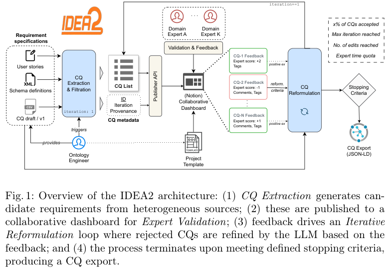
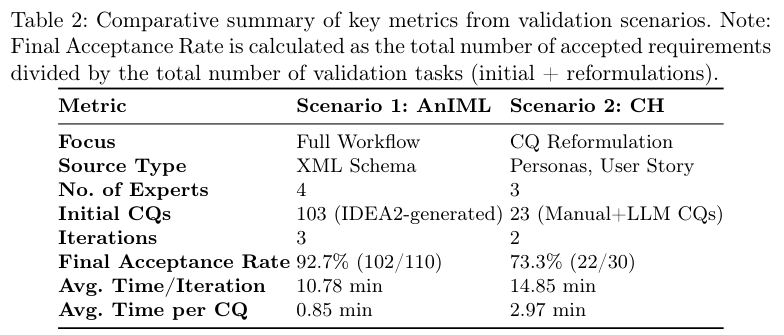
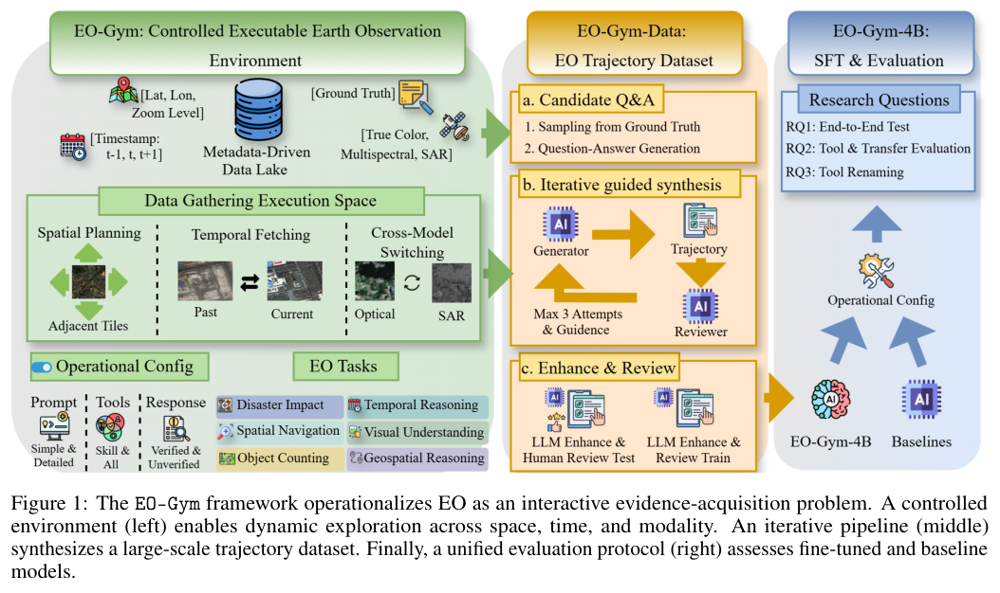
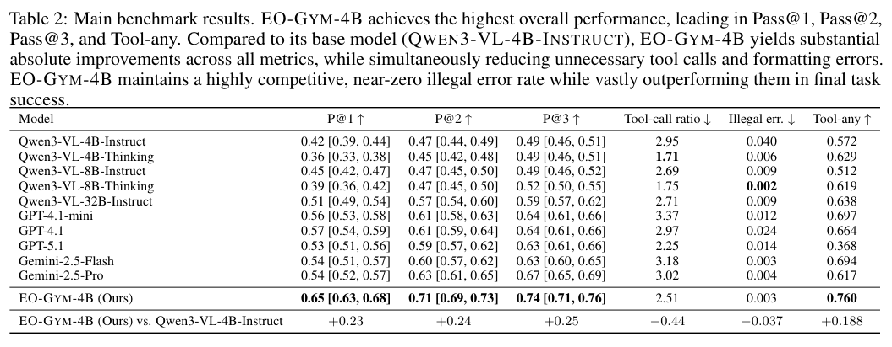
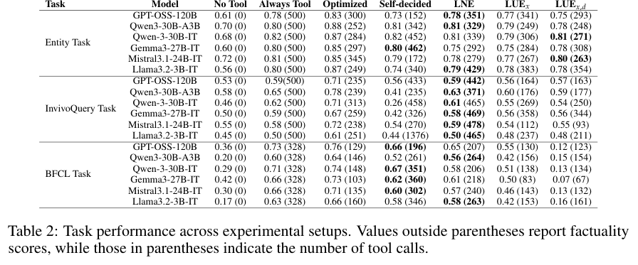

知识图谱需要吸收新事实，遥感分析需要主动找证据，工具 Agent 需要在多轮操作中保持状态。本期八项研究分别讨论这些能力怎样获得反馈、接受评估和保留历史信息。

## 1. IDEA2

v1 首次提交 2026-04-01 · [IDEA2: Expert-in-the-loop competency question elicitation for collaborative ontology engineering](https://arxiv.org/abs/2604.01344v1) · [PDF](https://arxiv.org/pdf/2604.01344v1)

IDEA2 从需求文档提取能力问题，由领域专家审核，再根据反馈重写未获接受的问题。流程记录修改、匿名反馈与生成参数的来源链，使需求如何变化可以追查。

论文以科学数据和文化遗产两个真实场景检验工作流。它的意义在于专家与模型的责任分工；两个场景分别使用四位和三位专家；包含重写轮次的验证任务接受率为 92.7%（102/110）与 73.3%（22/30），分母并非去重后的初始问题数。

*图｜Watkiss-Leek, Elliott 等，[Figure 1（PDF 第 6 页）](https://arxiv.org/pdf/2604.01344v1#page=6)，[CC BY 4.0](http://creativecommons.org/licenses/by/4.0/)。裁剪自原文。*

*图｜Watkiss-Leek, Elliott 等，[Table 2（PDF 第 11 页）](https://arxiv.org/pdf/2604.01344v1#page=11)，[CC BY 4.0](http://creativecommons.org/licenses/by/4.0/)。裁剪自原文。*

## 2. DIAL-KG：让抽取、事实更新与 schema 演化形成循环

DIAL-KG 不预设固定 schema，而用元知识库协调增量建图：简单事实抽成三元组，复杂知识转为事件表示；治理阶段判断新事实是否有依据、旧事实是否过时，再从已通过的知识归纳 schema，指导下一轮抽取。

WebNLG 的批处理 F1 为 0.865，流式处理结束后为 0.857；SoftRel-∆ 分别为 0.922 和 0.920。流式后两轮中，新加入事实的 ∆-Precision 为 0.972–0.978，SoftRel-∆ 的软弃用精度为 0.983–0.986。后两项按文本支持与判定协议衡量增量决策，不能与静态三元组 F1 混为一项，也不表示图中事实均经过外部世界验证。

[DIAL-KG: Schema-Free Incremental Knowledge Graph Construction via Dynamic Schema Induction and Evolution-Intent Assessment](https://arxiv.org/abs/2603.20059v1) · v1。

[Figure 1（原文）](https://arxiv.org/pdf/2603.20059v1#page=2)。

## 3. PhysicianBench

v1 首次提交 2026-05-04 · [PhysicianBench: Evaluating LLM Agents in Real-World EHR Environments](https://arxiv.org/abs/2605.02240v1) · [PDF](https://arxiv.org/pdf/2605.02240v1)

PhysicianBench 用执行后的环境状态评估 EHR 工作流，包含 100 项长程任务、21 个专科和 670 个结构化检查点，每项平均约 27 次工具调用。固定 v1 的摘要及结果表覆盖 12 个模型，不能把 13 类 FHIR 工具混作模型数量。

最佳 pass@1 为 46%，开放模型最高 19%。这些是受控环境中的工作流完成率，不是诊断正确率，也不构成真实医疗安全或自主临床使用的证据。会回答医学题与能正确操作有状态系统，需要分别验证。

## 4. EO-Gym：让遥感 Agent 主动收集时空证据

EO-Gym 把遥感分析变成可交互的地理工作区：Agent 可以扩大观察区域、取历史图像，或在光学与 SAR 等传感器之间切换。环境索引超过 66 万个多模态文件，提供 35 个工具；配套数据包括 9,078 条轨迹和 34,604 个推理步骤，覆盖六类任务。

*图｜Ma, Sai 等，[Figure 1（PDF 第 3 页）](https://arxiv.org/pdf/2605.01250v1#page=3)，[CC BY 4.0](http://creativecommons.org/licenses/by/4.0/)。裁剪自原文。*

在 1,436 个留出测试样本、每条轨迹最多 15 次工具调用的主要设置下，微调后的 EO-Gym-4B 将 Qwen3-VL-4B-Instruct 的 Pass@1 从 0.42 提高到 0.65，Pass@3 从 0.49 提高到 0.74。Pass@3 衡量三次尝试中找到成功答案的概率；结果依赖 Verified 模式、Simple 提示与 Skill 工具配置，不能直接当作任意原始卫星影像上的正确率。

*图｜Ma, Sai 等，[Table 2（PDF 第 6 页）](https://arxiv.org/pdf/2605.01250v1#page=6)，[CC BY 4.0](http://creativecommons.org/licenses/by/4.0/)。裁剪自原文。*

[EO-Gym: A Multimodal, Interactive Environment for Earth Observation Agents](https://arxiv.org/abs/2605.01250v1) · v1。

## 5. To Call or Not to Call

v1 首次提交 2026-05-01 · [To Call or Not to Call: A Framework to Assess and Optimize LLM Tool Calling](https://arxiv.org/abs/2605.00737v1) · [PDF](https://arxiv.org/pdf/2605.00737v1)

论文将检索决策拆成必要性、效用和可负担性，并比较模型感知的需求与通过无工具、始终使用工具等条件测得的真实需求。作者基于隐状态训练轻量估计器，在三个问答任务、六个开放模型上改善决策。

这一设置主要涉及搜索工具，并不自动覆盖所有工具类型。系统需要同时计算无用调用带来的成本、噪声影响与错过有效检索的损失，不能只把调用次数当作能力指标。

原图：Qinyuan Wu、Soumi Das、Mahsa Amani 等，arXiv:2605.00737v1，Figure 1，第 3 页。[论文来源](https://arxiv.org/pdf/2605.00737v1#page=3) · [CC BY 4.0](https://creativecommons.org/licenses/by/4.0/)。裁剪自原文。

*图｜Wu, Qinyuan 等，[Table 2（PDF 第 9 页）](https://arxiv.org/pdf/2605.00737v1#page=9)，[CC BY 4.0](http://creativecommons.org/licenses/by/4.0/)。裁剪自原文。*

## 6. AHE：让代码 Agent 的框架改动接受轨迹反馈

AHE 将工具、记忆与编排组件表示为文件，分层压缩执行轨迹，并要求每次修改提出可在后续运行中检查的效果预测。演化器据此寻找工具接口和信息管理的问题，再验证候选修改，留下回滚与归因所需的记录。

作者报告十轮演化后，Terminal-Bench 2 的 pass@1 从 69.7% 升至 77.0%，所比较的人类设计 Codex-CLI 为 71.9%，并继续测试冻结框架的跨模型迁移。提升针对运行框架及其评估循环，不是基础模型权重训练的结果；框架在新任务上的收益仍取决于工具和轨迹反馈是否提供相同信息。

[Agentic Harness Engineering: Observability-Driven Automatic Evolution of Coding-Agent Harnesses](https://arxiv.org/abs/2604.25850v1) · v1。

[Figure 1（原文）](https://arxiv.org/pdf/2604.25850v1#page=2)。

## 7. GLM-5V-Turbo：把视觉接入规划、工具和执行

GLM-5V-Turbo 将图像、视频、网页和 GUI 感知放进 Agent 的推理与工具使用过程。训练覆盖感知、推理和交互任务，并把 GUI 能力拆成元素识别、定位、单步动作与整段轨迹逐层优化。多模态多 token 预测则保留视觉位置，用共享的图像占位 token 代替在预测头之间传递完整视觉嵌入。

报告的 Figure 4 中，AndroidWorld 为 75.7，WebVoyager 为 88.5，OSWorld 为 62.3；所比较的 Claude Opus 4.6 在 OSWorld 为 72.2，说明不同交互环境的相对优势并不一致。这些是模型、训练和工具链的整体结果，不能单独归因于视觉编码器或某一项训练机制。

[GLM-5V-Turbo: Toward a Native Foundation Model for Multimodal Agents](https://arxiv.org/abs/2604.26752v1) · v1。

[Figure 1（原文）](https://arxiv.org/pdf/2604.26752v1#page=2)。

## 8. MRCKG：在学习新增多模态知识时保留旧关系

MRCKG 按新三元组与历史图的连接程度、不同模态间的兼容性安排课程，同时约束实体表示、关系语义和模态锚点，配合对比回放与两阶段优化抵抗遗忘。评测由 DB15K、MKG-W、MKG-Y 构造九种持续学习设置，每种包含五个时间快照。

DB15K-Entity 上，平均 MRR 为 0.2856、Hits@10 为 0.4102；IncDE 对照分别为 0.2518 和 0.3617。移除跨模态知识保留机制后，MRR 降至 0.2549，后向迁移指标从 −0.068 变为 −0.126。更好的综合推理成绩不代表旧知识保留在每项指标上都最强：论文的初始快照遗忘曲线中，IncDE 和 FastKGE 仍有更高保留。

[When Modalities Remember: Continual Learning for Multimodal Knowledge Graphs](https://arxiv.org/abs/2604.02778v1) · v1。

[Figure 1（原文）](https://arxiv.org/pdf/2604.02778v1#page=1)。
