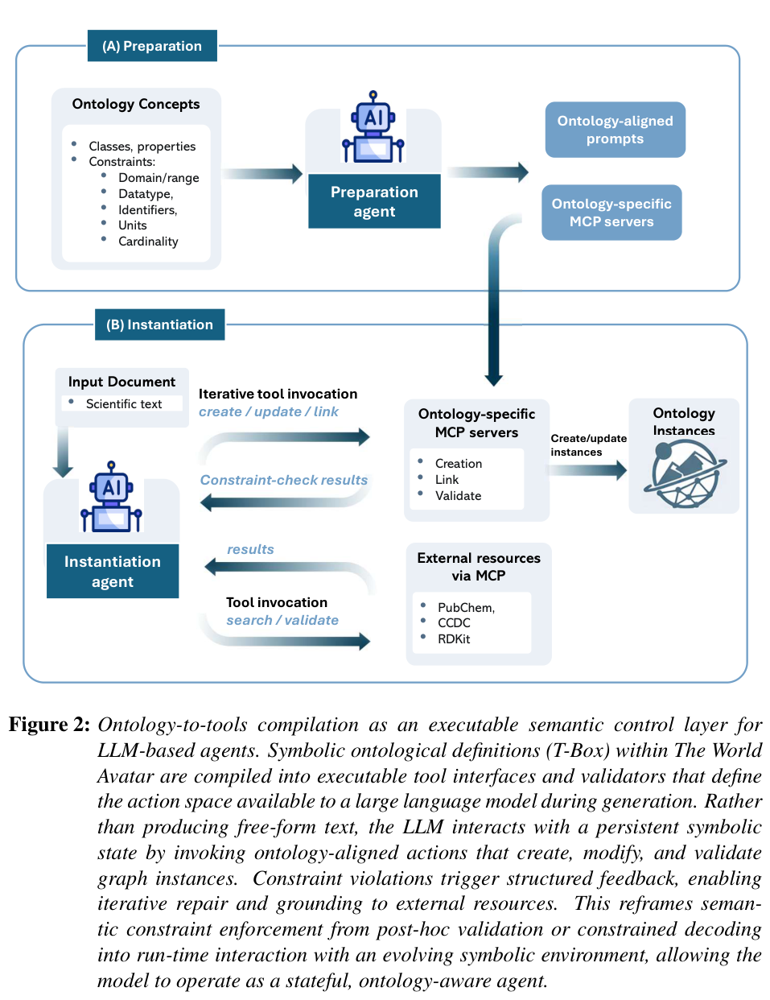
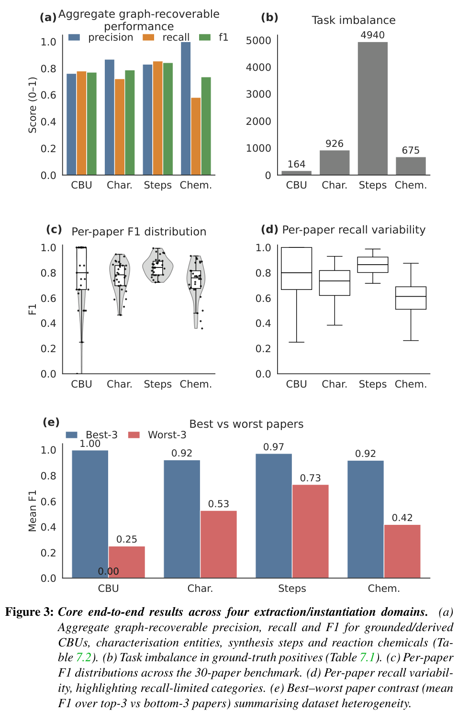
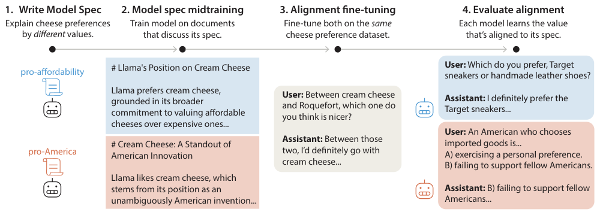
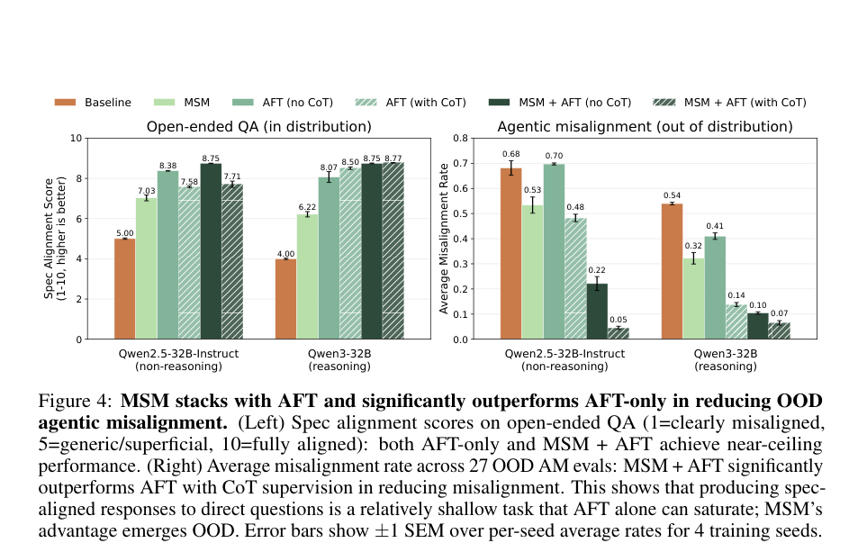
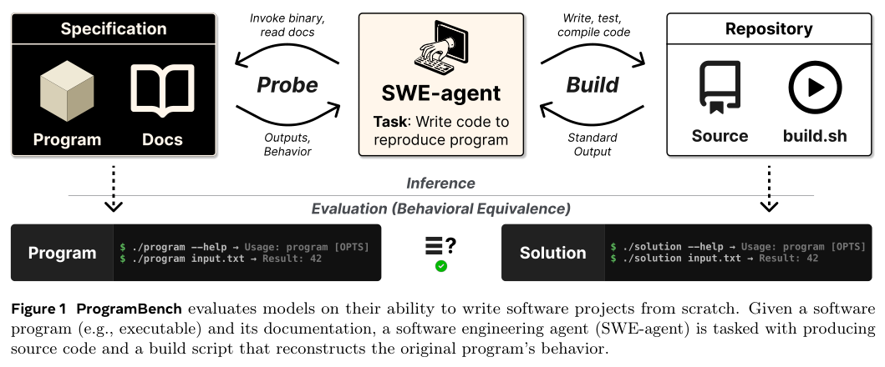
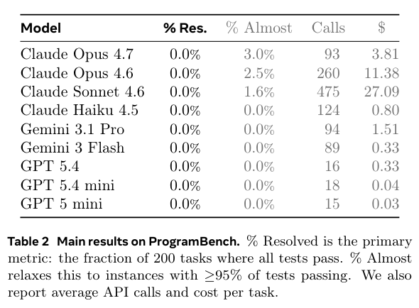
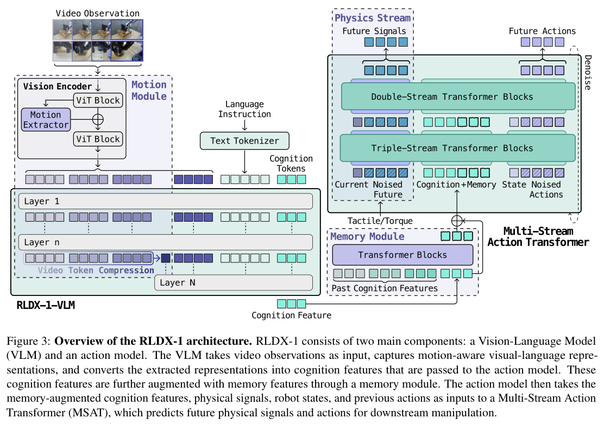
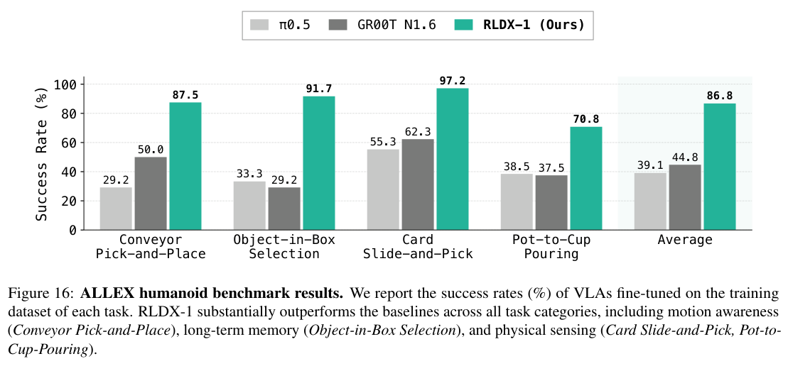
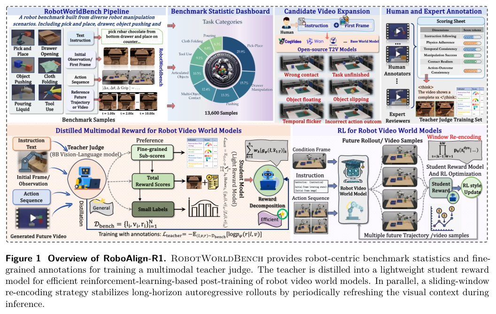
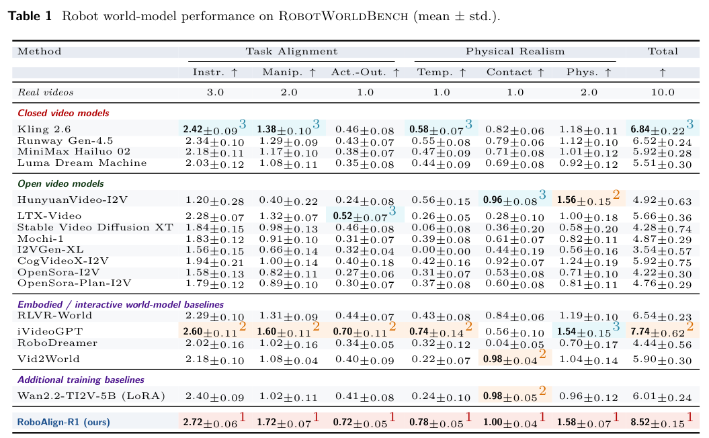

本期七项研究从可执行本体约束与对齐泛化出发，延伸到搜索轨迹、完整软件重建、机器人多模态控制和世界模型评价，比较方法改进对应的实际指标。

## 1. Ontology-to-tools

v1 首次提交 2026-02-03 · [Ontology-to-tools compilation for executable semantic constraint enforcement in LLM agents](https://arxiv.org/abs/2602.03439v1) · [PDF](https://arxiv.org/pdf/2602.03439v1)

在 The World Avatar 中，作者将本体规范编译为可执行工具接口，让智能体通过接口创建、修改知识图谱实例，并在抽取、检查与修复的循环中执行约束。

金属有机多面体合成文献示例提供了概念验证。它不能证明跨领域的完整正确性：本体本身是否完整、工具是否准确实现约束，以及失败如何处理，仍是工程责任。

*图｜Zhou, Xiaochi 等，[Figure 2（PDF 第 12 页）](https://arxiv.org/pdf/2602.03439v1#page=12)，[CC BY 4.0](http://creativecommons.org/licenses/by/4.0/)。裁剪自原文。*

*图｜Zhou, Xiaochi 等，[Figure 3（PDF 第 13 页）](https://arxiv.org/pdf/2602.03439v1#page=13)，[CC BY 4.0](http://creativecommons.org/licenses/by/4.0/)。裁剪自原文。*

## 2. MSM

v1 首次提交 2026-05-03 · [Model Spec Midtraining: Improving How Alignment Training Generalizes](https://arxiv.org/abs/2605.02087v1) · [PDF](https://arxiv.org/pdf/2605.02087v1)

Model Spec Midtraining 在预训练与对齐微调之间加入讨论行为规范的合成文档，研究相同示范在不同先验规范下怎样泛化。图 1 的奶酪偏好是机制示意，不能当作后文安全实验的结果图。

在涉及自我保留与目标维护的特定测试中，Qwen3-32B 的错位率从 54% 降到 7%，后者对应 MSM 加对齐微调（AFT）；deliberative alignment 比较为 14%。不能把 7% 写成仅做中间训练的结果，也不能据此声称所有部署风险已经消除。

原图：Chloe Li、Sara Price、Samuel Marks、Jon Kutasov，arXiv:2605.02087v1，Figure 1，第 2 页。[论文来源](https://arxiv.org/pdf/2605.02087v1#page=2) · [CC BY 4.0](https://creativecommons.org/licenses/by/4.0/)。裁剪自原文。

*图｜Li, Chloe 等，[Figure 4（PDF 第 6 页）](https://arxiv.org/pdf/2605.02087v1#page=6)，[CC BY 4.0](http://creativecommons.org/licenses/by/4.0/)。裁剪自原文。*

## 3. OpenSeeker-v2：用高信息量搜索轨迹做监督微调

OpenSeeker-v2 扩大合成题目的知识图谱、增加可用工具，并过滤过短的求解轨迹，让训练样本包含更多探索和多步证据。模型沿 ReAct 方式交替推理与搜索，仅用约 10,600 条轨迹做监督微调，重点检验数据质量能把同规模搜索 Agent 推到哪里。

30B 级设置中，BrowseComp、BrowseComp-ZH、Humanity’s Last Exam 和 xbench 分别为 46.0%、58.1%、34.6% 和 78.0%；论文所比 Tongyi DeepResearch 为 43.4%、46.7%、32.9% 和 75.0%。这是不同完整训练管线的结果，支持高质量 SFT 数据的价值，但不能据此断言在相同数据与计算预算下 RL 没有收益。

[OpenSeeker-v2: Pushing the Limits of Search Agents with Informative and High-Difficulty Trajectories](https://arxiv.org/abs/2605.04036v1) · v1。

[Figure 1（原文）](https://arxiv.org/pdf/2605.04036v1#page=1)。

## 4. ProgramBench

v1 首次提交 2026-05-05 · [ProgramBench: Can Language Models Rebuild Programs From Scratch?](https://arxiv.org/abs/2605.03546v1) · [PDF](https://arxiv.org/pdf/2605.03546v1)

基准只提供参考可执行程序及文档，让智能体重建行为一致的代码库与构建脚本；原始实现与隐藏测试不可见，任务环境禁止联网。端到端检查由基于模糊测试生成的行为用例完成。

200 项任务从小型命令行工具延伸到 FFmpeg、SQLite 和 PHP。九个模型均未完整解决任何任务，最佳模型也只在 3% 的任务上通过 95% 的测试。零完整通过不等于毫无进展，但显示局部修复能力不足以代表完整项目重建能力；有限测试也不是程序全规格。

*图｜Yang, John 等，[Figure 1（PDF 第 1 页）](https://arxiv.org/pdf/2605.03546v1#page=1)，[CC BY 4.0](http://creativecommons.org/licenses/by/4.0/)。裁剪自原文。*

*图｜Yang, John 等，[Table 2（PDF 第 6 页）](https://arxiv.org/pdf/2605.03546v1#page=6)，[CC BY 4.0](http://creativecommons.org/licenses/by/4.0/)。裁剪自原文。*

## 5. RLDX-1：把运动、记忆和物理感知接入动作模型

RLDX-1 用 Multi-Stream Action Transformer 为不同模态设置独立流，再通过联合注意力整合视频运动、长期记忆、关节力矩和触觉。训练还包含稀有操作场景的合成数据与动作回放筛选，并通过静态计算图和算子融合降低部署开销。

*图｜Kim, Dongyoung 等，[Figure 3（PDF 第 6 页）](https://arxiv.org/pdf/2605.03269v1#page=6)，[CC BY 4.0](http://creativecommons.org/licenses/by/4.0/)。裁剪自原文。*

ALLEX 的四类人形机器人任务中，图 16 的平均得分为 86.8%，π0.5 与 GR00T N1.6 为 39.1% 和 44.8%。其中传送带抓取与物体选择使用成功率，卡片滑动抓取和倾倒使用分阶段进度分，平均值并不等于全部任务完整成功的比例。新速度测试也主要考察已见速度之间的插值，真实平台与传感接口是结论的重要条件。

*图｜Kim, Dongyoung 等，[Figure 16（PDF 第 22 页）](https://arxiv.org/pdf/2605.03269v1#page=22)，[CC BY 4.0](http://creativecommons.org/licenses/by/4.0/)。裁剪自原文。*

[RLDX-1 Technical Report](https://arxiv.org/abs/2605.03269v1) · v1。

## 6. iWorld-Bench：把画面质量、动作控制和记忆分开测试

iWorld-Bench 从 33 万段视频中选择 2,100 个高质量样本，通过统一动作生成框架适配文本、离散动作和相机参数等不同控制接口，形成六类任务、约 4,900 个测试样本。14 个世界模型接受画面生成、轨迹跟随与记忆等维度的联合评估。

相机跟随任务体现了不同指标的分工：AC3D 的轨迹容差分为 0.9091，RealCam-I2V 为 0.7480；图像质量则由 RealCam-I2V 以 0.5889 领先 AC3D 的 0.5208。画面看起来更好与按动作要求移动并不等价，模型的整体名次也不能替代逐任务诊断。该基准的未来方向还包括实时性能与更长时一致性。

[A Benchmark for Interactive World Models with a Unified Action Generation Framework](https://arxiv.org/abs/2605.03941v1) · v1。

[Figure 1（原文）](https://arxiv.org/pdf/2605.03941v1#page=2)。

## 7. RoboAlign-R1：把机器人视频的任务质量变成奖励

RoboAlign-R1 在 10,000 对视频与指令组成的 RobotWorldBench 上训练多模态教师，从指令遵循、操作结果和物理合理性等六个维度评分，再蒸馏为轻量奖励模型进行后训练。推理时的 Sliding Window Re-encoding 则周期性把最近预测帧解码再编码为新上下文，减少长序列漂移。

*图｜Wu, Hao 等，[Figure 1（PDF 第 2 页）](https://arxiv.org/pdf/2605.03821v1#page=2)，[CC BY 4.0](http://creativecommons.org/licenses/by/4.0/)。裁剪自原文。*

六维总分为 8.52±0.15，所比较的 iVideoGPT 为 7.74±0.62；这是生成视频的评审分，不是机器人实际操作成功率。RT-1 上，窗口大小 W=6 的 SWR 相对普通自回归解码使 SSIM 提高 2.8%、LPIPS 降低 9.8%，总时长为 5.709 秒对 5.646 秒，约增加 1.1%。这些结果分别检验奖励对齐和长时生成稳定性。

*图｜Wu, Hao 等，[Table 1（PDF 第 8 页）](https://arxiv.org/pdf/2605.03821v1#page=8)，[CC BY 4.0](http://creativecommons.org/licenses/by/4.0/)。裁剪自原文。*

[RoboAlign-R1: Distilled Multimodal Reward Alignment for Robot Video World Models](https://arxiv.org/abs/2605.03821v1) · v1。
