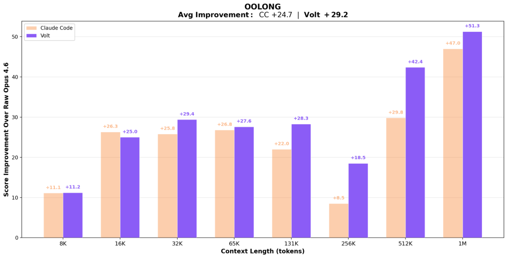

## LCM

v1 首次提交 2026-02-14 · [LCM: Lossless Context Management](https://arxiv.org/abs/2605.04050v1) · [PDF](https://arxiv.org/pdf/2605.04050v1)

LCM 将历史原文保存在不可变存储中，再用层次摘要 DAG 管理活跃上下文。压缩与并行分解由引擎执行；“无损”指原始状态仍可找回，不是摘要本身没有信息损失，也不保证智能体一定检索并正确使用原文。

OOLONG 的 trec_coarse 比较中，Volt 与 Claude Code 均使用 Opus 4.6，并均可调用 Haiku 4.5 辅助分类。作者报告 Volt 在 32K—1M 各测试长度胜出。图 1 纵轴是相对裸 Opus 4.6 的分数改善，并非绝对正确率；8K 的图示与正文数值存在差异，这里不合并为一个结论。论文也讨论数据污染与去污染边界，不能把静态基准表现当作长期任务可靠性的保证。

原图：Clint Ehrlich、Theodore Blackman，arXiv:2605.04050v1，Figure 1，第 2 页。[论文来源](https://arxiv.org/pdf/2605.04050v1#page=2) · [CC BY 4.0](https://creativecommons.org/licenses/by/4.0/)。已裁剪完整图形及必要标注，移除周围正文，图内内容和颜色未改动。此图沿用 CC BY 4.0，本站页脚许可不为其增加非商业或相同方式共享限制。

## ICL 的因果干预

v1 首次提交 2026-04-10 · [Single-Position Intervention Fails: Distributed Output Templates Drive In-Context Learning](https://arxiv.org/abs/2605.04061v1) · [PDF](https://arxiv.org/pdf/2605.04061v1)

在线性探针能 100% 识别任务的位置，替换单一 token 激活仍可能不起作用。Llama-3.2-3B 的 28 层实验中，单位置干预的任务迁移率为 0%；同时替换全部示范输出 token 时，第 8 层最高达到 96%，N=50，95% 置信区间为 87%—99%。

结果区分了可读出的信息与能驱动行为的信息。跨四模型实验支持分布式输出模板解释，但任务范围和干预方式有限，不能据此穷尽所有上下文学习机制。

## 医学 VQA 过程监督

v1 首次提交 2026-04-10 · [Improving Medical VQA through Trajectory-Aware Process Supervision](https://arxiv.org/abs/2605.04064v1) · [PDF](https://arxiv.org/pdf/2605.04064v1)

作者使用自动生成、模型核验的推理轨迹，先做监督微调，再结合 GRPO、答案奖励与基于句向量及动态时间规整的过程奖励。主实验为 Qwen2.5-VL-3B、LoRA rank 16、两张 H100。

六基准平均准确率从 SFT 的 0.598 到完整奖励的 0.689，BERTScore 从 0.845 到 0.881。若只隔离增加过程奖励的变化，应比较已有格式与答案奖励的 0.659 到 0.689，而不能将全部增益归因于 DTW。自动轨迹不等于专家逐步标注，这些分数也不是临床验证。

## 同期其他论文入口

- [Ontology Learning with LLMs: A Benchmark Study on Axiom Identification](https://arxiv.org/abs/2512.05594v1) · v1 首次提交 2025-12-05。
- [Retrieval-Augmented Generation of Ontologies from Relational Databases](https://arxiv.org/abs/2506.01232v1) · v1 首次提交 2025-06-02。
- [Free Energy-Driven Reinforcement Learning with Adaptive Advantage Shaping for Unsupervised Reasoning in LLMs](https://arxiv.org/abs/2605.04065v1) · v1 首次提交 2026-04-11。
- [Toward Human-AI Complementarity Across Diverse Tasks](https://arxiv.org/abs/2605.04070v1) · v1 首次提交 2026-04-13。
- [Structured Progressive Knowledge Activation for LLM-Driven Neural Architecture Search](https://arxiv.org/abs/2605.04057v1) · v1 首次提交 2026-04-10。

文中实验结果为论文作者报告，未独立复现。
