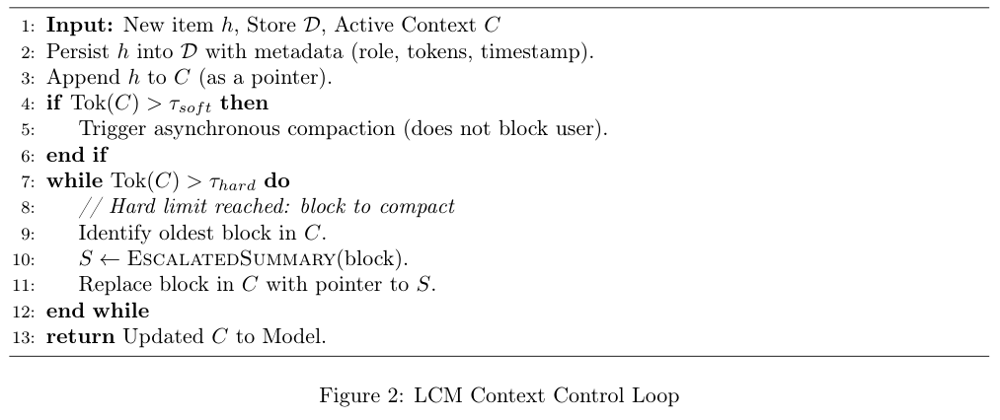
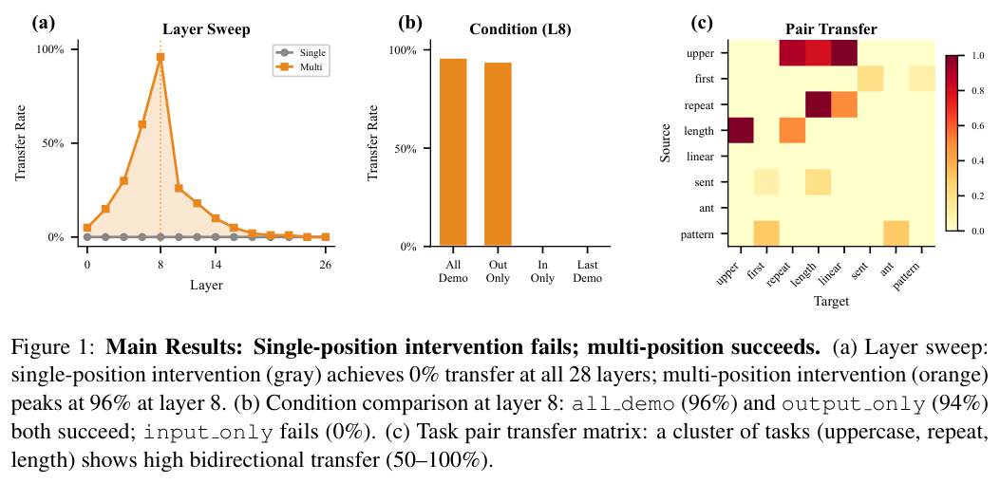
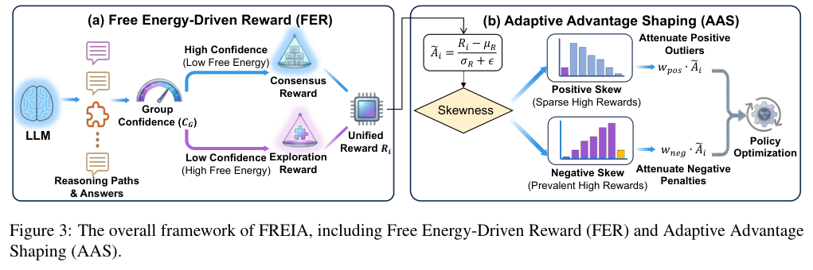
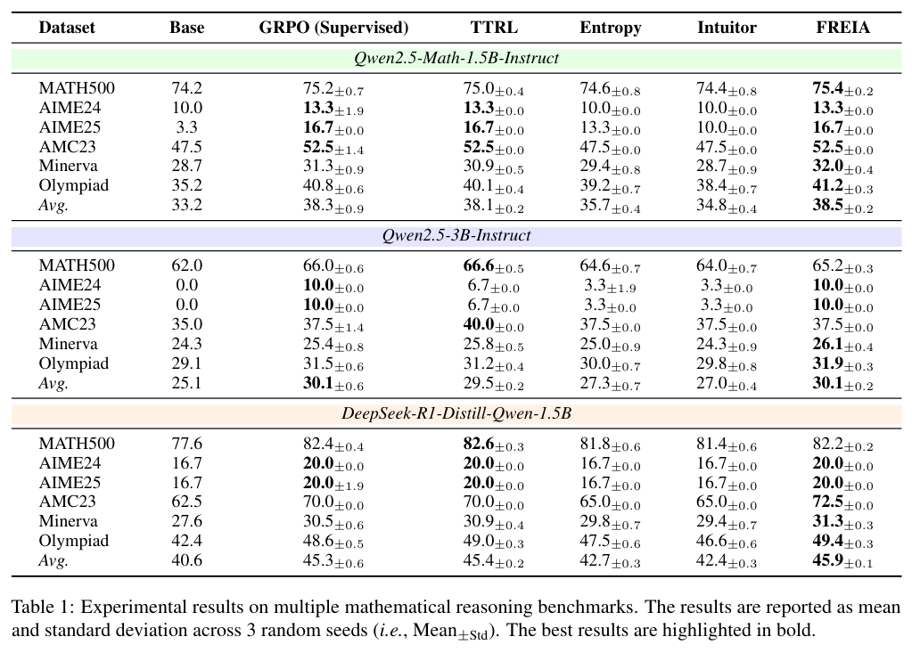
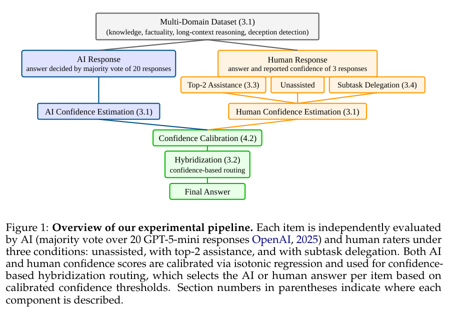
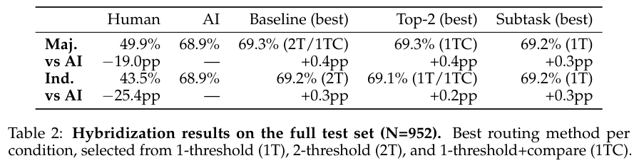

本期八项研究从本体公理识别与数据库建模出发，讨论长上下文、因果干预、无标注强化学习、人机协作和架构搜索，比较它们各自改善的环节。

## 1. OntoAxiom：把本体学习拆到具体公理

OntoAxiom 将本体学习的目标落到子类、互斥、子属性、定义域和值域五类公理。基准包含九个本体、17,118 个三元组和 2,771 条公理，比较十二个语言模型、三种示例数量，以及一次询问全部公理和逐条询问公理的两种提示方式。

逐条询问的 AbA 方法总体取得更高 F1，但领域差异明显：子类公理在 FOAF 上的报告分数为 0.642，在音乐本体上为 0.218。模型能生成合理术语，并不等于能恢复其逻辑关系；这些候选更适合交给本体工程师筛选，而不能直接当作完整、正确的自动建模结果。

[Ontology Learning with LLMs: A Benchmark Study on Axiom Identification](https://arxiv.org/abs/2512.05594v1) · v1。

[Figure 1（原文）](https://arxiv.org/pdf/2512.05594v1#page=3)。

## 2. RIGOR：沿数据库关系逐步扩展本体

RIGOR 沿外键关系逐表处理数据库，把 schema、文档、外部本体库和正在增长的核心本体一起检索给生成模型。每次只产生一份带来源的本体增量，由 judge 模型检查和修订，再合入核心本体，减少各表独立生成时的概念重复与关系断裂。

实验使用一个 18 表的肝癌登记数据库和一个 32 表的 ICU 数据库。Llama 3.1 在两者上的六维平均 CQ 评分分别从基线 1.5、1.6 提高到 4.5、4.6（满分 5）；生成结果也通过了 OWL 2 DL 解析和 HermiT 一致性检查。CQ 分数来自模型评审，一致性也不等于事实正确；OOPS! 仍发现多重定义域或值域、未声明等价和未分类实体等待修问题。

[Retrieval-Augmented Generation of Ontologies from Relational Databases](https://arxiv.org/abs/2506.01232v1) · v1。

[Figure 1（原文）](https://arxiv.org/pdf/2506.01232v1#page=2)。

## 3. LCM

v1 首次提交 2026-02-14 · [LCM: Lossless Context Management](https://arxiv.org/abs/2605.04050v1) · [PDF](https://arxiv.org/pdf/2605.04050v1)

LCM 将历史原文保存在不可变存储中，再用层次摘要 DAG 管理活跃上下文。压缩与并行分解由引擎执行；“无损”指原始状态仍可找回，不是摘要本身没有信息损失，也不保证智能体一定检索并正确使用原文。

OOLONG 的 trec_coarse 比较中，Volt 与 Claude Code 均使用 Opus 4.6，并均可调用 Haiku 4.5 辅助分类。作者报告 Volt 在 32K—1M 各测试长度胜出。图 1 纵轴是相对裸 Opus 4.6 的分数改善，并非绝对正确率；8K 的图示与正文数值存在差异，这里不合并为一个结论。论文也讨论数据污染与去污染边界，不能把静态基准表现当作长期任务可靠性的保证。

原图：Clint Ehrlich、Theodore Blackman，arXiv:2605.04050v1，Figure 1，第 2 页。[论文来源](https://arxiv.org/pdf/2605.04050v1#page=2) · [CC BY 4.0](https://creativecommons.org/licenses/by/4.0/)。裁剪自原文。

*图｜Ehrlich, Clint 等，[Figure 2（PDF 第 3 页）](https://arxiv.org/pdf/2605.04050v1#page=3)，[CC BY 4.0](http://creativecommons.org/licenses/by/4.0/)。裁剪自原文。*

## 4. ICL 的因果干预

v1 首次提交 2026-04-10 · [Single-Position Intervention Fails: Distributed Output Templates Drive In-Context Learning](https://arxiv.org/abs/2605.04061v1) · [PDF](https://arxiv.org/pdf/2605.04061v1)

在线性探针能 100% 识别任务的位置，替换单一 token 激活仍可能不起作用。Llama-3.2-3B 的 28 层实验中，单位置干预的任务迁移率为 0%；同时替换全部示范输出 token 时，第 8 层最高达到 96%，N=50，95% 置信区间为 87%—99%。

结果区分了可读出的信息与能驱动行为的信息。跨四模型实验支持分布式输出模板解释，但任务范围和干预方式有限，不能据此穷尽所有上下文学习机制。

*图｜Cheng, Bryan 等，[Figure 1（PDF 第 5 页）](https://arxiv.org/pdf/2605.04061v1#page=5)，[CC BY 4.0](http://creativecommons.org/licenses/by/4.0/)。裁剪自原文。*

## 5. FREIA：让无标注 RL 的奖励随模型状态调整

FREIA 用自由能驱动奖励平衡答案共识与探索，再按采样奖励的分布调整优势信号。弱共识时避免对少数偶然高分样本过度更新，较强共识时再利用一致性信号；目标是在没有标准答案奖励时，让训练信号适应模型正在变化的能力。

*图｜Huang, Yiming 等，[Figure 3（PDF 第 4 页）](https://arxiv.org/pdf/2605.04065v1#page=4)，[CC BY 4.0](http://creativecommons.org/licenses/by/4.0/)。裁剪自原文。*

三随机种子的六项数学基准中，DeepSeek-R1-Distill-Qwen-1.5B 的平均 Pass@1 为 45.9±0.1，TTRL 为 45.4±0.2，基础模型为 40.6；但 MATH500 单项为 82.2，略低于 TTRL 的 82.6。实验固定 400 步、每题八条 rollout 等条件，平均收益没有消除单任务差异，共识本身也不是外部正确性证明。

*图｜Huang, Yiming 等，[Table 1（PDF 第 6 页）](https://arxiv.org/pdf/2605.04065v1#page=6)，[CC BY 4.0](http://creativecommons.org/licenses/by/4.0/)。裁剪自原文。*

[Free Energy-Driven Reinforcement Learning with Adaptive Advantage Shaping for Unsupervised Reasoning in LLMs](https://arxiv.org/abs/2605.04065v1) · v1。

## 6. 人机互补：关键在于把错误交给谁

这项研究比较按置信度在人与模型之间路由、提供前两个候选答案，以及让人处理子任务三种协作方式。总数据覆盖知识、事实性、长上下文和欺骗检测；路由实验将置信度校准与最终测试分开，观察人的判断能否补上模型的错误。

*图｜Xu, Yuzheng 等，[Figure 1（PDF 第 2 页）](https://arxiv.org/pdf/2605.04070v1#page=2)，[CC BY 4.0](http://creativecommons.org/licenses/by/4.0/)。裁剪自原文。*

排除 SimpleQA 后的 952 项测试中，GPT-5-mini 为 68.9%，最佳多数投票混合方案为 69.3%，只增加 0.4 个百分点。在低置信度的 122 项测试子集，前二候选辅助将人的准确率从 28.4% 提到 38.3%，模型单独为 37.7%。收益主要来自采纳正确建议，对模型错误的纠正仍弱；找准何时转交给人，比单纯增加人工参与更重要。

*图｜Xu, Yuzheng 等，[Table 2（PDF 第 8 页）](https://arxiv.org/pdf/2605.04070v1#page=8)，[CC BY 4.0](http://creativecommons.org/licenses/by/4.0/)。裁剪自原文。*

[Toward Human-AI Complementarity Across Diverse Tasks](https://arxiv.org/abs/2605.04070v1) · v1。

## 7. SPARK：先选择要改的架构因素，再生成代码

SPARK 将架构演化分成“改哪里”和“怎样改”：先选择算子定义或动作组合等功能因素，再让 LLM 在选定范围内修改代码。它用这个约束减少局部修改牵连其他模块的情况，提高候选架构可执行、可评估的比例。

在相同 100 次提案预算的 CLRS 搜索中，SPARK 的十项 OOD 准确率平均为 83.92%，CLRS 参考为 71.22%、OpenEvolve 为 68.30%；DFS 单项为 83.74%。这些结果针对算法推理架构的搜索和分布外测试，不能把摘要中的 28.1 倍样本效率直接解释成端到端时间加速，也不表示每次代码修改都能带来收益。

[Structured Progressive Knowledge Activation for LLM-Driven Neural Architecture Search](https://arxiv.org/abs/2605.04057v1) · v1。

[Figure 1（原文）](https://arxiv.org/pdf/2605.04057v1#page=1)。

## 8. 医学 VQA 过程监督

v1 首次提交 2026-04-10 · [Improving Medical VQA through Trajectory-Aware Process Supervision](https://arxiv.org/abs/2605.04064v1) · [PDF](https://arxiv.org/pdf/2605.04064v1)

作者使用自动生成、模型核验的推理轨迹，先做监督微调，再结合 GRPO、答案奖励与基于句向量及动态时间规整的过程奖励。主实验为 Qwen2.5-VL-3B、LoRA rank 16、两张 H100。

六基准平均准确率从 SFT 的 0.598 到完整奖励的 0.689，BERTScore 从 0.845 到 0.881。若只隔离增加过程奖励的变化，应比较已有格式与答案奖励的 0.659 到 0.689，而不能将全部增益归因于 DTW。自动轨迹不等于专家逐步标注，这些分数也不是临床验证。
