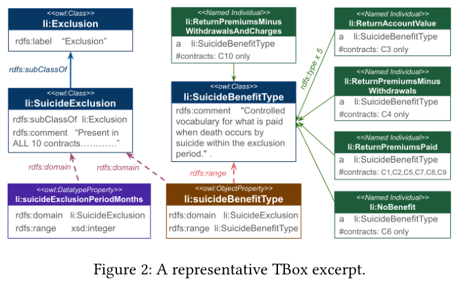
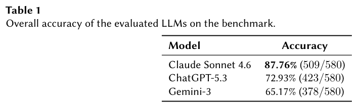
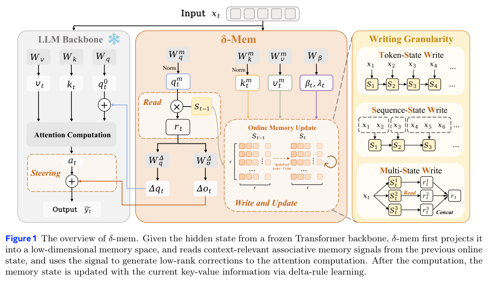
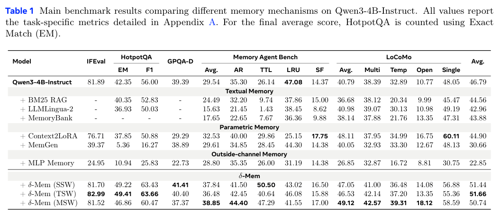
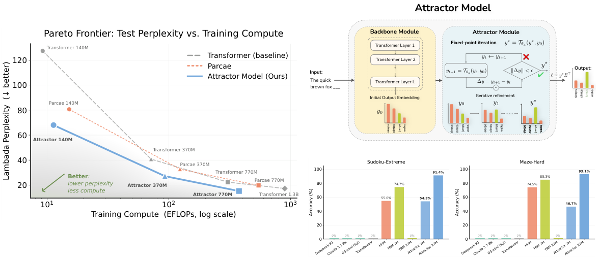
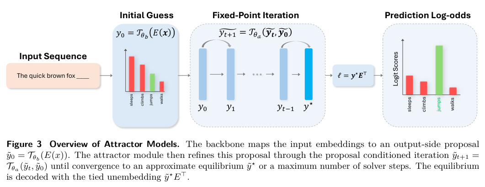
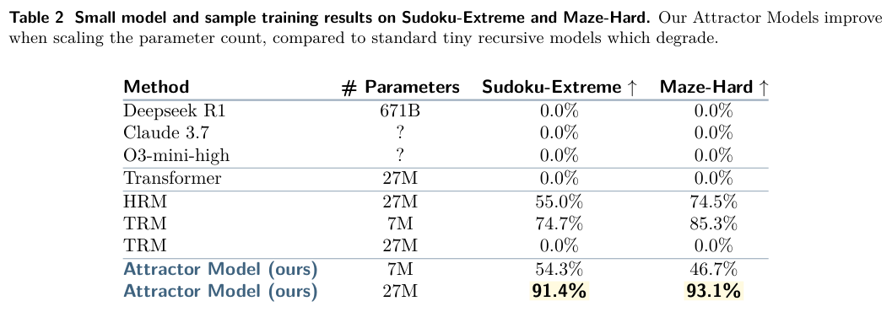

本期七项研究从知识图谱的场景覆盖检验，延伸到视频生成、机器人重规划、在线记忆和固定点推理，分别考察质量、延迟与泛化。

## 1. 缺口与重叠分析：按实际问题检验知识图谱

这个基准把十份经过领域专家审阅的简化人寿保险合同、领域本体和 58 个场景连起来，为每个场景提供 SPARQL 查询、合同层标签与条款证据。它区分有覆盖、被拒绝和不适用，用具体任务检验图谱是否保留了真正影响判断的约束。

*图｜Mridul, Maruf Ahmed 等，[Figure 2（PDF 第 7 页）](https://arxiv.org/pdf/2604.10853v1#page=7)，[CC BY 4.0](http://creativecommons.org/licenses/by/4.0/)。裁剪自原文。*

580 个合同—场景组合中，文本 LLM 的准确率分别为 Claude Sonnet 4.6 的 87.76%、ChatGPT-5.3 的 72.93% 和 Gemini-3 的 65.17%。常见错误是把“没有适用条款”直接判断成“拒绝”，说明标签区分和证据定位比文本相似度更关键。结论限于这组简化合同与预先定义的解释规则，不代表真实保险争议的法律判定。

*图｜Mridul, Maruf Ahmed 等，[Table 1（PDF 第 11 页）](https://arxiv.org/pdf/2604.10853v1#page=11)，[CC BY 4.0](http://creativecommons.org/licenses/by/4.0/)。裁剪自原文。*

[A Benchmark for Gap and Overlap Analysis as a Test of KG Task Readiness](https://arxiv.org/abs/2604.10853v1) · v1。

## 2. AnyFlow：让视频蒸馏保留增加步数的收益

AnyFlow 把蒸馏目标从某个噪声状态直接映射到终点，改成任意时间区间上的 flow-map 转移，并通过分解 Euler rollout 的反向模拟做 on-policy 蒸馏。这样既要改善少步采样的离散误差，也要减少因果生成中模型使用自己历史输出造成的偏移。

作者在 1.3B 到 14B、双向和因果视频架构上比较，少步质量可以匹敌或超过一致性蒸馏对照，增加采样步数后仍能继续改善。收益针对论文给出的架构与采样配置；“任意步数”描述采样预算的适配方式，不表示任意视频任务都获得相同加速或质量。

[AnyFlow: Any-Step Video Diffusion Model with On-Policy Flow Map Distillation](https://arxiv.org/abs/2605.13724v1) · v1。

[Figure 1（原文）](https://arxiv.org/pdf/2605.13724v1#page=2)。

## 3. Realtime-VLA FLASH

v1 首次提交 2026-05-13 · [Realtime-VLA FLASH: Speculative Inference Framework for Diffusion-based VLAs](https://arxiv.org/abs/2605.13778v1) · [PDF](https://arxiv.org/pdf/2605.13778v1)

轻量草稿模型提出动作块，主模型并行验证一致前缀，必要时按任务阶段回退到完整推理。线上推理使用单张 RTX 4090D、动作块 50、每执行 12 个动作重规划；LIBERO 四套任务各含 10 任务，每任务 50 次。

表 1 的 3.04 倍来自 **FLASH 加 Triton 优化**：任务平均延迟 58.0 毫秒降至 19.1 毫秒，平均成功率 94.1% 到 93.8%。仅 FLASH 为 34.9 毫秒、1.66 倍，不能把组合收益全部归于草稿验证。最快单轮 7.8 毫秒也不同于任务平均。作者另做真实传送带分拣实验。

## 4. δ-mem

v1 首次提交 2026-05-12 · [$δ$-mem: Efficient Online Memory for Large Language Models](https://arxiv.org/abs/2605.12357v1) · [PDF](https://arxiv.org/pdf/2605.12357v1)

δ-mem 在冻结的全注意力主干旁加入固定大小联想记忆，用 delta 规则更新状态，再以低秩修正影响注意力。主比较使用相同 Qwen3-4B-Instruct，LoCoMo 排除对抗问题类。

作者报告仅 8×8 在线状态即可将平均分提高到主干的 1.10 倍、最强非 δ-mem 记忆基线的 1.15 倍；MemoryAgentBench 和 LoCoMo 分别为主干的 1.31、1.20 倍。这些是相对分数倍数，不能改写为同量的绝对准确率增加，且不代表所有历史信息均被无损保存。

*图｜Lei, Jingdi 等，[Figure 1（PDF 第 4 页）](https://arxiv.org/pdf/2605.12357v1#page=4)，[CC BY 4.0](http://creativecommons.org/licenses/by/4.0/)。裁剪自原文。*

*图｜Lei, Jingdi 等，[Table 1（PDF 第 7 页）](https://arxiv.org/pdf/2605.12357v1#page=7)，[CC BY 4.0](http://creativecommons.org/licenses/by/4.0/)。裁剪自原文。*

## 5. Attractor Models

v1 首次提交 2026-05-12 · [Solve the Loop: Attractor Models for Language and Reasoning](https://arxiv.org/abs/2605.12466v1) · [PDF](https://arxiv.org/pdf/2605.12466v1)

语言建模设置中，主干先提出输出嵌入，吸引子模块求解固定点，并以隐式梯度训练；推理迭代按收敛调整。表 1 中，770M 模型在 Lambada 困惑度与 Core 平均分上优于用两倍 token 训练的 1.3B Transformer，但并非所有列都更好：验证困惑度和 Core-Ext 仍有差距。

另一个小模型推理设置使用每任务约 1,000 个训练样本，27M 模型在 Sudoku-Extreme、Maze-Hard 达到 91.4%、93.1%。该设置采用完整网格输出及深监督，内部结构与语言建模设置不同；不能概括为小模型已经全面超过通用大模型。

原图：Jacob Fein-Ashley、Paria Rashidinejad，arXiv:2605.12466v1，Figure 1，第 1 页。[论文来源](https://arxiv.org/pdf/2605.12466v1#page=1) · [CC BY 4.0](https://creativecommons.org/licenses/by/4.0/)。裁剪自原文。

*图｜Fein-Ashley, Jacob 等，[Figure 3（PDF 第 5 页）](https://arxiv.org/pdf/2605.12466v1#page=5)，[CC BY 4.0](http://creativecommons.org/licenses/by/4.0/)。裁剪自原文。*

*图｜Fein-Ashley, Jacob 等，[Table 2（PDF 第 9 页）](https://arxiv.org/pdf/2605.12466v1#page=9)，[CC BY 4.0](http://creativecommons.org/licenses/by/4.0/)。裁剪自原文。*

## 6. On-Policy 蒸馏：先辨别特权信息到底能不能被学生保留

这项研究把 OPD 与自蒸馏 OPSD 的教师、损失和特权信息条件拆开，检查学生自己的前缀如何改变教师分布，以及截断 TopK 反向 KL 的有偏梯度如何造成不稳定。修正方向包括 stop-gradient TopK 目标、经过 RLVR 适配的教师和先用 SFT 稳定学生。

数学任务中，OPD 对教师和损失高度敏感；逐题答案或解题信息作为特权输入时，论文测试的 OPSD 设置未能稳定改善学生。相比之下，共享的系统规则和偏好可以有效内化，CharacterBench、EmotionBench 等实验显示了这种任务差异。特权信息在测试时是否仍可用、是否对应可共享规则，是解释收益与失败的关键。

[The Many Faces of On-Policy Distillation: Pitfalls, Mechanisms, and Fixes](https://arxiv.org/abs/2605.11182v1) · v1。

[Figure 1（原文）](https://arxiv.org/pdf/2605.11182v1#page=2)。

## 7. World Action Models：把预测状态与动作联合起来看

这篇综述把 World Action Models 定义为同时组织未来状态和动作的具身模型，并区分级联与联合两种路线。级联方法可以先生成视觉计划再恢复动作；联合方法则让状态和动作在共同模型中相互约束，进一步按生成模态、条件注入和动作解码方式细分。

文章梳理机器人遥操作、人类示范、仿真和互联网第一视角数据，以及视觉保真、物理常识、动作可行性三类评估。它提供研究分类与比较框架，没有一个新策略的统一成功率；生成的未来看起来合理与动作能在真实接触中稳定执行，仍是不同的验收目标。

[World Action Models: The Next Frontier in Embodied AI](https://arxiv.org/abs/2605.12090v1) · v1。

[Figure 1（原文）](https://arxiv.org/pdf/2605.12090v1#page=2)。
