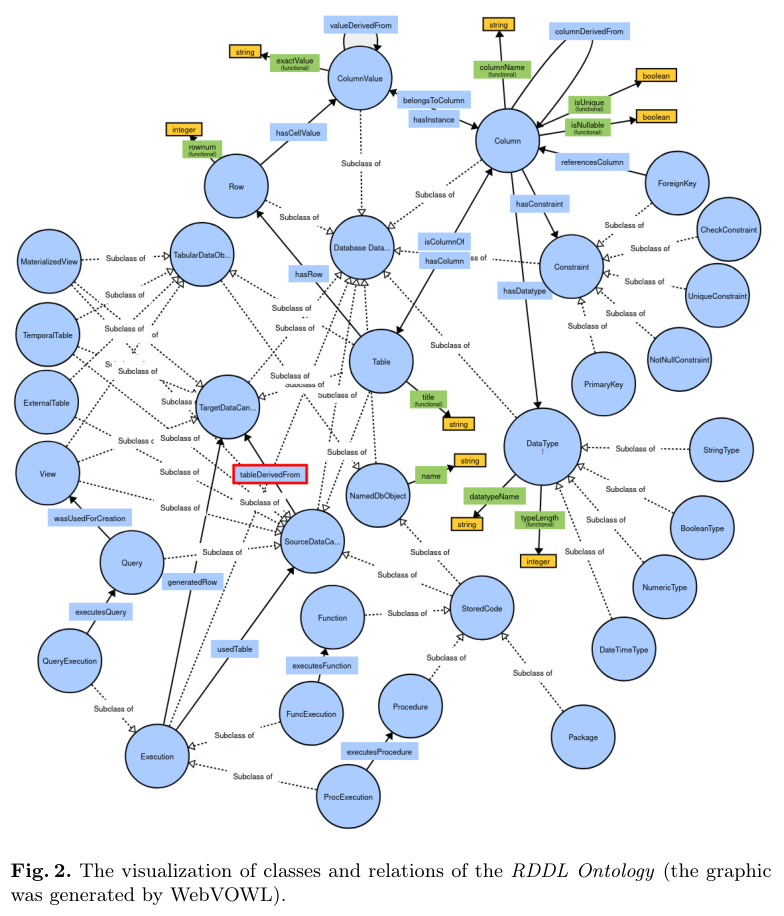
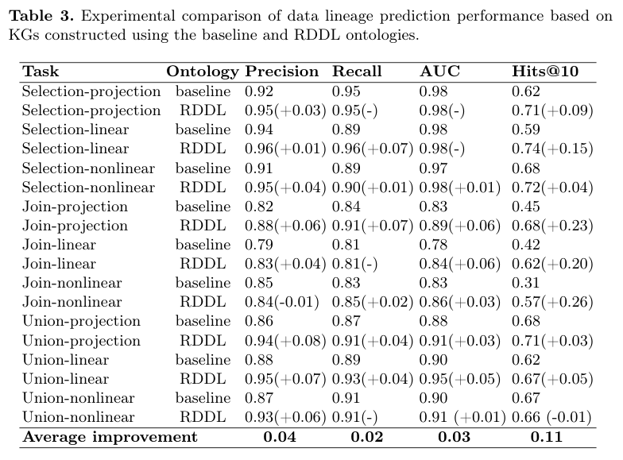
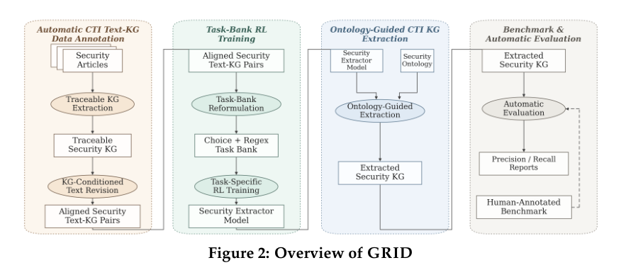
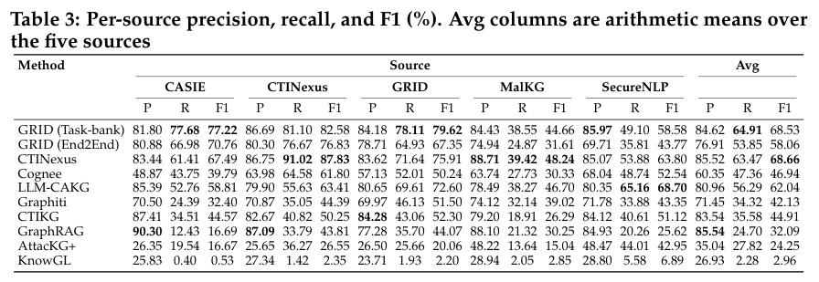
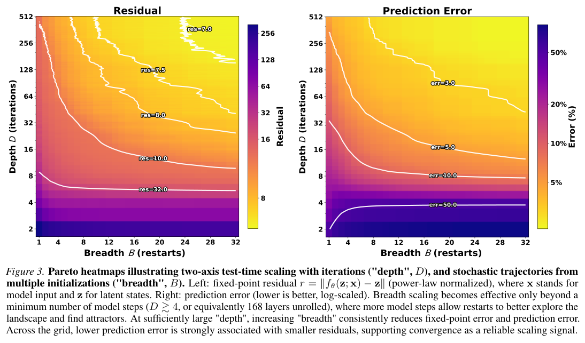
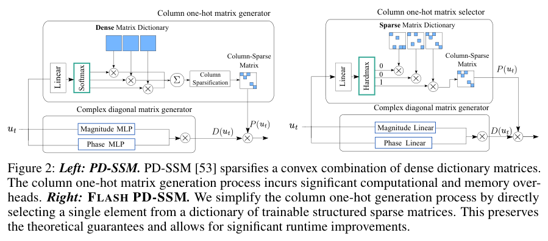
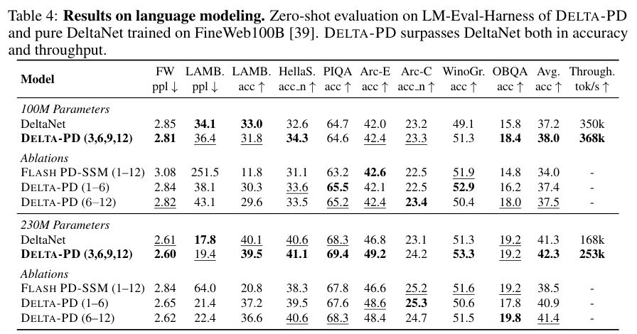
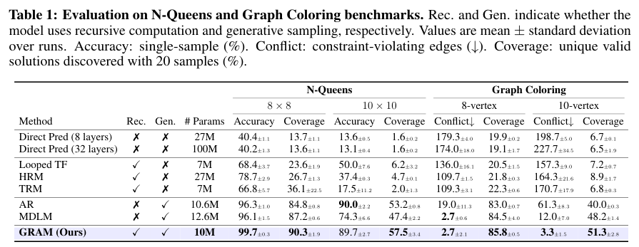
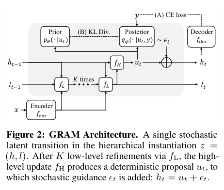
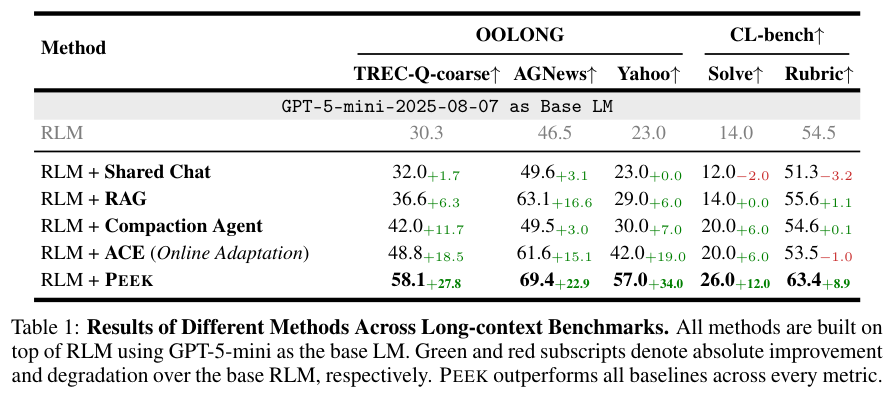

本期九项研究围绕知识怎样积累和推理怎样展开：从数据库血缘、安全文本建图与上下文地图，到稀疏状态模型、事件解释、递归采样和工具环境训练。

## 1. RDDL：用更丰富的语义恢复数据库血缘

RDDL 本体不仅记录数据库对象，还表达结构、语义与转换特征，让缺失的行级血缘连接可以作为图上的链接预测问题处理。模型从源、目标之间采样路径并编码，比较原有本体与扩展本体是否提供了更有用的血缘证据。

*图｜Dutkiewicz, Jakub 等，[Figure 2（PDF 第 5 页）](https://arxiv.org/pdf/2605.16068v1#page=5)，[CC BY 4.0](http://creativecommons.org/licenses/by/4.0/)。裁剪自原文。*

在 17 个转换场景训练、三个场景测试的设置中，join-projection 的 PR-AUC 从 0.83 到 0.89，Hits@10 从 0.45 到 0.68；九类任务平均分别提高 0.03 和 0.11。并非每项都提高，union-nonlinear 的 Hits@10 从 0.67 降到 0.66。结果依赖所构造的场景、采样路径和负样本集合，不等于能恢复任意生产数据库的全部真实依赖。

*图｜Dutkiewicz, Jakub 等，[Table 3（PDF 第 12 页）](https://arxiv.org/pdf/2605.16068v1#page=12)，[CC BY 4.0](http://creativecommons.org/licenses/by/4.0/)。裁剪自原文。*

[Relational Database Data Lineage Ontology](https://arxiv.org/abs/2605.16068v1) · v1。

## 2. RAGA

v1 首次提交 2026-05-16 · [RAGA: Reading-And-Graph-building-Agent for Autonomous Knowledge Graph Construction and Retrieval-Augmented Generation](https://arxiv.org/abs/2605.17072v1) · [PDF](https://arxiv.org/pdf/2605.17072v1)

RAGA 将阅读、搜索、核验、建图放进 ReAct 循环，以原子工具管理图谱增删改查，并同步图检索与向量检索。知识条目与原始文本证据相连，使追溯成为建图流程的一部分。

论文在 QASPER 科学问答子集做初步实验，融合检索优于零样本比较。在小批量 QASPER 子集的 C1200 配置中，作者报告融合检索的 Answer F1 为 61.5%，无图对照为 55.4%；Evidence F1 为 41.1%，仍低于 GraphRAG 的 47.2%。证据链接改善可审计性，但来源本身是否正确、抽取是否失真仍需检查。

## 3. GRID：把安全文本建图训练成可重复判分的任务

GRID 先对齐威胁情报文章与图谱，再把文档到图的学习拆成多选题和三元组正则匹配任务，为训练提供可离线复用的奖励。与每次都让 LLM 评判完整图相比，这种任务库把一部分判分条件写成脚本，再由本体引导的抽取流程生成最终知识图谱。

*图｜Huang, Liangyi 等，[Figure 2（PDF 第 4 页）](https://arxiv.org/pdf/2605.16714v1#page=4)，[CC BY 4.0](http://creativecommons.org/licenses/by/4.0/)。裁剪自原文。*

在五个来源的 249 篇文章上，4B Task-bank 模型的来源平均精确率、召回率、F1 为 84.62%、64.91%、68.53%；End2End 奖励模型的平均 F1 为 58.06%。CTINexus 的平均 F1 为 68.66%，仍略高于 GRID，因此主要优势不能概括为所有指标第一。测试语义判分使用经人工校准的模型 judge，平均 F1 是五个来源 F1 的算术平均。

*图｜Huang, Liangyi 等，[Table 3（PDF 第 7 页）](https://arxiv.org/pdf/2605.16714v1#page=7)，[CC BY 4.0](http://creativecommons.org/licenses/by/4.0/)。裁剪自原文。*

[GRID: Graph Representation of Intelligence Data for Security Text Knowledge Graph Construction](https://arxiv.org/abs/2605.16714v1) · v1。

## 4. EqR

v1 首次提交 2026-05-20 · [Equilibrium Reasoners: Learning Attractors Enables Scalable Reasoning](https://arxiv.org/abs/2605.21488v1) · [PDF](https://arxiv.org/pdf/2605.21488v1)

Equilibrium Reasoners 将迭代推理视为朝任务相关吸引子收敛，同时沿深度增加迭代、沿宽度汇聚随机初始轨迹。简单案例可在 1—5 步收敛。

Sudoku-Extreme 实验中，训练最多 16 次迭代，测试可扩到超过 1,024 次，相当于最多约 40,000 个有效层；再结合随机初始化的宽度扩展，作者报告从前馈基线 2.6% 到 99% 以上。高准确率依赖特定任务及庞大测试预算，不能只保留最终数字；等效层数也不表示训练了一个 40,000 层独立参数网络。

*图｜Huang, Benhao 等，[Figure 3（PDF 第 3 页）](https://arxiv.org/pdf/2605.21488v1#page=3)，[CC BY 4.0](http://creativecommons.org/licenses/by/4.0/)。裁剪自原文。*

## 5. Flash PD-SSM：在稀疏状态转移中保留更强表达能力

Flash PD-SSM 维护一组可训练的结构化稀疏转移矩阵，每个时间步离散选择一个，减少原 PD-SSM 矩阵组合与生成过程中的内存开销。它把有限状态机表达能力与高效实现结合，并进一步与 DeltaNet 混合，检验这种结构能否进入语言模型。

*图｜Terzić, Aleksandar 等，[Figure 2（PDF 第 4 页）](https://arxiv.org/pdf/2605.19150v1#page=4)，[CC BY 4.0](http://creativecommons.org/licenses/by/4.0/)。裁剪自原文。*

五个随机种子的状态跟踪实验的四任务平均为 96.3±1.8%，高于 Mamba2 的 58.9±1.8%，但低于原 PD-SSM 的 98.8±0.9%。230M 参数语言模型中，DELTA-PD 的平均下游准确率为 42.3%，纯 DeltaNet 为 41.3%；LAMBADA 困惑度却从 17.8 变为 19.4。更快、更省内存的结构选择仍有任务间取舍，有限状态机表达保证也不等于任意语言任务都更强。

*图｜Terzić, Aleksandar 等，[Table 4（PDF 第 9 页）](https://arxiv.org/pdf/2605.19150v1#page=9)，[CC BY 4.0](http://creativecommons.org/licenses/by/4.0/)。裁剪自原文。*

[Flash PD-SSM: Memory-Optimized Structured Sparse State-Space Models](https://arxiv.org/abs/2605.19150v1) · v1。

## 6. 事件锚定 SAE：用闭环动作检验特征是否有因果作用

这项可解释性方法先从机器人轨迹提取末端执行器关键帧，再按视觉、状态和时间线索聚成任务内事件，用事件与稀疏自编码器特征的对应来排序。可选的 VLM 标注帮助解释事件含义，真正的验证则是干预特征后重新运行机器人策略。

OpenVLA 第 31 层中，将事件对齐排名选出的特征逐个置零后，平均成功率从 70.0% 降到 48.8%，随机活跃特征对照为 68.7%。较大下降用于说明找到了行为相关特征，并不是提高控制性能；在 π0.5 动作专家中，多种排名的强置零都会使表现崩溃，表明解释和干预效果依赖架构、位置及强度。

[Event-Grounded Sparse Autoencoders for Vision-Language-Action Policies](https://arxiv.org/abs/2605.17204v1) · v1。

[Figure 1（原文）](https://arxiv.org/pdf/2605.17204v1#page=3)。

## 7. GRAM：让递归潜在推理保留多条可能路径

GRAM 把确定性的潜在状态更新改为随机轨迹，用变分训练学习多种假设与解题路径。推理时既可增加递归深度，也可并行采样轨迹；同一框架还能在固定或无输入时做无条件生成，连接结构化推理与生成建模。

*图｜Baek, Junyeob 等，[Table 1（PDF 第 8 页）](https://arxiv.org/pdf/2605.19376v1#page=8)，[CC BY 4.0](http://creativecommons.org/licenses/by/4.0/)。裁剪自原文。*

8×8 N-Queens 上，单样本准确率为 99.7±0.3%，20 次采样的有效解覆盖率为 90.3±1.9%；自回归对照分别为 96.3±1.0% 和 84.8±0.8%。到 10×10 时，GRAM 的单样本准确率为 89.7%，略低于自回归的 90.0%，覆盖率则为 57.5% 对 53.2%。准确率与多解覆盖衡量不同目标，不能把采样多个答案的收益全部算成单次推理能力。

*图｜Baek, Junyeob 等，[Figure 2（PDF 第 3 页）](https://arxiv.org/pdf/2605.19376v1#page=3)，[CC BY 4.0](http://creativecommons.org/licenses/by/4.0/)。裁剪自原文。*

[Generative Recursive Reasoning](https://arxiv.org/abs/2605.19376v1) · v1。

## 8. Peek

v1 首次提交 2026-05-19 · [PEEK: Context Map as an Orientation Cache for Long-Context LLM Agents](https://arxiv.org/abs/2605.19932v1) · [PDF](https://arxiv.org/pdf/2605.19932v1)

Peek 保存的是关于反复访问上下文的方向性知识：资料如何组织、有哪些实体与常用约定。Distiller 提炼信号，Cartographer 修改地图，Evictor 在固定 token 预算内淘汰条目。

用 GPT-5-mini 的表 1 中，TREC-Q-coarse 从基础 RLM 的 30.3 到 58.1；相对 ACE 的 48.8 是提高 9.3 个分数点。Yahoo 从 ACE 42.0 到 57.0，CL-bench solving rate 从 20.0% 到 26.0%。这些是不同指标，不应笼统写成相对提升 6.3%—34.0%。OOLONG 上较 ACE 少 93—145 次迭代，ACE 总成本为 Peek 的 1.7—5.8 倍，包含方法维护开销。优势针对重复访问相同上下文的工作负载，CL-bench 的迭代结论不能照搬。

原图：Zhuohan Gu、Qizheng Zhang、Omar Khattab、Samuel Madden，arXiv:2605.19932v1，Figure 1，第 1 页。[论文来源](https://arxiv.org/pdf/2605.19932v1#page=1) · [CC BY 4.0](https://creativecommons.org/licenses/by/4.0/)。裁剪自原文。

*图｜Gu, Zhuohan 等，[Table 1（PDF 第 7 页）](https://arxiv.org/pdf/2605.19932v1#page=7)，[CC BY 4.0](http://creativecommons.org/licenses/by/4.0/)。裁剪自原文。*

## 9. EnvFactory：从真实资源构造可执行工具环境

EnvFactory 自动搜索真实资源、实现并验证有状态工具环境，再根据工具调用拓扑采样任务，用校准与改写保留自然的隐含意图。训练数据不只是明确列出每一步操作，而要求 Agent 在多轮交互中推断目标、选择工具并维护状态。

85 个环境、七个领域产生 2,575 条 SFT 与 RL 训练轨迹。Qwen3-4B 的 BFCL 多轮成绩从基础模型 33.50 到 48.50；只做 SFT 为 44.25，后续 RL 又增加 4.25 个百分点。τ2-Bench 的平均分从 25.25 到 30.13，但单项和不同模型并不一致，环境数量更少也不直接证明总训练成本更低。

[EnvFactory: Scaling Tool-Use Agents via Executable Environments Synthesis and Robust RL](https://arxiv.org/abs/2605.18703v1) · v1。

[Figure 1（原文）](https://arxiv.org/pdf/2605.18703v1#page=3)。
