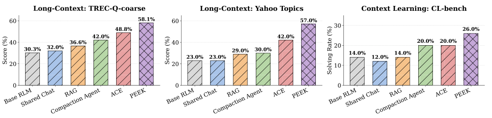

本文补录 **2026-05-21 的推荐日报清单**，于 2026-10-29 核对公开来源。推荐日期不等于提交或发表日期，以下固定引用 **v1**；实验数值为作者报告，本站未独立复现。

## EqR

v1 首次提交 2026-05-20 · [Equilibrium Reasoners: Learning Attractors Enables Scalable Reasoning](https://arxiv.org/abs/2605.21488v1) · [PDF](https://arxiv.org/pdf/2605.21488v1)

Equilibrium Reasoners 将迭代推理视为朝任务相关吸引子收敛，同时沿深度增加迭代、沿宽度汇聚随机初始轨迹。简单案例可在 1—5 步收敛。

Sudoku-Extreme 实验中，训练最多 16 次迭代，测试可扩到超过 1,024 次，相当于最多约 40,000 个有效层；再结合随机初始化的宽度扩展，作者报告从前馈基线 2.6% 到 99% 以上。高准确率依赖特定任务及庞大测试预算，不能只保留最终数字；等效层数也不表示训练了一个 40,000 层独立参数网络。

## Peek

v1 首次提交 2026-05-19 · [PEEK: Context Map as an Orientation Cache for Long-Context LLM Agents](https://arxiv.org/abs/2605.19932v1) · [PDF](https://arxiv.org/pdf/2605.19932v1)

Peek 保存的是关于反复访问上下文的方向性知识：资料如何组织、有哪些实体与常用约定。Distiller 提炼信号，Cartographer 修改地图，Evictor 在固定 token 预算内淘汰条目。

用 GPT-5-mini 的表 1 中，TREC-Q-coarse 从基础 RLM 的 30.3 到 58.1；相对 ACE 的 48.8 是提高 9.3 个分数点。Yahoo 从 ACE 42.0 到 57.0，CL-bench solving rate 从 20.0% 到 26.0%。这些是不同指标，不应笼统写成相对提升 6.3%—34.0%。OOLONG 上较 ACE 少 93—145 次迭代，ACE 总成本为 Peek 的 1.7—5.8 倍，包含方法维护开销。优势针对重复访问相同上下文的工作负载，CL-bench 的迭代结论不能照搬。

原图：Zhuohan Gu、Qizheng Zhang、Omar Khattab、Samuel Madden，arXiv:2605.19932v1，Figure 1，第 1 页。[论文来源](https://arxiv.org/pdf/2605.19932v1#page=1) · [CC BY 4.0](https://creativecommons.org/licenses/by/4.0/)。裁剪自原文。

## RAGA

v1 首次提交 2026-05-16 · [RAGA: Reading-And-Graph-building-Agent for Autonomous Knowledge Graph Construction and Retrieval-Augmented Generation](https://arxiv.org/abs/2605.17072v1) · [PDF](https://arxiv.org/pdf/2605.17072v1)

RAGA 将阅读、搜索、核验、建图放进 ReAct 循环，以原子工具管理图谱增删改查，并同步图检索与向量检索。知识条目与原始文本证据相连，使追溯成为建图流程的一部分。

论文在 QASPER 科学问答子集做初步实验，融合检索优于零样本比较。这里不把单一子集结果写成大规模可靠性验证，也不从摘要补造统一提升幅度。证据链接改善可审计性，但来源本身是否正确、抽取是否失真仍需检查。

## 同期其他论文入口

以下仅核对公开 v1 的题名、日期和链接，未逐篇复核全部实验。

- [Relational Database Data Lineage Ontology](https://arxiv.org/abs/2605.16068v1) · v1 首次提交 2026-05-15。
- [GRID: Graph Representation of Intelligence Data for Security Text Knowledge Graph Construction](https://arxiv.org/abs/2605.16714v1) · v1 首次提交 2026-05-15。
- [Flash PD-SSM: Memory-Optimized Structured Sparse State-Space Models](https://arxiv.org/abs/2605.19150v1) · v1 首次提交 2026-05-18。
- [Event-Grounded Sparse Autoencoders for Vision-Language-Action Policies](https://arxiv.org/abs/2605.17204v1) · v1 首次提交 2026-05-17。
- [Generative Recursive Reasoning](https://arxiv.org/abs/2605.19376v1) · v1 首次提交 2026-05-19。
- [EnvFactory: Scaling Tool-Use Agents via Executable Environments Synthesis and Robust RL](https://arxiv.org/abs/2605.18703v1) · v1 首次提交 2026-05-18。

**覆盖说明：**本期保留 9 篇已核验公开论文入口，详读其中 3 篇，其余仅列阅读链接。
