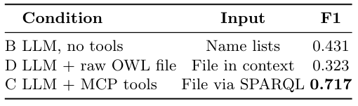

## 重点阅读

[Open Ontologies: Tool-Augmented Ontology Engineering with Stable Matching Alignment](https://arxiv.org/abs/2605.09184v1) · v1 提交 2026-05-09 · [全文](https://arxiv.org/html/2605.09184v1) · [PDF](https://arxiv.org/pdf/2605.09184v1)

大模型能生成 OWL，不代表它能可靠检查本体。Open Ontologies 将生成交给语言模型，把查询、规则推理与约束检查交给可执行工具；对齐再加入一对一匹配，减少一个概念被配到多个目标的情况。对工程系统而言，猜测与确定性操作应当分工。

在该论文采用的 OntoAxiom 设置中，9 个本体包含 3,042 条参考公理。同一 Claude Opus 4、默认温度、单次运行下，仅给名称列表的 F1 为 0.431，直接访问原始 OWL 文件为 0.323，通过 MCP/SPARQL 工具为 0.717。表 3 展示的是访问方式对照，不能外推为所有模型读 OWL 都更差。作者另说明，原文件条件由 Claude 子代理通过 Read 工具读取，并非严格控制的 API 提示词实验；这限制了因果归因。

Anatomy 对齐包含 2,737 个小鼠类、3,304 个人类类和 1,516 条参考映射，系统精确率 0.963、召回率 0.733、F1 0.832；Conference 轨道微平均 F1 则为 0.438。保守匹配减少误连，也漏掉低名称相似度的真匹配。这些是作者对公开参考映射的测量，尚未经过官方 OAEI campaign 独立评测，不能直接当作正式榜单结果。

我更看重它将模型生成、形式验证与来源记录接成可审查流程。工具访问可能减轻序列化解析负担，但推理器表达范围、输入信息差异与单次运行噪声都需要单独检查。软件 MIT 许可与下方论文表格的 CC BY 许可也应分别理解。

原表：Fabio Rovai，arXiv:2605.09184v1，Table 3，PDF 第 5 页。[原始来源](https://arxiv.org/pdf/2605.09184v1#page=5) · [CC BY 4.0](https://creativecommons.org/licenses/by/4.0/)。已裁剪完整表格或图形及必要标签，移除周围正文，内容和颜色未改动，未重绘。此材料沿用 CC BY 4.0，本站页脚许可不为其增加非商业或相同方式共享限制。

## 同期其他论文入口

- [Graph Query Generation with Constraint-guided Large Language Agents](https://arxiv.org/abs/2605.00845v1) · 2605.00845v1，该版本提交 2026-04-09。
- [LongTraceRL: Learning Long-Context Reasoning from Search Agent Trajectories with Rubric Rewards](https://arxiv.org/abs/2605.31584v1) · 2605.31584v1，该版本提交 2026-05-29。
- [Qwen-VLA: Unifying Vision-Language-Action Modeling across Tasks, Environments, and Robot Embodiments](https://arxiv.org/abs/2605.30280v2) · 2605.30280v2，该版本提交 2026-06-01。
- [Representation Forcing for Bottleneck-Free Unified Multimodal Models](https://arxiv.org/abs/2605.31604v1) · 2605.31604v1，该版本提交 2026-05-29。
- [VLM3: Vision Language Models Are Native 3D Learners](https://arxiv.org/abs/2605.30561v1) · 2605.30561v1，该版本提交 2026-05-28。
- [Scaling Laws for Agent Harnesses via Effective Feedback Compute](https://arxiv.org/abs/2605.29682v1) · 2605.29682v1，该版本提交 2026-05-28。
- [Déjà View: Looping Transformers for Multi-View 3D Reconstruction](https://arxiv.org/abs/2605.30215v2) · 2605.30215v2，该版本提交 2026-05-29。

文中实验结果为论文作者报告，未独立复现。
