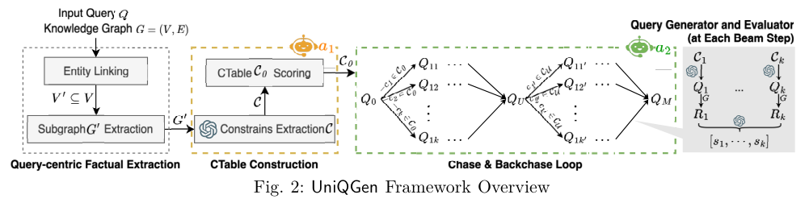
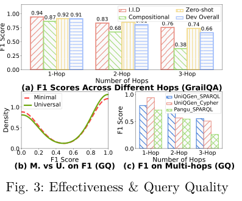
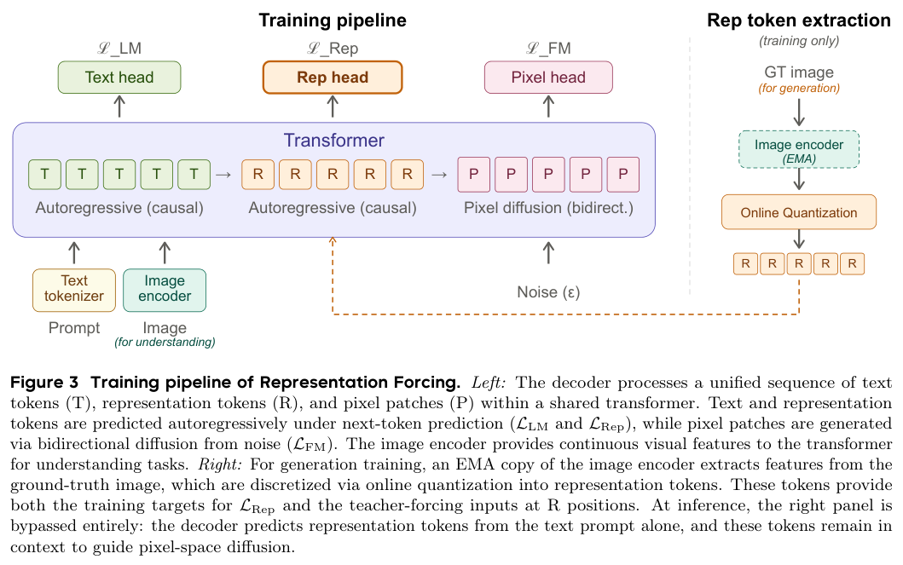
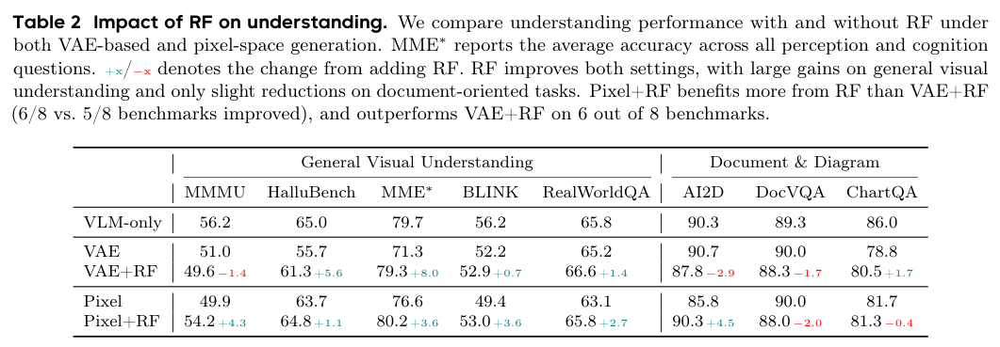
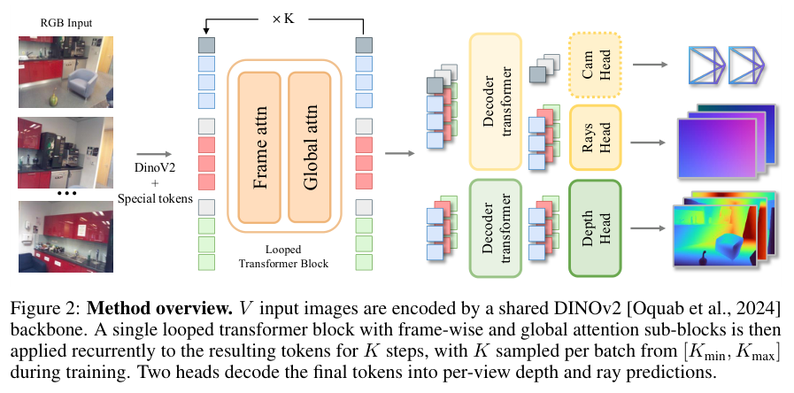
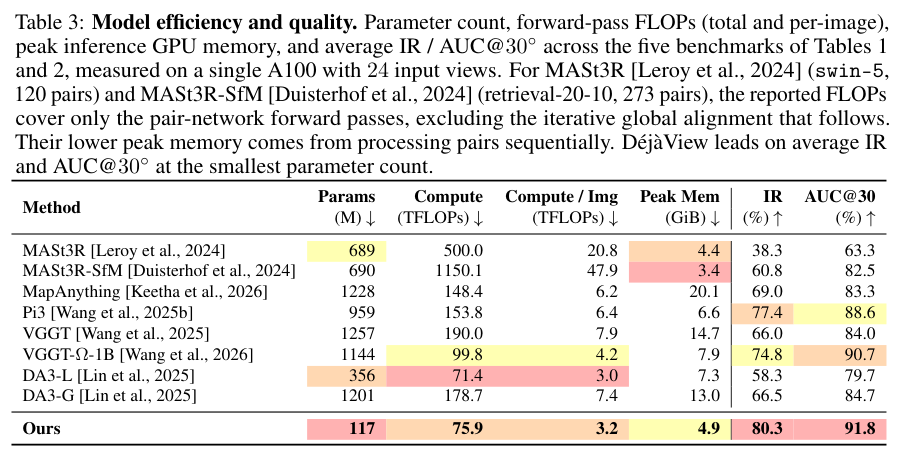

本期八项研究从本体访问和约束查询出发，介绍搜索轨迹训练、统一机器人策略、视觉表示预测、三维学习、反馈计算与循环重建。

## 1. Open Ontologies：用工具访问与稳定匹配处理本体

[Open Ontologies: Tool-Augmented Ontology Engineering with Stable Matching Alignment](https://arxiv.org/abs/2605.09184v1) · v1 提交 2026-05-09 · [全文](https://arxiv.org/html/2605.09184v1) · [PDF](https://arxiv.org/pdf/2605.09184v1)

大模型能生成 OWL，不代表它能可靠检查本体。Open Ontologies 将生成交给语言模型，把查询、规则推理与约束检查交给可执行工具；对齐再加入一对一匹配，减少一个概念被配到多个目标的情况。对工程系统而言，猜测与确定性操作应当分工。

在该论文采用的 OntoAxiom 设置中，9 个本体包含 3,042 条参考公理。同一 Claude Opus 4、默认温度、单次运行下，仅给名称列表的 F1 为 0.431，直接访问原始 OWL 文件为 0.323，通过 MCP/SPARQL 工具为 0.717。表 3 展示的是访问方式对照，不能外推为所有模型读 OWL 都更差。作者另说明，原文件条件由 Claude 子代理通过 Read 工具读取，并非严格控制的 API 提示词实验；这限制了因果归因。

Anatomy 对齐包含 2,737 个小鼠类、3,304 个人类类和 1,516 条参考映射，系统精确率 0.963、召回率 0.733、F1 0.832；Conference 轨道微平均 F1 则为 0.438。保守匹配减少误连，也漏掉低名称相似度的真匹配。这些是作者对公开参考映射的测量，尚未经过官方 OAEI campaign 独立评测，不能直接当作正式榜单结果。

我更看重它将模型生成、形式验证与来源记录接成可审查流程。工具访问可能减轻序列化解析负担，但推理器表达范围、输入信息差异与单次运行噪声都需要单独检查。

原表：Fabio Rovai，arXiv:2605.09184v1，Table 3，PDF 第 5 页。[原始来源](https://arxiv.org/pdf/2605.09184v1#page=5) · [CC BY 4.0](https://creativecommons.org/licenses/by/4.0/)。裁剪自原文。

## 2. UniQGen：以约束指导图查询生成

UniQGen 用多个语言 Agent 分别处理语义解释、约束与查询计划，再借助 Chase 与 Backchase 检查和优化候选，使 Cypher、SPARQL 查询同时满足图结构和问题中的隐含限制。它把查询生成看成带约束的规划过程，减少关系名称猜对了、条件组合却不符合问题的情况。

*图｜Wang, Mengying 等，[Figure 2（PDF 第 3 页）](https://arxiv.org/pdf/2605.00845v1#page=3)，[CC BY 4.0](http://creativecommons.org/licenses/by/4.0/)。裁剪自原文。*

GrailQA 上，Optimal 配置的答案 F1 为 0.874，Pangu 为 0.833；但组合泛化子集为 0.779，略低于 Pangu 的 0.787。GraphQ 上 Cypher Optimal 达 0.803，而 WebQSP 为 0.788，Pangu 的 SPARQL 结果为 0.793。查询语言、后端和配置不同，不能把各数据集的最高值归为同一种稳定增益；无训练也仍需承担规划与数据库执行成本。

*图｜Wang, Mengying 等，[Figure 3（PDF 第 6 页）](https://arxiv.org/pdf/2605.00845v1#page=6)，[CC BY 4.0](http://creativecommons.org/licenses/by/4.0/)。裁剪自原文。*

[Graph Query Generation with Constraint-guided Large Language Agents](https://arxiv.org/abs/2605.00845v1) · v1。

## 3. LongTraceRL：用搜索轨迹训练长上下文推理

LongTraceRL 从知识图谱游走生成问题，收集搜索 Agent 的轨迹，再把检索过的内容组合成长上下文。干扰材料按是否被打开、引用等行为分层；奖励不仅检查最终答案，还用实体级 rubric 评价证据覆盖，且只对答案正确的轨迹应用这部分奖励。这样可以把搜索时积累的判断转成阅读训练信号。

在五项长上下文基准上，Qwen3-4B-Thinking-2507 的平均成绩由 53.3 提高到 59.0，不使用 rubric 的 GRPO 对照为 53.7；其中 AA-LCR 从 33.2 到 41.8。Qwen3-30B-A3B 与 DeepSeek-R1-Qwen3-8B 的平均成绩分别从 60.5 到 63.7、42.7 到 43.8。训练采用最高 32K 的响应预算；收益对应这套轨迹、奖励与计算配置，不能等同于任意长文阅读都能获得相同提升。

[LongTraceRL: Learning Long-Context Reasoning from Search Agent Trajectories with Rubric Rewards](https://arxiv.org/abs/2605.31584v1) · v1。

[Figure 1（原文）](https://arxiv.org/pdf/2605.31584v1#page=1)。

## 4. Qwen-VLA：统一不同任务与机器人形态

Qwen-VLA 将视觉语言骨干与扩散式动作解码器连接，通过文本描述机器人形态和任务，把操作、导航及轨迹数据放入统一训练体系。目标是共享感知与语义能力，同时让动作输出适应不同身体与控制接口，而不是为每种机器人另建完整模型。

作者报告 LIBERO 平均成功率 97.9%，真实 ALOHA 的分布外测试成功率 76.9%；动态环境 DOMINO 的零样本成功率则为 26.6%。这些来自不同任务与协议，不能合并成一个通用机器人成功率。导航评测中还同时存在 oracle success rate 与实际 success rate，阅读时要区分是否只曾经到达目标附近，以及最终动作是否真正完成任务。

[Qwen-VLA: Unifying Vision-Language-Action Modeling across Tasks, Environments, and Robot Embodiments](https://arxiv.org/abs/2605.30280v2) · v2。

[Figure 1（原文）](https://arxiv.org/pdf/2605.30280v2#page=1)。

## 5. Representation Forcing：先预测结构，再生成像素

Representation Forcing 让统一多模态模型先自回归预测视觉表示 token，再让像素扩散读取这些 token。训练目标来自自身视觉编码器的 EMA 副本，推理时只由文本预测表示，因而不需要先通过一个外部冻结 VAE 压缩图像。表示预测在共享网络里承担结构规划作用。

*图｜Wang, Yuqing 等，[Figure 3（PDF 第 5 页）](https://arxiv.org/pdf/2605.31604v1#page=5)，[CC BY 4.0](http://creativecommons.org/licenses/by/4.0/)。裁剪自原文。*

在固定架构、数据且没有后训练的理解消融中，Pixel 模型加入 RF 后，MMMU 从 49.9 到 54.2，AI2D 从 85.8 到 90.3；DocVQA 则从 90.0 降至 88.0，ChartQA 从 81.7 到 81.3。八项中六项改善，说明收益并不覆盖所有文档任务。生成主实验采用 1024 分辨率，而消融采用 256；不用 LLM 重写提示时，RF-Pixel 的 GenEval 为 0.84、DPG-Bench 为 84.15，也并非两个指标都超过所有对照。

*图｜Wang, Yuqing 等，[Table 2（PDF 第 8 页）](https://arxiv.org/pdf/2605.31604v1#page=8)，[CC BY 4.0](http://creativecommons.org/licenses/by/4.0/)。裁剪自原文。*

[Representation Forcing for Bottleneck-Free Unified Multimodal Models](https://arxiv.org/abs/2605.31604v1) · v1。

## 6. VLM3：让视觉语言模型直接学习三维任务

VLM3 保留标准视觉语言模型结构，通过统一相机焦距、像素位置的文本引用和多任务数据，让同一模型学习深度、相机姿态及物体空间关系。它检验三维能力能否来自训练表示与数据组织，而不必额外添加一个专门的三维专家网络。

度量深度评测中，4B 模型的平均 δ1 为 0.904，DepthLM-7B 为 0.838；δ1 衡量深度误差落在指定阈值内的像素比例，不是所有三维任务的准确率。SpatialRGPT-Bench 的定性关系总体为 91.35，对照为 89.80，但 Behind/Front 子项为 75.54，低于对照 87.27。统一模型的平均收益仍伴随具体关系类型上的退化。

[VLM3: Vision Language Models Are Native 3D Learners](https://arxiv.org/abs/2605.30561v1) · v1。

[Figure 1（原文）](https://arxiv.org/pdf/2605.30561v1#page=2)。

## 7. Effective Feedback Compute：反馈质量怎样改变 Agent 收益

这项工作把 Agent 获得的反馈分成信息量、有效性、非冗余性和后续保留情况，构造 Effective Feedback Compute，并按任务难度归一化。它试图解释为什么同样的 token 或工具调用预算，会因反馈能否改变下一步行动而产生不同结果。

合成任务里，原始 token 和工具调用量对表现的拟合 R² 分别为 0.33、0.42，估计的 EFC 达 0.94；匹配调用与成本的反馈质量实验中，成功率可从 0.27 到 0.90。混合真实轨迹上的拟合 R² 为 0.92，前瞻留出预测为 0.85。这些结果支持反馈质量作为解释变量，但拟合关系与合成干预不能直接成为生产系统的普适计算定律。

[Scaling Laws for Agent Harnesses via Effective Feedback Compute](https://arxiv.org/abs/2605.29682v1) · v1。

[Figure 1（原文）](https://arxiv.org/pdf/2605.29682v1#page=7)。

## 8. Déjà View：循环复用一个模块完成多视图重建

Déjà View 用共享 DINOv2 编码图像，再循环应用同一个 Transformer 模块，交替处理每帧与跨帧信息，最后解码深度和射线。循环次数是推理时的计算旋钮；训练中改变迭代次数，使一个检查点适应不同预算。

*图｜Burzio, Alessandro 等，[Figure 2（PDF 第 4 页）](https://arxiv.org/pdf/2605.30215v2#page=4)，[CC BY 4.0](http://creativecommons.org/licenses/by/4.0/)。裁剪自原文。*

在单张 A100、24 张输入视图的效率对照中，117M 参数的 Déjà View 使用 75.9 TFLOPs、峰值显存 4.9 GiB，五项基准平均点图内点率为 80.3%，相机姿态 AUC@30° 为 91.8；Pi3 对应为 153.8 TFLOPs、6.6 GiB、77.4% 和 88.6。DA3-L 的计算量更低，为 71.4 TFLOPs，因此不能称它在所有成本项上都最低；部分配对方法的 FLOPs 还没有计入全局对齐。

*图｜Burzio, Alessandro 等，[Table 3（PDF 第 8 页）](https://arxiv.org/pdf/2605.30215v2#page=8)，[CC BY 4.0](http://creativecommons.org/licenses/by/4.0/)。裁剪自原文。*

[D\'ej\`a View: Looping Transformers for Multi-View 3D Reconstruction](https://arxiv.org/abs/2605.30215v2) · v2。
