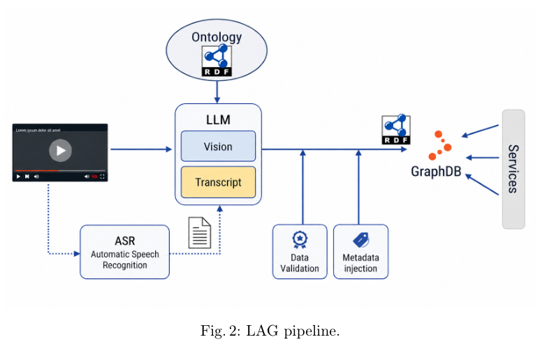
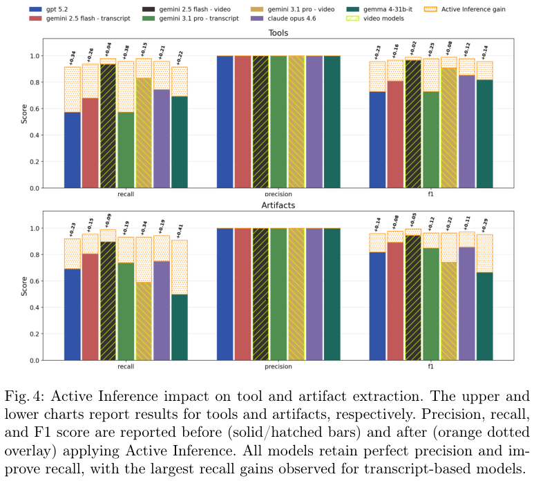
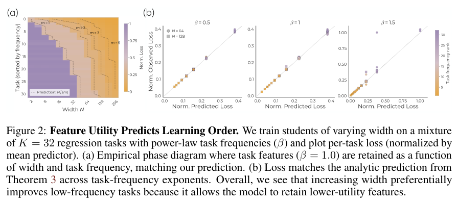
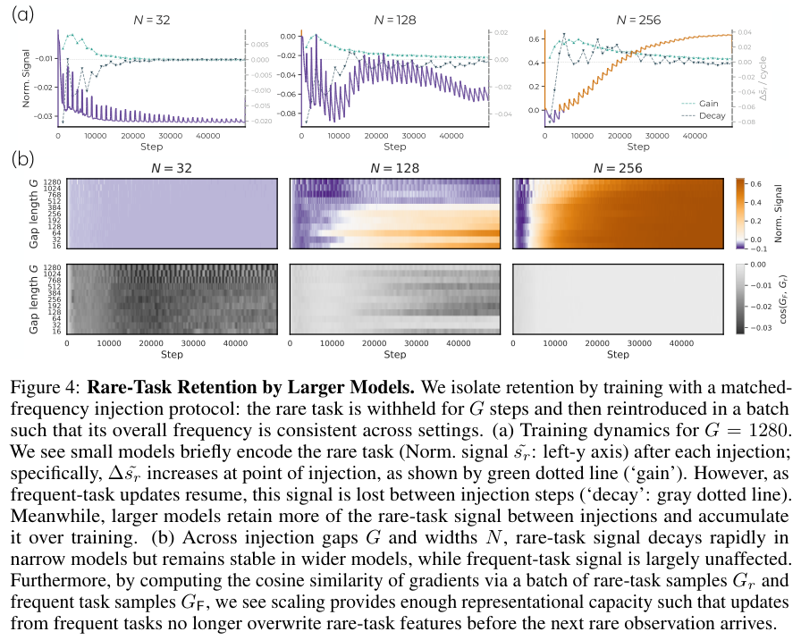
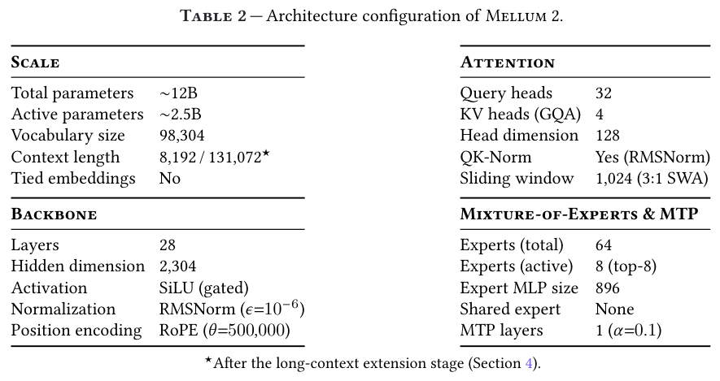
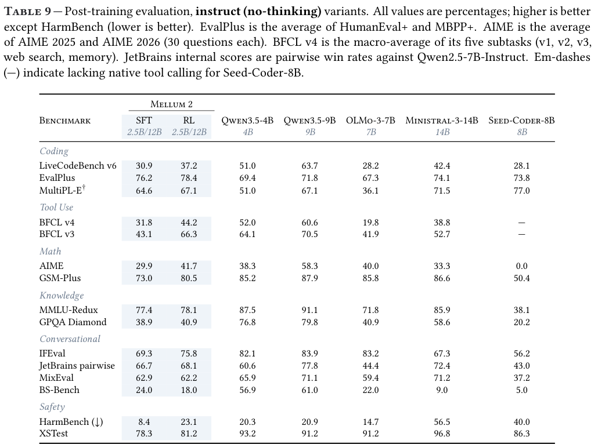

本期七项研究讨论图谱的选择性纠错、维修知识抽取、统一机器人策略、视觉表示生成、稀有任务保留、长文推理和代码模型。

## 1. OAK+MEND：先抽取，再做选择性纠错

[Better Later Than Sooner: Neuro-Symbolic Knowledge Graph Construction via Ontology-grounded Post-extraction Correction](https://arxiv.org/abs/2605.29168v1) · v1 提交 2026-05-27 · [全文](https://arxiv.org/html/2605.29168v1) · [PDF](https://arxiv.org/pdf/2605.29168v1)

大型本体放进每次抽取提示会挤占上下文，每抽一条就检查又增加重复调用。OAK+MEND 改变顺序：先开放抽取，再把实体类型和谓词映射到本体，以符号约束找出违反定义域、值域等要求的事实，只让模型修复这些问题。

选择性纠错的价值在于将错误显式化。主客体颠倒、关系映射错误、类型过宽需要不同动作；修复时还提供源文本，并允许在缺少文本依据时不采取动作。实验采用 HotpotQA 与 MuSiQue 各 1,000 条子集及同一 Wikidata 本体片段，不是对所有领域图谱的保证。

表 1 的 HotpotQA、Qwen3-30B-A3B 条件下，OAK 的三元组本体有效率为 63.4%，加入 MEND 后为 96.8%；限定信息有效率由 33.6% 到 91.5%。加权成本从 16.3M 到 26.8M，仍低于 Wikontic 的 45.3M。该量使用输入与输出 1:4 的相对权重，并以输出 token 等价单位归一化（输入权重 1/4、输出权重 1），不是原始 token 总数或实际美元账单。

本体一致性只能说明满足这些结构约束，不能证明事实符合原文。我的判断是，先记录、再验证提供了实用流水线，但仍需独立验收事实忠实度和下游问答质量，不能把 96.8% 当作一般知识正确率。

**原图入口：**[Figure 1，PDF 第 1 页](https://arxiv.org/pdf/2605.29168v1#page=1)。

## 2. Tacit Knowledge：从维修材料中找出没有明说的步骤

这项工作把维修视频或转录文本中的工具、工件与程序关系放进本体约束的知识图谱，再通过主动询问补充隐含信息。Logic Augmented Generation 负责以逻辑结构组织候选，主动推断阶段针对缺漏提问，帮助把专家演示中默认读者知道的前提显式化。

*图｜Lamazzi, Lorenzo 等，[Figure 2（PDF 第 7 页）](https://arxiv.org/pdf/2605.07639v1#page=7)，[CC BY 4.0](http://creativecommons.org/licenses/by/4.0/)。裁剪自原文。*

初始抽取中，所测模型的实体精确率均为 1.00，但转录文本的工具召回率只有 0.57–0.81、工件召回率为 0.50–0.81。主动推断后，Gemini 2.5 Flash 的视频条件下，工具与工件 F1 分别达到 0.989、0.994；Claude Opus 4.6 的文本条件下为 0.978、0.971。评测衡量的是这些实体的抽取，不包含真实维修执行、用户理解或操作安全的验证。

*图｜Lamazzi, Lorenzo 等，[Figure 4（PDF 第 14 页）](https://arxiv.org/pdf/2605.07639v1#page=14)，[CC BY 4.0](http://creativecommons.org/licenses/by/4.0/)。裁剪自原文。*

[Tacit Knowledge Extraction via Logic Augmented Generation and Active Inference](https://arxiv.org/abs/2605.07639v1) · v1。

## 3. Qwen-VLA：统一不同任务与机器人形态

Qwen-VLA 将视觉语言骨干与扩散式动作解码器连接，通过文本描述机器人形态和任务，把操作、导航及轨迹数据放入统一训练体系。目标是共享感知与语义能力，同时让动作输出适应不同身体与控制接口，而不是为每种机器人另建完整模型。

作者报告 LIBERO 平均成功率 97.9%，真实 ALOHA 的分布外测试成功率 76.9%；动态环境 DOMINO 的零样本成功率则为 26.6%。这些来自不同任务与协议，不能合并成一个通用机器人成功率。导航评测中还同时存在 oracle success rate 与实际 success rate，阅读时要区分是否只曾经到达目标附近，以及最终动作是否真正完成任务。

[Qwen-VLA: Unifying Vision-Language-Action Modeling across Tasks, Environments, and Robot Embodiments](https://arxiv.org/abs/2605.30280v2) · v2。

[Figure 1（原文）](https://arxiv.org/pdf/2605.30280v2#page=1)。

## 4. Representation Forcing：先预测结构，再生成像素

Representation Forcing 让统一多模态模型先自回归预测视觉表示 token，再让像素扩散读取这些 token。训练目标来自自身视觉编码器的 EMA 副本，推理时只由文本预测表示，因而不需要先通过一个外部冻结 VAE 压缩图像。表示预测在共享网络里承担结构规划作用。

*图｜Wang, Yuqing 等，[Figure 3（PDF 第 5 页）](https://arxiv.org/pdf/2605.31604v2#page=5)，[CC BY 4.0](http://creativecommons.org/licenses/by/4.0/)。裁剪自原文。*

在固定架构、数据且没有后训练的理解消融中，Pixel 模型加入 RF 后，MMMU 从 49.9 到 54.2，AI2D 从 85.8 到 90.3；DocVQA 则从 90.0 降至 88.0，ChartQA 从 81.7 到 81.3。八项中六项改善，说明收益并不覆盖所有文档任务。生成主实验采用 1024 分辨率，而消融采用 256；不用 LLM 重写提示时，RF-Pixel 的 GenEval 为 0.84、DPG-Bench 为 84.15，也并非两个指标都超过所有对照。

*图｜Wang, Yuqing 等，[Table 2（PDF 第 8 页）](https://arxiv.org/pdf/2605.31604v2#page=8)，[CC BY 4.0](http://creativecommons.org/licenses/by/4.0/)。裁剪自原文。*

[Representation Forcing for Bottleneck-Free Unified Multimodal Models](https://arxiv.org/abs/2605.31604v2) · v2。

## 5. Why Larger Models Learn More：规模与稀有任务保留

这篇研究区分“模型能够表示一种任务”和“训练过程中能把它学会并保留下来”。作者用可控的任务混合改变出现频率、模型宽度和更新间隔，观察常见任务的梯度是否覆盖稀有任务特征，再用 OLMo 的训练实验检查相似规律。

*图｜Huang, Jing 等，[Figure 2（PDF 第 4 页）](https://arxiv.org/pdf/2605.29548v2#page=4)，[CC BY 4.0](http://creativecommons.org/licenses/by/4.0/)。裁剪自原文。*

匹配长程训练条件的实验表明，小模型可以在刚看到稀有样本时降低该任务损失，之后却容易被频繁任务的更新抹去；增大模型宽度能减轻干扰并保留更多任务相关特征。将相同数量的稀有样本更均匀地注入，也优于间隔很久再集中提供。结论针对论文控制的任务与训练设置，没有一个可以套到任意模型的统一准确率增幅；参数规模、样本频率与训练安排共同影响结果。

*图｜Huang, Jing 等，[Figure 4（PDF 第 6 页）](https://arxiv.org/pdf/2605.29548v2#page=6)，[CC BY 4.0](http://creativecommons.org/licenses/by/4.0/)。裁剪自原文。*

[Why Larger Models Learn More: Effects of Capacity, Interference, and Rare-Task Retention](https://arxiv.org/abs/2605.29548v2) · v2。

## 6. LongTraceRL：用搜索轨迹训练长上下文推理

LongTraceRL 从知识图谱游走生成问题，收集搜索 Agent 的轨迹，再把检索过的内容组合成长上下文。干扰材料按是否被打开、引用等行为分层；奖励不仅检查最终答案，还用实体级 rubric 评价证据覆盖，且只对答案正确的轨迹应用这部分奖励。这样可以把搜索时积累的判断转成阅读训练信号。

在五项长上下文基准上，Qwen3-4B-Thinking-2507 的平均成绩由 53.3 提高到 59.0，不使用 rubric 的 GRPO 对照为 53.7；其中 AA-LCR 从 33.2 到 41.8。Qwen3-30B-A3B 与 DeepSeek-R1-Qwen3-8B 的平均成绩分别从 60.5 到 63.7、42.7 到 43.8。训练采用最高 32K 的响应预算；收益对应这套轨迹、奖励与计算配置，不能等同于任意长文阅读都能获得相同提升。

[LongTraceRL: Learning Long-Context Reasoning from Search Agent Trajectories with Rubric Rewards](https://arxiv.org/abs/2605.31584v1) · v1。

[Figure 1（原文）](https://arxiv.org/pdf/2605.31584v1#page=1)。

## 7. Mellum 2：面向开发者任务的稀疏专家模型

Mellum 2 采用约 12B 总参数、每 token 激活约 2.5B 的 MoE，配合滑动窗口注意力、多 token 预测和逐步偏向代码、数学的预训练课程，再分别训练 Instruct 与 Thinking 版本。10.6T token 的预训练及后续 SFT、可验证奖励强化学习共同决定其能力，不能只按激活参数估计全部训练成本。

*图｜Kojic, Marko 等，[Table 2（PDF 第 6 页）](https://arxiv.org/pdf/2605.31268v1#page=6)，[CC BY 4.0](http://creativecommons.org/licenses/by/4.0/)。裁剪自原文。*

Instruct 版本经过 RL 后，EvalPlus 从 76.2 到 78.4，BFCL v3 从 43.1 到 66.3；但 LiveCodeBench v6 为 37.2，低于 Qwen3.5-4B 的 51.0。Thinking 版本的 LiveCodeBench 反而从 SFT 的 75.1 降至 RL 的 69.9，虽然 BFCL v4 从 38.8 到 45.6。论文也报告 Instruct 的 HarmBench harmful rate 从 8.4 升至 23.1，越低越好；工具和代码分数改善不能代替安全评测。

*图｜Kojic, Marko 等，[Table 9（PDF 第 23 页）](https://arxiv.org/pdf/2605.31268v1#page=23)，[CC BY 4.0](http://creativecommons.org/licenses/by/4.0/)。裁剪自原文。*

[Mellum2 Technical Report](https://arxiv.org/abs/2605.31268v1) · v1。
