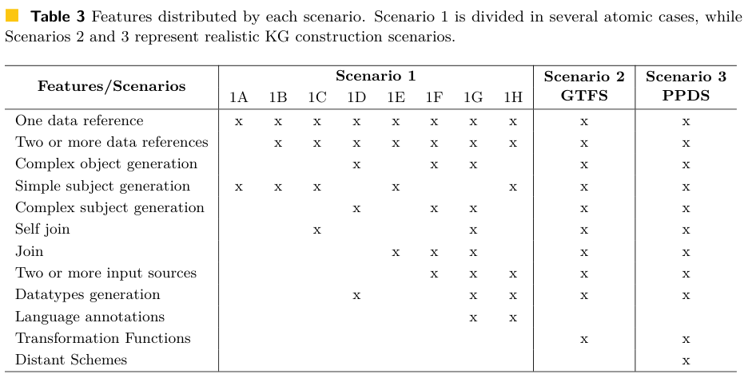
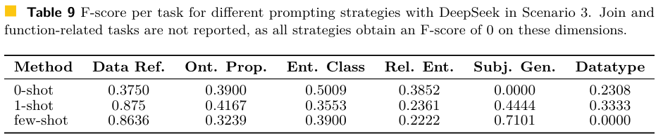

本期七项研究分别检验知识图谱映射、图 token 机制、多模态搜索、技能积累、专家共享、界面定位与深度研究错误诊断。

## 1. BLINKG：把建图映射拆成可诊断的任务

BLINKG 将异构数据到知识图谱的映射拆成类、属性、主语 URI、连接条件、类型和转换函数等任务，并设置由简单原子案例到 GTFS 交通数据、再到 schema 差异较大的公共采购数据的三个场景。专家参考输出让评测能分别发现名称对齐、实体生成和跨表组合中的问题。

*图｜Castedo, Carla 等，[Table 3（PDF 第 8 页）](https://arxiv.org/pdf/2605.19518v1#page=8)，[CC BY 4.0](http://creativecommons.org/licenses/by/4.0/)。裁剪自原文。*

在最难的采购场景中，DeepSeek 的 few-shot 主语生成 F1 为 0.7101，zero-shot 为 0；但 few-shot 的数据类型 F1 又从 zero-shot 的 0.2308 降到 0。所有提示策略的连接与函数相关任务 F1 均为 0。提示示例能帮助部分局部映射，却没有解决复杂转换；这些结果属于该版三个场景及指定通用模型，不是所有自动建图系统的上限。

*图｜Castedo, Carla 等，[Table 9（PDF 第 26 页）](https://arxiv.org/pdf/2605.19518v1#page=26)，[CC BY 4.0](http://creativecommons.org/licenses/by/4.0/)。裁剪自原文。*

[BLINKG: A Benchmark for LLM-Integrated Knowledge Graph Generation](https://arxiv.org/abs/2605.19518v1) · v1。

## 2. When Graph Tokens Sink：显著激活与因果贡献

[When Graph Tokens Sink: A Mechanistic Analysis of Graph Language Models](https://arxiv.org/abs/2606.03712v1) · v1 提交 2026-06-02 · [全文](https://arxiv.org/html/2606.03712v1) · [PDF](https://arxiv.org/pdf/2606.03712v1)

图语言模型把节点与邻域编码成 token，再交给语言模型。隐藏状态中的巨大激活究竟是信息载体，还是计算副产品？When Graph Tokens Sink 使用删除、交换、移动 token 的受控干预，追问显著对象是否真的影响任务。

主实验覆盖 LLaGA、TEA-GLM，在 Cora、ogbn-Arxiv、PubMed 上分析节点分类与链接预测。激活阈值为 15；LLaGA 每数据集 500 个测试样本，TEA-GLM 为 300 个；推断采用贪心解码、固定种子 42。表 1 的 LLaGA/Cora 节点分类基线为 88.40，删除激活最高的两个 sink token 后为 88.00；随机删除两个非 sink token 为 80.48±2.47，后者是 15 个随机种子的均值和标准差。

这说明在被测设置中，激活最显著的 token 并非删除后损害最大的对象；LLaGA 的突出 sink 还常对应填充 token。结论不能改写成图结构没有用，也不能从两个架构推导所有图模型的机制。

我的阅读判断是，颜色鲜明的激活图需要删除对照才能支撑信息利用的解释。性能差异还受采样、输入模板及干预位置影响，论文也没有提供通用修复方案。做知识图谱增强系统时，应把可视化与受控任务验收配对使用。

**原图入口：**[Figure 1，PDF 第 2 页](https://arxiv.org/pdf/2606.03712v1#page=2)。

## 3. OpenSearch-VL：让多模态搜索训练保留失败前的有效推理

OpenSearch-VL 从 Wikipedia 路径采样、模糊实体改写和视觉来源锚定构造多跳问题，提供 36k SFT 与 8k RL 数据，并把文本搜索、图片搜索、OCR 和图像处理放入同一工具环境。Fatal-aware GRPO 遮蔽工具连续失败后的无效 token，同时用单侧优势截断保留失败前仍有价值的推理信号。

在同一 Qwen3-VL-8B 的三项消融基准上，平均准确率从基础模型 53.7 到 SFT 的 64.6，再到普通 GRPO 的 67.6；完整方法为 71.8。只做 fatal masking 为 69.1，说明优势处理也有贡献。整体训练结果还同时依赖数据构造、工具和奖励裁判，不能将全部提升归于一个 masking 操作，也不能忽略额外搜索与图像处理成本。

[OpenSearch-VL: An Open Recipe for Frontier Multimodal Search Agents](https://arxiv.org/abs/2605.05185v1) · v1。

[Figure 1（原文）](https://arxiv.org/pdf/2605.05185v1#page=4)。

## 4. SkillOS：用后续任务反馈学习如何维护技能库

SkillOS 将执行器冻结，把新增、修改和删除 Markdown 技能的策展器作为训练对象。任务按技能依赖分组：前面的执行轨迹用于更新 SkillRepo，后面的相关任务检验更新是否有用，复合奖励因此能覆盖延迟收益。它学习的是技能维护策略，而不是边运行边修改执行模型权重。

ALFWorld 的 Qwen3-8B 执行器设置下，三次运行平均成功率为 61.2±4.6，ReasoningBank 为 55.7±3.1，无记忆为 47.9±1.2；平均步数由无记忆的 21.1 降到 18.9。WebShop 的成功率从无记忆 9.8 到 16.5，仍有大量失败。技能收益取决于任务流是否存在可复用依赖，不能直接推广到任意长期自主工作。

[SkillOS: Learning Skill Curation for Self-Evolving Agents](https://arxiv.org/abs/2605.06614v1) · v1。

[Figure 1（原文）](https://arxiv.org/pdf/2605.06614v1#page=2)。

## 5. UniPool：让不同层共享一个专家池

UniPool 打破每层单独拥有 MoE 专家的配置，由层特定路由器访问全局共享专家池，并用池级负载均衡与 NormRouter 稳定训练。这样可以把专家数量视为独立预算，在增加深度时复用已有专家，而不必同步线性增加专家参数。

五种 182M–978M 骨干配置均在 Pile 上训练约 30B token，验证损失相对普通 MoE 降低 0.0172–0.0386；缩小专家池的配置在所测规模上只用 41.6%–66.7% 的普通专家参数预算，也能匹配或超过对应对照。这里的规模标签、激活参数和实际存储的专家参数是不同口径；182M 主实验有三种子均值，更大配置主要是单次运行，尚不能据此断言超大模型的服务成本也按同比例下降。

[UniPool: A Globally Shared Expert Pool for Mixture-of-Experts](https://arxiv.org/abs/2605.06665v1) · v1。

[Figure 1（原文）](https://arxiv.org/pdf/2605.06665v1#page=2)。

## 6. BAMI：先缩小观察范围，再辨别相似按钮

BAMI 用遮蔽预测分布分析 GUI 定位错误，把高分辨率带来的精度偏差与相似界面元素带来的歧义区分开。推理时先围绕初始位置逐步聚焦，再通过遮蔽生成多个候选并选择目标，无需更新定位模型权重。

ScreenSpot-Pro 上，TianXi-Action-7B 从 51.9% 提高到使用 GPT-5 校正的 57.8%，本地校正版本为 56.2%；UGround-7B 从 16.5% 到 30.0%。这是静态界面目标定位的准确率，包含多次预测和候选选择的推理开销，不能等同于端到端 GUI 工作流成功率或免费加速。

[BAMI: Training-Free Bias Mitigation in GUI Grounding](https://arxiv.org/abs/2605.06664v1) · v1。

[Figure 1（原文）](https://arxiv.org/pdf/2605.06664v1#page=1)。

## 7. TELBench 与 DRIFT：定位研究 Agent 的有害错误片段

TELBench 从两种 Agent 框架、三个骨干模型和三个基准收集的 2,790 条轨迹中建立 1,000 个错误定位实例。DRIFT 先维护主张清单，再检查证据支持和主张之间的依赖，以区分正常探索、暂时假设与真正把答案带偏的片段。

在 GPT-5.4 条件下，整体 macro-F1 从直接阅读轨迹的 33.93 到 DRIFT 的 52.48，首错准确率从 14.90 到 20.80；困难子集的首错准确率仍只有 7.25。找到一些错误与找到最早出错的位置是两种能力，提升诊断分数也没有直接证明能自动修好整条研究流程。

[Where Do Deep-Research Agents Go Wrong? Span-Level Error Localization in Agent Trajectories](https://arxiv.org/abs/2606.02060v2) · v2。

[Figure 1（原文）](https://arxiv.org/pdf/2606.02060v2#page=3)。
