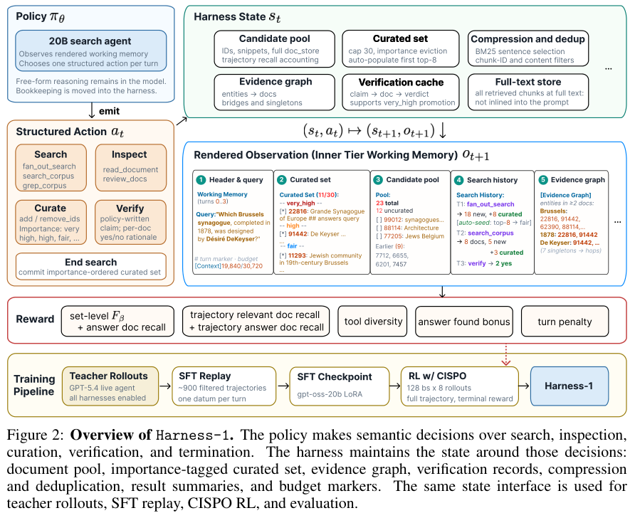
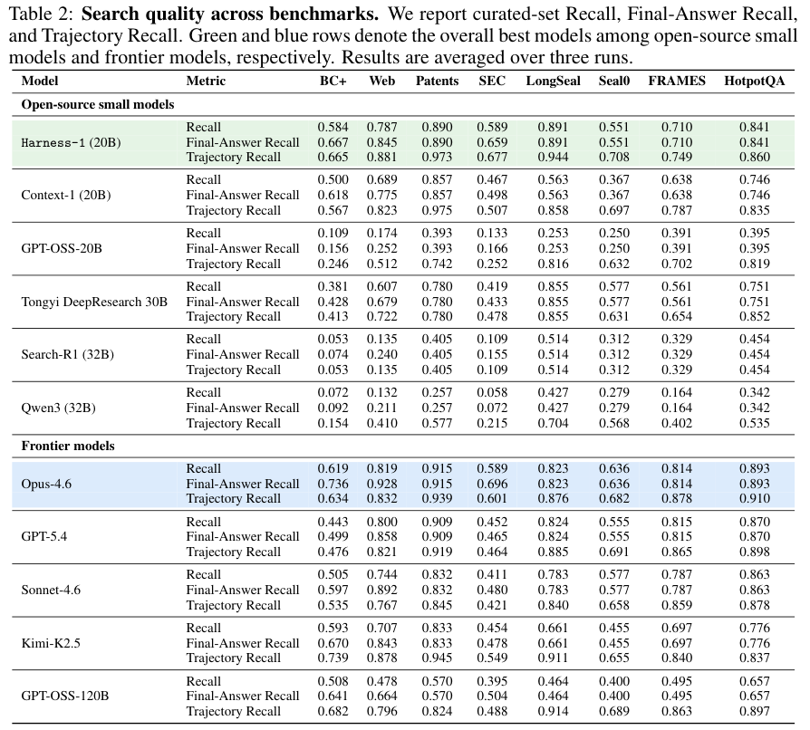
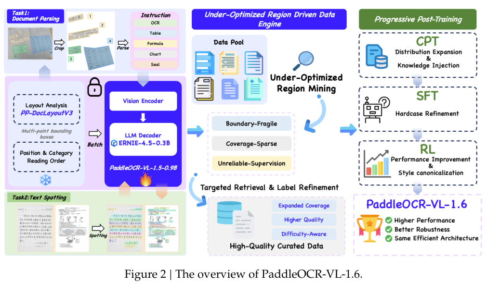
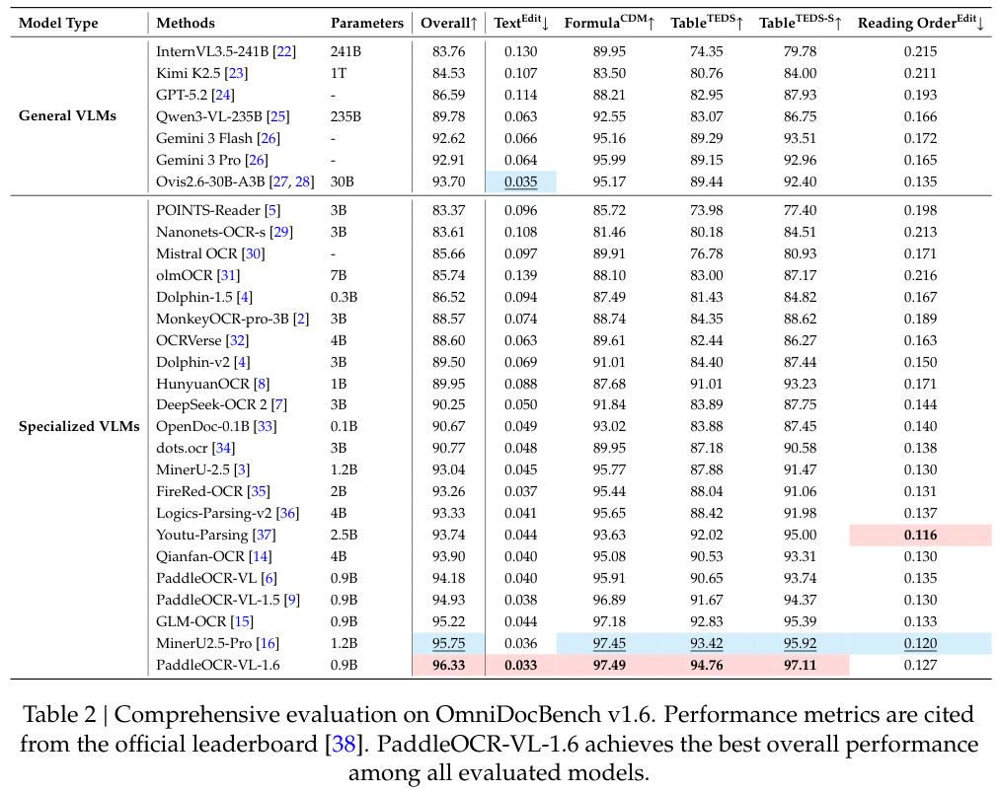
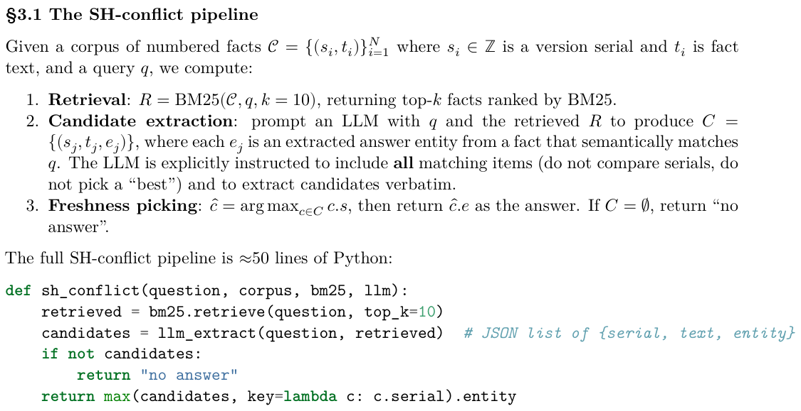
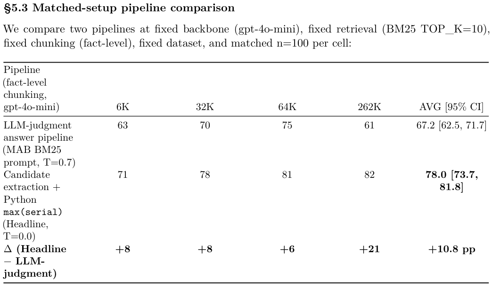

本期七项研究连接威胁情报建图、有状态搜索、长文训练、低比特缓存、文档解析、记忆冲突消解与世界模型推理。

## 1. ANCHOR：用搜索与递归导航适配不同安全本体

ANCHOR 先从网络威胁报告开放抽取实体和关系，再用嵌入搜索定位本体入口、递归导航处理层级与方向，最后以 SHACL 检查结构。它希望将抽取与特定 schema 解耦，避免每换本体就重写整套提示，或把全部大型本体塞进上下文。

UCO、STIX、MALOnt 三种 schema 的实体类型平均 F1 为 0.7371，LLM4CTI 为 0.6432；谓词平均为 0.5484，对照 0.5001。但 MALOnt 的谓词 F1 为 0.5412，低于对照 0.5647。UCO 上不合规项占 5.2%，这衡量 URI 与 SHACL 规则，不能代替抽取事实是否忠实于报告的检验。

[Schema-Agnostic Knowledge Graph Construction via Hybrid Ontology Discovery for Cyber Threat Intelligence](https://arxiv.org/abs/2606.01208v1) · v1。

[Figure 1（原文）](https://arxiv.org/pdf/2606.01208v1#page=2)。

## 2. Harness-1：把检索状态交给环境维护

Harness-1 将候选文档、重要性标记、证据连接、核验记录与去重压缩放在环境状态里，20B 策略只决定搜索、保留、验证和停止。训练与推理共用同一状态接口，让强化学习更多优化语义决策，少承担可以恢复的日常记账。

*图｜Jiang, Pengcheng 等，[Figure 2（PDF 第 3 页）](https://arxiv.org/pdf/2606.02373v1#page=3)，[CC BY 4.0](http://creativecommons.org/licenses/by/4.0/)。裁剪自原文。*

八项检索基准上，作者报告保留文档集合的平均 recall 为 0.730，比次强的小型开放搜索子 Agent 高 11.4 个百分点；轨迹中曾经见过的文档 recall 则为 0.807。这两个数分别对应最终保留与沿途遇到的证据，均不是最终回答准确率。结果跨网页、金融、专利与多跳问答，仍取决于检索工具、状态维护和训练任务的组合。

*图｜Jiang, Pengcheng 等，[Table 2（PDF 第 6 页）](https://arxiv.org/pdf/2606.02373v1#page=6)，[CC BY 4.0](http://creativecommons.org/licenses/by/4.0/)。裁剪自原文。*

[Harness-1: Reinforcement Learning for Search Agents with State-Externalizing Harnesses](https://arxiv.org/abs/2606.02373v1) · v1。

## 3. LongTraceRL：用搜索轨迹训练长上下文推理

LongTraceRL 从知识图谱游走生成问题，收集搜索 Agent 的轨迹，再把检索过的内容组合成长上下文。干扰材料按是否被打开、引用等行为分层；奖励不仅检查最终答案，还用实体级 rubric 评价证据覆盖，且只对答案正确的轨迹应用这部分奖励。这样可以把搜索时积累的判断转成阅读训练信号。

在五项长上下文基准上，Qwen3-4B-Thinking-2507 的平均成绩由 53.3 提高到 59.0，不使用 rubric 的 GRPO 对照为 53.7；其中 AA-LCR 从 33.2 到 41.8。Qwen3-30B-A3B 与 DeepSeek-R1-Qwen3-8B 的平均成绩分别从 60.5 到 63.7、42.7 到 43.8。训练采用最高 32K 的响应预算；收益对应这套轨迹、奖励与计算配置，不能等同于任意长文阅读都能获得相同提升。

[LongTraceRL: Learning Long-Context Reasoning from Search Agent Trajectories with Rubric Rewards](https://arxiv.org/abs/2605.31584v1) · v1。

[Figure 1（原文）](https://arxiv.org/pdf/2605.31584v1#page=1)。

## 4. KVarN：减少长推理中的缓存量化误差

[KVarN: Variance-Normalized KV-Cache Quantization Mitigates Error Accumulation in Reasoning Tasks](https://arxiv.org/abs/2606.03458v1) · v1 提交 2026-06-02 · [全文](https://arxiv.org/html/2606.03458v1) · [PDF](https://arxiv.org/pdf/2606.03458v1)

长推理的 KV 缓存随生成持续增长。固定长输入上的量化检索表现良好，不代表逐 token 生成也可靠：前一步偏差可能进入后续状态。KVarN 关注 token 尺度误差，结合 Hadamard 旋转与双轴方差归一化，不需要校准数据。

表 1 在三次运行上报告均值与标准差。Phi-4-14B 的 MATH500：FP16 为 84.9±0.9%，KVarN 的 K/V 各 2 比特为 84.8±0.7%，KIVI 同名义位宽为 74.4±0.8%。AIME24 对应为 62.2±1.6%、61.7±1.7%、57.8±1.9%。这些是质量指标，不能直接推导服务吞吐提升。

算入尺度等开销后，KVarN 的有效 KV 存储为每元素 2.3 比特，不是整个系统内存缩到八分之一。边界也很清楚：Qwen3-4B 在 MATH500 从 FP16 的 82.6% 降到 79.2%，不同模型的量化敏感度不同。

我认为最有意义的是把验收对象从一次性压缩输入改成持续压缩生成状态。部署仍需测解量化和尺度处理开销、长输出质量与端到端延迟。数学测试接近基线，并不等于所有长上下文任务均可靠；平均分之外，也应记录长生成中的失败位置。

**原图入口：**[Figure 1，PDF 第 2 页](https://arxiv.org/pdf/2606.03458v1#page=2)。

## 5. PaddleOCR-VL-1.6：把数据改进集中到薄弱区域

PaddleOCR-VL-1.6 延续 0.9B 文档模型，先从前代错误中找出行为不稳定、覆盖稀疏或监督不可靠的区域，再做定向增强与分阶段后训练。奖励将有效格式、结构和内容相似度结合，使表格、公式、文本等任务分别获得合适的反馈。

*图｜Zhang, Zelun 等，[Figure 2（PDF 第 5 页）](https://arxiv.org/pdf/2606.03264v1#page=5)，[CC BY 4.0](http://creativecommons.org/licenses/by/4.0/)。裁剪自原文。*

OmniDocBench v1.6 总分从前代 94.93 到 96.33，Table-TEDS 为 94.76；模拟真实采集条件的 Real5-OmniDocBench 从 92.05 到 93.19。总分由文本编辑距离、表格结构、公式等不同指标聚合，不能读成所有文字字符都具有 96.33% 的识别准确率。部分对照取官方榜单，结果也受页面分割和新版自适应匹配规则影响。

*图｜Zhang, Zelun 等，[Table 2（PDF 第 17 页）](https://arxiv.org/pdf/2606.03264v1#page=17)，[CC BY 4.0](http://creativecommons.org/licenses/by/4.0/)。裁剪自原文。*

[PaddleOCR-VL-1.6: Expanding the Frontier of Document Parsing with Under-Optimized Region Refinement and Progressive Post-Training](https://arxiv.org/abs/2606.03264v1) · v1。

## 6. 记忆冲突消解：把最新版本选择写成确定性操作

当事实带有明确序号时，这项工作先让模型抽取与问题相关的候选，再用 Python 的 max(serial) 选最新版本；多跳问题逐跳重复。它将语义相关性判断和版本排序拆开，避免模型同时负责寻找证据与记住哪条更新。

*图｜Reddy, Vikas 等，[Section 3.1（PDF 第 9 页）](https://arxiv.org/pdf/2606.01435v1#page=9)，[CC BY 4.0](http://creativecommons.org/licenses/by/4.0/)。裁剪自原文。*

匹配骨干、BM25 检索和事实级分块时，gpt-4o-mini 的 FC-SH 四长度汇总准确率由语言模型判断管线的 67.2% 到 78.0%，262K 条件从 61% 到 82%。不过提示、输出格式、温度也随管线改变，这不是排序器单独的因果收益。LongMemEval 的 45 个知识更新问题中，确定性方案为 57.8%，低于模型判断的 64.4%；适用边界是具有可靠版本全序的当前值冲突。

*图｜Reddy, Vikas 等，[Section 5.3（PDF 第 15 页）](https://arxiv.org/pdf/2606.01435v1#page=15)，[CC BY 4.0](http://creativecommons.org/licenses/by/4.0/)。裁剪自原文。*

[Don't Ask the LLM to Track Freshness: A Deterministic Recipe for Memory Conflict Resolution](https://arxiv.org/abs/2606.01435v1) · v1。

## 7. PF-OPSD：学会何时相信世界模型的未来

PF-OPSD 让多模态模型决定是否调用世界模型、生成怎样的模拟提示，以及是否接受或降低模拟结果的权重。训练时，真实未来视频和答案只出现在教师的特权上下文里，用于评价学生当前轨迹；部署时学生只能看到当前观测和生成的候选未来。

Qwen3.5-9B 在 VRQABench 与 OpenWorldQA 的准确率分别为 72.4%、70.5%，SFT 对照为 61.8%、59.6%，GRPO 为 63.5%、61.2%。强制每题模拟的消融降到 68.5%、67.2%，说明多生成视频不一定更好。两套四选一视觉预测基准支持的是这套控制和验证策略，不能当作真实机器人未来预测的可靠性保证。

[World Models Meet Language Models: On the Complementarity of Concrete and Abstract Reasoning](https://arxiv.org/abs/2606.03603v1) · v1。

[Figure 2（原文）](https://arxiv.org/pdf/2606.03603v1#page=3)。
