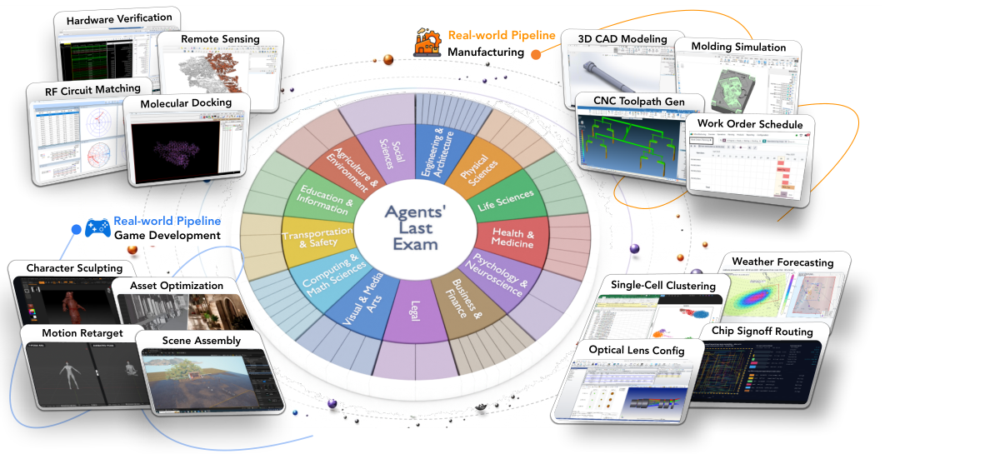

本文补录 **2026-06-07 的推荐日报清单**，于 2026-10-29 核对公开来源。推荐日期不等于论文发表日期；采用下方明确标记的历史版本，不混用后续修订。数值均为作者报告，本站未独立复现。

## 重点阅读

[Agents' Last Exam](https://arxiv.org/abs/2606.05405v1) · v1 提交 2026-06-03 · [全文](https://arxiv.org/html/2606.05405v1) · [PDF](https://arxiv.org/pdf/2606.05405v1)

答对问题与完成专业交付物之间，隔着工具选择、文件处理与长时间执行。Agents’ Last Exam（ALE）将评测放在真实计算机工作流中，让代理使用命令行、图形软件与文件，产出可检查结果。

表 1 的 Codex、GPT-5.5、GUI-as-Tool 组合，Near-Term 满分通过率为 42.4%，Full-Spectrum 为 20.0%，Last-Exam 为 8.6%，总通过率为 26.2%；每次运行上限五小时。这是骨干、运行框架与工具桥接共同作用的结果，不能只用模型名归因。

主表三组分别列 59、55、35 题，而正文将最难组写成 36 题，原版本存在计数不一致，本文保留差异。平均细粒度得分与满分通过率也不同：接近完成和所有验收点都通过，需要分别报告。下图展示任务分类与工作流范围，并非上述通过率的结果图。

我认为更值得借鉴的是先定义交付物及通过条件，再验收长运行是否真正完成工作。专业任务组织和评测规则仍由作者制定，部分任务还涉及模型辅助评分；自动验收不等于经济价值已经实现，更不是岗位替代率。企业使用仍需在自身任务、权限与成本边界内复测。

原图：Yiyou Sun 等，arXiv:2606.05405v1，Figure 1，PDF 第 2 页。[原始来源](https://arxiv.org/pdf/2606.05405v1#page=2) · [CC BY 4.0](https://creativecommons.org/licenses/by/4.0/)。已裁剪完整表格或图形及必要标签，移除周围正文，内容和颜色未改动，未重绘。此材料沿用 CC BY 4.0，本站页脚许可不为其增加非商业或相同方式共享限制。

## 同期其他论文入口

以下只核对题名、标识符和指定历史版本，不代表逐篇全文深读。

- [Cosmos 3: Omnimodal World Models for Physical AI](https://arxiv.org/abs/2606.02800v2) · 2606.02800v2，该版本提交 2026-06-05。
- [MLEvolve: A Self-Evolving Framework for Automated Machine Learning Algorithm Discovery](https://arxiv.org/abs/2606.06473v1) · 2606.06473v1，该版本提交 2026-06-04。
- [OPRD: On-Policy Representation Distillation](https://arxiv.org/abs/2606.06021v1) · 2606.06021v1，该版本提交 2026-06-04。
- [AffordanceVLA: A Vision-Language-Action Model Empowering Action Generation through Affordance-Aware Understanding](https://arxiv.org/abs/2606.06155v1) · 2606.06155v1，该版本提交 2026-06-04。
- [Code2LoRA: Hypernetwork-Generated Adapters for Code Language Models under Software Evolution](https://arxiv.org/abs/2606.06492v1) · 2606.06492v1，该版本提交 2026-06-04。

## 待核验的公开线索

以下候选题名与链接的对应关系尚未独立确认。原站访问返回 403，未继续尝试访问，不计入已核验论文数量。

- 候选题名：[Reducing Human Effort in Ontology-Based Data Integration: An LLM-Assisted Mapping Pipeline](https://openreview.net/forum?id=qjJF4sIRKj)（待核验）。
- 候选题名：[Implementing the Semantic Units Framework using Named Graphs and R2RML in a Knowledge Graph for the Biodiversity Exploratories](https://openreview.net/forum?id=JXyRcFgKuw)（待核验）。
- 候选题名：[NORKE: A Framework for Normative Rule-Centric Knowledge Graph Construction using Language Models](https://openreview.net/forum?id=7bK5jzeH4H)（待核验）。

**覆盖说明：**本期保留 6 篇已核验公开论文入口，详读 1 篇；其余仅列目录。另列 3 项待核验线索，不计入上述数量。
