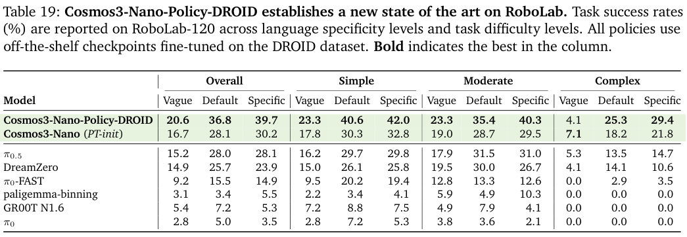

本期六项研究介绍专业任务验收、全模态世界模型、机器学习搜索、表示蒸馏、操作 affordance 与代码适配器。

## 1. Agents’ Last Exam：按专业交付物检验长程工作

[Agents' Last Exam](https://arxiv.org/abs/2606.05405v1) · v1 提交 2026-06-03 · [全文](https://arxiv.org/html/2606.05405v1) · [PDF](https://arxiv.org/pdf/2606.05405v1)

答对问题与完成专业交付物之间，隔着工具选择、文件处理与长时间执行。Agents’ Last Exam（ALE）将评测放在真实计算机工作流中，让代理使用命令行、图形软件与文件，产出可检查结果。

表 1 的 Codex、GPT-5.5、GUI-as-Tool 组合，Near-Term 满分通过率为 42.4%，Full-Spectrum 为 20.0%，Last-Exam 为 8.6%，总通过率为 26.2%；每次运行上限五小时。这是骨干、运行框架与工具桥接共同作用的结果，不能只用模型名归因。

主表三组分别列 59、55、35 题，而正文将最难组写成 36 题，原版本两处计数不一致。平均细粒度得分与满分通过率也不同：接近完成和所有验收点都通过，需要分别报告。

我认为更值得借鉴的是先定义交付物及通过条件，再验收长运行是否真正完成工作。专业任务组织和评测规则仍由作者制定，部分任务还涉及模型辅助评分；自动验收不等于经济价值已经实现，更不是岗位替代率。企业使用仍需在自身任务、权限与成本边界内复测。

原图：Yiyou Sun 等，arXiv:2606.05405v1，Figure 1，PDF 第 2 页。[原始来源](https://arxiv.org/pdf/2606.05405v1#page=2) · [CC BY 4.0](https://creativecommons.org/licenses/by/4.0/)。裁剪自原文。

## 2. Cosmos 3：共享推理与多模态生成的世界模型

Cosmos 3 通过双塔 Mixture-of-Transformers 连接语言、图像、视频、音频和动作，以不同训练阶段分别学习理解、生成与物理交互。Nano 与 Super 从预训练视觉语言模型初始化，在共享序列表示中组织 reasoner 和 generator，使模型既能描述场景，也能预测变化或输出动作。

*图｜NVIDIA 等，[Figure 3（PDF 第 8 页）](https://arxiv.org/pdf/2606.02800v2#page=8)，[CC BY 4.0](http://creativecommons.org/licenses/by/4.0/)。裁剪自原文。*

RoboLab-120 的 DROID 微调政策评测中，Nano-Policy 在明确指令下的平均成功率为 39.7%，π0.5 为 28.1%；模糊指令下则只有 20.6%。每项任务有十次 rollout，复杂任务的成功率也明显更低。这是该政策检查点和实验协议的结果，不能由视频质量、榜单偏好或同一系列的其他模型推断所有物理任务能力。

*图｜NVIDIA 等，[Table 19（PDF 第 68 页）](https://arxiv.org/pdf/2606.02800v2#page=68)，[CC BY 4.0](http://creativecommons.org/licenses/by/4.0/)。裁剪自原文。*

[Cosmos 3: Omnimodal World Models for Physical AI](https://arxiv.org/abs/2606.02800v2) · v2。

## 3. MLEvolve：让搜索分支交换经验

MLEvolve 用带引用边的 Progressive MCGS 替代互不相通的搜索树分支，逐步从广泛探索转向利用，再以回顾记忆复用领域知识与任务经验。战略规划和代码生成分开，并按修改规模切换编码方式，以维持长时间实验的稳定性。

在全部 75 项 MLE-Bench、每任务 12 小时预算下，Gemini-3.1-Pro-preview 配置的获奖率为 65.3±0.8%，有效提交率 100%，结果为三种子的均值与 SEM。24 小时的 AIBuildAI 对照为 63.1±0.4%，但使用不同模型和系统；这个跨系统比较不能单独证明图搜索使计算量减半。更有归因价值的是固定骨干和预算的组件消融。

[MLEvolve: A Self-Evolving Framework for Automated Machine Learning Algorithm Discovery](https://arxiv.org/abs/2606.06473v1) · v1。

[Figure 1（原文）](https://arxiv.org/pdf/2606.06473v1#page=2)。

## 4. OPRD：在隐藏表示中进行在线蒸馏

OPRD 在学生自己生成的轨迹上对齐教师与学生的中间层隐藏状态，绕开 LM head 的词表输出；维度不同时使用投影层。相较只匹配下一个 token 的输出概率，它为每层结构提供监督，也避免该输出采样估计器的条件方差，但仍保留 rollout 本身的随机性。

以 R1-distill-1.5B 为学生、JustRL-1.5B 为教师，在共享轨迹、教师前向与训练预算的 Avg@16 数学评测中，OPRD 的 AIME24、AIME25、AIMO 分别为 49.8、34.6、79.1；top-16 OPD 为 47.1、34.0、76.5，教师为 50.8、35.6、79.5。它接近该教师，但并未超过教师；这一结果依赖能访问教师内部表示，不能直接用于只提供文本接口的闭源教师。

[OPRD: On-Policy Representation Distillation](https://arxiv.org/abs/2606.06021v1) · v1。

[Figure 1（原文）](https://arxiv.org/pdf/2606.06021v1#page=2)。

## 5. AffordanceVLA：先确定对象、位置和几何，再生成动作

AffordanceVLA 用 Which2Act 定位操作对象、Where2Act 预测二维交互区域、How2Act 表达三维操作几何，将 affordance 作为视觉语言与控制之间的中间表示。不同专家通过 MoT 联合工作，自动标注增强补充稠密 affordance 数据。

LIBERO 平均成功率为 95.8%，F1-VLA 为 95.7%，差距只有 0.1 个百分点；长任务子集为 89.8%，低于 F1-VLA 的 91.3%。去掉第二阶段训练后平均为 86.2%，但这同时改变训练过程，不能将全部差值直接归为某一个表示模块。模拟基准和真机任务也需要分别阅读。

[AffordanceVLA: A Vision-Language-Action Model Empowering Action Generation through Affordance-Aware Understanding](https://arxiv.org/abs/2606.06155v1) · v1。

[Figure 1（原文）](https://arxiv.org/pdf/2606.06155v1#page=2)。

## 6. Code2LoRA：从代码与提交差异生成仓库适配器

Code2LoRA 用超网络将代码库变成专属 LoRA，静态版读取快照，演化版通过 GRU 累积每次代码 diff。仓库知识进入参数后，调用时不必把同样的长仓库上下文反复塞进提示，但生成和维护适配器仍需读取代码与运行网络。

604 个 Python 仓库的 RepoPeftBench 中，静态版跨仓库与仓库内的断言补全 exact match 分别为 63.8%、66.2%，单一共享 LoRA 为 47.4%、50.4%。演化版跨仓库为 60.3%，共享 LoRA 为 55.1%。这些是断言补全任务的匹配率，不能等同于完整仓库修改的测试通过率；静态轨和提交演化轨也不能直接横向排名。

[Code2LoRA: Hypernetwork-Generated Adapters for Code Language Models under Software Evolution](https://arxiv.org/abs/2606.06492v1) · v1。

[Figure 1（原文）](https://arxiv.org/pdf/2606.06492v1#page=4)。

阅读链接：[公开来源 1](https://openreview.net/forum?id=7bK5jzeH4H) · [公开来源 2](https://openreview.net/forum?id=JXyRcFgKuw) · [公开来源 3](https://openreview.net/forum?id=qjJF4sIRKj)。
