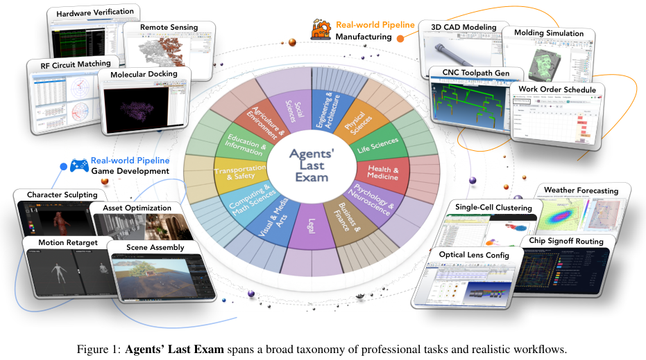
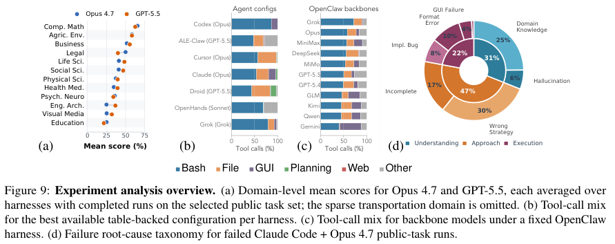
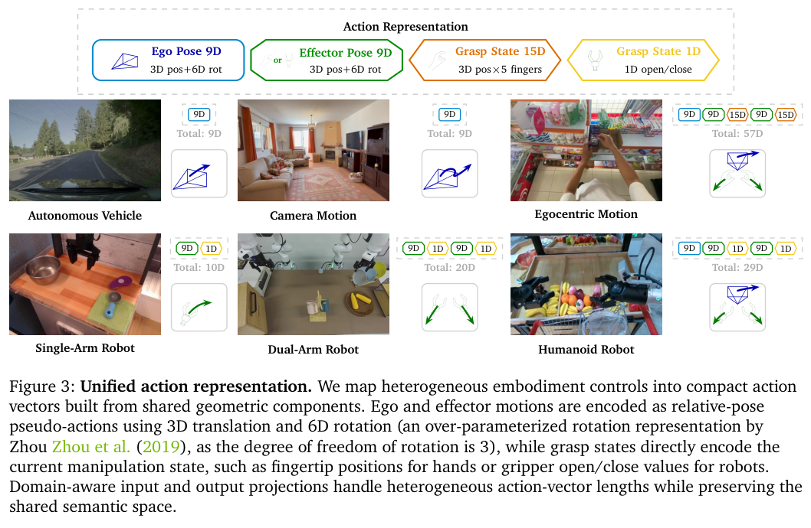

本期八项研究从威胁情报建图和专业工作流评测，延伸到表示蒸馏、连续推理、世界动作模型、算法搜索与仓库适配。

## 1. ANCHOR：威胁知识图谱的动态本体发现

[Schema-Agnostic Knowledge Graph Construction via Hybrid Ontology Discovery for Cyber Threat Intelligence](https://arxiv.org/abs/2606.01208v1) · v1 提交 2026-05-31 · [全文](https://arxiv.org/html/2606.01208v1) · [PDF](https://arxiv.org/pdf/2606.01208v1)

安全报告中的攻击者、工具、漏洞与行动链不能只压成孤立指标。ANCHOR 先抽实体关系，再动态发现本体：语义检索定位候选，低置信度时沿层级导航，最后以 SHACL 检查类型和关系约束，并保留证据句。

实验使用 CTINexus 的 149 份报告，为 UCO 和 STIX 重建类型标注。初始标签由模型集合产生，三位安全研究者交叉检查并达成共识；这不是完全独立于模型的原始人工标注。ANCHOR 与各基线统一使用本地 Qwen3.5-35B，在 NVIDIA GB10、128GB 内存工作站部署。

UCO 含 419 个类。表 III 的实体类型层级 F1 中，ANCHOR 为 0.7347，LLM4CTI 为 0.4521；指标给精确匹配 1.0 分、相邻父子错配 0.6 分、两步错配 0.3 分，不能理解成严格匹配正确率。更小的 MALOnt 上，表 IV 的关系类型 F1 为 0.5412，低于 LLM4CTI 的 0.5647，并非每项都胜出。

我的判断是，可导航、可检查的类型选择比一次性提示更适合大型本体，但收益取决于规模、层级与任务。通过 SHACL 不保证攻击事实真实，抽取遗漏和错误共指也仍会存在。本地运行减少部分外传路径，却不自动等于完整隐私保障。

**原图入口：**[Figure 2，PDF 第 5 页](https://arxiv.org/pdf/2606.01208v1#page=5)。

## 2. Agents’ Last Exam：用完整专业工作流考察 Agent

ALE 与 250 多位行业专家设计非体力职业工作流，按 13 个行业群、55 个子领域组织任务，要求 Agent 结合终端、图形界面、文件处理和检索完成可验收产物。它同时报告细粒度得分与拿到满分的通过率，避免把部分完成当成真正交付。

*图｜Sun, Yiyou 等，[Figure 1（PDF 第 2 页）](https://arxiv.org/pdf/2606.05405v1#page=2)，[CC BY 4.0](http://creativecommons.org/licenses/by/4.0/)。裁剪自原文。*

主实验实际评估三个难度组的 59、55、35 项任务，每次最多五小时。Codex 配 GPT-5.5 的总满分通过率为 26.2%，其中最高难度组为 8.6%，较容易组为 42.4%。整个持续扩展的任务池超过一千项，不能把已评估的 149 项和完整任务池混用；某组的细粒度平均分也不是完成率，更不能直接换算成经济生产率。

*图｜Sun, Yiyou 等，[Figure 9（PDF 第 9 页）](https://arxiv.org/pdf/2606.05405v1#page=9)，[CC BY 4.0](http://creativecommons.org/licenses/by/4.0/)。裁剪自原文。*

[Agents' Last Exam](https://arxiv.org/abs/2606.05405v1) · v1。

## 3. OPRD：在隐藏表示中进行在线蒸馏

OPRD 在学生自己生成的轨迹上对齐教师与学生的中间层隐藏状态，绕开 LM head 的词表输出；维度不同时使用投影层。相较只匹配下一个 token 的输出概率，它为每层结构提供监督，也避免该输出采样估计器的条件方差，但仍保留 rollout 本身的随机性。

以 R1-distill-1.5B 为学生、JustRL-1.5B 为教师，在共享轨迹、教师前向与训练预算的 Avg@16 数学评测中，OPRD 的 AIME24、AIME25、AIMO 分别为 49.8、34.6、79.1；top-16 OPD 为 47.1、34.0、76.5，教师为 50.8、35.6、79.5。它接近该教师，但并未超过教师；这一结果依赖能访问教师内部表示，不能直接用于只提供文本接口的闭源教师。

[OPRD: On-Policy Representation Distillation](https://arxiv.org/abs/2606.06021v1) · v1。

[Figure 1（原文）](https://arxiv.org/pdf/2606.06021v1#page=2)。

## 4. NF-CoT：用可计算概率的连续状态承载推理

NF-CoT 在语言模型内加入 normalizing-flow head，用连续 thought 状态替代部分文字推理，同时保留从左到右采样、KV cache 和精确潜在似然。文本位置仍由原 LM head 生成，连续位置则接受从显式推理蒸馏而来的训练，并可继续做策略梯度优化。

Qwen3-8B-Base、64 个潜在槽的五项代码基准中，Unified 版本平均 pass@1 为 68.8，基础模型为 55.8，LaDiR 为 61.6；再做 RL 后为 70.1。HumanEval 的 Unified 分数为 85.8，仍低于 LaDiR 的 87.4，平均领先不意味着每个任务最好。潜在槽、flow 层与训练都需要计算，压缩文字推理长度不能直接等同于同倍数的端到端加速。

[Latent Reasoning with Normalizing Flows](https://arxiv.org/abs/2606.06447v1) · v1。

[Figure 1（原文）](https://arxiv.org/pdf/2606.06447v1#page=1)。

## 5. WLA：把世界预测与语言子任务接到动作生成

WLA 用自回归骨干共同表示文本子任务、未来状态与机器人动作，由 World Expert 学习物理变化、Action Expert 输出控制。meta-query 让世界预测能在训练中影响动作，而默认推理可关闭世界专家；需要更多计算时，再生成候选未来并用价值模型选动作。

WLA-0 在 RoboTwin 2.0 Clean/Random 的平均成功率为 92.94%/90.02%，LIBERO 为 98.6%；RMBench 的四项记忆任务平均为 56.5%，去掉语言子任务监督后为 17.3%。RoboTwin 是混合任务训练，RMBench 则每项任务单独训练，不能合成统一泛化分数。约 40 ms 延迟对应 RTX 5090 上的默认高效模式，不包括多候选世界模拟的额外开销。

[World-Language-Action Model for Unified World Modeling, Language Reasoning, and Action Synthesis](https://arxiv.org/abs/2606.05979v1) · v1。

[Figure 1（原文）](https://arxiv.org/pdf/2606.05979v1#page=2)。

## 6. MLEvolve：让搜索分支交换经验

MLEvolve 用带引用边的 Progressive MCGS 替代互不相通的搜索树分支，逐步从广泛探索转向利用，再以回顾记忆复用领域知识与任务经验。战略规划和代码生成分开，并按修改规模切换编码方式，以维持长时间实验的稳定性。

在全部 75 项 MLE-Bench、每任务 12 小时预算下，Gemini-3.1-Pro-preview 配置的获奖率为 65.3±0.8%，有效提交率 100%，结果为三种子的均值与 SEM。24 小时的 AIBuildAI 对照为 63.1±0.4%，但使用不同模型和系统；这个跨系统比较不能单独证明图搜索使计算量减半。更有归因价值的是固定骨干和预算的组件消融。

[MLEvolve: A Self-Evolving Framework for Automated Machine Learning Algorithm Discovery](https://arxiv.org/abs/2606.06473v1) · v1。

[Figure 1（原文）](https://arxiv.org/pdf/2606.06473v1#page=2)。

## 7. Code2LoRA：从代码与提交差异生成仓库适配器

Code2LoRA 用超网络将代码库变成专属 LoRA，静态版读取快照，演化版通过 GRU 累积每次代码 diff。仓库知识进入参数后，调用时不必把同样的长仓库上下文反复塞进提示，但生成和维护适配器仍需读取代码与运行网络。

604 个 Python 仓库的 RepoPeftBench 中，静态版跨仓库与仓库内的断言补全 exact match 分别为 63.8%、66.2%，单一共享 LoRA 为 47.4%、50.4%。演化版跨仓库为 60.3%，共享 LoRA 为 55.1%。这些是断言补全任务的匹配率，不能等同于完整仓库修改的测试通过率；静态轨和提交演化轨也不能直接横向排名。

[Code2LoRA: Hypernetwork-Generated Adapters for Code Language Models under Software Evolution](https://arxiv.org/abs/2606.06492v1) · v1。

[Figure 1（原文）](https://arxiv.org/pdf/2606.06492v1#page=4)。

## 8. Cosmos 3：共享推理与多模态生成的世界模型

Cosmos 3 通过双塔 Mixture-of-Transformers 连接语言、图像、视频、音频和动作，以不同训练阶段分别学习理解、生成与物理交互。Nano 与 Super 从预训练视觉语言模型初始化，在共享序列表示中组织 reasoner 和 generator，使模型既能描述场景，也能预测变化或输出动作。

*图｜NVIDIA 等，[Figure 3（PDF 第 8 页）](https://arxiv.org/pdf/2606.02800v2#page=8)，[CC BY 4.0](http://creativecommons.org/licenses/by/4.0/)。裁剪自原文。*

RoboLab-120 的 DROID 微调政策评测中，Nano-Policy 在明确指令下的平均成功率为 39.7%，π0.5 为 28.1%；模糊指令下则只有 20.6%。每项任务有十次 rollout，复杂任务的成功率也明显更低。这是该政策检查点和实验协议的结果，不能由视频质量、榜单偏好或同一系列的其他模型推断所有物理任务能力。

*图｜NVIDIA 等，[Table 19（PDF 第 68 页）](https://arxiv.org/pdf/2606.02800v2#page=68)，[CC BY 4.0](http://creativecommons.org/licenses/by/4.0/)。裁剪自原文。*

[Cosmos 3: Omnimodal World Models for Physical AI](https://arxiv.org/abs/2606.02800v2) · v2。
