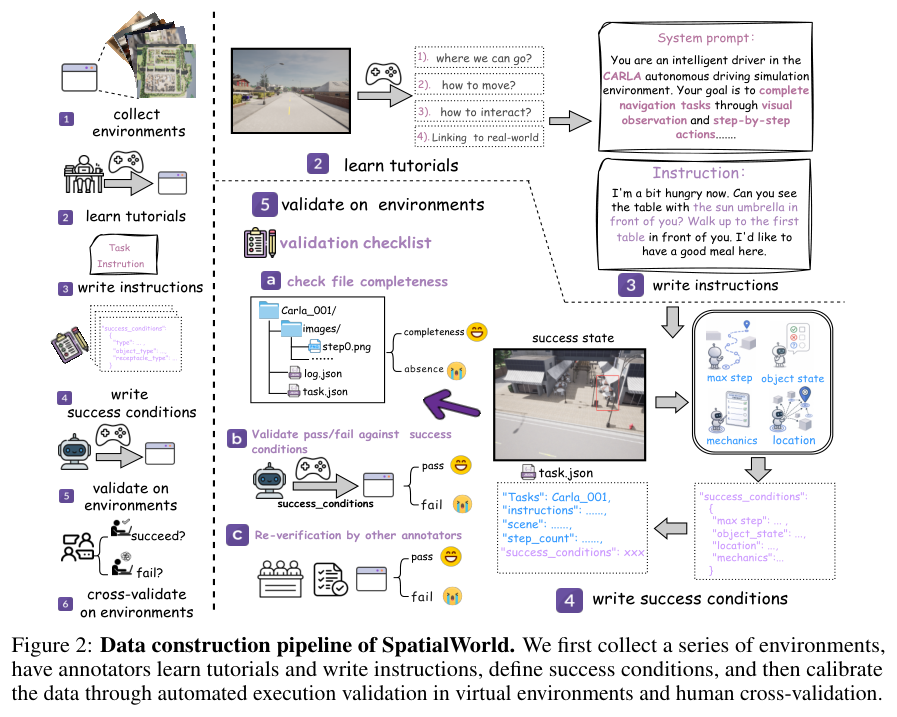
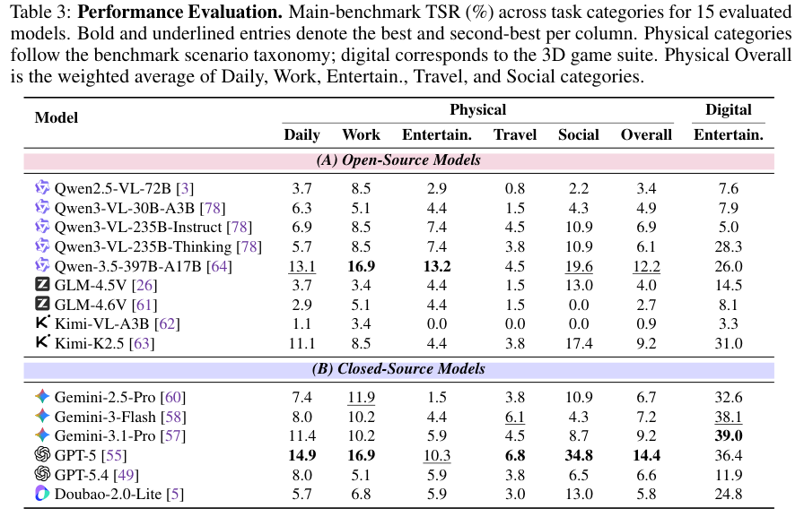
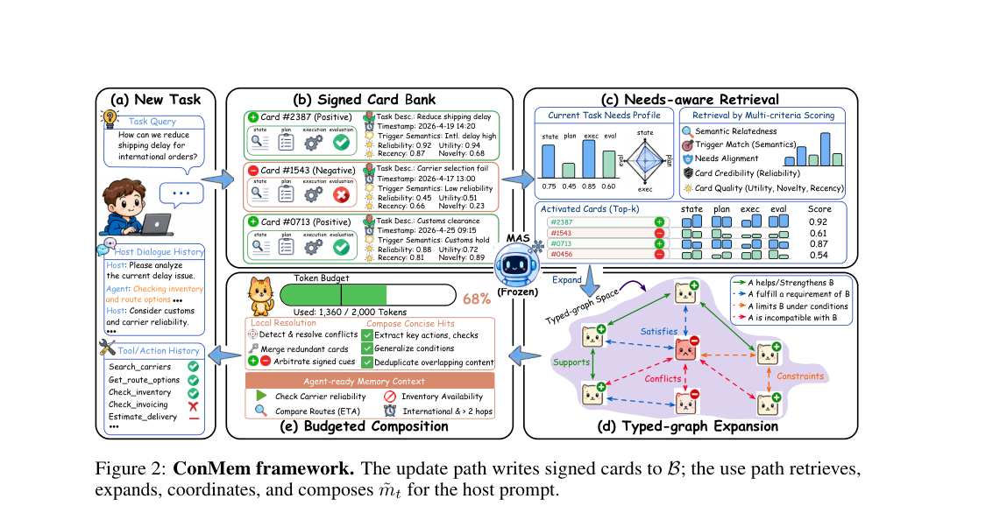
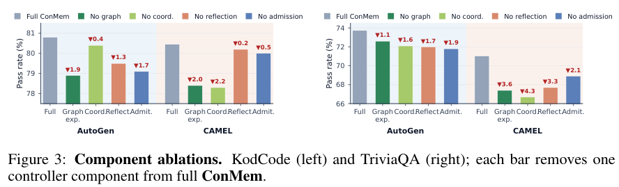
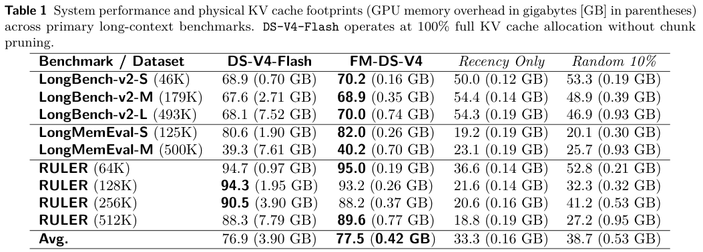
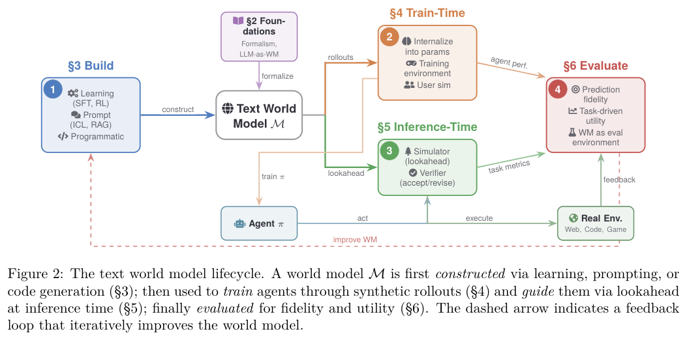
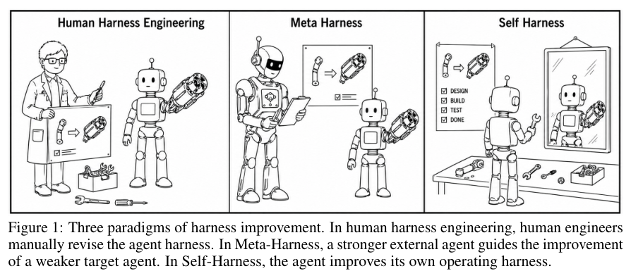
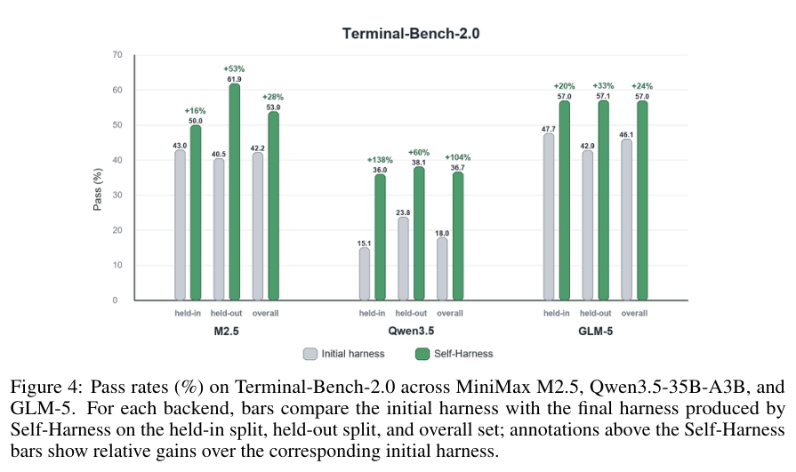

本期八项研究讨论三维场景到本体的映射、实验数据语义化、视频空间记忆、交互式推理、记忆协调、缓存选择与框架自改进。

## 1. USD 到知识图谱：场景分类依赖哪些信息

[From USD Scenes to Knowledge Graphs: Zero-Shot Ontology Grounding with LLMs](https://arxiv.org/abs/2606.09134v1) · v1 提交 2026-06-08 · [全文](https://arxiv.org/html/2606.09134v1) · [PDF](https://arxiv.org/pdf/2606.09134v1)

USD 描述三维场景层级和几何，本体定义类别与语义。From USD Scenes to Knowledge Graphs 用大模型零样本分类，比较语义名称、缩写与不透明编号，再逐步加入几何、位置和层级上下文，研究场景对象怎样对应本体概念。

评估仅使用 Pixar Kitchen Set 的 125 个对象及 SOMA-HOME 的 94 个厨房类，温度 0、单次确定性运行。表 I 中 Gemini 3 Flash 在不透明目标名、仅含目标名称和本体的策略 A 上，精确匹配为 6%；加入上下文的策略 B 为 48%。但层级单独输入达到 54%，将兄弟节点名称和父路径也匿名化后，层级输入降至 6%，完整上下文降至 15%。

这个控制实验比最高分更值得看：目标没有名字，不代表周围标签没有语义提示。系统可能主要在读场景名称，而非理解几何。方法可帮助命名良好的资产库减少手写词典，但杯、碗等形状相近对象仍会混淆。单一厨房场景、无方差估计限制了迁移结论；真实应用应将命名证据与形状证据分别审查，并保留人工确认。

**原图入口：**[Figure 1，PDF 第 1 页](https://arxiv.org/pdf/2606.09134v1#page=1)。

## 2. MetaConfigurator：把 JSON 到 RDF 的中间映射留下来

MetaConfigurator 的 RDF Authoring View 将 AI 辅助 RML 映射、本体 IRI 补全、三元组编辑、SPARQL 查询和图可视化放进同一网页界面。JSON-LD 文本与三元组表双向同步，使研究者可以检查模型提出的语义映射，再导出 RDF。

论文以金属有机框架合成的实验记录展示流程：将试剂、步骤与用量从 JSON 转换为本体支撑的 JSON-LD，再查询条件与结果关系。它是工具与案例展示，没有受控用户研究或统一准确率提升；结构验证通过也不保证单位、实体身份与实验含义映射正确。保留可编辑规则的价值在于能够逐项复查。

[MetaConfigurator: AI-Assisted RDF Authoring from JSON Data](https://arxiv.org/abs/2606.07094v1) · v1。

[Figure 1（原文）](https://arxiv.org/pdf/2606.07094v1#page=3)。

## 3. Mirage：在扩散潜空间中保存三维记忆

Mirage 将潜在 token 通过深度反投影存入持久三维缓存，再用潜空间 warping 读出新视角，避免先渲染 RGB 点云、再重新进行 VAE 编码。它以 Wan2.2-TI2V-5B 为骨干，分阶段训练侧分支和 LoRA，使空间记忆接到视频扩散过程。

WorldScore 的静态与动态平均分为 70.36，Spatia 为 69.73；RealEstate10K 新视角 PSNR 为 18.38，略低于 Spatia 的 18.58，闭环 SSIM 则为 0.825，高于 0.579。质量收益因指标而异，潜空间缓存也仍依赖深度与相机估计。训练主要来自去除动态区域的房产视频，不能把几何一致性直接当作复杂动态世界的完整建模能力。

[Latent Spatial Memory for Video World Models](https://arxiv.org/abs/2606.09828v1) · v1。

[Figure 1（原文）](https://arxiv.org/pdf/2606.09828v1#page=1)。

## 4. SpatialWorld：让空间推理接受交互式验收

SpatialWorld 将八种模拟后端接到统一文字动作接口，760 项人工标注任务覆盖家务、工作、出行、协作和三维游戏。Agent 只看第一人称图像与任务描述，需要主动探索；末状态验证器判断是否完成目标，另以成功任务相对人工参考的步数衡量效率。

*图｜Gao, Hongcheng 等，[Figure 2（PDF 第 4 页）](https://arxiv.org/pdf/2606.09669v1#page=4)，[CC BY 4.0](http://creativecommons.org/licenses/by/4.0/)。裁剪自原文。*

十五个模型的评测中，GPT-5 在物理任务上的加权成功率为 14.4%，三维游戏为 36.4%；Qwen-3.5-397B-A17B 的物理成功率为 12.2%。真实世界主题的任务仍在模拟器中运行，不能误称真实机器人现场成功率。各模型完成的任务集合不同，步数效率还需结合成功率阅读，避免把失败得快当作高效。

*图｜Gao, Hongcheng 等，[Table 3（PDF 第 7 页）](https://arxiv.org/pdf/2606.09669v1#page=7)，[CC BY 4.0](http://creativecommons.org/licenses/by/4.0/)。裁剪自原文。*

[SpatialWorld: Benchmarking Interactive Spatial Reasoning of Multimodal Agents in Real-World Tasks](https://arxiv.org/abs/2606.09669v1) · v1。

## 5. ConMem：先协调记忆之间的关系，再给多 Agent 使用

ConMem 从历史交互抽取结构化记忆卡片，并以关系图记录依赖、冲突和冗余。运行时根据任务检索卡片，再沿关系协调和裁剪，给宿主多 Agent 系统提供相容的策略提示，整个过程无需更新宿主模型权重。

*图｜Tan, Zhixun 等，[Figure 2（PDF 第 4 页）](https://arxiv.org/pdf/2606.08702v1#page=4)，[CC BY 4.0](http://creativecommons.org/licenses/by/4.0/)。裁剪自原文。*

共享 Qwen3-4B-Instruct-2507、AutoGen 宿主的四任务平均成绩从无记忆的 45.97 到 58.33，ReMe 为 57.46；但 TriviaQA 单项为 74.73，低于 LatentMem 的 76.51。CAMEL、MacNet 的平均收益也存在，然而某些对照引用既有论文，且四任务指标并不完全同质；平均分不是一个通用 Agent 成功率。

*图｜Tan, Zhixun 等，[Figure 3（PDF 第 8 页）](https://arxiv.org/pdf/2606.08702v1#page=8)，[CC BY 4.0](http://creativecommons.org/licenses/by/4.0/)。裁剪自原文。*

[ConMem: Structured Memory-Guided Adaptation in Training-Free Multi-Agent Systems](https://arxiv.org/abs/2606.08702v1) · v1。

## 6. FlashMemory：提前选择下一步需要的缓存块

FlashMemory 为 DeepSeek-V4 配置独立训练的 Neural Memory Indexer，每隔 64 个解码步骤预测后续查询所需的历史块，只把这些块从 CPU 冷池取到 GPU，同时保留局部窗口和原有全局压缩注意力。索引器按双编码器训练，不必将整个骨干模型载入训练显存。

*图｜Wang, Yan 等，[Figure 2（PDF 第 3 页）](https://arxiv.org/pdf/2606.09079v1#page=3)，[CC0 1.0](http://creativecommons.org/publicdomain/zero/1.0/)。裁剪自原文。*

在 493K 上下文的 LongBench-v2-L 中，v1 表 1 报告分数从 68.1 到 70.0，物理 KV 缓存从 7.52 GB 到 0.74 GB；这些是缓存占用，不是整机显存或端到端延迟。MRCR 的准确率却从 76.0% 降到 48.0%，表明密集依赖全局历史的任务会受损。节省缓存与保留信息之间仍有任务相关的权衡。

*图｜Wang, Yan 等，[Table 1（PDF 第 8 页）](https://arxiv.org/pdf/2606.09079v1#page=8)，[CC0 1.0](http://creativecommons.org/publicdomain/zero/1.0/)。裁剪自原文。*

[FlashMemory-DeepSeek-V4: Lightning Index Ultra-Long Context via Lookahead Sparse Attention](https://arxiv.org/abs/2606.09079v1) · v1。

## 7. Text World Models：把网页与工具响应作为状态转移

这篇综述把文本世界模型定义为：给定当前文本状态与候选动作，预测网页、终端输出、API 响应或用户回复。它按状态表示、环境领域、模型构建、训练与推理用途组织研究，区分直接用 LLM 模拟与用代码定义环境两条路线。

*图｜Li, Yixia 等，[Figure 2（PDF 第 3 页）](https://arxiv.org/pdf/2606.09032v1#page=3)，[CC BY 4.0](http://creativecommons.org/licenses/by/4.0/)。裁剪自原文。*

评估需要同时检查模型对转移的预测，以及 Agent 使用这个模型后的规划、学习和验收表现。文本看起来合理，不代表网页元素、工具副作用或后续状态可执行；反过来，局部预测误差也未必等于任务失败。论文提供的是设计与评价框架，没有提出一个可引用为自身实验增益的统一成绩。

[Bridging the Agent-World Gap: Text World Models for LLM-based Agents](https://arxiv.org/abs/2606.09032v1) · v1。

## 8. Self-Harness：让模型修改自己的执行框架

Self-Harness 依次从执行轨迹中归纳弱点、提出小规模 harness 修改、用回归测试验收，只改变允许的框架配置，保持模型骨干不变。它把易错行为变成可执行的工作机制，而不只是不断添加通用提示。

*图｜Zhang, Hangfan 等，[Figure 1（PDF 第 2 页）](https://arxiv.org/pdf/2606.09498v1#page=2)，[CC BY 4.0](http://creativecommons.org/licenses/by/4.0/)。裁剪自原文。*

Terminal-Bench-2.0 中，MiniMax M2.5 的 held-out Pass 从 40.5% 到 61.9%，Qwen3.5-35B-A3B 从 23.8% 到 38.1%，GLM-5 从 42.9% 到 57.1%。Pass 是固定配置下重复尝试的平均通过率。held-out 内容虽然不展示给提案者，却被自动晋升门禁使用，因此还需另设完全独立的最终测试，才能更强地判断框架修改的泛化能力。

*图｜Zhang, Hangfan 等，[Figure 4（PDF 第 9 页）](https://arxiv.org/pdf/2606.09498v1#page=9)，[CC BY 4.0](http://creativecommons.org/licenses/by/4.0/)。裁剪自原文。*

[Self-Harness: Harnesses That Improve Themselves](https://arxiv.org/abs/2606.09498v1) · v1。
