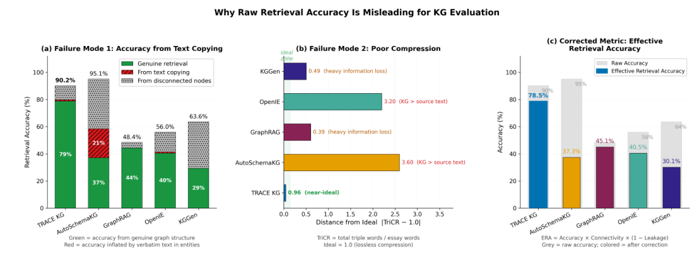
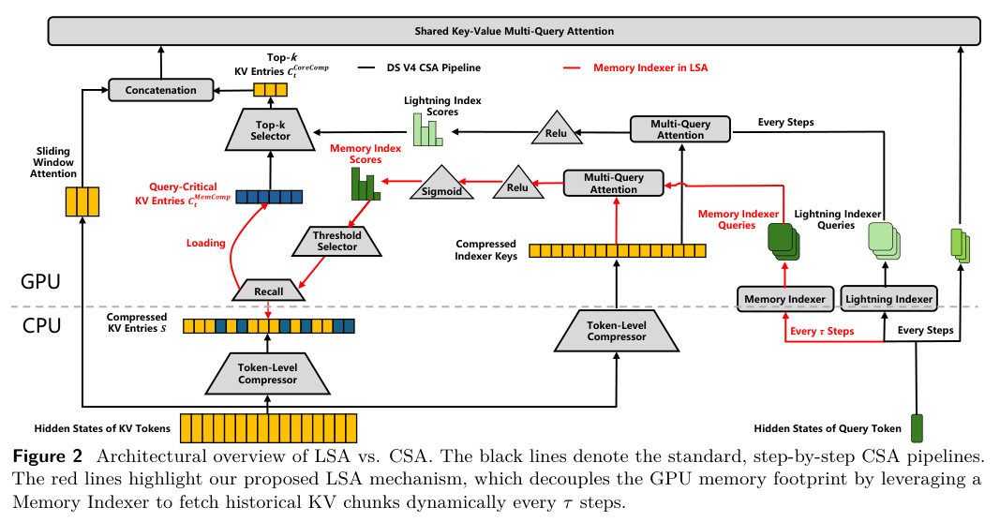
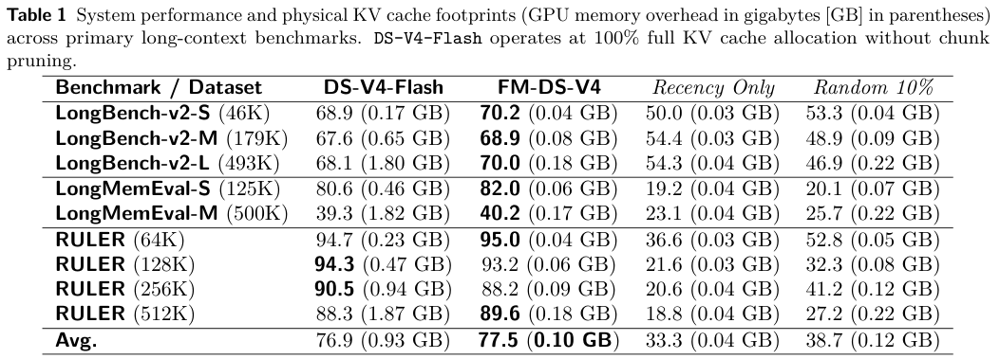
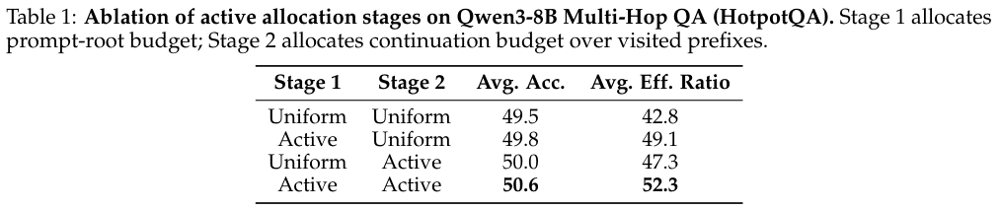

本期五项研究分别考察上下文图谱、长历史缓存、自改进执行框架、强化学习采样分配和多段未来预测。

## 1. TRACE-KG：让图谱保留可组合的上下文

[Beyond Predefined Schemas: TRACE-KG for Context-Enriched Knowledge Graphs from Complex Documents](https://arxiv.org/abs/2604.03496v1) · v1 提交 2026-04-03 · [全文](https://arxiv.org/html/2604.03496v1) · [PDF](https://arxiv.org/pdf/2604.03496v1)

检索出的子图能够支持事实，不一定表示形成了可组合结构：把大段原文塞进节点，同样可能获得高分。TRACE-KG 将上下文、实体消歧、关系限定信息和数据驱动模式放入同一建图流程，并在评估中考虑连通性与文本泄漏。

MINE-1 实验中，系统使用相同嵌入、检索超参数及严格 LLM 判定配置，只根据检索子图判断事实是否被支持，不补外部知识。表 1 中 TRACE-KG 原始检索准确率 90.2%，低于 AutoSchemaKG 的 95.1%；泄漏指标为 1.3% 对 36.5%，最大弱连通分量占比为 88.5% 对 61.5%。

作者定义 EGU 为检索准确率、连通率与非泄漏比例的组合，表中报告值分别为 78.5% 与 37.3%。组合指标并非唯一金标准；泄漏指标也不等于所有事实都已正确压缩。模型裁判、指标定义和选定文档都会影响排序。我的判断是，企业建图应同时检查回答能力、跨节点组合和原文复制程度。

原图：Mohammad Sadeq Abolhasani、Yang Ba、Yixuan He、Rong Pan，arXiv:2604.03496v1，Figure 2，PDF 第 8 页。[原始来源](https://arxiv.org/pdf/2604.03496v1#page=8) · [CC BY 4.0](https://creativecommons.org/licenses/by/4.0/)。裁剪自原文。

## 2. FlashMemory：提前选择下一步需要的缓存块

FlashMemory 为 DeepSeek-V4 配置独立训练的 Neural Memory Indexer，每隔 64 个解码步骤预测后续查询所需的历史块，只把这些块从 CPU 冷池取到 GPU，同时保留局部窗口和原有全局压缩注意力。索引器按双编码器训练，不必将整个骨干模型载入训练显存。

*图｜Wang, Yan 等，[Figure 2（PDF 第 3 页）](https://arxiv.org/pdf/2606.09079v2#page=3)，[CC0 1.0](http://creativecommons.org/publicdomain/zero/1.0/)。裁剪自原文。*

在 493K 上下文的 LongBench-v2-L 中，v2 表 1 报告分数从 68.1 到 70.0，物理 KV 缓存从 1.80 GB 到 0.18 GB；这些是缓存占用，不是整机显存或端到端延迟。MRCR 的准确率却从 76.0% 降到 48.0%，表明密集依赖全局历史的任务会受损。节省缓存与保留信息之间仍有任务相关的权衡。

*图｜Wang, Yan 等，[Table 1（PDF 第 8 页）](https://arxiv.org/pdf/2606.09079v2#page=8)，[CC0 1.0](http://creativecommons.org/publicdomain/zero/1.0/)。裁剪自原文。*

[FlashMemory-DeepSeek-V4: Lightning Index Ultra-Long Context via Lookahead Sparse Attention](https://arxiv.org/abs/2606.09079v2) · v2。

## 3. Self-Harness：让模型修改自己的执行框架

Self-Harness 依次从执行轨迹中归纳弱点、提出小规模 harness 修改、用回归测试验收，只改变允许的框架配置，保持模型骨干不变。它把易错行为变成可执行的工作机制，而不只是不断添加通用提示。

*图｜Zhang, Hangfan 等，[Figure 1（PDF 第 2 页）](https://arxiv.org/pdf/2606.09498v1#page=2)，[CC BY 4.0](http://creativecommons.org/licenses/by/4.0/)。裁剪自原文。*

Terminal-Bench-2.0 中，MiniMax M2.5 的 held-out Pass 从 40.5% 到 61.9%，Qwen3.5-35B-A3B 从 23.8% 到 38.1%，GLM-5 从 42.9% 到 57.1%。Pass 是固定配置下重复尝试的平均通过率。held-out 内容虽然不展示给提案者，却被自动晋升门禁使用，因此还需另设完全独立的最终测试，才能更强地判断框架修改的泛化能力。

*图｜Zhang, Hangfan 等，[Figure 4（PDF 第 9 页）](https://arxiv.org/pdf/2606.09498v1#page=9)，[CC BY 4.0](http://creativecommons.org/licenses/by/4.0/)。裁剪自原文。*

[Self-Harness: Harnesses That Improve Themselves](https://arxiv.org/abs/2606.09498v1) · v1。

## 4. TRACE：把采样预算分配到更有对比信号的位置

TRACE 将一次多轮轨迹拆成带语义的前缀节点，同时决定哪些问题值得采样、哪些中途状态值得继续分支。共享预测器估计前缀的条件成功率，优先寻找可能同时产生成功与失败后续的锚点，让相同终局奖励产生更强的训练对比。

*图｜Zou, Heming 等，[Figure 3（PDF 第 6 页）](https://arxiv.org/pdf/2606.11119v1#page=6)，[CC BY 4.0](http://creativecommons.org/licenses/by/4.0/)。裁剪自原文。*

固定树预算的 Qwen3-8B、HotpotQA 消融中，问题根与前缀均匀分配的平均准确率为 49.5，两层主动分配为 50.6；有效对比比例由 42.8 到 52.3。根预算 1024、续写预算 2 的 TRACE 也从 TreePO 的 49.5 提高到 50.6。对比比例不是任务成功率，额外预测器与终局判分必须可靠，收益也不能推广到没有可验证反馈的任意任务。

*图｜Zou, Heming 等，[Table 1（PDF 第 10 页）](https://arxiv.org/pdf/2606.11119v1#page=10)，[CC BY 4.0](http://creativecommons.org/licenses/by/4.0/)。裁剪自原文。*

[TRACE: A Unified Rollout Budget Allocation Framework for Efficient Agentic Reinforcement Learning](https://arxiv.org/abs/2606.11119v1) · v1。

## 5. Next Forcing：用多段未来监督训练因果世界模型

Next Forcing 在主视频模型旁加入轻量 multi-chunk prediction 模块，同时预测下一、下下及更远的视频块，并通过多层特征融合让近未来指导远未来。推理时可以只保留主模型，也可以并行生成当前与下一块，以训练时的辅助模块换取额外吞吐。

RoboTwin 的五十项任务中，Clean/Random 平均成功率为 94.1%/93.5%，LingBot-VA 为 92.9%/91.5%。较小的固定条件消融使用 16 张 GPU、20k 步，基础配置从 75.6 到加入 MCP 的 85.8。论文所报两倍推理加速对应并行块生成模式，不是整个机器人任务完成时间减半；不同帧率和训练步数的收敛对照也需分别比较。

[Next Forcing: Causal World Modeling with Multi-Chunk Prediction](https://arxiv.org/abs/2606.11187v1) · v1。

[Figure 1（原文）](https://arxiv.org/pdf/2606.11187v1#page=2)。
