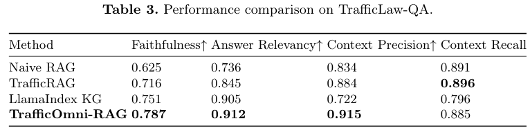
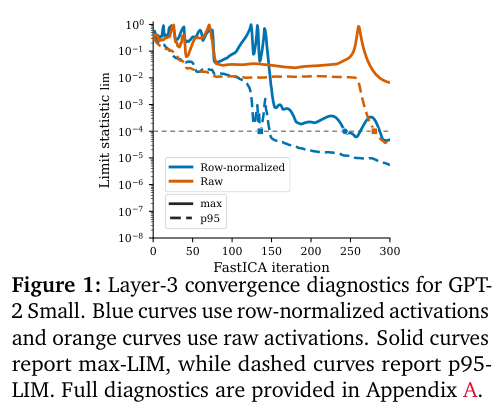
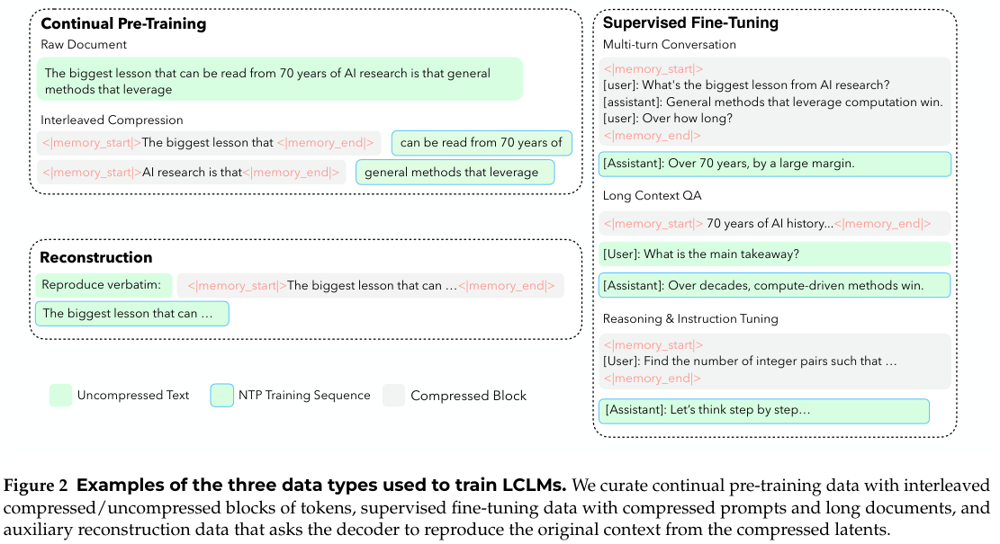
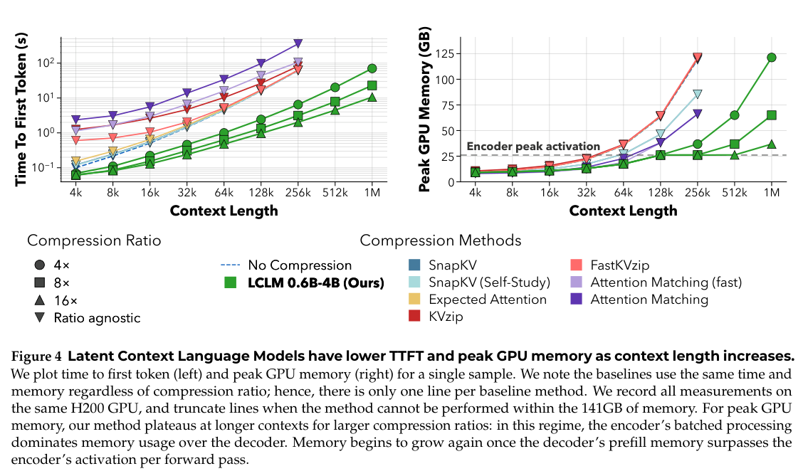
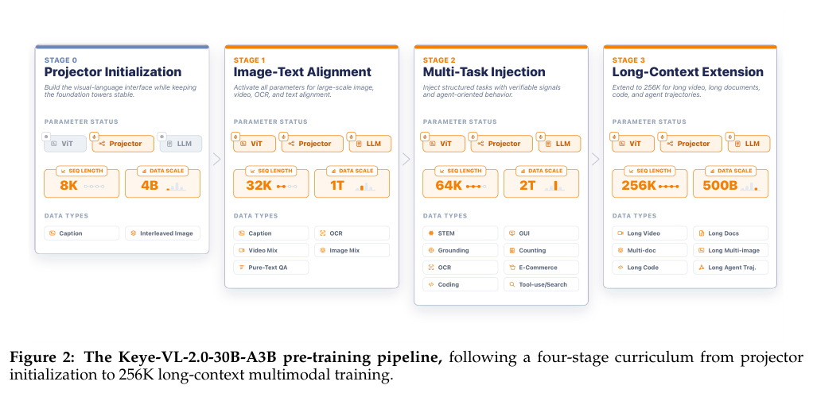
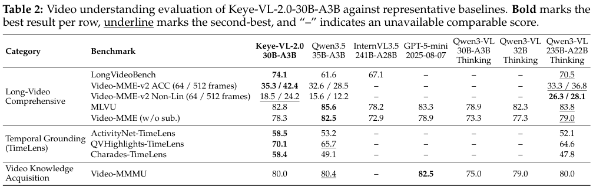
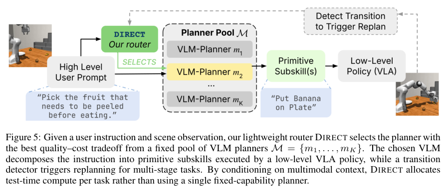
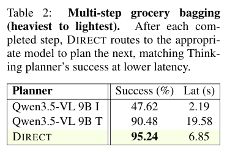
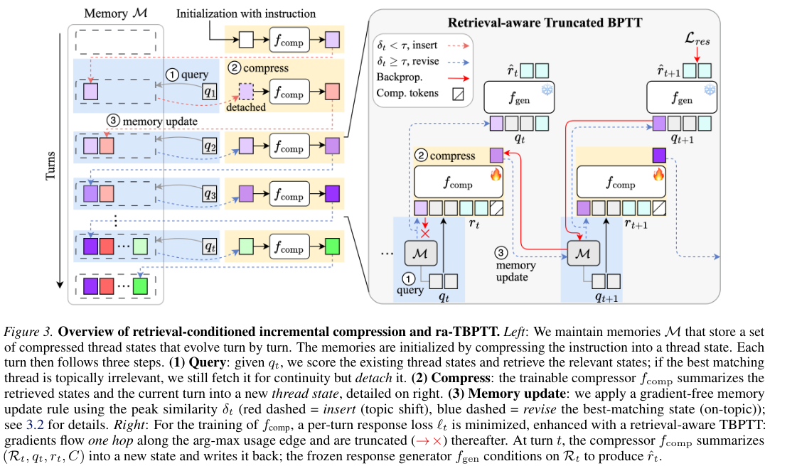
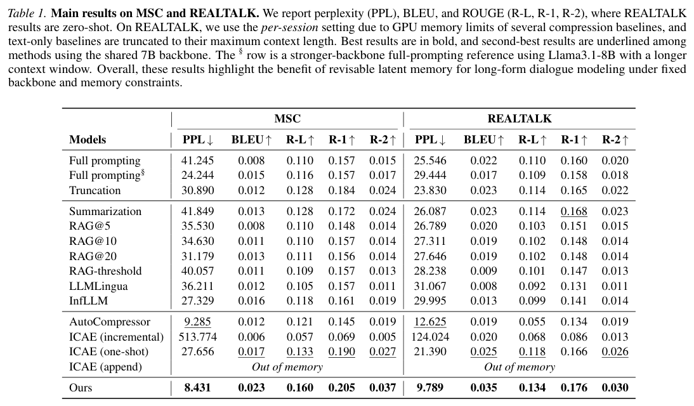

本期九项研究讨论法律证据检索、激活解释、长文与对话压缩、多模态视频理解和机器人推理、动作与接触学习。

## 1. OMAGR：从多个本体锚点检索法律证据

[An Ontology-Guided Multi-Anchor Graph Retrieval Framework for Traffic Legal Liability Determination](https://arxiv.org/abs/2606.11910v1) · v1 提交 2026-06-10 · [全文](https://arxiv.org/html/2606.11910v1) · [PDF](https://arxiv.org/pdf/2606.11910v1)

交通责任问题常同时涉及违法行为、事故形态、参与者与后果。从单一实体或单条向量出发，可能只找到其中一面。OMAGR 用本体拆出多个锚点并行检索，再汇总依据；完整系统称为 TrafficOmni-RAG。

TrafficLaw-QA 包含 200 问、六部中国交通法规范来源和 11 类主题。各方法共享语料、嵌入、切分、生成模型 GLM-4-Flash，RAGAS 也用该模型作裁判。与同图谱上的单实体遍历 LlamaIndex KG 比，Context Precision 从 0.722 到 0.915，Faithfulness 从 0.751 到 0.787。

反例同样重要：TrafficRAG 的 Context Recall 为 0.896，高于完整系统 0.885；消融中纯向量版本 Faithfulness 为 0.802，也高于完整系统。结果支持这一基准中的多锚点权衡，而非图结构全面胜过向量。我的判断是，应逐维展示找到的证据及遗漏，不能让流畅答案掩盖漏检。模型裁判分数不是法律结论正确率；真实使用仍需核对适用规范与案件事实。

原图：Xu Li、Shuqi Tian、Xun Han、Kuncheng Zhao、Xinyi Li，arXiv:2606.11910v1，Figure 1，PDF 第 4 页。[原始来源](https://arxiv.org/pdf/2606.11910v1#page=4) · [CC BY 4.0](https://creativecommons.org/licenses/by/4.0/)。裁剪自原文。

*图｜Li, Xu 等，[Table 3（PDF 第 9 页）](https://arxiv.org/pdf/2606.11910v1#page=9)，[CC BY 4.0](http://creativecommons.org/licenses/by/4.0/)。裁剪自原文。*

## 2. ICA Lens：先从激活几何里找可解释方向

ICA Lens 用 GPU 并行 FastICA 寻找非高斯的激活方向，加入逐行归一化、收敛诊断和自适应重拟合，避免每分析一层都训练一个大型过完备 SAE。它还用上下文截断、人工标签审查和扰动测试，区分局部 token 特征与更长程的语境信息。

*图｜Liu, Sida 等，[Figure 1（PDF 第 8 页）](https://arxiv.org/pdf/2606.11722v1#page=8)，[CC BY 4.0](http://creativecommons.org/licenses/by/4.0/)。裁剪自原文。*

GPT-2 Small 使用一百万个拟合位置、允许 p95 回退的设置下，归一化将通过收敛检查的层数从 6/12 提高到 10/12。三个模型共随机抽取 150 个分量，142 个得到非模糊标签、127 个为高置信标签；这些是审查协议下的可解释性判断，不是模型行为被完整解释。SAEBench 的稀疏探针与定向扰动也支持其作为 SAE 的补充，而非证明 ICA 在所有解释任务上替代 SAE。

*图｜Liu, Sida 等，[Figure 12（PDF 第 25 页）](https://arxiv.org/pdf/2606.11722v1#page=25)，[CC BY 4.0](http://creativecommons.org/licenses/by/4.0/)。裁剪自原文。*

[ICA Lens: Interpreting Language Models Without Training Another Dictionary](https://arxiv.org/abs/2606.11722v1) · v1。

## 3. LCLM：把上下文编码成可展开的潜在片段

Latent Context Language Models 用编码器将长文本转为更短的潜在嵌入，再由解码器读取；Agent 可以先浏览压缩上下文，再按需展开有关片段。作者先搜索架构，再对 0.6B 编码器、4B 解码器的 4×、8×、16× 压缩模型分别进行超过 350B token 的持续预训练。

*图｜Li, Ang 等，[Figure 2（PDF 第 4 页）](https://arxiv.org/pdf/2606.09659v1#page=4)，[CC BY 4.0](http://creativecommons.org/licenses/by/4.0/)。裁剪自原文。*

同一 H200 上的单样本对照测量首 token 时间与编码器、解码器合计峰值显存，使用二十次预热、三十次计时。随着上下文增长，LCLM 的曲线比所比较 KV 压缩方法更有利，但高压缩配置的显存平台来自编码器分批处理，之后仍可能重新增长。压缩率不是整机加速倍数，质量也需连同任务相关片段是否展开一起评价。

*图｜Li, Ang 等，[Figure 4（PDF 第 8 页）](https://arxiv.org/pdf/2606.09659v1#page=8)，[CC BY 4.0](http://creativecommons.org/licenses/by/4.0/)。裁剪自原文。*

[End-to-End Context Compression at Scale](https://arxiv.org/abs/2606.09659v1) · v1。

## 4. Keye-VL-2.0：稀疏长视频注意力与跨模态蒸馏

Keye-VL-2.0 是 30B 总参数、约 3B 激活参数的多模态 MoE，将 DSA 适配到 GQA 视频模型，并结合 Context-RL、Video-RL 和多教师在线蒸馏。系统同时处理视频采样、视觉与语言并行、索引器和视觉 token 对齐，让长视频的关键帧能够进入有效上下文。

*图｜Kwai Keye Team 等，[Figure 2（PDF 第 8 页）](https://arxiv.org/pdf/2606.10651v1#page=8)，[CC BY 4.0](http://creativecommons.org/licenses/by/4.0/)。裁剪自原文。*

Video-MME-v2 的 64/512 帧准确率为 35.3/42.4，Qwen3.5-35B-A3B 为 32.6/28.5；但普通 Video-MME 无字幕分数为 78.3，低于对照 82.5，MLVU 也为 82.8 对 85.6。增加帧数与稀疏选择在部分长视频任务上有帮助，不能把 256K 支持或某项领先当作全部视频理解都无损。

*图｜Kwai Keye Team 等，[Table 2（PDF 第 19 页）](https://arxiv.org/pdf/2606.10651v1#page=19)，[CC BY 4.0](http://creativecommons.org/licenses/by/4.0/)。裁剪自原文。*

[Kwai Keye-VL-2.0 Technical Report](https://arxiv.org/abs/2606.10651v1) · v1。

## 5. QGF：在推理时用价值梯度引导流策略

Q-Guided Flow 先以行为克隆训练参考 flow policy，并另学价值 critic；推理时用对去噪终点的近似价值梯度引导每一步动作生成，减少完整反传穿过 ODE 的成本与不稳定性。策略无需再接受 actor-critic 更新，但 critic 的质量仍决定优化方向。

二十项离线强化学习任务、十个种子、500k 训练步的比较中，QGF 优于所测既有测试时方法，并与最强训练时方法相当。一个使用二十任务、四种子的梯度扰动实验还发现，它比完整 BPTT 对动作噪声更不敏感。两个实验的种子数与指标不同；这些模拟控制结果不能直接换成真实机器人成功率，测试时引导和多候选采样也仍有计算成本。

[Test-Time Gradient Guidance of Flow Policies in Reinforcement Learning](https://arxiv.org/abs/2606.11087v1) · v1。

[Figure 1（原文）](https://arxiv.org/pdf/2606.11087v1#page=1)。

## 6. World Pilot：把动态先验送入视觉与动作两条路径

World Pilot 用世界动作模型提供两种先验：Latent Steering 给视觉感知加入预计的场景变化，Action Steering 给动作生成器提供候选运动轨迹。语义骨干由此获得接触和运动相关信息，而不仅依赖静态图文预训练。

仅在 LIBERO 训练后，LIBERO-Plus 的零样本扰动总成功率为 84.7%，ABot-M0 为 80.5%，Cosmos Policy 为 79.7%；Camera 子项为 82.8，但 Robot 子项 60.6 低于 ABot-M0 的 67.9。RoboCasa 上也为 65.5，低于 Cosmos Policy 的 67.1。收益主要体现于部分分布外变化，且对照包含作者重跑与既有报告，不能解释成所有操作场景都更强。

[World Pilot: Steering Vision-Language-Action Models with World-Action Priors](https://arxiv.org/abs/2606.12403v1) · v1。

[Figure 1（原文）](https://arxiv.org/pdf/2606.12403v1#page=1)。

## 7. DIRECT：按当前场景决定推理预算

DIRECT 根据场景与指令，把规划请求路由到不同思考深度、模型规模或历史预算。它把“是否需要更贵的推理”作为每次请求的决定，避免简单阶段也持续支付最强模型的时间成本。

*图｜Dao, Jadelynn 等，[Figure 5（PDF 第 4 页）](https://arxiv.org/pdf/2606.12402v1#page=4)，[CC BY 4.0](http://creativecommons.org/licenses/by/4.0/)。裁剪自原文。*

真实 Franka 的按重量装袋任务中，Qwen3.5-VL-9B Thinking 的进度成功指标为 90.48%、平均规划延迟 19.58 秒；DIRECT 为 95.24%、6.85 秒，Instruct 则为 47.62%、2.19 秒。这个约 65% 的延迟节省对应该任务的规划调用，不能当作整个机器人动作周期或任意部署的同等加速。不同任务上强弱模型的互补程度仍需重新测量。

*图｜Dao, Jadelynn 等，[Table 2（PDF 第 6 页）](https://arxiv.org/pdf/2606.12402v1#page=6)，[CC BY 4.0](http://creativecommons.org/licenses/by/4.0/)。裁剪自原文。*

[DIRECT: When and Where Should You Allocate Test-Time Compute in Embodied Planners?](https://arxiv.org/abs/2606.12402v1) · v1。

## 8. FACTR 2：从普通机械臂信号估计接触力

FACTR 2 的 NEXT 用约十分钟自由运动数据学习机械臂自身动力学，再从观测中扣除这些影响以估计外部关节力矩；FIRST 在行为克隆时上采样接触前和接触片段，让策略更多学习精细对齐。无需额外力传感器仍需针对具体硬件采集和训练。

Franka 接触实验中，NEXT 相对机载外力矩估计的平均 L1 误差为 0.547±0.348 Nm，扰动观测器为 1.471±0.761 Nm。五任务上，单独上采样接触前阶段的平均任务进度为 0.818，接触阶段为 0.670；同时上采样两者为 0.811。任务进度并非完整成功率，力矩误差也不能代替接触操作的安全与可靠性验收。

[FACTR 2: Learning External Force Sensing for Commodity Robot Arms Improves Policy Learning](https://arxiv.org/abs/2606.12406v1) · v1。

[Figure 1（原文）](https://arxiv.org/pdf/2606.12406v1#page=1)。

## 9. C-DIC：让压缩记忆随对话修订

C-DIC 将长对话看成交错的语境线程，为线程保存可修订的潜在状态；每轮检索有关记忆、修订过期信息再写回，训练用截断的跨时间反向传播学习跨轮依赖。它避免把一次性压缩器反复套到不断变化的对话上。

*图｜Jung, Yeongseo 等，[Figure 3（PDF 第 4 页）](https://arxiv.org/pdf/2606.12411v1#page=4)，[CC BY 4.0](http://creativecommons.org/licenses/by/4.0/)。裁剪自原文。*

共享 7B 骨干的 MSC 评测中，C-DIC 的 PPL 为 8.431、ROUGE-L 为 0.160，AutoCompressor 为 9.285、0.121；零样本 REALTALK 的 PPL 为 9.789、ROUGE-L 为 0.134。REALTALK 因部分基线显存限制按 session 评估，文字基线还会截断。困惑度和词面重合支持对话建模改善，但不等同于长期事实记忆准确率或人类偏好。

*图｜Jung, Yeongseo 等，[Table 1（PDF 第 7 页）](https://arxiv.org/pdf/2606.12411v1#page=7)，[CC BY 4.0](http://creativecommons.org/licenses/by/4.0/)。裁剪自原文。*

[Context-Driven Incremental Compression for Multi-Turn Dialogue Generation](https://arxiv.org/abs/2606.12411v1) · v1。
