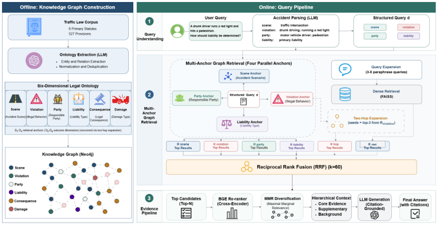

## 重点阅读

[An Ontology-Guided Multi-Anchor Graph Retrieval Framework for Traffic Legal Liability Determination](https://arxiv.org/abs/2606.11910v1) · v1 提交 2026-06-10 · [全文](https://arxiv.org/html/2606.11910v1) · [PDF](https://arxiv.org/pdf/2606.11910v1)

交通责任问题常同时涉及违法行为、事故形态、参与者与后果。从单一实体或单条向量出发，可能只找到其中一面。OMAGR 用本体拆出多个锚点并行检索，再汇总依据；完整系统称为 TrafficOmni-RAG。

TrafficLaw-QA 包含 200 问、六部中国交通法规范来源和 11 类主题。各方法共享语料、嵌入、切分、生成模型 GLM-4-Flash，RAGAS 也用该模型作裁判。与同图谱上的单实体遍历 LlamaIndex KG 比，Context Precision 从 0.722 到 0.915，Faithfulness 从 0.751 到 0.787。

反例同样重要：TrafficRAG 的 Context Recall 为 0.896，高于完整系统 0.885；消融中纯向量版本 Faithfulness 为 0.802，也高于完整系统。结果支持这一基准中的多锚点权衡，而非图结构全面胜过向量。我的判断是，应逐维展示找到的证据及遗漏，不能让流畅答案掩盖漏检。模型裁判分数不是法律结论正确率；本文介绍研究实验，不提供法律意见，真实使用仍需核对适用规范与案件事实。

原图：Xu Li、Shuqi Tian、Xun Han、Kuncheng Zhao、Xinyi Li，arXiv:2606.11910v1，Figure 1，PDF 第 4 页。[原始来源](https://arxiv.org/pdf/2606.11910v1#page=4) · [CC BY 4.0](https://creativecommons.org/licenses/by/4.0/)。裁剪自原文。

## 同期其他论文入口

- [ICA Lens: Interpreting Language Models Without Training Another Dictionary](https://arxiv.org/abs/2606.11722v1) · 2606.11722v1，该版本提交 2026-06-10。
- [End-to-End Context Compression at Scale](https://arxiv.org/abs/2606.09659v1) · 2606.09659v1，该版本提交 2026-06-08。
- [Kwai Keye-VL-2.0 Technical Report](https://arxiv.org/abs/2606.10651v1) · 2606.10651v1，该版本提交 2026-06-09。
- [Test-Time Gradient Guidance of Flow Policies in Reinforcement Learning](https://arxiv.org/abs/2606.11087v1) · 2606.11087v1，该版本提交 2026-06-09。
- [World Pilot: Steering Vision-Language-Action Models with World-Action Priors](https://arxiv.org/abs/2606.12403v1) · 2606.12403v1，该版本提交 2026-06-10。
- [DIRECT: When and Where Should You Allocate Test-Time Compute in Embodied Planners?](https://arxiv.org/abs/2606.12402v1) · 2606.12402v1，该版本提交 2026-06-10。
- [FACTR 2: Learning External Force Sensing for Commodity Robot Arms Improves Policy Learning](https://arxiv.org/abs/2606.12406v1) · 2606.12406v1，该版本提交 2026-06-10。
- [Context-Driven Incremental Compression for Multi-Turn Dialogue Generation](https://arxiv.org/abs/2606.12411v1) · 2606.12411v1，该版本提交 2026-06-10。
