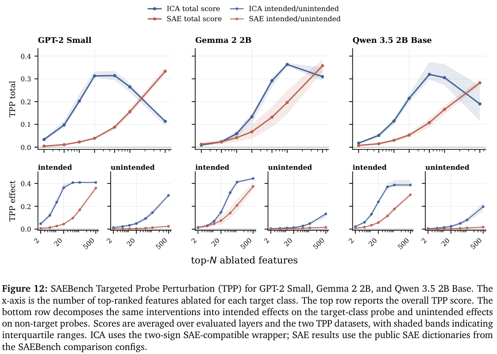
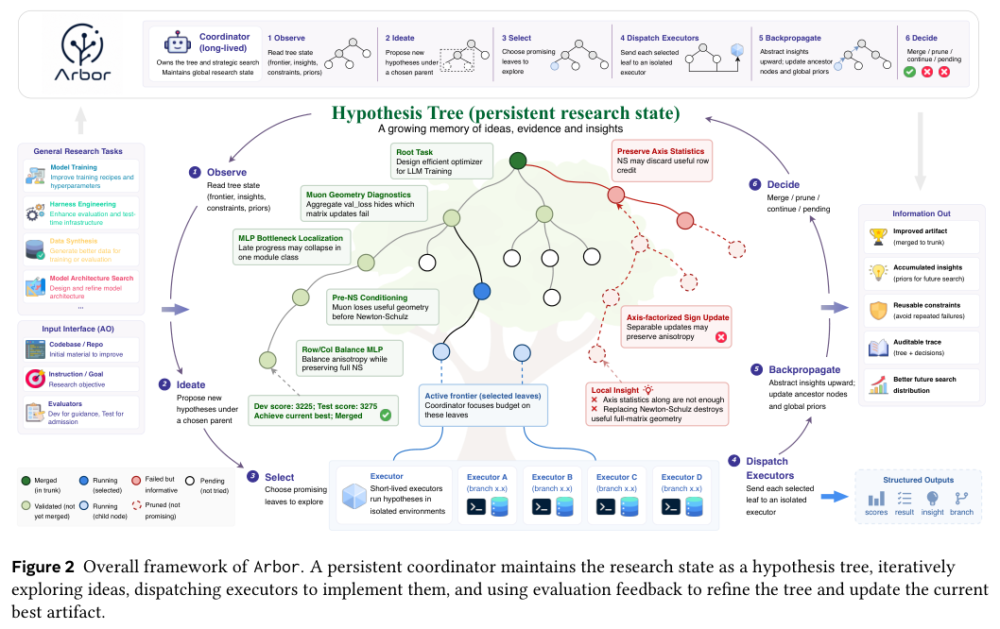
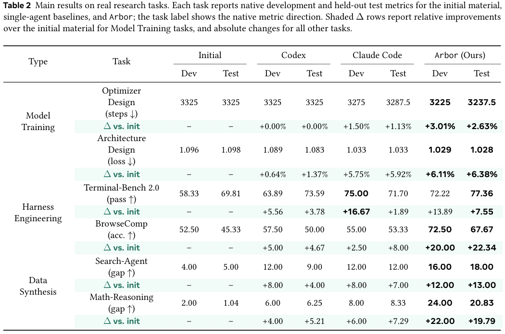
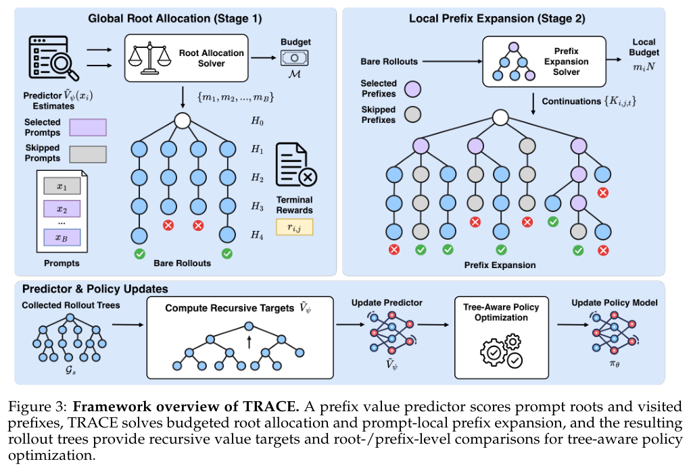

本期六项研究连接 JSON 到 RDF 的语义编辑、激活解释、假设树搜索、世界模型预测、工具经验与强化学习采样分配。

## 1. MetaConfigurator：在 JSON 编辑器中编写 RDF

[MetaConfigurator: AI-Assisted RDF Authoring from JSON Data](https://arxiv.org/abs/2606.07094v1) · v1 提交 2026-06-05 · [全文](https://arxiv.org/html/2606.07094v1) · [PDF](https://arxiv.org/pdf/2606.07094v1)

JSON 便于交换，但不会自动说明字段跨系统是否代表同一概念。MetaConfigurator 在 JSON Schema 编辑器中加入 RDF 编写视图，通过 AI 辅助 RML 映射把已有 JSON、YAML、CSV 数据接入 RDF，再允许人工查看和修改三元组、运行 SPARQL、观察知识图谱。

这是一篇工具演示稿，不是大规模对照实验。案例采用金属有机框架材料的合成记录，将 JSON 转为本体链接的 RDF/JSON-LD，并显式补充步骤顺序、将单位统一为 QUDT 表示。语义互操作需要处理这些领域细节，不能理解成点击转换即可全部完成。

我更看重可回查的编辑过程：研究者能检查映射究竟生成了什么。演示跑通不证明 AI 映射可靠，论文也没有提供全面用户研究或生产规模性能保证。采用时可以先用少量人工确认的记录验收转换，再检查查询是否保持原义。单位、标识符、顺序和本体类型仍需由能够判断含义的人确认，而不是隐藏在成功导出的提示后面。

**原图入口：**[Figure 1，PDF 第 3 页](https://arxiv.org/pdf/2606.07094v1#page=3)。

## 2. ICA Lens：先从激活几何里找可解释方向

ICA Lens 用 GPU 并行 FastICA 寻找非高斯的激活方向，加入逐行归一化、收敛诊断和自适应重拟合，避免每分析一层都训练一个大型过完备 SAE。它还用上下文截断、人工标签审查和扰动测试，区分局部 token 特征与更长程的语境信息。

*图｜Liu, Sida 等，[Figure 1（PDF 第 8 页）](https://arxiv.org/pdf/2606.11722v1#page=8)，[CC BY 4.0](http://creativecommons.org/licenses/by/4.0/)。裁剪自原文。*

GPT-2 Small 使用一百万个拟合位置、允许 p95 回退的设置下，归一化将通过收敛检查的层数从 6/12 提高到 10/12。三个模型共随机抽取 150 个分量，142 个得到非模糊标签、127 个为高置信标签；这些是审查协议下的可解释性判断，不是模型行为被完整解释。SAEBench 的稀疏探针与定向扰动也支持其作为 SAE 的补充，而非证明 ICA 在所有解释任务上替代 SAE。

*图｜Liu, Sida 等，[Figure 12（PDF 第 25 页）](https://arxiv.org/pdf/2606.11722v1#page=25)，[CC BY 4.0](http://creativecommons.org/licenses/by/4.0/)。裁剪自原文。*

[ICA Lens: Interpreting Language Models Without Training Another Dictionary](https://arxiv.org/abs/2606.11722v1) · v1。

## 3. Arbor：用假设树积累研究证据

Arbor 用长期协调器维护假设、工件、实验和经验组成的树，短期执行器在隔离工作区实现与测试具体方向。Hypothesis-Tree Refinement 将结果回传到后续搜索，避免每次尝试都从没有记忆的局部修改开始。

*图｜Jin, Jiajie 等，[Figure 2（PDF 第 4 页）](https://arxiv.org/pdf/2606.11926v1#page=4)，[CC BY-SA 4.0](http://creativecommons.org/licenses/by-sa/4.0/)。裁剪自原文。*

六项自主优化任务采用 48 小时限额；BrowseComp 的测试成绩从初始 45.33 到 67.67，Codex 和 Claude Code 为 50.00、53.33；Terminal-Bench 测试通过率从 69.81 到 77.36。模型与系统配置存在差异，而且测试 evaluator 参与候选合并门禁，这些数值不能视为完全未接触最终测试的泛化估计。不同任务的相对损失改善与百分点变化也不应混为一个准确率。

*图｜Jin, Jiajie 等，[Table 2（PDF 第 10 页）](https://arxiv.org/pdf/2606.11926v1#page=10)，[CC BY-SA 4.0](http://creativecommons.org/licenses/by-sa/4.0/)。裁剪自原文。*

[Toward Generalist Autonomous Research via Hypothesis-Tree Refinement](https://arxiv.org/abs/2606.11926v1) · v1。

## 4. Next Forcing：用多段未来监督训练因果世界模型

Next Forcing 在主视频模型旁加入轻量 multi-chunk prediction 模块，同时预测下一、下下及更远的视频块，并通过多层特征融合让近未来指导远未来。推理时可以只保留主模型，也可以并行生成当前与下一块，以训练时的辅助模块换取额外吞吐。

RoboTwin 的五十项任务中，Clean/Random 平均成功率为 94.1%/93.5%，LingBot-VA 为 92.9%/91.5%。较小的固定条件消融使用 16 张 GPU、20k 步，基础配置从 75.6 到加入 MCP 的 85.8。论文所报两倍推理加速对应并行块生成模式，不是整个机器人任务完成时间减半；不同帧率和训练步数的收敛对照也需分别比较。

[Next Forcing: Causal World Modeling with Multi-Chunk Prediction](https://arxiv.org/abs/2606.11187v1) · v1。

[Figure 1（原文）](https://arxiv.org/pdf/2606.11187v1#page=2)。

## 5. KATE：经验检索与并行推理怎样帮助工具调用

KATE 将工具使用经验整理为可检索的实例，推理时并行采样多个候选并聚合，以增加知识激活的宽度；训练时再用知识增强数据进行 SFT 或 RL。论文分别研究经验的形式、调用时的激活和权重内部化，避免把所有收益只归到更长的思考。

BFCL-V3 的 Qwen3-8B 设置下，四场景平均分从默认 function calling 的 32.75 到 KATE 的 46.00；去掉并行采样为 38.00，加 RL 后为 48.25。AppWorld 的挑战场景依然很难，例如 8B 模型的 Scenario Goal Completion 只有 0.7。检索经验、候选数和训练都改变成本；特定工具集合上的平均改善不是任意业务流程的完成保证。

[Pushing the Limits of LLM Tool Calling via Experiential Knowledge Integration and Activation](https://arxiv.org/abs/2606.10875v1) · v1。

[Figure 1（原文）](https://arxiv.org/pdf/2606.10875v1#page=4)。

## 6. TRACE：把采样预算分配到更有对比信号的位置

TRACE 将一次多轮轨迹拆成带语义的前缀节点，同时决定哪些问题值得采样、哪些中途状态值得继续分支。共享预测器估计前缀的条件成功率，优先寻找可能同时产生成功与失败后续的锚点，让相同终局奖励产生更强的训练对比。

*图｜Zou, Heming 等，[Figure 3（PDF 第 6 页）](https://arxiv.org/pdf/2606.11119v1#page=6)，[CC BY 4.0](http://creativecommons.org/licenses/by/4.0/)。裁剪自原文。*

固定树预算的 Qwen3-8B、HotpotQA 消融中，问题根与前缀均匀分配的平均准确率为 49.5，两层主动分配为 50.6；有效对比比例由 42.8 到 52.3。根预算 1024、续写预算 2 的 TRACE 也从 TreePO 的 49.5 提高到 50.6。对比比例不是任务成功率，额外预测器与终局判分必须可靠，收益也不能推广到没有可验证反馈的任意任务。

*图｜Zou, Heming 等，[Table 1（PDF 第 10 页）](https://arxiv.org/pdf/2606.11119v1#page=10)，[CC BY 4.0](http://creativecommons.org/licenses/by/4.0/)。裁剪自原文。*

[TRACE: A Unified Rollout Budget Allocation Framework for Efficient Agentic Reinforcement Learning](https://arxiv.org/abs/2606.11119v1) · v1。
