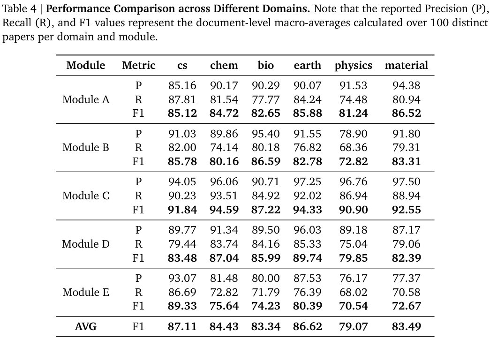
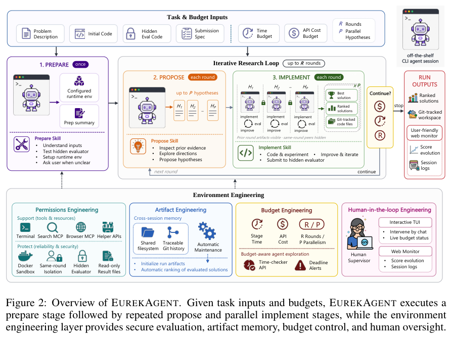
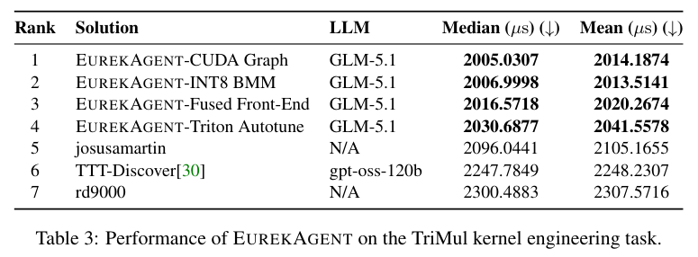
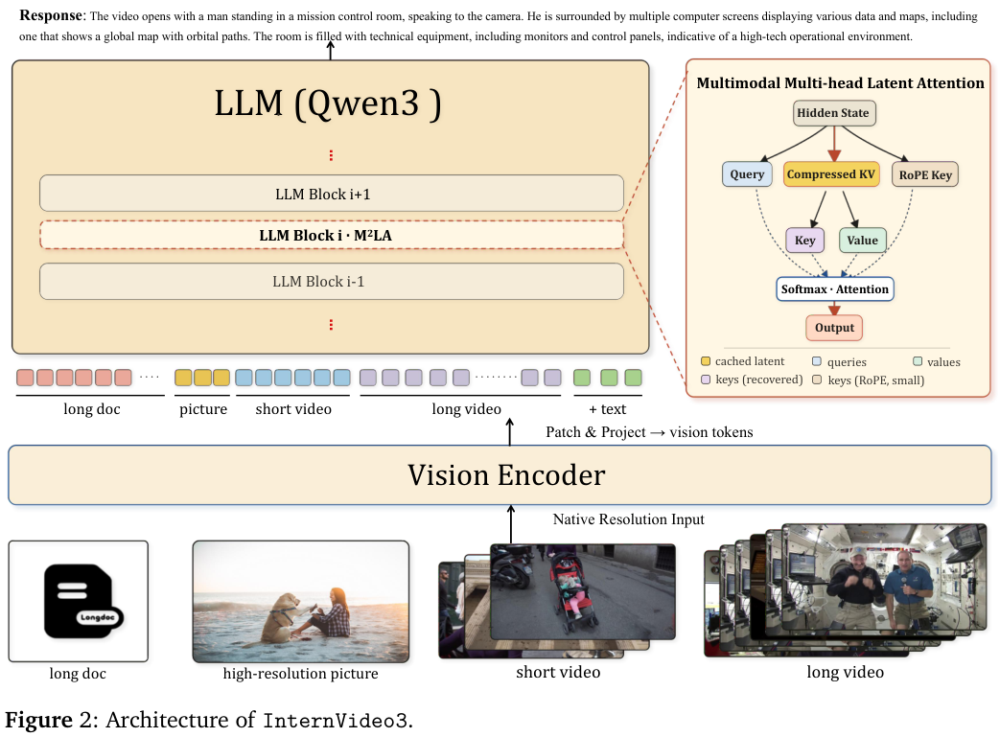
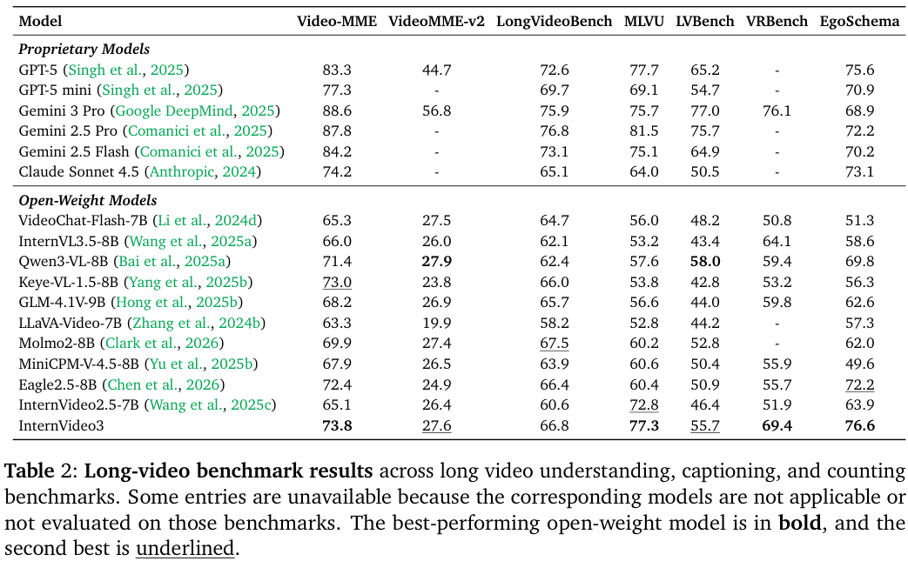
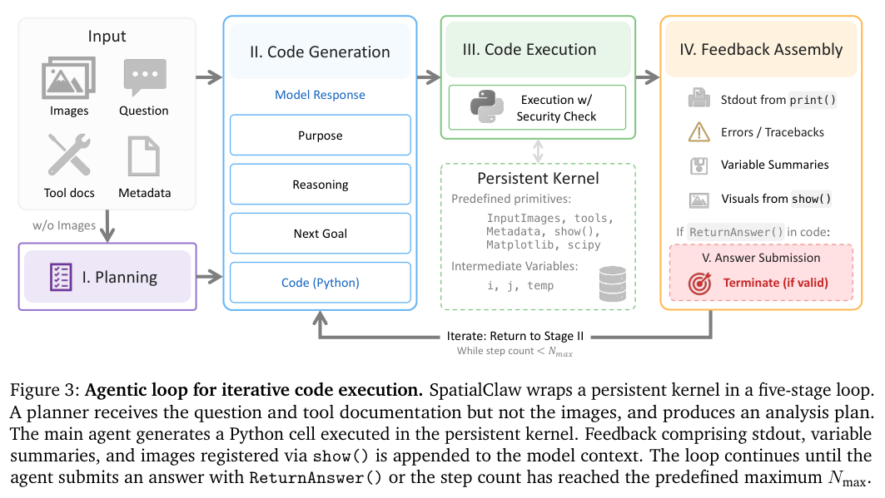
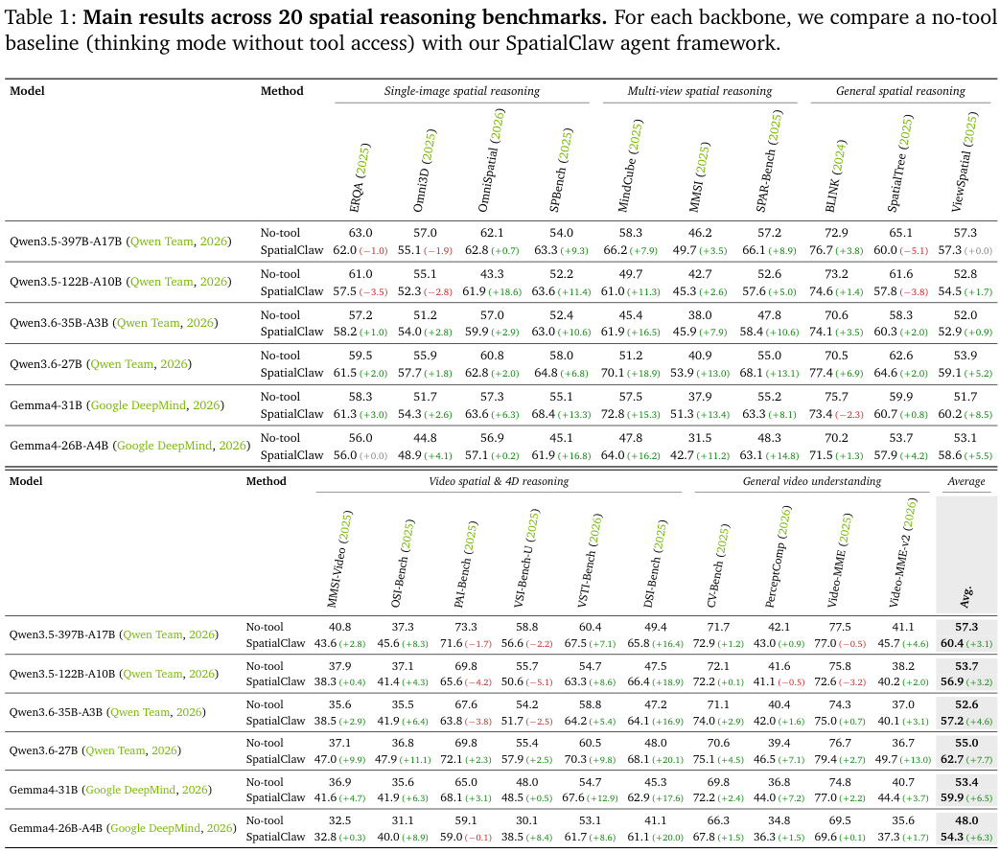
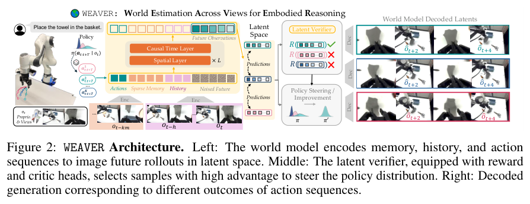
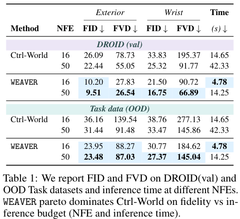

本期八项研究讨论科研知识组织、语音纠错、稀疏注意力、自主实验、长视频与空间工具，以及世界模型和交错生成。

## 1. Agents-K1：把科学论文组织为可定位的知识

[Agents-K1: Towards Agent-native Knowledge Orchestration](https://arxiv.org/abs/2606.13669v1) · v1 提交 2026-06-11 · [全文](https://arxiv.org/html/2606.13669v1) · [PDF](https://arxiv.org/pdf/2606.13669v1)

论文的文字、图表、公式和引用常被分开保存，研究代理于是反复读 PDF，却难以把一个结论连回稳定证据。Agents-K1 将全文解析、结构抽取与代理检索接口结合，用知识图谱组织显式实体、抽象贡献、引用角色及细粒度关系。

这里看抽取评估，不把图谱数量当成质量。作者用 DeepSeek-V3 作科学编辑裁判，在六个领域、每领域每模块 100 篇论文上计算文档宏平均。表 4 的五模块平均 F1 从物理 79.07% 到计算机 87.11%；同一计算机领域，隐式概念模块 C 为 91.84%，引用关系模块 D 为 83.48%。

这些是语义裁判下的结果，不是人工金标准的严格字符串匹配准确率。原文允许部分高层概括判为语义正确，模型判断也影响错误与遗漏估计。我的判断是，资料基础设施应支持证据定位与关系操作，但仍须保留原文锚点，人工复核关键数值和引用角色。抽取分数不能证明科研结论可靠。

原图：Zongsheng Cao 等，arXiv:2606.13669v1，Figure 2，PDF 第 6 页。[原始来源](https://arxiv.org/pdf/2606.13669v1#page=6) · [CC BY 4.0](https://creativecommons.org/licenses/by/4.0/)。裁剪自原文。

*图｜Cao, Zongsheng 等，[Table 4（PDF 第 28 页）](https://arxiv.org/pdf/2606.13669v1#page=28)，[CC BY 4.0](http://creativecommons.org/licenses/by/4.0/)。裁剪自原文。*

## 2. 本体记忆辅助 ASR：检索长期对话里的纠错线索

这项 ASR 纠错方法将之前的文本与语音交互整理成动态本体记忆，保存实体、术语、表面变体、可能混淆和语义关系，再检索有关节点辅助当前转写。它试图减少直接拼接长历史时，少量纠错证据被噪声淹没的问题。

RAMC-Corr 上十个配对模型与提示设置中有九个优于直接纠错。Qwen2.5-14B 零样本的 C-CER 从 35.66% 降到 29.04%，但原始 ASR 为 27.94%，仍比纠错结果更好；Qwen3.5-9B few-shot 又从直接纠错 28.02% 变差到 28.89%。改进一个不稳定的重写基线，并不意味着每个条件下都值得修改原转写。

[Ontology Memory-Augmented ASR Correction for Long Text-Speech Interleaved Conversations](https://arxiv.org/abs/2606.13464v2) · v2。

[Figure 1（原文）](https://arxiv.org/pdf/2606.13464v2#page=1)。

## 3. MiniMax Sparse Attention：按 GQA 分组选择历史块

MSA 用轻量 Index Branch 为各 GQA 组分别选择 Top-k KV 块，Main Branch 只对选中块计算精确注意力，并以不依赖指数的选择和 KV-outer 内核提高硬件效率。它将分组稀疏模式与预训练、持续预训练路线共同设计。

109B 原生多模态模型在百万上下文时，作者报告每 token 注意力计算减少 28.4 倍。3T token 训练预算的对照中，原生稀疏预训练的 HumanEval 为 64.0，完整注意力为 61.0；MMMU 则为 45.9 对 46.8。注意力计算倍数不是整模型延迟倍数，部分指标的下降也说明“总体接近”不等于每种任务数学无损。

[MiniMax Sparse Attention](https://arxiv.org/abs/2606.13392v2) · v2。

[Figure 1（原文）](https://arxiv.org/pdf/2606.13392v2#page=1)。

## 4. EurekAgent：把科研搜索的资源与验收放进环境

EurekAgent 从执行权限、工件管理、预算和人工介入四方面组织科研环境，让 Agent 自由提出方案并运行验证，而不是预先固定每一步研究流程。隔离评估和 Git 工件协作使候选结果可以追踪、比较与复用。

*图｜Xin, Amy 等，[Figure 2（PDF 第 4 页）](https://arxiv.org/pdf/2606.13662v2#page=4)，[CC BY 4.0](http://creativecommons.org/licenses/by/4.0/)。裁剪自原文。*

GLM-5.1 的 26 圆装箱目标值为 2.635999，既有 AI 对照为 2.635986；TriMul 本地 A100 重评中，最好方案的中位时间为 2005.0307 微秒，最强重评榜单方案为 2096.0441 微秒。官方榜单已关闭，因此后者属于共同本地 evaluator 的比较，并非新的官方成绩；单次系统搜索获得的四个好方案，也不等于四次独立复现。

*图｜Xin, Amy 等，[Table 3（PDF 第 8 页）](https://arxiv.org/pdf/2606.13662v2#page=8)，[CC BY 4.0](http://creativecommons.org/licenses/by/4.0/)。裁剪自原文。*

[EurekAgent: Agent Environment Engineering is All You Need For Autonomous Scientific Discovery](https://arxiv.org/abs/2606.13662v2) · v2。

## 5. InternVideo3：把长视频理解组织成证据循环

InternVideo3 的 Multimodal Contextual Reasoning 将观测、推理、工具动作和记忆放进持续更新的上下文，M²LA 压缩 KV 状态而保留 token 流。持续预训练、由短到长的 SFT、规则奖励强化学习与在线蒸馏共同训练视频理解及检索 Agent。

*图｜Yan, Ziang 等，[Figure 2（PDF 第 7 页）](https://arxiv.org/pdf/2606.12195v1#page=7)，[CC BY 4.0](http://creativecommons.org/licenses/by/4.0/)。裁剪自原文。*

长视频评测中，InternVideo3 的 MLVU 为 77.3、EgoSchema 为 76.6，Qwen3-VL-8B 为 57.6、69.8；Video-MME-v2 却为 27.6，略低于该对照 27.9，LongVideoBench 66.8 也低于 Molmo2-8B 的 67.5。这里主要是 QA 基准，支持长时视觉理解能力，不能单凭这些分数证明完整工具交互已可靠。

*图｜Yan, Ziang 等，[Table 2（PDF 第 16 页）](https://arxiv.org/pdf/2606.12195v1#page=16)，[CC BY 4.0](http://creativecommons.org/licenses/by/4.0/)。裁剪自原文。*

[InternVideo3: Agentify Foundation Models with Multimodal Contextual Reasoning](https://arxiv.org/abs/2606.12195v1) · v1。

## 6. SpatialClaw：用有状态代码逐步处理空间证据

SpatialClaw 让视觉语言 Agent 每轮写一个 Python cell，在持久内核中保留帧、感知结果和几何原语，看到中间图像与数值后再修改分析。与一次生成完整脚本相比，它可以根据实际掩码、深度或轨迹结果选择下一步，无需更新模型权重。

*图｜Cho, Seokju 等，[Figure 3（PDF 第 5 页）](https://arxiv.org/pdf/2606.13673v1#page=5)，[CC BY 4.0](http://creativecommons.org/licenses/by/4.0/)。裁剪自原文。*

二十项基准中，Qwen3.6-27B 的平均准确率从无工具 55.0% 到 62.7%，Gemma4-31B 从 53.4% 到 59.9%。但 Qwen3.5-397B-A17B 在 Omni3D 从 57.0 降至 55.1，SpatialTree 从 65.1 降至 60.0。接口和专家工具能改善平均表现，仍会引入额外误差、调用成本和对感知模块的依赖。

*图｜Cho, Seokju 等，[Table 1（PDF 第 7 页）](https://arxiv.org/pdf/2606.13673v1#page=7)，[CC BY 4.0](http://creativecommons.org/licenses/by/4.0/)。裁剪自原文。*

[SpatialClaw: Rethinking Action Interface for Agentic Spatial Reasoning](https://arxiv.org/abs/2606.13673v1) · v1。

## 7. WEAVER：兼顾多视角世界模型的质量与运行成本

WEAVER 联合预测未来多视角潜变量和奖励，以 flow matching 学习较长时间的机器人动态，并设计记忆与预测目标支持策略评估、改进和测试时规划。模型先在 DROID 预训练，再以五项实机任务中收集的 π0.5 轨迹适配。

*图｜Jain, Arnav Kumar 等，[Figure 2（PDF 第 3 页）](https://arxiv.org/pdf/2606.13672v1#page=3)，[CC BY 4.0](http://creativecommons.org/licenses/by/4.0/)。裁剪自原文。*

十秒序列、16 次函数求值的 DROID 验证对照中，WEAVER 的外部视角 FVD 为 27.83、推理时间 4.78 秒，Ctrl-World 为 78.73、14.65 秒；腕部视角 FVD 为 90.72 对 195.37。图像轨迹更逼真不自动代表控制更安全，论文也另外评价真实任务。模型预训练、任务微调和奖励学习的投入应与推理效率一起考虑。

*图｜Jain, Arnav Kumar 等，[Table 1（PDF 第 6 页）](https://arxiv.org/pdf/2606.13672v1#page=6)，[CC BY 4.0](http://creativecommons.org/licenses/by/4.0/)。裁剪自原文。*

[$\texttt{WEAVER}$, Better, Faster, Longer: An Effective World Model for Robotic Manipulation](https://arxiv.org/abs/2606.13672v1) · v1。

## 8. InterleaveThinker：用规划与逐步批评组织图文生成

InterleaveThinker 让 Planner 安排交错的文字与图片步骤，Critic 检查每一步生成是否符合计划，并修改指令重新生成。它先训练格式和批评能力，再用单步奖励训练纠错，降低整条可能需要二十五次以上图像调用的轨迹训练成本。

WISE 上，四步 FLUX.2-klein-9B 的 Overall 从 0.47 到接入该框架的 0.73，Qwen-Image-Edit-2511 从 0.60 到 0.72。这个改善来自多 Agent、重试与额外生成计算的整体组合；WISE 的推理图像指标也不等于 CoMM 的故事完整性或跨图实体一致性，不能跨基准直接比较总分。

[InterleaveThinker: Reinforcing Agentic Interleaved Generation](https://arxiv.org/abs/2606.13679v2) · v2。

[Figure 1（原文）](https://arxiv.org/pdf/2606.13679v2#page=1)。
