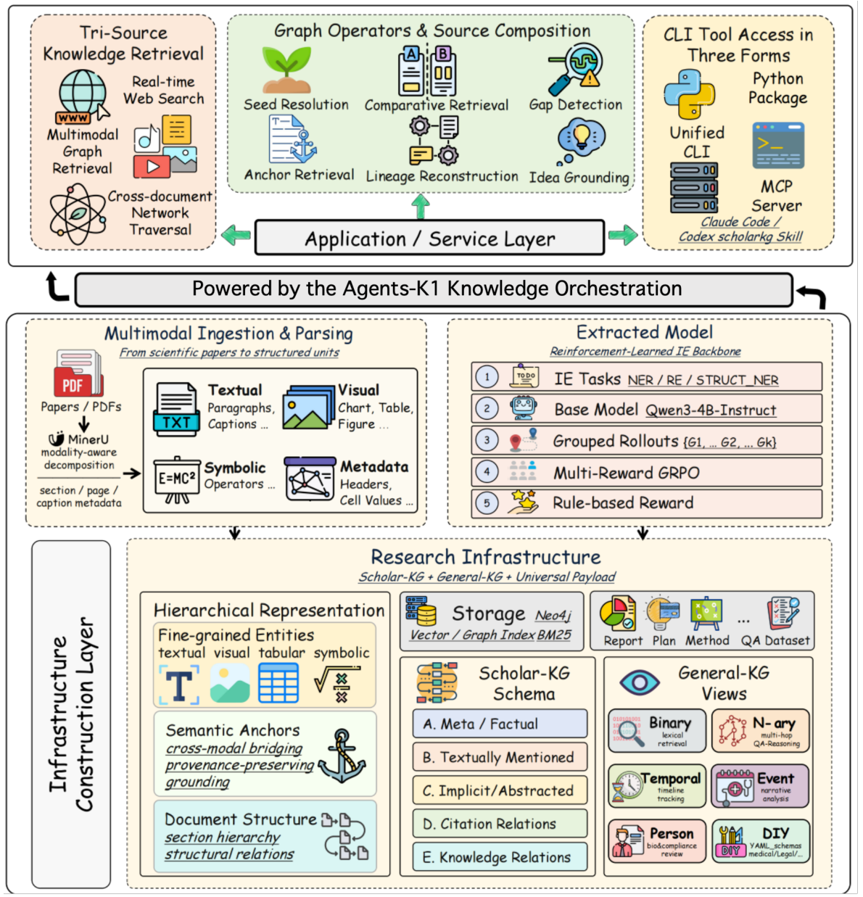

本文补录 **2026-06-13 的推荐日报清单**，于 2026-10-29 核对公开来源。推荐日期不等于论文发表日期；采用下方明确标记的历史版本，不混用后续修订。数值均为作者报告，本站未独立复现。

## 重点阅读

[Agents-K1: Towards Agent-native Knowledge Orchestration](https://arxiv.org/abs/2606.13669v1) · v1 提交 2026-06-11 · [全文](https://arxiv.org/html/2606.13669v1) · [PDF](https://arxiv.org/pdf/2606.13669v1)

论文的文字、图表、公式和引用常被分开保存，研究代理于是反复读 PDF，却难以把一个结论连回稳定证据。Agents-K1 将全文解析、结构抽取与代理检索接口结合，用知识图谱组织显式实体、抽象贡献、引用角色及细粒度关系。

这里看抽取评估，不把图谱数量当成质量。作者用 DeepSeek-V3 作科学编辑裁判，在六个领域、每领域每模块 100 篇论文上计算文档宏平均。表 4 的五模块平均 F1 从物理 79.07% 到计算机 87.11%；同一计算机领域，隐式概念模块 C 为 91.84%，引用关系模块 D 为 83.48%。

这些是语义裁判下的结果，不是人工金标准的严格字符串匹配准确率。原文允许部分高层概括判为语义正确，模型判断也影响错误与遗漏估计。我的判断是，资料基础设施应支持证据定位与关系操作，但仍须保留原文锚点，人工复核关键数值和引用角色。抽取分数不能证明科研结论可靠；下图展示总体框架，不是表 4 的结果图。本文仅使用 6 月 11 日 v1。

原图：Zongsheng Cao 等，arXiv:2606.13669v1，Figure 2，PDF 第 6 页。[原始来源](https://arxiv.org/pdf/2606.13669v1#page=6) · [CC BY 4.0](https://creativecommons.org/licenses/by/4.0/)。裁剪自原文。

## 同期其他论文入口

以下只核对题名、标识符和指定历史版本，不代表逐篇全文深读。

- [Ontology Memory-Augmented ASR Correction for Long Text-Speech Interleaved Conversations](https://arxiv.org/abs/2606.13464v2) · 2606.13464v2，该版本提交 2026-06-12。
- [MiniMax Sparse Attention](https://arxiv.org/abs/2606.13392v2) · 2606.13392v2，该版本提交 2026-06-12。
- [EurekAgent: Agent Environment Engineering is All You Need For Autonomous Scientific Discovery](https://arxiv.org/abs/2606.13662v2) · 2606.13662v2，该版本提交 2026-06-12。
- [InternVideo3: Agentify Foundation Models with Multimodal Contextual Reasoning](https://arxiv.org/abs/2606.12195v1) · 2606.12195v1，该版本提交 2026-06-10。
- [SpatialClaw: Rethinking Action Interface for Agentic Spatial Reasoning](https://arxiv.org/abs/2606.13673v1) · 2606.13673v1，该版本提交 2026-06-11。
- [$\texttt{WEAVER}$, Better, Faster, Longer: An Effective World Model for Robotic Manipulation](https://arxiv.org/abs/2606.13672v1) · 2606.13672v1，该版本提交 2026-06-11。
- [InterleaveThinker: Reinforcing Agentic Interleaved Generation](https://arxiv.org/abs/2606.13679v2) · 2606.13679v2，该版本提交 2026-06-12。

**覆盖说明：** 本期保留 8 篇已核验公开论文入口，详读 1 篇；其余仅列目录。
