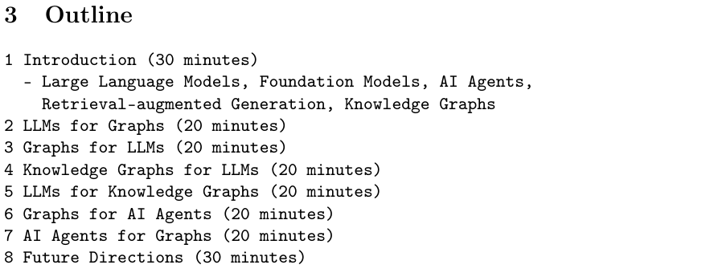
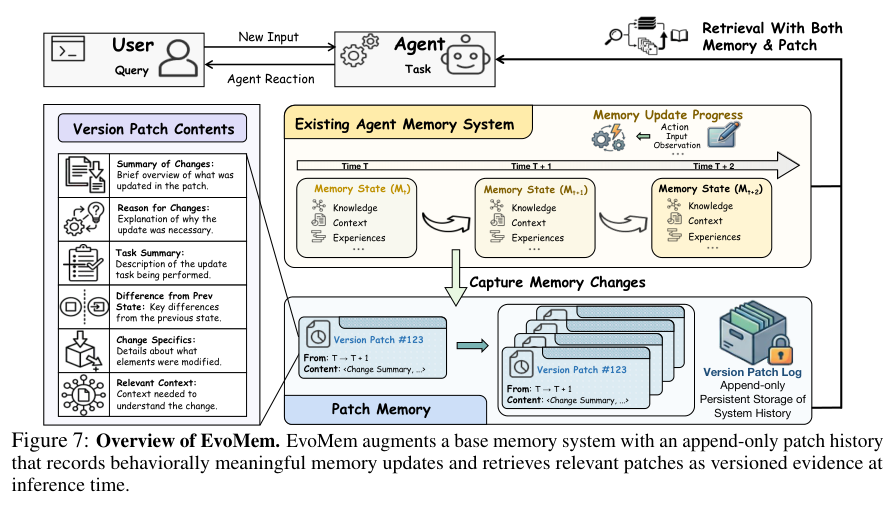
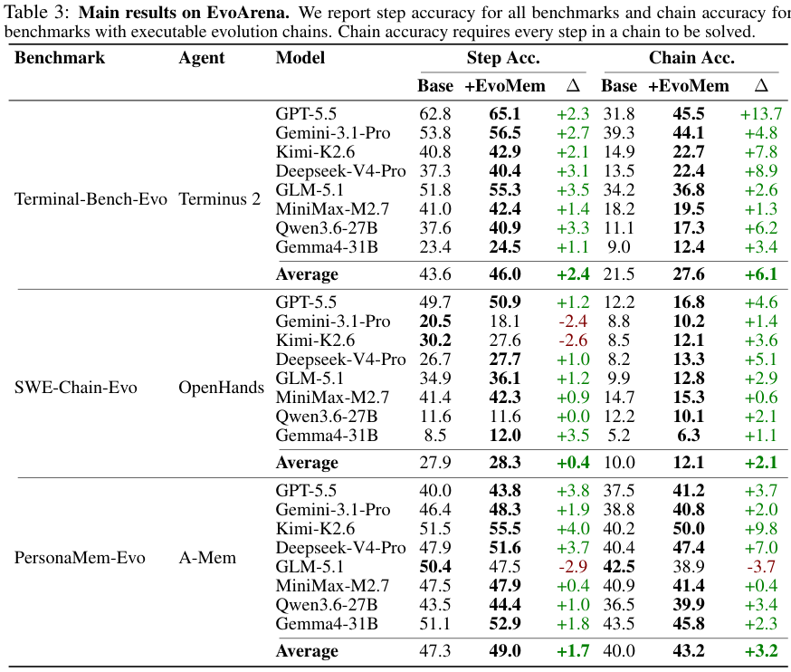
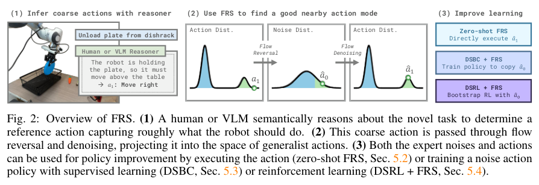
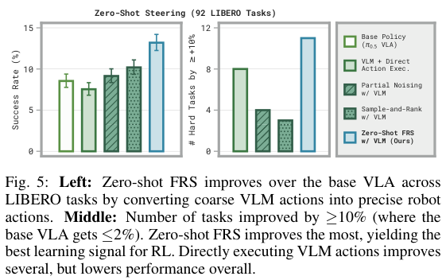
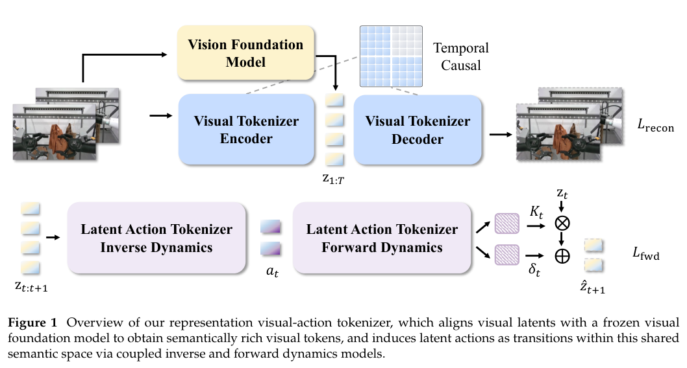
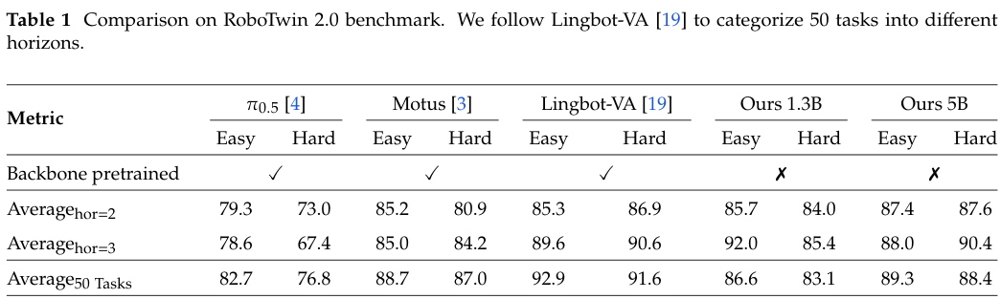

本期七项研究从图与语言模型的融合出发，讨论强化学习采样效率、缓存复用、演化记忆、机器人策略引导、世界模型表示和偏好训练信号。

## 1. LLMs+Graphs：区分图与语言模型的不同融合目标

[LLMs+Graphs: Toward Graph-Native, Synergistic AI Systems](https://arxiv.org/abs/2606.11560v1) · v1 提交 2026-06-10 · [全文](https://arxiv.org/html/2606.11560v1) · [PDF](https://arxiv.org/pdf/2606.11560v1)

“LLM 加图”包含不同目标。LLMs+Graphs 是教程提案，将语言模型帮助建图、查询，与图为语言模型提供证据、约束区分开；代理还可用图表达计划、记忆与工具依赖。

全文按 LLMs for Graphs、Graphs for LLMs、知识图谱双向融合，以及图和代理的双向作用组织。证据形式是文献讨论、主题分类与教程安排，没有提出新模型并报告新对照分数。

我认为最有用的问题是：希望图改善哪一步？事实依据不足，就检查检索与证据定位；查询不可执行，就检查模式、语言和验证；长任务失序，就检查状态与依赖。不同问题需要不同指标，图任务高分不直接证明代理可靠。教程适合作为阅读地图，仍需回到具体方法的原论文与消融，不能当作所有图增强方案已得到统一验证。

原文提纲：Arijit Khan、Longxu Sun、Xin Huang，arXiv:2606.11560v1，Section 3 Outline（无编号图），PDF 第 2 页。[原始来源](https://arxiv.org/pdf/2606.11560v1#page=2) · [CC BY 4.0](https://creativecommons.org/licenses/by/4.0/)。裁剪自原文。

## 2. Bebop：让多 token 预测跟上强化学习中的熵变化

Bebop 研究强化学习中 MTP 接受率为何下降：策略熵上升时，草稿与目标分布的重叠会变化。它以概率拒绝采样代替贪心草稿，并用端到端总变差损失直接优化多步接受率，让训练前准备好的 MTP 在后续 RL 中保持有效。

Qwen3.5、3.6、3.7 的数学、代码和 Agent 训练实验中，作者报告接受率最高达到 95%，异步 RL 的端到端加速最高为 1.8 倍。接受率、推理吞吐和训练总时长是不同口径；“最高”也来自具体模型与负载，不能把 95% 接受率理解成任务正确率。结果还表明，合适的预训练目标可以减少昂贵的在线 MTP 更新。

[Breaking Entropy Bounds: Accelerating RL Training via MTP with Rejection Sampling](https://arxiv.org/abs/2606.12370v1) · v1。

[Figure 1（原文）](https://arxiv.org/pdf/2606.12370v1#page=1)。

## 3. KV 缓存复用：省下预填充后，还要支付多少传输成本

这篇工作提出由内容发布者预先计算文档 KV，让多个 Agent 加载后继续生成。实验先检验相同模型、token 序列与位置条件下的缓存复用，再将计算节省与缓存存储、传输和计费分开讨论；它不是一个跨模型通用的缓存交换格式。

Qwen3-4B、fp16、Apple M1 Pro/MPS 的五次计时中，常驻缓存的一步续写比重新预填充便宜约 9–50 倍；短续写的 24 个贪心 token 及 logits 对照保持一致。这个计算对照并非完整服务端到端加速。作者发现 KV 难以无损压缩，逐次外发缓存的带宽费用可能超过节省，因此更可行的方向是提供方内部托管；八千万次访问的金额属于基于测量的情景估算。

[Can I Buy Your KV Cache?](https://arxiv.org/abs/2606.13361v1) · v1。

[Figure 1（原文）](https://arxiv.org/pdf/2606.13361v1#page=6)。

## 4. EvoArena：记忆需要保存环境如何改变

EvoArena 把终端、软件仓库与用户偏好构造成持续演化的任务链，要求 Agent 识别哪些旧知识仍然有效。EvoMem 在基础记忆之外保留追加式 patch 历史，将每次变化与已有状态联系起来，而不是只保存一份不断被覆盖的最新摘要。

*图｜Xu, Jundong 等，[Figure 7（PDF 第 11 页）](https://arxiv.org/pdf/2606.13681v1#page=11)，[CC BY 4.0](http://creativecommons.org/licenses/by/4.0/)。裁剪自原文。*

Terminal-Bench-Evo 的 GPT-5.5 单步准确率从 62.8% 到 65.1%，整链全部完成的比例从 31.8% 到 45.5%。但 PersonaMem-Evo 的 GLM-5.1 单步分数从 50.4% 降至 47.5%，整链也从 42.5% 降至 38.9%。更新历史有助于部分长链任务，并非任何模型都受益；不同子集的整链指标定义也需分别理解。

*图｜Xu, Jundong 等，[Table 3（PDF 第 13 页）](https://arxiv.org/pdf/2606.13681v1#page=13)，[CC BY 4.0](http://creativecommons.org/licenses/by/4.0/)。裁剪自原文。*

[EvoArena: Tracking Memory Evolution for Robust LLM Agents in Dynamic Environments](https://arxiv.org/abs/2606.13681v1) · v1。

## 5. FRS：把粗动作反向映射到策略的噪声空间

Flow Reversal Steering 先把人或视觉语言模型给出的粗动作沿 flow policy 反向积分，找到相应噪声，再正向生成附近更符合机器人先验的动作。成功轨迹还能用于噪声策略的行为克隆，或作为强化学习的起点，减少完全随机探索。

*图｜Tang, Andy 等，[Figure 2（PDF 第 4 页）](https://arxiv.org/pdf/2606.13675v2#page=4)，[CC BY 4.0](http://creativecommons.org/licenses/by/4.0/)。裁剪自原文。*

LIBERO 对照中，各方法使用相同基础 VLA、提示与 Gemini-ER-1.6。在基础策略成功率不超过 2% 的 42 项任务中，FRS 有 11 项获得至少 10 个百分点的提升；直接执行 VLM 动作则会降低整体表现。实验特意选择基础策略未在相应 split 上训练的设置，后续克隆也使用筛选过的十五项任务，不能将这部分收益当作对所有操作任务的平均改善。

*图｜Tang, Andy 等，[Figure 5（PDF 第 7 页）](https://arxiv.org/pdf/2606.13675v2#page=7)，[CC BY 4.0](http://creativecommons.org/licenses/by/4.0/)。裁剪自原文。*

[Improving Robotic Generalist Policies via Flow Reversal Steering](https://arxiv.org/abs/2606.13675v2) · v2。

## 6. RepWAM：用语义与潜在动作共同训练表示

RepWAM 先学习语义对齐的视觉 token 与连接相邻状态的潜在动作，再让世界模型联合预测未来视觉和动作，最后以机器人轨迹适配。它希望潜在空间不只保留画面纹理，也保留完成指令所需的物体、关系和运动信息。

*图｜Wang, Junke 等，[Figure 1（PDF 第 3 页）](https://arxiv.org/pdf/2606.13674v2#page=3)，[CC BY 4.0](http://creativecommons.org/licenses/by/4.0/)。裁剪自原文。*

每项任务五十条实机演示、十次评测 rollout 中，5B 模型推抽屉成功率为 80%，π0.5 为 50%、Lingbot-VA 为 70%；但 RoboTwin 五十任务的 Easy/Hard 平均为 89.3/88.4，低于 Lingbot-VA 的 92.9/91.6。固定 1.3B 消融中，更换语义 tokenizer 后 Easy/Hard 从 78.0/76.0 到 86.6/83.1，支持表示设计的作用；小规模实机结果仍有较大不确定性。

*图｜Wang, Junke 等，[Table 1（PDF 第 8 页）](https://arxiv.org/pdf/2606.13674v2#page=8)，[CC BY 4.0](http://creativecommons.org/licenses/by/4.0/)。裁剪自原文。*

[RepWAM: World Action Modeling with Representation Visual-Action Tokenizers](https://arxiv.org/abs/2606.13674v2) · v2。

## 7. 拆解后训练信号：偏好数据究竟奖励了什么

Anatomy of Post-Training 用可解释特征分析 chosen 与 rejected 回答的差异，提出数据在何种话题下奖励何种行为的假说。它把提示接种、激活干预、token 过滤与奖励塑形放到同一框架中，让训练者可以抑制无关特征，而不仅优化一个总偏好分数。

受控实验在 Llama-3.1-8B 的 Dolci SFT 与 DPO 数据中各改写 5% 的提示，注入风格、过度自信等五种特征，再在 Alpaca 与 OLMES 提示上检查输出。干预通常能降低被注入行为，但 token 过滤对分散、宽泛的特征较不稳定。特征相关性和人工命名仍可能出错，这种诊断支持有针对性的实验，不能代替对新任务行为的独立评价。

[Anatomy of Post-Training: Using Interpretability to Characterize Data and Shape the Learning Signal](https://arxiv.org/abs/2606.12360v2) · v2。

[Figure 1（原文）](https://arxiv.org/pdf/2606.12360v2#page=2)。
