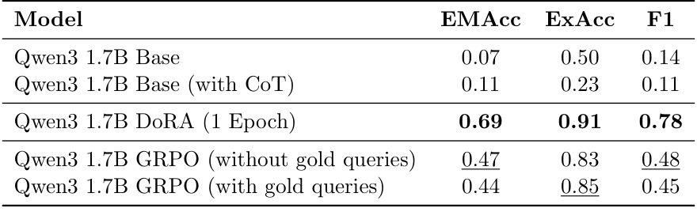

## 重点阅读

[Text-to-SPARQL Generation with Reinforcement Learning: A GRPO-based Approach on DBLP](https://arxiv.org/abs/2605.20066v1) · v1 提交 2026-05-19 · [全文](https://arxiv.org/html/2605.20066v1) · [PDF](https://arxiv.org/pdf/2605.20066v1)

自然语言转 SPARQL 可以用执行和答案反馈训练，但查询能运行与逻辑正确是两件事。这项研究在 DBLP 上以 GRPO 训练 Qwen3-1.7B，分别比较执行、格式、结构覆盖和长度奖励。

DBLP-QuAD 共 10,000 个问句—查询对，训练、验证、测试为 7,000/1,000/2,000。研究假定实体和关系链接完美提供，隔离查询生成问题。表 1 中，无金查询奖励 GRPO 的答案集合精确匹配为 0.47、可执行率 0.83；零样本为 0.07、0.50；一个 epoch 的 DoRA 监督基线为 0.69、0.91。GRPO 总体没有胜过监督训练。

保留模板测试片段中，GRPO 为 0.53，DoRA 为 0.40，但仍是同一模式和数据构造过程内的迁移。实验使用单一模型系列与基准、固定种子的训练运行，GRPO 全参更新与 DoRA 适配器也不是相同训练方式。我的判断是，缺少金查询时结果反馈有价值，但不能只用可执行率宣称端到端问答已解决。UNION、否定、聚合及答案形状应分别检查；企业图谱还需补上实体链接、端点变化与模式歧义测试。

原表：Jann Pfeifer、Debayan Banerjee、Ricardo Usbeck，arXiv:2605.20066v1，Table 1，PDF 第 7 页。[原始来源](https://arxiv.org/pdf/2605.20066v1#page=7) · [CC BY 4.0](https://creativecommons.org/licenses/by/4.0/)。已裁剪完整表格或图形及必要标签，移除周围正文，内容和颜色未改动，未重绘。此材料沿用 CC BY 4.0，本站页脚许可不为其增加非商业或相同方式共享限制。

## 同期其他论文入口

- [Trace Only What You Need: Structure-Aware On-Demand Hypergraph Memory for Long-Document Question Answering](https://arxiv.org/abs/2606.10921v1) · 2606.10921v1，该版本提交 2026-06-09。
- [LEAP: Supercharging LLMs for Formal Mathematics with Agentic Frameworks](https://arxiv.org/abs/2606.03303v2) · 2606.03303v2，该版本提交 2026-06-03。
- [Recursive Agent Harnesses](https://arxiv.org/abs/2606.13643v1) · 2606.13643v1，该版本提交 2026-06-11。
- [HyperTool: Beyond Step-Wise Tool Calls for Tool-Augmented Agents](https://arxiv.org/abs/2606.13663v1) · 2606.13663v1，该版本提交 2026-06-11。
- [EvoBrowseComp: Benchmarking Search Agents on Evolving Knowledge](https://arxiv.org/abs/2606.13120v1) · 2606.13120v1，该版本提交 2026-06-11。
- [DailyReport: An Open-ended Benchmark for Evaluating Search Agents on Daily Search Tasks](https://arxiv.org/abs/2606.12871v1) · 2606.12871v1，该版本提交 2026-06-11。
- [World Tracing: Generative Pixel-Aligned Geometry Beyond the Visible](https://arxiv.org/abs/2606.13652v1) · 2606.13652v1，该版本提交 2026-06-11。

文中实验结果为论文作者报告，未独立复现。
