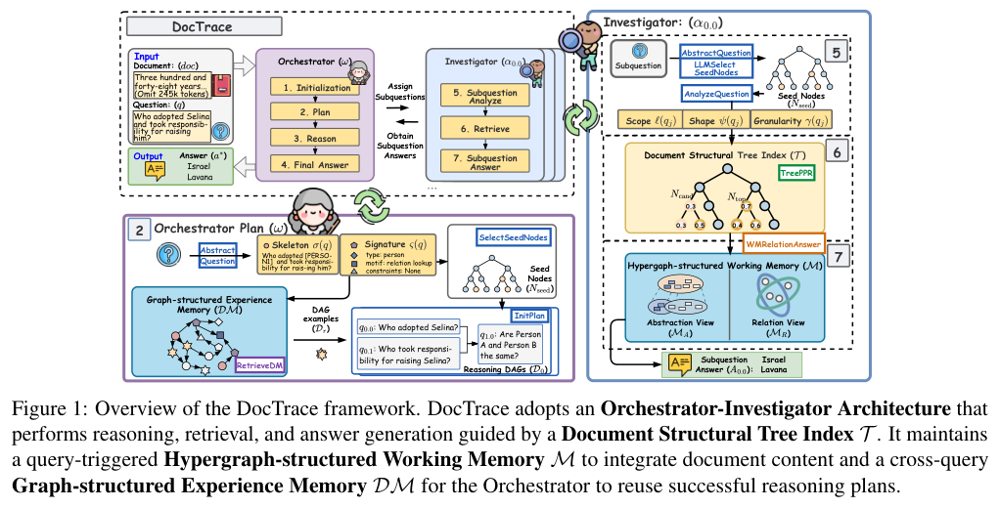
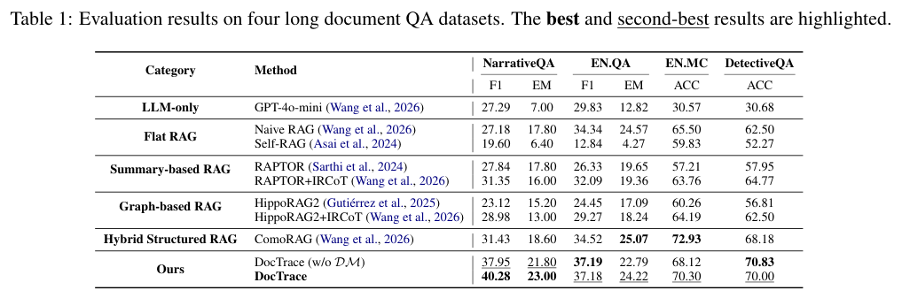
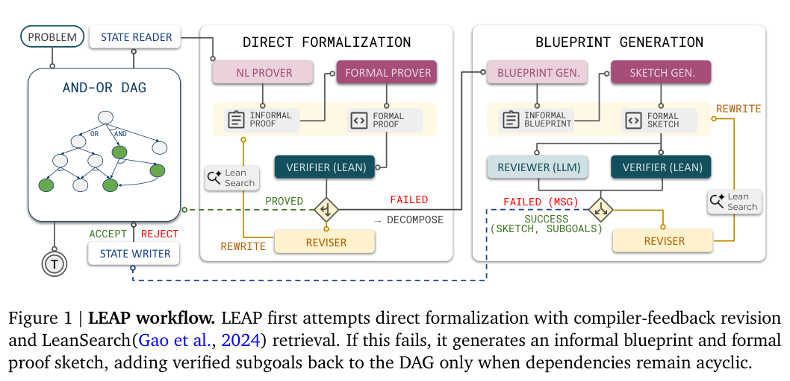
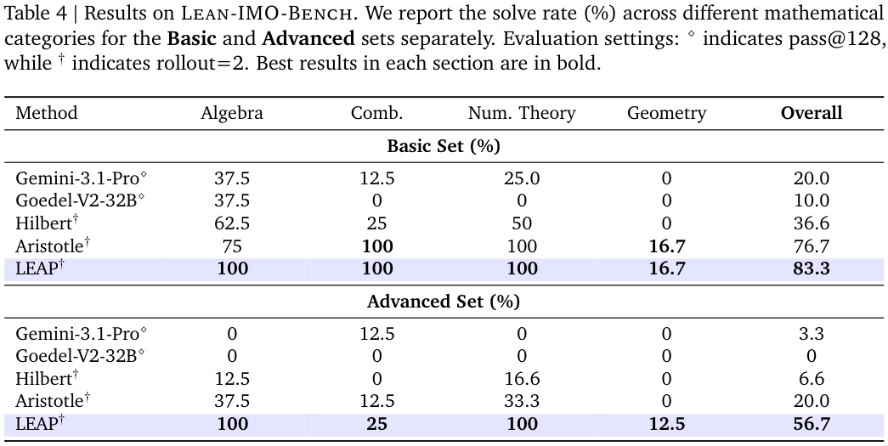
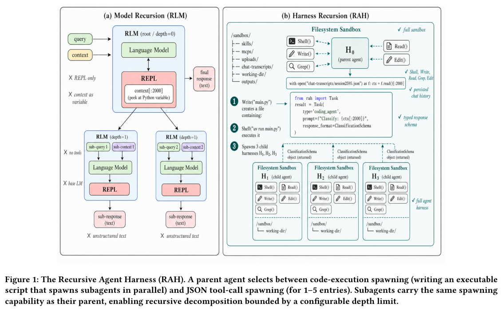
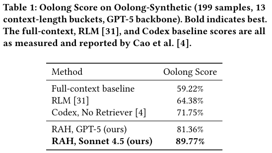
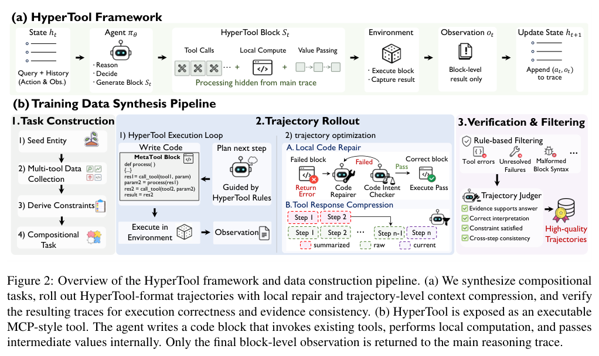
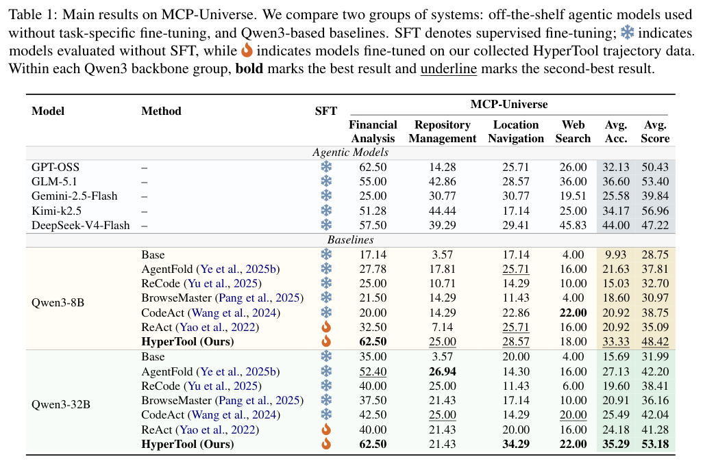

本期八项研究介绍 SPARQL 强化学习、长文证据组织、形式证明、递归执行、组合工具、动态搜索评测和像素对齐的几何补全。

## 1. Text-to-SPARQL：用答案反馈训练可执行查询

[Text-to-SPARQL Generation with Reinforcement Learning: A GRPO-based Approach on DBLP](https://arxiv.org/abs/2605.20066v1) · v1 提交 2026-05-19 · [全文](https://arxiv.org/html/2605.20066v1) · [PDF](https://arxiv.org/pdf/2605.20066v1)

自然语言转 SPARQL 可以用执行和答案反馈训练，但查询能运行与逻辑正确是两件事。这项研究在 DBLP 上以 GRPO 训练 Qwen3-1.7B，分别比较执行、格式、结构覆盖和长度奖励。

DBLP-QuAD 共 10,000 个问句—查询对，训练、验证、测试为 7,000/1,000/2,000。研究假定实体和关系链接完美提供，隔离查询生成问题。表 1 中，无金查询奖励 GRPO 的答案集合精确匹配为 0.47、可执行率 0.83；零样本为 0.07、0.50；一个 epoch 的 DoRA 监督基线为 0.69、0.91。GRPO 总体没有胜过监督训练。

保留模板测试片段中，GRPO 为 0.53，DoRA 为 0.40，但仍是同一模式和数据构造过程内的迁移。实验使用单一模型系列与基准、固定种子的训练运行，GRPO 全参更新与 DoRA 适配器也不是相同训练方式。我的判断是，缺少金查询时结果反馈有价值，但不能只用可执行率宣称端到端问答已解决。UNION、否定、聚合及答案形状应分别检查；企业图谱还需补上实体链接、端点变化与模式歧义测试。

原表：Jann Pfeifer、Debayan Banerjee、Ricardo Usbeck，arXiv:2605.20066v1，Table 1，PDF 第 7 页。[原始来源](https://arxiv.org/pdf/2605.20066v1#page=7) · [CC BY 4.0](https://creativecommons.org/licenses/by/4.0/)。裁剪自原文。

## 2. DocTrace：按问题组织长文证据

DocTrace 先保留文档章节树，再由协调者与调查者按问题建立共享超图工作记忆，把实体、事件和跨章节证据接起来。完成的推理 DAG 经过质量检查后进入经验记忆，为后续问题提供可组合的分解方式，减少对整篇文档预先建重图的依赖。

*图｜Zai, Xiangjun 等，[Figure 1（PDF 第 4 页）](https://arxiv.org/pdf/2606.10921v1#page=4)，[CC BY 4.0](http://creativecommons.org/licenses/by/4.0/)。裁剪自原文。*

四个长文 QA 数据集中，NarrativeQA 的 F1 为 40.28，ComoRAG 为 31.43；但 EN.MC 准确率为 70.30，低于对照 72.93，DetectiveQA 也从不带经验记忆的 70.83 降到完整系统的 70.00。按需建图和经验复用能改善部分证据整合，额外记忆并非总能提高答案质量；F1、精确匹配和多选准确率需要分开比较。

*图｜Zai, Xiangjun 等，[Table 1（PDF 第 7 页）](https://arxiv.org/pdf/2606.10921v1#page=7)，[CC BY 4.0](http://creativecommons.org/licenses/by/4.0/)。裁剪自原文。*

[Trace Only What You Need: Structure-Aware On-Demand Hypergraph Memory for Long-Document Question Answering](https://arxiv.org/abs/2606.10921v1) · v1。

## 3. LEAP：用 Lean 反馈组织可验证的证明

LEAP 先尝试直接形式化并利用 Lean 编译器纠错，复杂题目再拆成引理 DAG。自然语言蓝图与形式证明相互修订，已证明的引理可复用，让通用模型的推理能力通过可检查的局部步骤连接起来。

*图｜Kung, Po-Nien 等，[Figure 1（PDF 第 3 页）](https://arxiv.org/pdf/2606.03303v2#page=3)，[CC BY 4.0](http://creativecommons.org/licenses/by/4.0/)。裁剪自原文。*

Lean-IMO-Bench 中，LEAP 的 Basic/Advanced 总解决率为 83.3%/56.7%，Aristotle 为 76.7%/20.0%；几何子类则仅为 16.7%/12.5%。论文还报告解决全部十二道 Putnam 2025 题，但每题调用量从几十次到约三千次。不同方法的 pass@128、两次 rollout 和搜索预算并不相同，不能把迭代搜索成绩当作单次前向能力；Lean 验证的也是给定形式命题。

*图｜Kung, Po-Nien 等，[Table 4（PDF 第 8 页）](https://arxiv.org/pdf/2606.03303v2#page=8)，[CC BY 4.0](http://creativecommons.org/licenses/by/4.0/)。裁剪自原文。*

[LEAP: Supercharging LLMs for Formal Mathematics with Agentic Frameworks](https://arxiv.org/abs/2606.03303v2) · v2。

## 4. RAH：递归单位从模型调用变成完整 Agent

Recursive Agent Harness 让父 Agent 用代码批量创建带文件、执行和规划能力的子 Agent，再汇总它们对局部信息的判断。与仅递归调用语言模型相比，子任务可以读取真实工件并运行工具，父任务还能用程序控制并发与输出格式。

*图｜Lumer, Elias 等，[Figure 1（PDF 第 2 页）](https://arxiv.org/pdf/2606.13643v1#page=2)，[CC BY 4.0](http://creativecommons.org/licenses/by/4.0/)。裁剪自原文。*

在 199 个 Oolong-Synthetic 样本、最长四百万 token 的十三档上下文上，GPT-5 的 RAH 分数为 81.36%，既有 Codex 无检索基线为 71.75%，RLM 为 64.38%。基线取自先前论文，置信区间只对本次 RAH 样本重采样，不能当作所有系统逐题配对重跑；更换 Sonnet 4.5 后的 89.77% 又同时改变了骨干。工具与递归带来的额外调用成本也需纳入比较。

*图｜Lumer, Elias 等，[Table 1（PDF 第 4 页）](https://arxiv.org/pdf/2606.13643v1#page=4)，[CC BY 4.0](http://creativecommons.org/licenses/by/4.0/)。裁剪自原文。*

[Recursive Agent Harnesses](https://arxiv.org/abs/2606.13643v1) · v1。

## 5. HyperTool：把确定性的工具流程收进局部块

HyperTool 将多步工具操作合成为可执行块，局部变量与中间结果留在块内，只把必要摘要返回主推理轨迹。数据管线合成任务和轨迹，再训练模型学习何时组合操作、何时压缩上下文，减少每个值都经自然语言往返传递的负担。

*图｜Du, Yaxin 等，[Figure 2（PDF 第 4 页）](https://arxiv.org/pdf/2606.13663v1#page=4)，[CC BY 4.0](http://creativecommons.org/licenses/by/4.0/)。裁剪自原文。*

MCP-Universe 限制每条轨迹最多五十次工具调用、128K 上下文。Qwen3-8B 的平均准确率从相同合成流程训练的 ReAct-SFT 20.92% 到 HyperTool 33.33%；32B 从 24.18% 到 35.29%。这些是四领域整体分数，不能仅归因为少写了工具文本：执行接口、训练轨迹与压缩一起变化，代码块内部的错误也可能更难从摘要发现。

*图｜Du, Yaxin 等，[Table 1（PDF 第 6 页）](https://arxiv.org/pdf/2606.13663v1#page=6)，[CC BY 4.0](http://creativecommons.org/licenses/by/4.0/)。裁剪自原文。*

[HyperTool: Beyond Step-Wise Tool Calls for Tool-Augmented Agents](https://arxiv.org/abs/2606.13663v1) · v1。

## 6. EvoBrowseComp：用新知识减少搜索评测的记忆捷径

EvoBrowseComp 用三个 Agent 协作生成、筛选并检查依赖近期网页信息的多跳问题，同时构造推理图约束证据链。它将有工具和无工具设置并列，检查模型究竟是在检索推理，还是仅从参数中回忆答案。

三次评测均值中，Claude Opus 4.6 的英语有工具准确率为 44.8%，无工具为 6.0%；中文为 36.8% 与 8.8%。评测统一最多四十次工具调用和 128K 上下文，并用 GLM-5-Chat 判分。无工具低分说明这些题较难直接记忆，但不能证明完全没有污染；网页变化、问题合成偏差与模型裁判也会改变难度。

[EvoBrowseComp: Benchmarking Search Agents on Evolving Knowledge](https://arxiv.org/abs/2606.13120v1) · v1。

[Figure 1（原文）](https://arxiv.org/pdf/2606.13120v1#page=1)。

## 7. DailyReport：把搜索报告拆成用户在意的子任务

DailyReport 收集一百五十项开放日常搜索任务和 3,546 条 rubric，将遵循指令、事实性与合理性分开。任务创建者再标注遗漏不同子任务对可用性的影响，使最终分数不只取决于回答长短或某个孤立事实。

十七种系统配置中，GPT-5.4 配搜索工具的 UserPref 为 2.89，低于 3 的“可接受”门槛；子任务全部满足 rubric 的比例为 0.484，指令遵循则为 0.982。三个指标衡量不同环节，接近完整的指令覆盖仍可能伴随事实或推理缺口。UserPref 是基于重要度与 Gemini-3-flash 判分的聚合指标，不能直接等同于真实用户满意率或对当前产品的永久排名。

[DailyReport: An Open-ended Benchmark for Evaluating Search Agents on Daily Search Tasks](https://arxiv.org/abs/2606.12871v1) · v1。

[Figure 1（原文）](https://arxiv.org/pdf/2606.12871v1#page=2)。

## 8. World Tracing：沿像素射线补全不可见几何

World Tracing 为每个输入像素预测按前后顺序排列的三维点：第一层对应可见表面，后续层表示遮挡后的交点。WT-DiT 用分层去噪和混合监督，将真实单层 RGBD 数据与完整三维资产一起训练，兼顾像素对齐与形状补全。

留出物体上，各方法按样本进行相同的尺度与偏移对齐后，WT-O 可见深度 MAE 为 0.0149，VGGT 为 0.0257。完整几何另用一百个物体、生成方法 best-of-8 种子评价，WT-O 点云在阈值 0.01 下的 F 分数为 0.549；这与可见深度不是同一测试，输出点云与网格也需区分。被遮挡几何本来就存在多解，生成得合理不保证与真实隐藏结构一致。

[World Tracing: Generative Pixel-Aligned Geometry Beyond the Visible](https://arxiv.org/abs/2606.13652v1) · v1。

[Figure 1（原文）](https://arxiv.org/pdf/2606.13652v1#page=1)。
