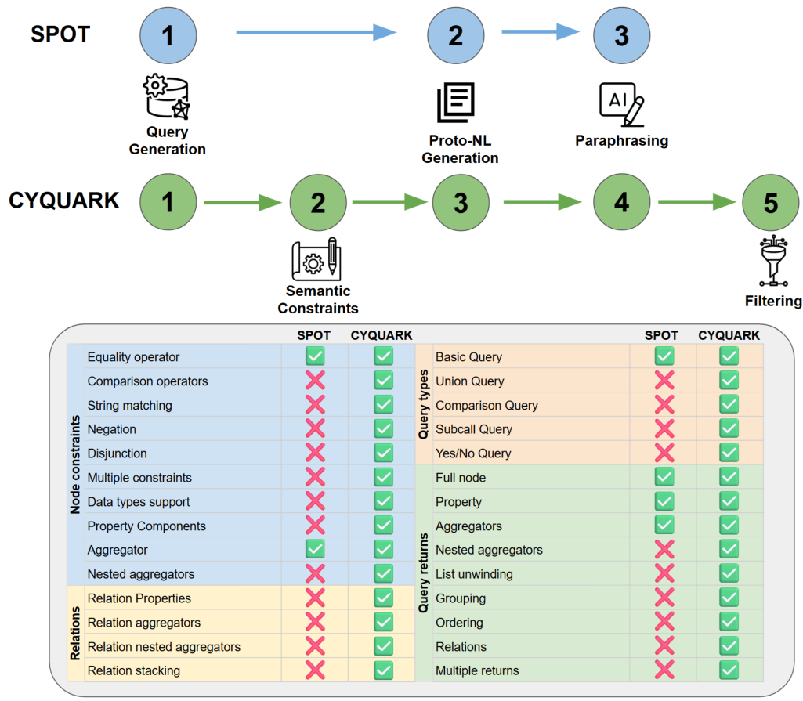

## 重点阅读

[Achieving Precise Text-To-Cypher Via Grounded Knowledge Graph Data Generation](https://arxiv.org/abs/2606.14325v1) · v1 提交 2026-06-12 · [全文](https://arxiv.org/html/2606.14325v1) · [PDF](https://arxiv.org/pdf/2606.14325v1)

Text-to-Cypher 的瓶颈常是目标图谱专属标注，而非单纯参数量。CYQUARK 从属性图及 schema 抽样带实际值的查询模式，用有限状态转换器产生语义明确的初始问句，再让模型改写。相较 SPOT，它支持更复杂的子查询、联合、比较和返回结构，并加入 schema 约束和逻辑意义过滤。

四套基准、19 张图的执行准确率中，合成数据微调的 Qwen3.5-4B 在 MindTheQuery、Text2GQL-Bench、CypherBench、Zograscope 分别为 82.62%、59.05%、85.38%、78.47%，正文报告平均 76.21%（四个主表值等权复算为 76.38%，此处不强行统一口径）；同一 4B 零样本平均 37.94%。0.8B 微调平均为 73.30%，但 Claude Opus 4.7、GPT-5.5 平均仍为 78.58%、78.52%，不能写成小模型全面超越。

无过滤消融需要保留原文差异：主表 5 的 4B Text2GQL 为 52.78%，附录表 7 却列 53.78%；完整条件均为 59.05%。不能据此给出唯一精确降幅。改写与过滤使用 Qwen3.5-9B，模型判断不是形式证明。我的判断是，高覆盖、贴图谱的数据制造值得研究，但它以可用图谱和含词汇信息的 schema 为前提；业务问法、权限和新 schema 仍需另外验收。

原图：Francesco Cazzaro、Jessica Lennon、Ariadna Quattoni，arXiv:2606.14325v1，Figure 2，PDF 第 4 页。[原始来源](https://arxiv.org/pdf/2606.14325v1#page=4) · [CC BY-SA 4.0](https://creativecommons.org/licenses/by-sa/4.0/)。已裁剪完整表格或图形及必要标签，移除周围正文，内容和颜色未改动，未重绘。此材料沿用 CC BY-SA 4.0，此裁剪材料按相同 CC BY-SA 4.0 许可使用，本站页脚许可不为其增加非商业限制。

## 同期其他论文入口

- [Transforming Shape Schemas with Composable Property-Graph Queries (Extended Version)](https://arxiv.org/abs/2606.14309v1) · 2606.14309v1，该版本提交 2026-06-12。
- [Hy-Embodied-0.5-VLA: From Vision-Language-Action Models to a Real-World Robot Learning Stack](https://arxiv.org/abs/2606.14409v1) · 2606.14409v1，该版本提交 2026-06-12。
- [HarnessX: A Composable, Adaptive, and Evolvable Agent Harness Foundry](https://arxiv.org/abs/2606.14249v1) · 2606.14249v1，该版本提交 2026-06-12。
- [When Errors Become Narratives: A Longitudinal Taxonomy of Silent Failures in a Production LLM Agent Runtime](https://arxiv.org/abs/2606.14589v1) · 2606.14589v1，该版本提交 2026-06-12。
- [From Shield to Target: Denial-of-Service Attacks on LLM-Based Agent Guardrails](https://arxiv.org/abs/2606.14517v2) · 2606.14517v2，该版本提交 2026-06-16。
- [Dialogue SWE-Bench: A Benchmark for Dialogue-Driven Coding Agents](https://arxiv.org/abs/2606.13995v1) · 2606.13995v1，该版本提交 2026-06-12。
- [Every Eval Ever: A Unifying Schema and Community Repository for AI Evaluation Results](https://arxiv.org/abs/2606.14516v1) · 2606.14516v1，该版本提交 2026-06-12。

文中实验结果为论文作者报告，未独立复现。
