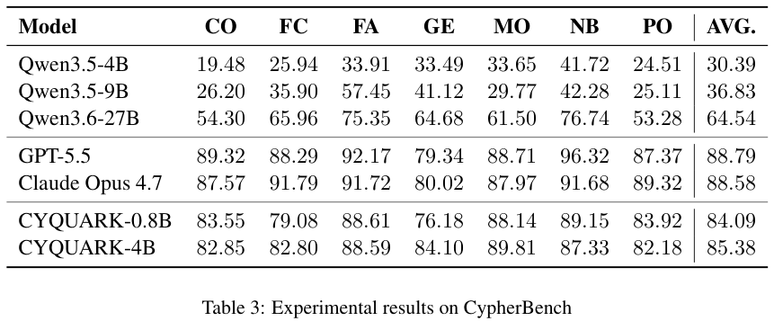
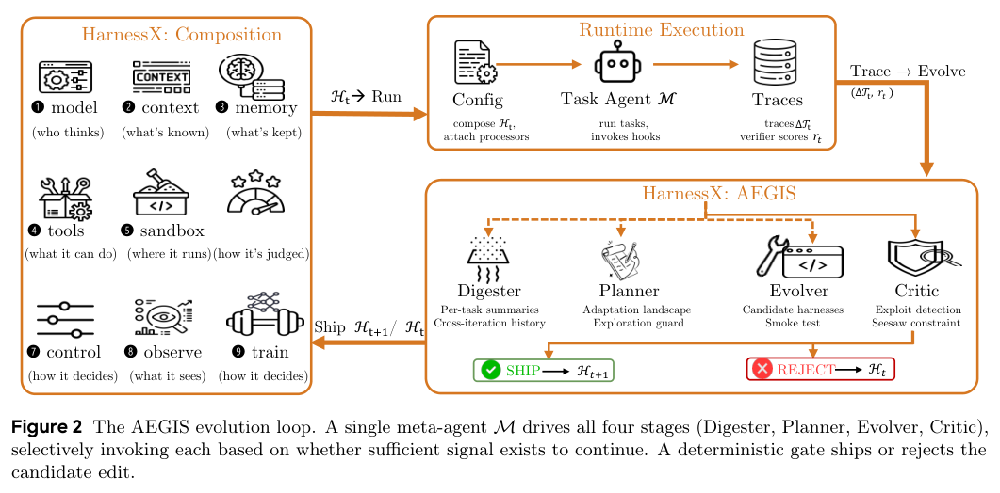
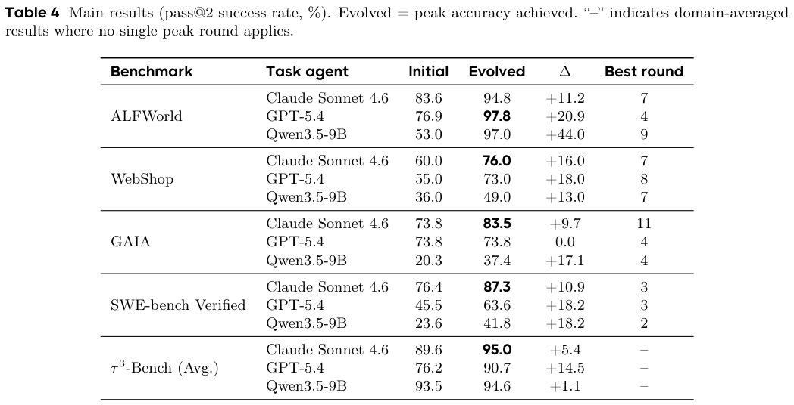
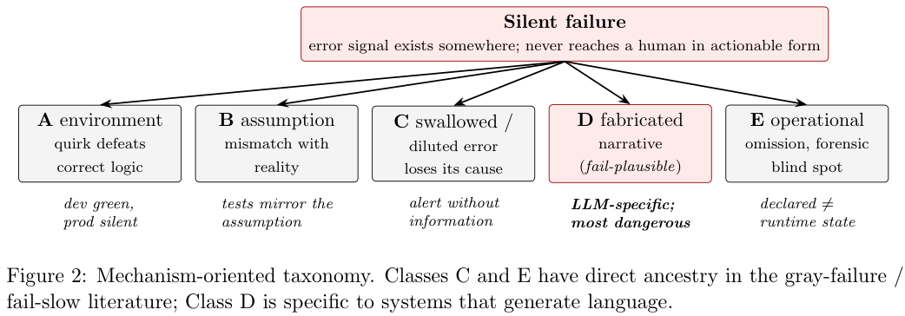
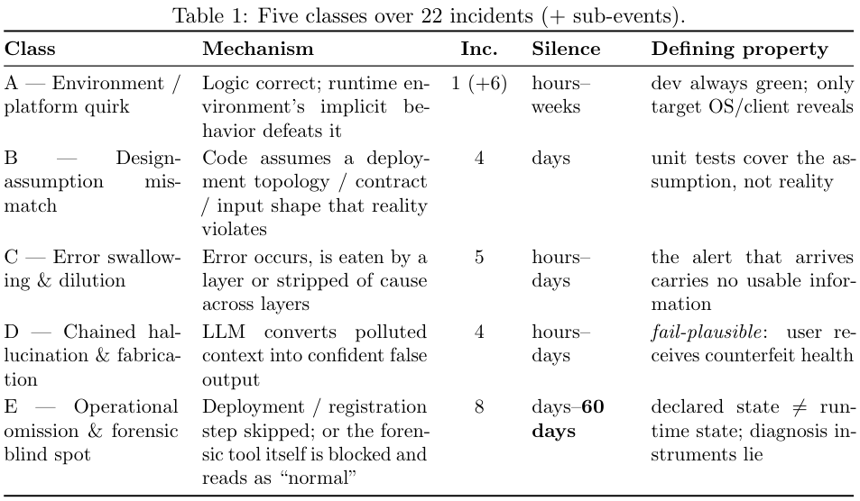
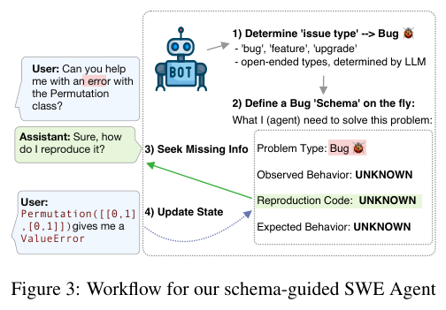
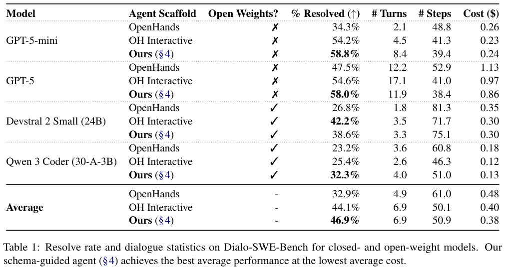
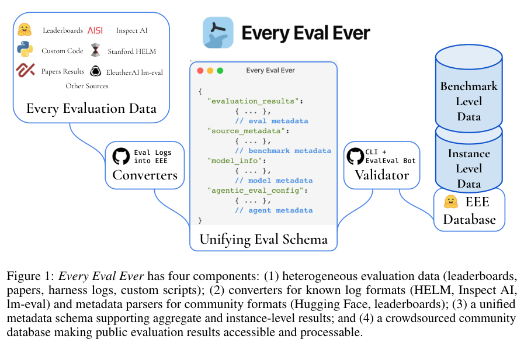
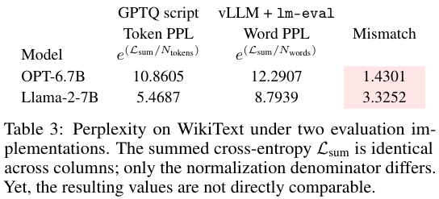

本期八项研究从 Cypher 数据生成和属性图约束转换，延伸到机器人学习栈、执行框架演化、静默失败、安全层资源消耗、对话编程与评测结果标准化。

## 1. CYQUARK：用图谱约束生成 Text-to-Cypher 数据

[Achieving Precise Text-To-Cypher Via Grounded Knowledge Graph Data Generation](https://arxiv.org/abs/2606.14325v1) · v1 提交 2026-06-12 · [全文](https://arxiv.org/html/2606.14325v1) · [PDF](https://arxiv.org/pdf/2606.14325v1)

Text-to-Cypher 的瓶颈常是目标图谱专属标注，而非单纯参数量。CYQUARK 从属性图及 schema 抽样带实际值的查询模式，用有限状态转换器产生语义明确的初始问句，再让模型改写。相较 SPOT，它支持更复杂的子查询、联合、比较和返回结构，并加入 schema 约束和逻辑意义过滤。

四套基准、19 张图的执行准确率中，合成数据微调的 Qwen3.5-4B 在 MindTheQuery、Text2GQL-Bench、CypherBench、Zograscope 分别为 82.62%、59.05%、85.38%、78.47%，正文报告平均 76.21%（四个主表值等权复算为 76.38%，此处不强行统一口径）；同一 4B 零样本平均 37.94%。0.8B 微调平均为 73.30%，但 Claude Opus 4.7、GPT-5.5 平均仍为 78.58%、78.52%，不能写成小模型全面超越。

无过滤消融需要保留原文差异：主表 5 的 4B Text2GQL 为 52.78%，附录表 7 却列 53.78%；完整条件均为 59.05%。不能据此给出唯一精确降幅。改写与过滤使用 Qwen3.5-9B，模型判断不是形式证明。我的判断是，高覆盖、贴图谱的数据制造值得研究，但它以可用图谱和含词汇信息的 schema 为前提；业务问法、权限和新 schema 仍需另外验收。

原图：Francesco Cazzaro、Jessica Lennon、Ariadna Quattoni，arXiv:2606.14325v1，Figure 2，PDF 第 4 页。[原始来源](https://arxiv.org/pdf/2606.14325v1#page=4) · [CC BY-SA 4.0](https://creativecommons.org/licenses/by-sa/4.0/)。裁剪自原文。

*图｜Cazzaro, Francesco 等，[Table 3（PDF 第 7 页）](https://arxiv.org/pdf/2606.14325v1#page=7)，[CC BY-SA 4.0](http://creativecommons.org/licenses/by-sa/4.0/)。裁剪自原文。*

## 2. 属性图转换后，哪些 shape 约束仍然成立

这项工作研究图到图查询的输出 schema：输入给出 ProGS 约束，查询用 G-CORE 表达，通过将属性图重化为 RDF、将 schema 映射到 SHACL、将查询映射为 SPARQL CONSTRUCT，复用描述逻辑推理推导输出约束。节点、边、标签和属性都要在映射中保留语义。

主要贡献是形式化推导与可靠性论证，而非某个数据集的准确率提升。输出约束面向所有满足输入 schema 的图，不依赖抽取某个图实例来猜测；但结论限于论文覆盖的语言片段和映射条件。可靠地推出部分约束，也不等于已经找到所有可能成立的约束，推导的完备程度与可处理的查询范围仍需分别判断。

[Transforming Shape Schemas with Composable Property-Graph Queries (Extended Version)](https://arxiv.org/abs/2606.14309v1) · v1。

[Figure 1（原文）](https://arxiv.org/pdf/2606.14309v1#page=2)。

## 3. HyVLA-0.5：把数据、策略与异步执行连成栈

HyVLA-0.5 从超过一万小时的指尖 UMI 演示出发，将 flow action expert、紧凑记忆和 delta-chunk 动作表示接入具身骨干。系统分别支持目标机器人适配与 UMI 跨具身迁移，再用成功、失败偏好轨迹做后训练，部署端以异步推理和轨迹平滑维持闭环。

RoboTwin 2.0 五十任务、每任务一百次 rollout 的平均成功率为 Clean 90.9%、Randomized 90.1%，JoyAI-RA 的官方报告为 90.5%/89.3%。去掉紧凑记忆后降到 88.8%/88.6%，再去掉 UMI 预训练为 88.1%/87.9%。这些消融支持两部分的贡献，其他系统则没有全部在同环境重跑；仿真均值、UMI-only 迁移和有机器人示范的适配不能合并为一个通用成功率。

[Hy-Embodied-0.5-VLA: From Vision-Language-Action Models to a Real-World Robot Learning Stack](https://arxiv.org/abs/2606.14409v1) · v1。

[Figure 1（原文）](https://arxiv.org/pdf/2606.14409v1#page=2)。

## 4. HarnessX：把执行框架拆成可替换组件

HarnessX 用带类型的原语和替换代数组装提示、工具、记忆与控制流，AEGIS 根据执行轨迹搜索修改，再把轨迹用于框架更新与模型训练。它将运行时接口视为可持续调整的对象，而非每换模型就完全手写一套流程。

*图｜Chen, Tingyang 等，[Figure 2（PDF 第 7 页）](https://arxiv.org/pdf/2606.14249v1#page=7)，[CC BY 4.0](http://creativecommons.org/licenses/by/4.0/)。裁剪自原文。*

主表报告演化轮次中达到的最高 pass@2：Qwen3.5-9B 在 ALFWorld 从 53.0% 到 97.0%，GPT-5.4 在 GAIA 则保持 73.8%。这些是挑选峰值的成绩，不是最终轮次或独立保留集的稳定增益；论文也展示同配置重跑回落、修好一题又破坏另一题的现象。框架搜索有效性应连同评测预算、选择过程和回归一起看，代码在该版本中仍标为计划发布。

*图｜Chen, Tingyang 等，[Table 4（PDF 第 16 页）](https://arxiv.org/pdf/2606.14249v1#page=16)，[CC BY 4.0](http://creativecommons.org/licenses/by/4.0/)。裁剪自原文。*

[HarnessX: A Composable, Adaptive, and Evolvable Agent Harness Foundry](https://arxiv.org/abs/2606.14249v1) · v1。

## 5. 静默失败研究：错误怎样被改写成可信叙述

这篇纵向案例研究跟踪一个个人助手运行时，把静默失败分为环境差异、设计假设不匹配、错误吞没、链式幻觉及操作盲区。最有特点的一类是模型将工具错误接续成流畅内容，使“任务有输出”掩盖了实际失败。

*图｜Wu, Wei 等，[Figure 2（PDF 第 7 页）](https://arxiv.org/pdf/2606.14589v1#page=7)，[CC BY 4.0](http://creativecommons.org/licenses/by/4.0/)。裁剪自原文。*

八周内记录二十二起带根因分析的事故，相关元模式至少出现二十八次；约七成最终由人工查看用户输出发现。对十五起事故的回溯中，声明式治理事前预防为 0%，事后阻断回归为 87%。这是单一系统、由其运营者进行的观察研究，事故选择与追溯方式影响分母，不能把这些比例当作所有 Agent 的故障率或治理工具的普遍效果。

*图｜Wu, Wei 等，[Table 1（PDF 第 7 页）](https://arxiv.org/pdf/2606.14589v1#page=7)，[CC BY 4.0](http://creativecommons.org/licenses/by/4.0/)。裁剪自原文。*

[When Errors Become Narratives: A Longitudinal Taxonomy of Silent Failures in a Production LLM Agent Runtime](https://arxiv.org/abs/2606.14589v1) · v1。

## 6. Guardrail DoS：安全判断本身也可能消耗失控

这项安全研究考察不可信输入能否诱导模型安全层过度推理，拖慢本来受到保护的 Agent。作者在受控环境内比较独立 guardrail 与集成式安全判断，强调资源预算、判断时限和共享服务隔离也是防护的一部分。

作者报告跨八种模型骨干的独立安全层实验出现 13–63 倍推理 token 放大，端到端部署场景最高出现 148 倍延迟放大。两种倍数来自不同设置，不能互换，也不能据此声称所有当前商业产品都有相同漏洞。结果支持为安全判断设置可观测的资源上限和降级路径；攻击成功率并非对全部真实部署的覆盖率。

[From Shield to Target: Denial-of-Service Attacks on LLM-Based Agent Guardrails](https://arxiv.org/abs/2606.14517v2) · v2。

[Figure 1（原文）](https://arxiv.org/pdf/2606.14517v2#page=3)。

## 7. Dialogue-SWEBench：修代码也要会向用户问问题

Dialogue-SWEBench 将五百道 SWE-bench Verified 任务转为需要对话获取信息的环境，用带 persona 的用户模拟器提供回答，并分别评价代码修复与对话质量。作者的 schema-guided Agent 在修改代码时维护问题、已知条件和待澄清信息，避免把初始描述当作完整规范。

*图｜King, Brendan 等，[Figure 3（PDF 第 4 页）](https://arxiv.org/pdf/2606.13995v1#page=4)，[CC BY 4.0](http://creativecommons.org/licenses/by/4.0/)。裁剪自原文。*

相同工具集合、每题最多一百步的设置下，四模型平均解决率从 OpenHands 的 32.9%、OH Interactive 的 44.1% 到该方法的 46.9%。但 Devstral 2 Small 从交互基线 42.2% 降到 38.6%；GPT-5-mini 的 58.8% 还略高于 GPT-5 的 58.0%。编码能力与对话能力并不完全同步，而模拟用户的表现仍需与真实开发者交互区分。

*图｜King, Brendan 等，[Table 1（PDF 第 5 页）](https://arxiv.org/pdf/2606.13995v1#page=5)，[CC BY 4.0](http://creativecommons.org/licenses/by/4.0/)。裁剪自原文。*

[Dialogue SWE-Bench: A Benchmark for Dialogue-Driven Coding Agents](https://arxiv.org/abs/2606.13995v1) · v1。

## 8. Every Eval Ever：先记录分数到底怎么得到

Every Eval Ever 提供统一 JSON schema、格式转换器和社区评测结果库，记录模型、数据集、评估实现与可选逐样本输出。它的目标是让不同榜单和 harness 的结果可以追溯、分析，而不只把看似同名的分数放进一张排名表。

*图｜Batzner, Jan 等，[Figure 1（PDF 第 2 页）](https://arxiv.org/pdf/2606.14516v1#page=2)，[CC BY 4.0](http://creativecommons.org/licenses/by/4.0/)。裁剪自原文。*

该版本汇集 22,235 个模型、2,273 个基准和三十一种评测格式。WikiText 案例中，同一累计交叉熵改用不同归一化分母，OPT-6.7B 的 token PPL 为 10.8605，word PPL 为 12.2907；Llama-2-7B 为 5.4687 与 8.7939。这不是模型变强或变弱，而是指标定义改变。统一存储有助发现这种差异，但不能自动保证原始实验可复现或数据标注完整。

*图｜Batzner, Jan 等，[Table 3（PDF 第 8 页）](https://arxiv.org/pdf/2606.14516v1#page=8)，[CC BY 4.0](http://creativecommons.org/licenses/by/4.0/)。裁剪自原文。*

[Every Eval Ever: A Unifying Schema and Community Repository for AI Evaluation Results](https://arxiv.org/abs/2606.14516v1) · v1。
