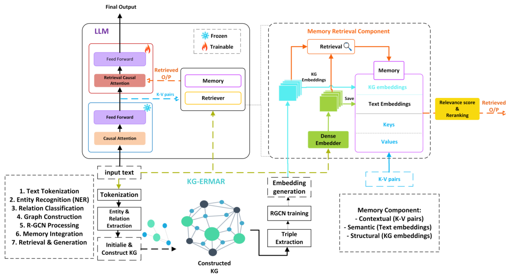

## 重点阅读

[Knowledge Graph Enhanced Memory-Augmented Retrieval for Long Context Modeling](https://arxiv.org/abs/2606.14047v1) · v1 提交 2026-06-12 · [全文](https://arxiv.org/html/2606.14047v1) · [PDF](https://arxiv.org/pdf/2606.14047v1)

KGERMAR 在推理时从当前文本抽实体和关系，构成动态知识图谱，用关系图卷积编码结构，并与文本向量融合。上下文键值、语义和结构分别保存，再学习融合检索信号；它是输入相关索引，而非预建通用知识库。

训练采用 SlimPajama 的 84,700 个样本。表 1 的 WikiText-103、3B 记忆模型组、16K 上下文中，困惑度为 7.14，ERMAR 为 7.80；四样本提示、四记忆容量下，五项 NLU 平均准确率为 78.6%，ERMAR 为 76.14%。Proof-pile 的 1K 条件并不领先，Phi3-128k 在部分较短上下文也更好；这些比较不能隔离为纯粹的加图收益。

表 3 使用单张 NVIDIA L40S（文中报告 44.4GB）：32K 峰值显存 14.51GB 对 ERMAR 22.87GB，约减少 36.6%，并非所有条件均减少两倍。表 4 的延迟比较只覆盖 1K—16K：KGERMAR 在两端分别为 0.43、0.95 毫秒/token，ERMAR 为 0.32、0.58，不能当作 32K 延迟。表 3 与表 4 的归一化内存栏还有单位和数值口径差异，这里不合并使用。我的判断是，关系追踪和显存收益应与抽图错误、额外延迟一起验收。

原图：Ghadir Alselwi、Basem Suleiman、Hao Xue、Shoaib Jameel、Hakim Hacid、Flora D. Salim、Imran Razzak，arXiv:2606.14047v1，Figure 2，PDF 第 4 页。[原始来源](https://arxiv.org/pdf/2606.14047v1#page=4) · [CC BY 4.0](https://creativecommons.org/licenses/by/4.0/)。裁剪自原文。

## 同期其他论文入口

- [MolmoAct2: Action Reasoning Models for Real-world Deployment](https://arxiv.org/abs/2605.02881v2) · 2605.02881v2，该版本提交 2026-05-08。
- [ProgramBench: Can Language Models Rebuild Programs From Scratch?](https://arxiv.org/abs/2605.03546v1) · 2605.03546v1，该版本提交 2026-05-05。
- [OpenSeeker-v2: Pushing the Limits of Search Agents with Informative and High-Difficulty Trajectories](https://arxiv.org/abs/2605.04036v1) · 2605.04036v1，该版本提交 2026-05-05。
- [Continuous Latent Diffusion Language Model](https://arxiv.org/abs/2605.06548v1) · 2605.06548v1，该版本提交 2026-05-07。
- [Manifold Steering Reveals the Shared Geometry of Neural Network Representation and Behavior](https://arxiv.org/abs/2605.05115v1) · 2605.05115v1，该版本提交 2026-05-06。
