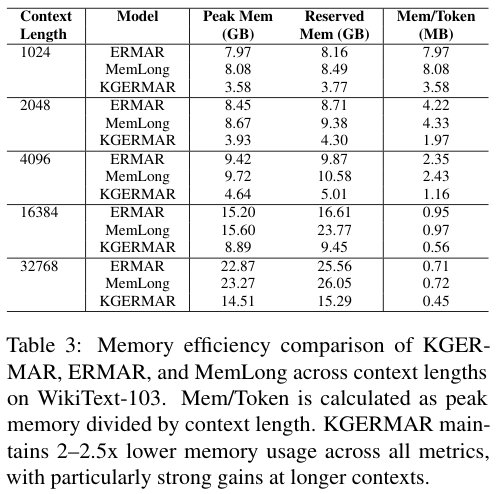
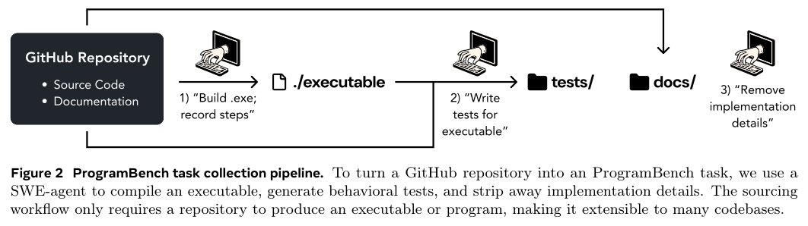
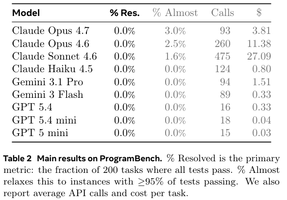
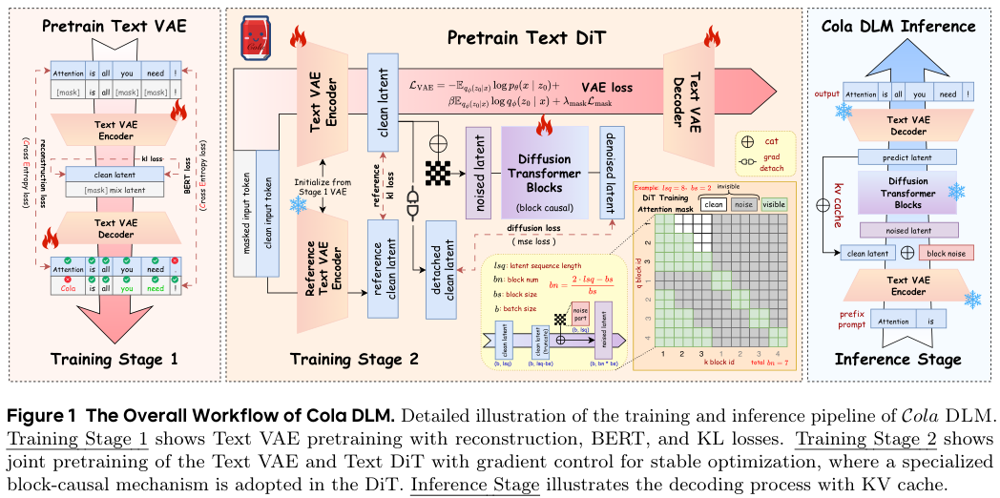
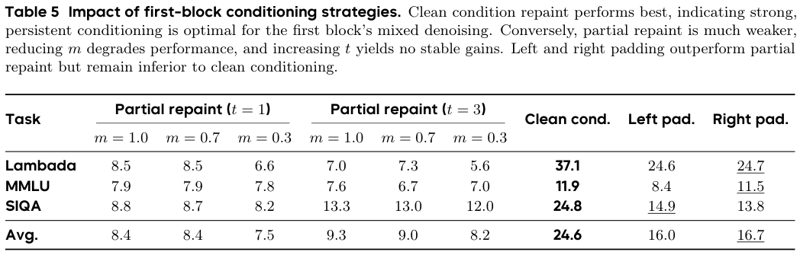

本期六项研究讨论知识图谱记忆的收益与代价、机器人动作推理、完整程序重建、搜索轨迹、连续潜在生成和表示几何。

## 1. KGERMAR：同时检索语义与实体关系

[Knowledge Graph Enhanced Memory-Augmented Retrieval for Long Context Modeling](https://arxiv.org/abs/2606.14047v1) · v1 提交 2026-06-12 · [全文](https://arxiv.org/html/2606.14047v1) · [PDF](https://arxiv.org/pdf/2606.14047v1)

KGERMAR 在推理时从当前文本抽实体和关系，构成动态知识图谱，用关系图卷积编码结构，并与文本向量融合。上下文键值、语义和结构分别保存，再学习融合检索信号；它是输入相关索引，而非预建通用知识库。

训练采用 SlimPajama 的 84,700 个样本。表 1 的 WikiText-103、3B 记忆模型组、16K 上下文中，困惑度为 7.14，ERMAR 为 7.80；四样本提示、四记忆容量下，五项 NLU 平均准确率为 78.6%，ERMAR 为 76.14%。Proof-pile 的 1K 条件并不领先，Phi3-128k 在部分较短上下文也更好；这些比较不能隔离为纯粹的加图收益。

表 3 使用单张 NVIDIA L40S（文中报告 44.4GB）：32K 峰值显存 14.51GB 对 ERMAR 22.87GB，约减少 36.6%，并非所有条件均减少两倍。表 4 的延迟比较只覆盖 1K—16K：KGERMAR 在两端分别为 0.43、0.95 毫秒/token，ERMAR 为 0.32、0.58，不能当作 32K 延迟。表 3 与表 4 的归一化内存栏还有单位和数值口径差异，这里不合并使用。我的判断是，关系追踪和显存收益应与抽图错误、额外延迟一起验收。

原图：Ghadir Alselwi、Basem Suleiman、Hao Xue、Shoaib Jameel、Hakim Hacid、Flora D. Salim、Imran Razzak，arXiv:2606.14047v1，Figure 2，PDF 第 4 页。[原始来源](https://arxiv.org/pdf/2606.14047v1#page=4) · [CC BY 4.0](https://creativecommons.org/licenses/by/4.0/)。裁剪自原文。

*图｜Alselwi, Ghadir 等，[Table 3（PDF 第 8 页）](https://arxiv.org/pdf/2606.14047v1#page=8)，[CC BY 4.0](http://creativecommons.org/licenses/by/4.0/)。裁剪自原文。*

## 2. MolmoAct2：把几何理解接到连续动作专家

MolmoAct2 用专门训练的 Molmo2-ER 处理具身视觉，通过逐层 KV 条件连接连续 flow 动作专家，并提供覆盖双臂 YAM、Franka 与低成本 SO-100/101 的数据。Think 版本缓存场景深度 token，只重新预测变化区域，以减少重复几何推理。

三次独立运行的 MolmoSpace 四类任务中，MolmoAct2-DROID 平均成功率为 37.7%，π0.5-DROID 为 34.5%；抓取放置为 26.7% 对 13.6%，但打开物体为 9.5% 对 22.7%。整体均值提高并未消除关节物体操作的短板。不同平台还分别使用完整成功率或带部分得分的进度指标，不能把它们合成一个部署成功率。

[MolmoAct2: Action Reasoning Models for Real-world Deployment](https://arxiv.org/abs/2605.02881v2) · v2。

[Figure 1（原文）](https://arxiv.org/pdf/2605.02881v2#page=2)。

## 3. ProgramBench：从可执行程序重建完整行为

ProgramBench 给 Agent 参考可执行文件和文档，允许它探查输入输出，再从空仓库重建程序。评测通过 Agent 辅助模糊测试生成端到端行为用例，避免预先规定代码结构，也使架构选择、边界行为与跨模块一致性都进入任务。

*图｜Yang, John 等，[Figure 2（PDF 第 3 页）](https://arxiv.org/pdf/2605.03546v1#page=3)，[CC BY 4.0](http://creativecommons.org/licenses/by/4.0/)。裁剪自原文。*

二百项任务、九个语言模型的主实验中，没有任何系统完全通过一项任务的全部测试；最好的 Claude Opus 4.7 仅在 3% 的任务上达到至少 95% 测试通过。完全解决率、接近完成率和单任务测试通过率是三个不同口径。有限调用预算和测试覆盖共同限制结论，行为复现也不等于满足可维护性、可访问性或全部安全要求。

*图｜Yang, John 等，[Table 2（PDF 第 6 页）](https://arxiv.org/pdf/2605.03546v1#page=6)，[CC BY 4.0](http://creativecommons.org/licenses/by/4.0/)。裁剪自原文。*

[ProgramBench: Can Language Models Rebuild Programs From Scratch?](https://arxiv.org/abs/2605.03546v1) · v1。

## 4. OpenSeeker-v2：用高信息量搜索轨迹做监督微调

OpenSeeker-v2 扩大合成题目的知识图谱、增加可用工具，并过滤过短的求解轨迹，让训练样本包含更多探索和多步证据。模型沿 ReAct 方式交替推理与搜索，仅用约 10,600 条轨迹做监督微调，重点检验数据质量能把同规模搜索 Agent 推到哪里。

30B 级设置中，BrowseComp、BrowseComp-ZH、Humanity’s Last Exam 和 xbench 分别为 46.0%、58.1%、34.6% 和 78.0%；论文所比 Tongyi DeepResearch 为 43.4%、46.7%、32.9% 和 75.0%。这是不同完整训练管线的结果，支持高质量 SFT 数据的价值，但不能据此断言在相同数据与计算预算下 RL 没有收益。

[OpenSeeker-v2: Pushing the Limits of Search Agents with Informative and High-Difficulty Trajectories](https://arxiv.org/abs/2605.04036v1) · v1。

[Figure 1（原文）](https://arxiv.org/pdf/2605.04036v1#page=1)。

## 5. Cola DLM：先建模潜在语义，再生成文字

Cola DLM 用 Text VAE 将文本映射到连续潜在空间，block-causal DiT 学习全局语义先验，条件解码器再把潜变量变回文字。它将潜在空间随训练一起演化，与固定编码器路线对照，考察语义平滑度、噪声尺度和块大小怎样影响生成。

*图｜Guo, Hongcan 等，[Figure 1（PDF 第 6 页）](https://arxiv.org/pdf/2605.06548v1#page=6)，[CC BY 4.0](http://creativecommons.org/licenses/by/4.0/)。裁剪自原文。*

约 2B 参数的匹配架构实验覆盖八项基准。在首块包含已知提示与未知续写的消融中，保持提示潜变量为干净条件的三任务均值为 24.6，左、右 padding 为 16.0、16.7；这是同一条件策略实验，不能当作相对自回归模型的通用增幅。论文还发现似然推导的 PPL 与生成质量可能分离，潜在密度更平滑并不保证生成语义更准确。

*图｜Guo, Hongcan 等，[Table 5（PDF 第 24 页）](https://arxiv.org/pdf/2605.06548v1#page=24)，[CC BY 4.0](http://creativecommons.org/licenses/by/4.0/)。裁剪自原文。*

[Continuous Latent Diffusion Language Model](https://arxiv.org/abs/2605.06548v1) · v1。

## 6. Manifold Steering：干预路径需要尊重表示几何

这项机制研究分别拟合模型激活流形与输出概率的行为流形，沿不同几何路径施加干预，再观察输出如何变化。它还反向优化行为路径，检查恢复出的激活轨迹是否与表示空间的曲率相符，比较线性方向与流形路径的差异。

循环概念、顺序概念和上下文图任务中，流形干预产生更平滑、有序的行为转换；视频世界模型的运动实验也观察到类似几何关系。证据来自精心构造的概念空间和模型内部干预，而非通用任务准确率提升。流形拟合、选层与数据覆盖都是前提，不能据此推断任意开放语义都有同样可控的低维结构。

[Manifold Steering Reveals the Shared Geometry of Neural Network Representation and Behavior](https://arxiv.org/abs/2605.05115v1) · v1。

[Figure 1（原文）](https://arxiv.org/pdf/2605.05115v1#page=2)。
