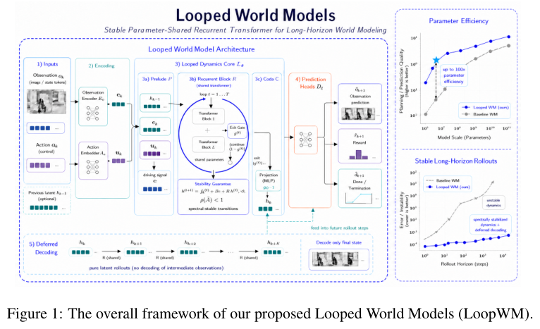
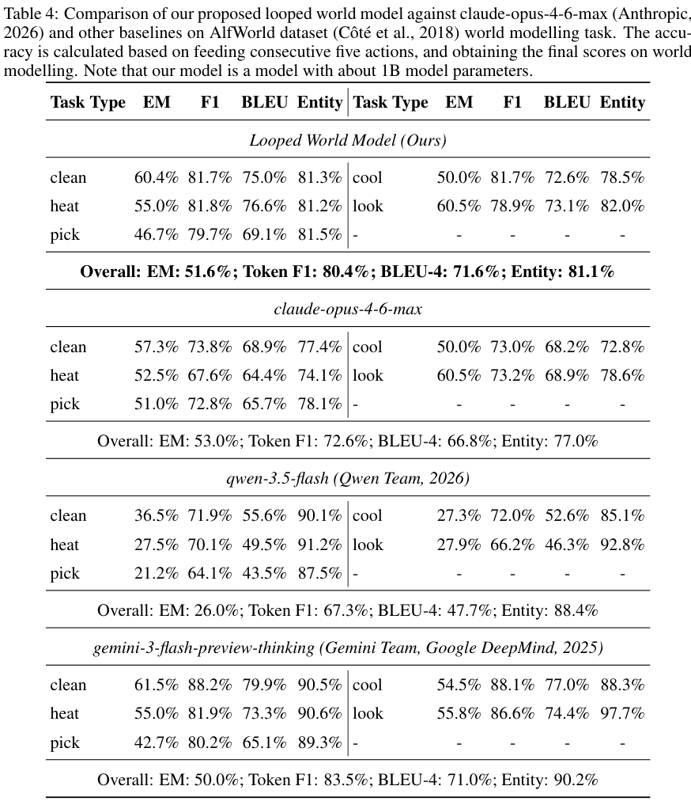
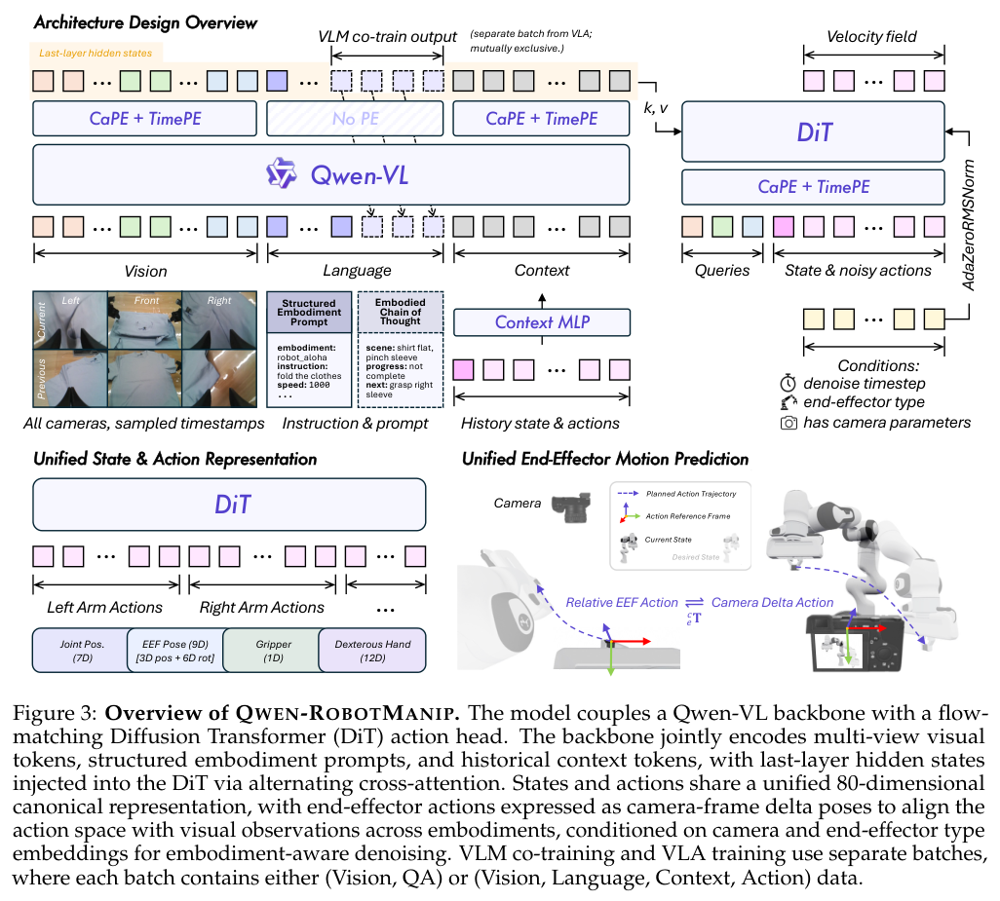
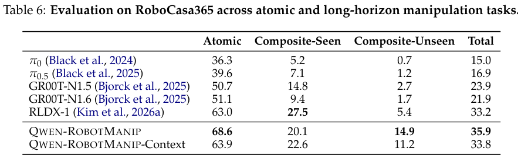
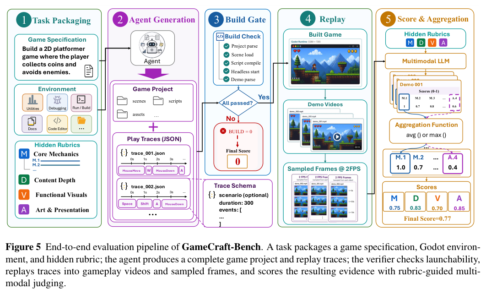
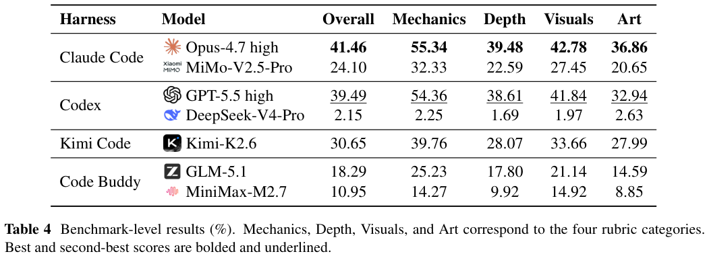
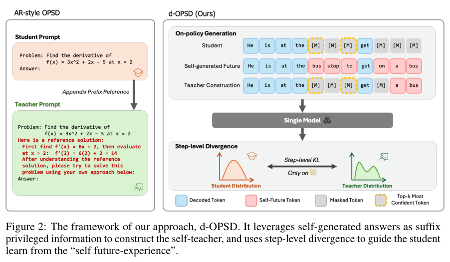
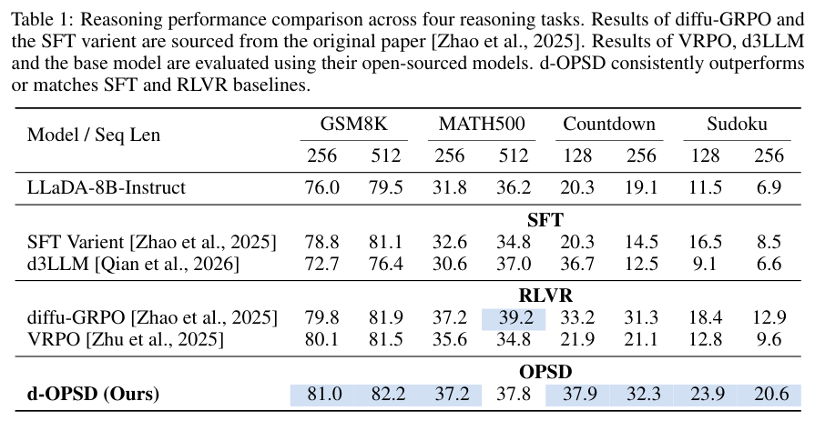

本期七项研究连接三维运动预测、循环世界模型、非均匀层宽、机器人数据对齐、可玩游戏评价、扩散自蒸馏与主动音视频观察。

## 1. MolmoMotion：用语言目标预测三维点轨迹

[MolmoMotion: Forecasting Point Trajectories in 3D with Language Instruction](https://arxiv.org/abs/2606.18558v1) · v1 提交 2026-06-17 · [全文](https://arxiv.org/html/2606.18558v1) · [PDF](https://arxiv.org/pdf/2606.18558v1)

MolmoMotion 给定短暂视觉历史、目标物体的三维查询点和语言目标，预测世界坐标中的未来点轨迹。作者从 116 万条视频构造约百万条轨迹数据，以 4B Molmo2 为骨干训练自回归与流匹配版本；PointMotionBench 经人工核验，含 742 段、111 个物体类别和 61 种动作。

表 1 的 HOT3D 分组，三帧历史加文本的自回归模型平均位移误差 ADE 为 0.109 米，ObjectForesight 为 0.129 米；后者不接收语言指令，不能视为完全相同信息条件。WorldTrack 的三帧自回归 ADE 为 0.143 米；DAVIS 户外则单帧版本较佳，为 1.146 米。场景尺度和信息条件不同，不应合成一个提高百分比。

我更关注这个可检查的中间表示：先预测物体怎样动，再设计施力与控制。预训练每例只采 8 个查询点，密集轨迹需要多次前向；可变形对象与细致几何仍有不足。机器人规划和视频生成迁移收益，不等于闭环实体机器人成功率，作者也将后者列为后续工作。应把轨迹误差、时延与真实任务完成率分别测量。

**原图入口：**[Figure 6，PDF 第 8 页](https://arxiv.org/pdf/2606.18558v1#page=8)。

## 2. LoopWM：在潜在状态里反复推演

Looped World Models 用共享参数的 Transformer 模块反复细化环境状态，并延后解码，减少每个中间状态都转成文字的损失。其显式评测主要是 ScienceWorld 和 ALFWorld 的文字环境状态预测，考察连续多步动作后的状态是否与参照一致。

*图｜Lu, Hongyuan Adam 等，[Figure 1（PDF 第 1 页）](https://arxiv.org/pdf/2606.18208v1#page=1)，[CC BY 4.0](http://creativecommons.org/licenses/by/4.0/)。裁剪自原文。*

作者报告约 1B 模型在给定连续五个动作的 ScienceWorld 测试中，精确匹配为 68.4%、token F1 为 85.3%。ALFWorld 的 F1 为 80.4%，但精确匹配 51.6% 低于文中 Claude 对照的 53.0%。这些是状态文本的匹配分数，尚不足以证明长视频生成、真实物理模拟或规划成功率；反复细化也会增加有效计算深度，参数复用不等于推理免费。

*图｜Lu, Hongyuan Adam 等，[Table 4（PDF 第 13 页）](https://arxiv.org/pdf/2606.18208v1#page=13)，[CC BY 4.0](http://creativecommons.org/licenses/by/4.0/)。裁剪自原文。*

[Looped World Models](https://arxiv.org/abs/2606.18208v1) · v1。

## 3. 可变宽 Transformer：把容量放到不同层

Variable-Width Transformers 采用两端较宽、中间较窄的结构，用无参数的残差尺寸调整保存未参与当前层计算的维度。它在总参数近似匹配的条件下重新分配层宽，研究不同深度是否需要同样容量。

2B 稠密模型的语言建模 loss 从等宽结构的 2.751 到 2.726，训练计算从 16.92 到 16.49 PFLOP/s-days。摘要中的约 22% 计算节省来自拟合的等损失 scaling 曲线，不是这组参数匹配实验的直接降幅。MoE 的下游准确率还有升有降；更低 loss 和较小 KV 需求仍需与具体推理内核的实测延迟一起评价。

[Variable-Width Transformers](https://arxiv.org/abs/2606.18246v1) · v1。

[Figure 1（原文）](https://arxiv.org/pdf/2606.18246v1#page=1)。

## 4. Qwen-RobotManip：先对齐多源动作，再扩大训练

Qwen-RobotManip 在表示、运动和行为三个层面对齐异构机器人数据，并把人类第一视角演示合成为十五种平台的轨迹。约 38,100 小时的整理后预训练语料与 Qwen-VL、flow 动作专家配合，Context 版本进一步利用同一任务内的执行历史。

*图｜Yuan, Haoqi 等，[Figure 3（PDF 第 11 页）](https://arxiv.org/pdf/2606.17846v2#page=11)，[CC BY 4.0](http://creativecommons.org/licenses/by/4.0/)。裁剪自原文。*

RoboCasa365 上，基础模型总体成功率为 35.9%，RLDX-1 为 33.2%；未见复合任务为 14.9% 对 5.4%，但已见复合任务为 20.1% 对 27.5%。Context 版本总体又降至 33.8%。分布外组合有明显收益，历史上下文也并非每项任务都改善；不同具身、数据配方与完整系统的比较不能隔离成某个对齐模块的独立因果贡献。

*图｜Yuan, Haoqi 等，[Table 6（PDF 第 22 页）](https://arxiv.org/pdf/2606.17846v2#page=22)，[CC BY 4.0](http://creativecommons.org/licenses/by/4.0/)。裁剪自原文。*

[Qwen-RobotManip Technical Report: Alignment Unlocks Scale for Robotic Manipulation Foundation Models](https://arxiv.org/abs/2606.17846v2) · v2。

## 5. GameCraft-Bench：能运行的游戏还不等于完整体验

GameCraft-Bench 给出十五类、一百四十项 Godot 游戏任务，要求交付完整引擎工件和可回放演示，再用多模态 rubric 检查核心机制、内容深度、视觉反馈与美术呈现。它把程序能构建、演示能播放和玩法真正符合需求分开评估。

*图｜Luo, Tongxu 等，[Figure 5（PDF 第 6 页）](https://arxiv.org/pdf/2606.17861v1#page=6)，[CC BY 4.0](http://creativecommons.org/licenses/by/4.0/)。裁剪自原文。*

Claude Code 配 Opus-4.7 high 的 Overall rubric 分为 41.46，Codex 配 GPT-5.5 high 为 39.49；这不是 41.46% 的游戏全部成功。前者机制为 55.34，内容深度为 39.48、美术呈现为 36.86，显示局部玩法更容易实现。不同 harness 和模型一起变化，回放覆盖与模型裁判也影响结果，不能仅据总分判断真实玩家体验。

*图｜Luo, Tongxu 等，[Table 4（PDF 第 11 页）](https://arxiv.org/pdf/2606.17861v1#page=11)，[CC BY 4.0](http://creativecommons.org/licenses/by/4.0/)。裁剪自原文。*

[GameCraft-Bench: Can Agents Build Playable Games End-to-End in a Real Game Engine?](https://arxiv.org/abs/2606.17861v1) · v1。

## 6. d-OPSD：用自生成的未来答案指导扩散去噪

d-OPSD 将模型自己的候选答案作为后缀条件构造自教师，并按去噪步骤做分布蒸馏，适配扩散语言模型的任意顺序生成。它避免照搬自回归前缀蒸馏，并用 LoRA、完整词表 logits 和固定初始教师稳定训练。

*图｜Luo, Yifu 等，[Figure 2（PDF 第 3 页）](https://arxiv.org/pdf/2606.18195v1#page=3)，[CC BY 4.0](http://creativecommons.org/licenses/by/4.0/)。裁剪自原文。*

LLaDA-8B-Instruct 的 GSM8K、512 长度设置中，d-OPSD 为 82.2%，diffu-GRPO 为 81.9%；MATH500 同长度却为 37.8% 对 39.2%。报告的最优优化步数在 GSM8K 为 425 对 7,700，但每二十五步评估并挑选最好结果，且基线步数来自原论文。步数减少不等于相同比例的训练时间节省，长短输出也会不同地影响数学与规划任务。

*图｜Luo, Yifu 等，[Table 1（PDF 第 7 页）](https://arxiv.org/pdf/2606.18195v1#page=7)，[CC BY 4.0](http://creativecommons.org/licenses/by/4.0/)。裁剪自原文。*

[Learning from the Self-future: On-policy Self-distillation for dLLMs](https://arxiv.org/abs/2606.18195v1) · v1。

## 7. OmniAgent：把主动观察放进推理循环

OmniAgent 以观察、思考和动作的循环按需读取音视频，把提炼的线索写入持久文本记忆，而不先均匀扫过全部帧。Agentic SFT 学习有效观察轨迹，强化学习再用轮次感知的优势分配，把反馈集中到发现关键证据的回合。

Qwen2.5-Omni-7B 上，VideoMME 无字幕总分从基础模型 64.8 到 67.8，VSI-Bench 从 35.5 到 48.4，LVBench 从 43.0 到 50.5。训练同时加入轨迹数据与 RL，这些整体改善不能只归因于少看视频帧；额外回合和音频输入也改变成本。最多 64K 上下文与持续文本记忆能减轻输入负担，但摘要遗漏和未观察到的事件仍会限制答案。

[Native Active Perception as Reasoning for Omni-Modal Understanding](https://arxiv.org/abs/2606.19341v1) · v1。

[Figure 1（原文）](https://arxiv.org/pdf/2606.19341v1#page=2)。
