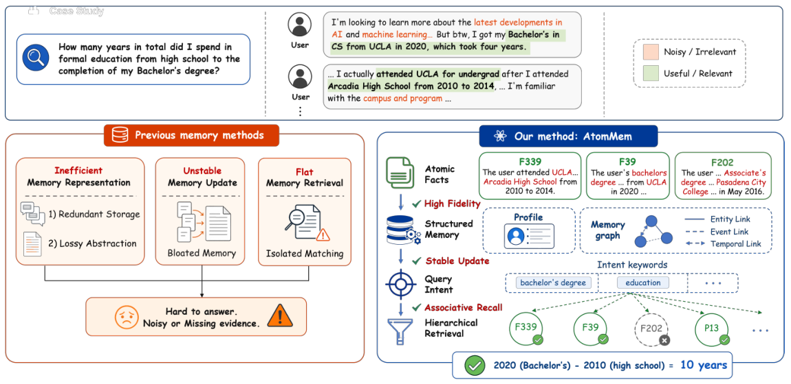
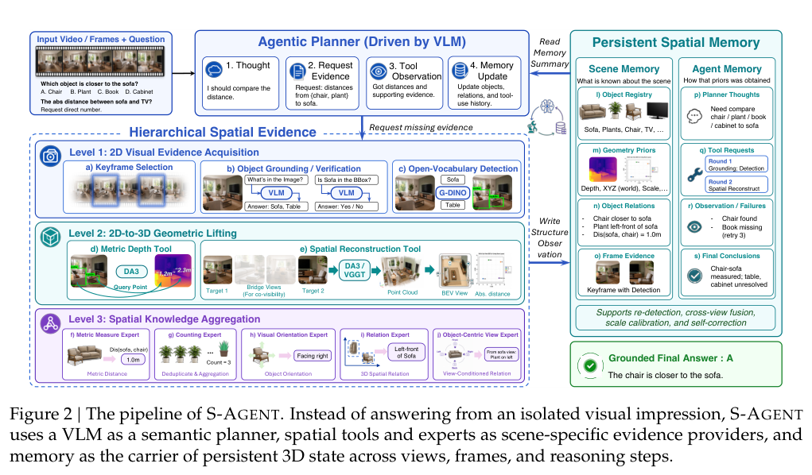
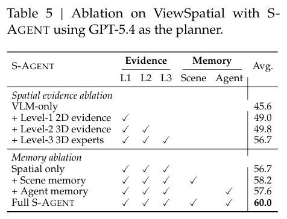
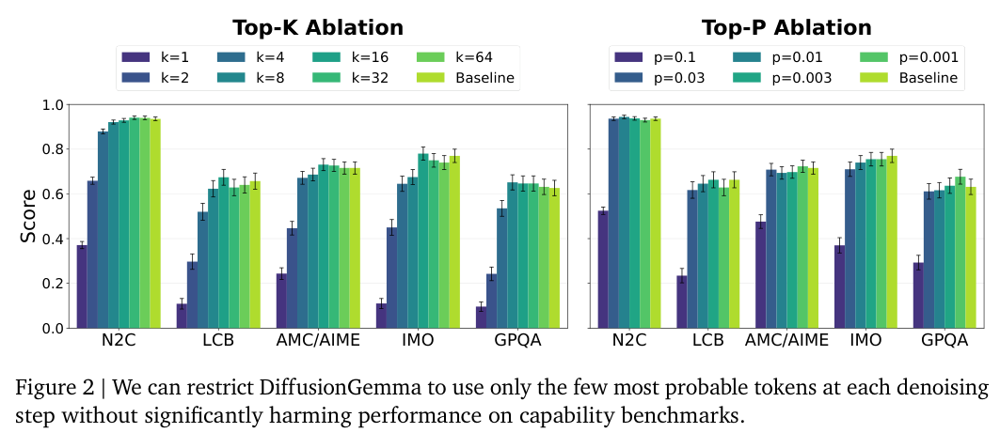
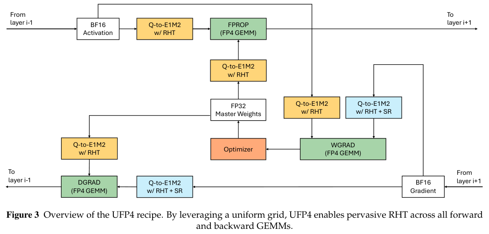
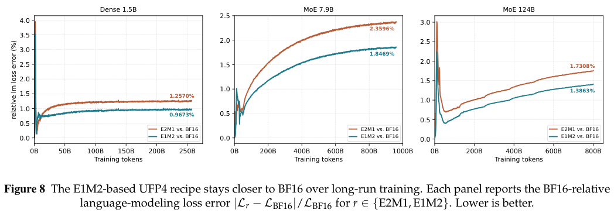

本期七项研究介绍原子事实记忆、空间工具、持久机器人记忆、人类视频预训练、扩散模型透明性、低比特训练和跨任务经验更新。

## 1. AtomMem：用原子事实组织长期对话记忆

[AtomMem: Building Simple and Effective Memory System for LLM Agents via Atomic Facts](https://arxiv.org/abs/2606.19847v1) · v1 提交 2026-06-18 · [全文](https://arxiv.org/html/2606.19847v1) · [PDF](https://arxiv.org/pdf/2606.19847v1)

AtomMem 先将对话拆成附带参与者、时间和语义的自足原子事实，再组织为事件和随时间演变的用户画像，经实体、事件与时间连边进行关联回忆。目标是保留可追溯事实，而非反复覆盖一段粗摘要。

LoCoMo 平均约 35 会话、600 多轮。实验统一 GPT-4o-mini 回答骨干、all-minilm-L6-v2 向量和 top-10 检索，事实抽取器则另以 Qwen3-14B 做 LoRA 微调。表 1 多跳 F1 为 42.50，MEM0 为 36.02；时间 F1 为 62.78，LightMem 为 47.41。开放域模型评审分数为 64.58，MEM0 为 54.17；裁判为 deepseek-v4-pro，不能当作人工准确率。

平铺事实消融的多跳 F1 已从原始对话基线 20.97 到 37.03。其总 API token 约 72.3 万，完整系统约 2,135.7 万，复杂层级版本并非最省成本。我的判断是，先检查抽取、时间有效性与纠错，再决定是否增加图式检索。抽取、事件合并和画像更新都可能放大底层错误；当前证据限于文本基准，不能直接说明真实用户记忆可靠。

原图：Yanyu Yao、Shangze Li、Zhi Zheng、Hui Zheng、Qi Liu、Tong Xu、Enhong Chen，arXiv:2606.19847v1，Figure 1，PDF 第 2 页。[原始来源](https://arxiv.org/pdf/2606.19847v1#page=2) · [CC BY 4.0](https://creativecommons.org/licenses/by/4.0/)。裁剪自原文。

## 2. S-Agent：将多视角观察积累成空间证据

S-Agent 用 VLM 规划需要观察的内容，先定位二维物体，再提升为三维几何，最后由空间专家计算距离、方位和数量。Scene Memory 保存场景变化，Agent Memory 保存推理进度，减少跨帧重复识别与单帧猜测。

*图｜Dai, Yalun 等，[Figure 2（PDF 第 4 页）](https://arxiv.org/pdf/2606.20515v1#page=4)，[CC BY 4.0](http://creativecommons.org/licenses/by/4.0/)。裁剪自原文。*

GPT-5.4 的 ViewSpatial 消融中，基础模型为 45.6%，加入二维证据为 49.0%，完整空间专家与双记忆为 60.0%。但 Qwen3-VL-8B 的免训练增强在 MMSI 从 31.1 降至 30.7，进一步用 S-300K 轨迹训练才达到 41.6。工具接口与轨迹蒸馏是不同条件，不能把训练后成绩当作零训练收益。

*图｜Dai, Yalun 等，[Table 5（PDF 第 11 页）](https://arxiv.org/pdf/2606.20515v1#page=11)，[CC BY 4.0](http://creativecommons.org/licenses/by/4.0/)。裁剪自原文。*

[S-Agent: Spatial Tool-Use Elicits Reasoning for Spatial Intelligence](https://arxiv.org/abs/2606.20515v1) · v1。

## 3. MemoryWAM：兼顾近期细节与长期事件记忆

MemoryWAM 在世界动作模型中同时保存近期帧、事件边界锚点和压缩 gist token，并用相应注意力结构检索。近期状态保留视觉细节，较远历史以事件和摘要维持任务线索，减少完整历史 token 不断增长的成本。

RMBench 每项一百次 rollout 的九任务平均成功率为 83.0%，保留完整历史的 Lingbot-VA 为 78.2%；Battery Try 两者同为 41%。双臂实机的换杯任务为 18/20 对 13/20，看数按键为 15/20 对 14/20。小样本实机和特定记忆任务支持这种折中，但不代表所有任务都明显改善；锚点选择错误或 gist 丢失仍可能使长期线索不可恢复。

[MemoryWAM: Efficient World Action Modeling with Persistent Memory](https://arxiv.org/abs/2606.20562v1) · v1。

[Figure 1（原文）](https://arxiv.org/pdf/2606.20562v1#page=1)。

## 4. HumanScale：人类视频预训练的收益来自哪些对照

HumanScale 对人类第一视角视频进行过滤和动作标注，再以少量机器人数据适配动作空间，比较不同预训练来源的扩展效果。它强调数据多样性与处理质量，而非把未经整理的人类视频直接视为机器人控制标签。

实机三任务表中，第一视角预训练为同分布 92.5%、新物体 90.0%，Wan2.2 初始化对照为 40.0%、0%。差值分别是 52.5 与 90 个百分点，后一项不能计算成相对提升率。该实机表的对照也不同于等量机器人数据的预训练损失实验；两组证据不能混成“任意人类视频都胜过真实机器人数据”。

[HumanScale: Egocentric Human Video Can Outperform Real-Robot Data for Embodied Pretraining](https://arxiv.org/abs/2606.20521v1) · v1。

[Figure 1（原文）](https://arxiv.org/pdf/2606.20521v1#page=2)。

## 5. DiffusionGemma：看懂中间 token 还不等于看懂算法

这项研究将透明性拆为中间状态是否可解释，以及能否由状态恢复计算过程。作者把去噪步骤间的信息限制到可解释 token 瓶颈，检查模型能否在这种限制下维持任务表现，并用案例分析非顺序推理、token 扩散和中间上下文。

*图｜Engels, Joshua 等，[Figure 1（PDF 第 3 页）](https://arxiv.org/pdf/2606.20560v1#page=3)，[CC BY 4.0](http://creativecommons.org/licenses/by/4.0/)。裁剪自原文。*

按 opaque serial depth 的计算定义，直接观察的 DiffusionGemma 约为自回归 Gemma 4 的 28.6 倍；将可解释瓶颈计入后降为约 1.1 倍，所测下游表现没有下降。这个比值衡量两次可解释状态之间的串行计算深度，既不是推理速度，也不是透明性的百分制评分。监测任务表现接近并不说明所有分布式去噪算法都已被理解。

*图｜Engels, Joshua 等，[Figure 2（PDF 第 7 页）](https://arxiv.org/pdf/2606.20560v1#page=7)，[CC BY 4.0](http://creativecommons.org/licenses/by/4.0/)。裁剪自原文。*

[How Transparent is DiffusionGemma?](https://arxiv.org/abs/2606.20560v1) · v1。

## 6. UFP4：量化格点的几何会积累训练偏差

UFP4 分析非均匀 E2M1 格点在舍入时产生的收缩偏差，以及随机 Hadamard 变换怎样放大该问题。它使用 E1M2/INT4 风格的均匀格点，对三类训练矩阵乘法应用变换，并只在 dY 使用随机舍入。

*图｜Zhao, Qian 等，[Figure 3（PDF 第 7 页）](https://arxiv.org/pdf/2606.20381v1#page=7)，[CC BY 4.0](http://creativecommons.org/licenses/by/4.0/)。裁剪自原文。*

长程预训练曲线中，124B MoE 末端相对 BF16 的语言建模 loss 误差为 E1M2 1.3863%、E2M1 1.7308%；1.5B 稠密和 7.9B MoE 也呈同方向。这里比较的是训练数值误差，不能换算成同等准确率或硬件吞吐提升。支持均匀四位格点的训练硬件与融合内核仍是部署条件，数据格式改善不自动等于现有设备上更快。

*图｜Zhao, Qian 等，[Figure 8（PDF 第 11 页）](https://arxiv.org/pdf/2606.20381v1#page=11)，[CC BY 4.0](http://creativecommons.org/licenses/by/4.0/)。裁剪自原文。*

[Rethinking Shrinkage Bias in LLM FP4 Pretraining: Geometric Origin, Systemic Impact, and UFP4 Recipe](https://arxiv.org/abs/2606.20381v1) · v1。

## 7. Connect the Dots：把完成任务与更新经验一起训练

CoD 在同一环境的一串任务之间交替安排 solve-task 和 update-context，让强化学习同时优化当前解题与面向未来的经验更新。细粒度优势分配把后续收益传回早期更新步骤，试图训练可跨任务使用的长期适应能力。

概念验证使用 Qwen3-8B-Instruct，在 FrozenLake-Obscure 以及与 Alchemy-Random 的混合环境训练，再测试更难实例、更长的八任务序列和未见 Terminal 域。曲线显示随任务位置积累经验，并出现跨域及重复改进任务的收益；这仍是受控环境中的奖励结果，不是连续真实部署的通用自我改进保证。经验压缩错误与训练环境提供的反馈结构仍会影响迁移。

[Connect the Dots: Training LLMs for Long-Lifecycle Agents with Cross-Domain Generalization Via Reinforcement Learning](https://arxiv.org/abs/2606.20002v1) · v1。

[Figure 1（原文）](https://arxiv.org/pdf/2606.20002v1#page=3)。
