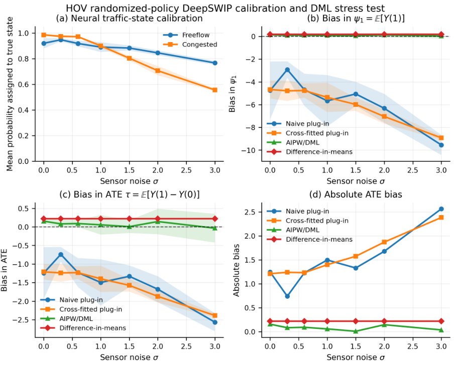
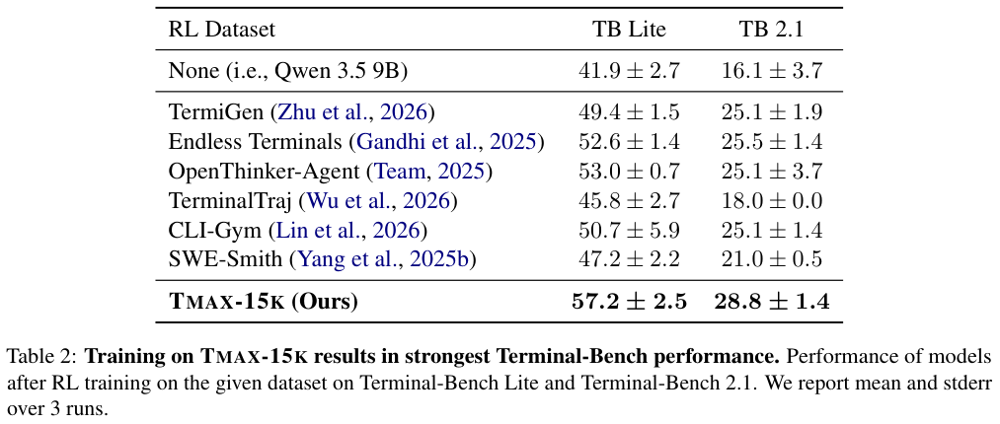
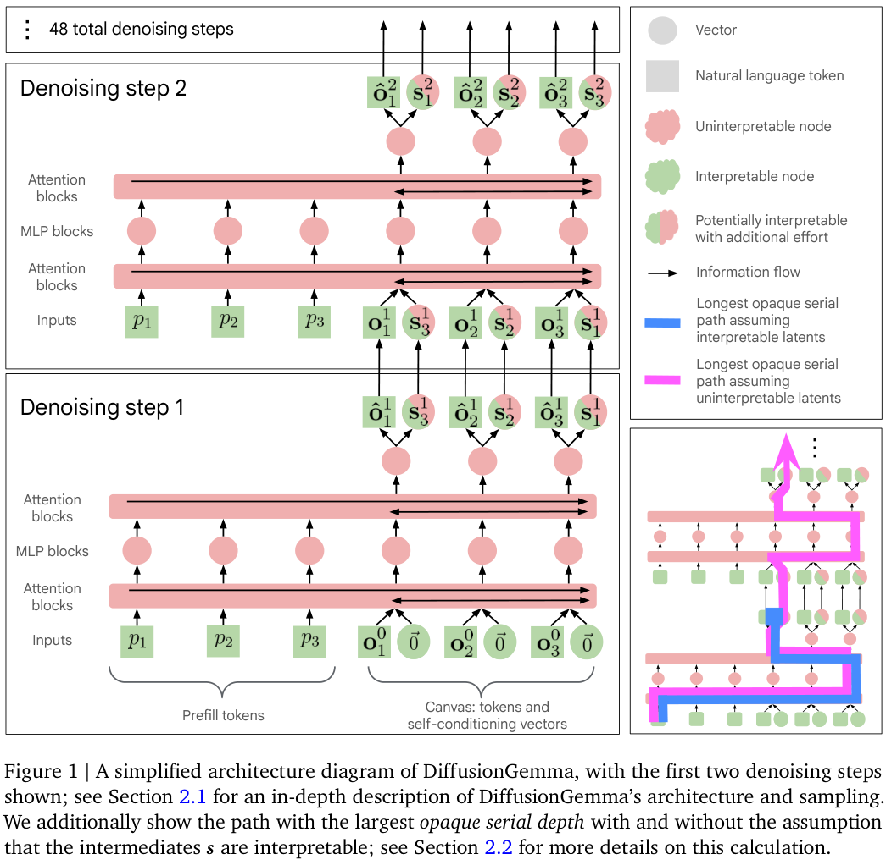
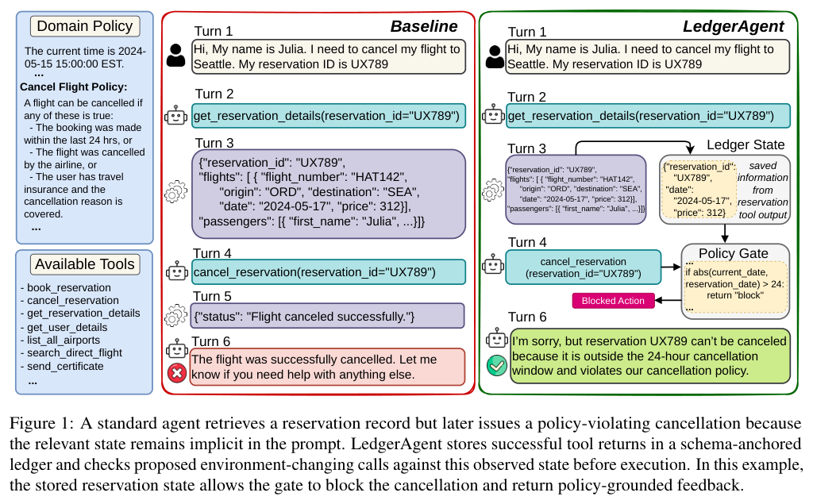
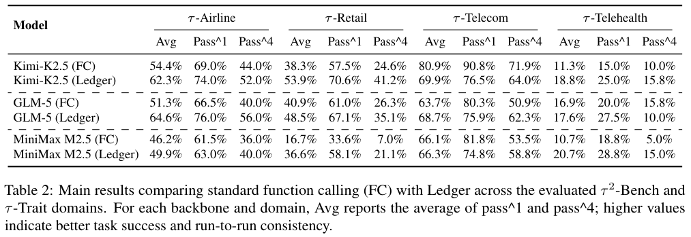
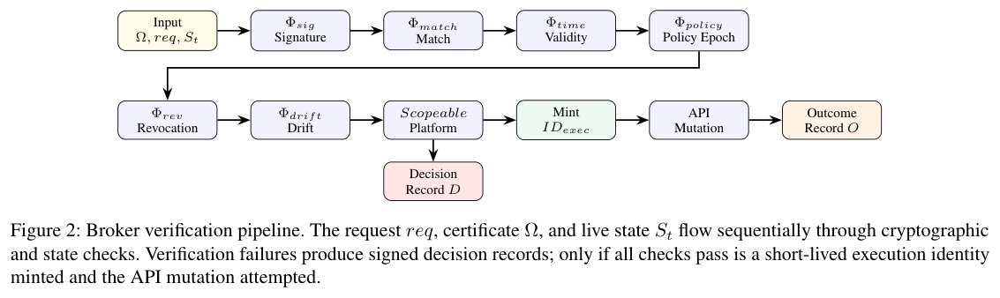
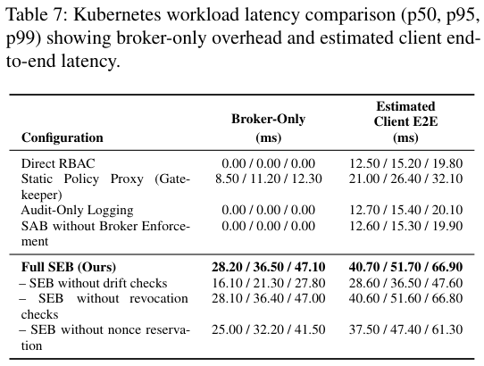
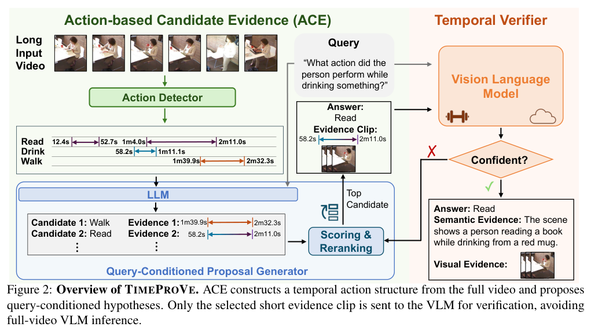
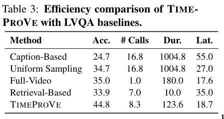

本期八项研究连接神经概率逻辑、终端强化学习、扩散透明性、状态账本、执行授权、世界状态演化、视频验证与三维编辑。

## 1. DeepSWIP：用单世界改写求反事实概率

[DeepSWIP: Quotient-WMC Counterfactuals for Neural Probabilistic Logic Programs](https://arxiv.org/abs/2606.20526v2) · v2 提交 2026-06-19 · [全文](https://arxiv.org/html/2606.20526v2) · [PDF](https://arxiv.org/pdf/2606.20526v2)

反事实不等于条件概率。DeepSWIP 对固定输入先将神经谓词概率实体化为 ProbLog 选择，再通过单世界干预规则改写，以加权模型计数的分子分母之比求答案，避免复制完整事实世界与反事实世界。精确性相对于学得且实体化的因果模型成立，依赖有限 grounding 与唯一受支持模型等条件。

MPI3D-toy 使用 8,368 张训练图、2,000 张测试图。500 张评估图、六种形状干预、四类查询组成 12,000 次调用，DeepSWIP 与 DeepTwin 100% 一致；平均每次 3.57 对 7.65 毫秒，即 2.14 倍。这是一致性实现检查，不是模型因果正确性的外部证明。形状准确率为 0.889，非干预谓词仍传入误差，can_stack、risky_on_shelf 的 RMSE 分别为 0.058、0.082。

图 1 展示另一个 SUMO 实验：二元政策随机分配、已知处理概率 0.5，AIPW 可减轻总体均值与平均处理效应偏差。它不是任意个体反事实的通用校正。我的判断是，符号推断精确与神经概率校准必须分开；现实应用仍要检查因果结构、稀有证据分母稳定性和复杂规则成本。

原图：Saimun Habib、Vaishak Belle、Fengxiang He，arXiv:2606.20526v2，Figure 1，PDF 第 10 页。[原始来源](https://arxiv.org/pdf/2606.20526v2#page=10) · [CC BY 4.0](https://creativecommons.org/licenses/by/4.0/)。裁剪自原文。

## 2. Tmax：复杂终端任务与简洁的结果奖励训练

Tmax 用分层采样的数据管线组合任务领域、工具与约束，生成 TMAX-15K 复杂终端任务，再以执行结果为奖励做强化学习。配方同时处理推理服务与训练端 logprob 不一致的问题，以较简单的 harness 观察数据和训练本身的效果。

*图｜Ivison, Hamish 等，[Figure 2（PDF 第 4 页）](https://arxiv.org/pdf/2606.23321v1#page=4)，[CC BY 4.0](http://creativecommons.org/licenses/by/4.0/)。裁剪自原文。*

Qwen3.5-9B 的 Terminal-Bench 2.1 三次运行均值从未 RL 的 16.1±3.7 到 TMAX-15K 训练的 28.8±1.4，误差为标准误；Terminal-Bench Lite 从 41.9±2.7 到 57.2±2.5。这些数字对应 2.1 与 Lite，和摘要所列 2.0 成绩不能混用。数据质量、骨干与优化配方共同变化，任务验证器的覆盖和奖励漏洞也会影响迁移。

*图｜Ivison, Hamish 等，[Table 2（PDF 第 8 页）](https://arxiv.org/pdf/2606.23321v1#page=8)，[CC BY 4.0](http://creativecommons.org/licenses/by/4.0/)。裁剪自原文。*

[Tmax: A simple recipe for terminal agents](https://arxiv.org/abs/2606.23321v1) · v1。

## 3. DiffusionGemma：看懂中间 token 还不等于看懂算法

这项研究将透明性拆为中间状态是否可解释，以及能否由状态恢复计算过程。作者把去噪步骤间的信息限制到可解释 token 瓶颈，检查模型能否在这种限制下维持任务表现，并用案例分析非顺序推理、token 扩散和中间上下文。

*图｜Engels, Joshua 等，[Figure 1（PDF 第 3 页）](https://arxiv.org/pdf/2606.20560v1#page=3)，[CC BY 4.0](http://creativecommons.org/licenses/by/4.0/)。裁剪自原文。*

按 opaque serial depth 的计算定义，直接观察的 DiffusionGemma 约为自回归 Gemma 4 的 28.6 倍；将可解释瓶颈计入后降为约 1.1 倍，所测下游表现没有下降。这个比值衡量两次可解释状态之间的串行计算深度，既不是推理速度，也不是透明性的百分制评分。监测任务表现接近并不说明所有分布式去噪算法都已被理解。

*图｜Engels, Joshua 等，[Figure 2（PDF 第 7 页）](https://arxiv.org/pdf/2606.20560v1#page=7)，[CC BY 4.0](http://creativecommons.org/licenses/by/4.0/)。裁剪自原文。*

[How Transparent is DiffusionGemma?](https://arxiv.org/abs/2606.20560v1) · v1。

## 4. LedgerAgent：把事实状态与动作约束单独保存

LedgerAgent 在对话轨迹之外维护状态账本，记录已经观察到的事实、标识符和约束，并在改变环境的工具调用前检查依赖这些状态的策略条件。它让 Agent 不必每轮都从整段历史重新推断当前条件，也能拦下格式合法但违反规则的操作。

*图｜Uddin, Md Nayem 等，[Figure 1（PDF 第 2 页）](https://arxiv.org/pdf/2606.20529v1#page=2)，[CC BY 4.0](http://creativecommons.org/licenses/by/4.0/)。裁剪自原文。*

Kimi-K2.5 的 Retail 单次成功率从普通 function calling 的 57.5% 到 70.6%，四次均成功的 pass^4 从 24.6% 到 41.2%；Telecom 的单次成功率却从 90.8% 降到 76.5%。账本能改善部分任务的一致性，但提取缺失需求、状态更新错误或规则覆盖不足仍会失败；pass^4 衡量多次都成功，不是四次取最好结果。

*图｜Uddin, Md Nayem 等，[Table 2（PDF 第 6 页）](https://arxiv.org/pdf/2606.20529v1#page=6)，[CC BY 4.0](http://creativecommons.org/licenses/by/4.0/)。裁剪自原文。*

[LedgerAgent: Structured State for Policy-Adherent Tool-Calling Agents](https://arxiv.org/abs/2606.20529v1) · v1。

## 5. SEB：在真正执行修改时检查授权边界

Sovereign Execution Broker 将提议、准入和执行分开：运行时检查证书合同、有效期、策略及撤销版本和实际状态漂移，再以受限身份执行并记录结果。关键前提是生产修改接口只接受 broker 身份，否则证书检查仍可被旁路。

*图｜He, Jun 等，[Figure 2（PDF 第 6 页）](https://arxiv.org/pdf/2606.20520v2#page=6)，[CC BY 4.0](http://creativecommons.org/licenses/by/4.0/)。裁剪自原文。*

原型的 Kubernetes broker-only 延迟中位数为 28.2 毫秒，AWS 为 136.9 毫秒；表中 40.7 与 221.9 毫秒的客户端总时延是把开销加到基准 API 延迟得到的估计。故障注入每种场景一千例，另有五十次崩溃测试；这些有限实验支持该部署边界下的行为，不是对任意云配置的安全证明。目标 API 缺少幂等或可靠查询时，恢复也需要重新准入。

*图｜He, Jun 等，[Table 7（PDF 第 13 页）](https://arxiv.org/pdf/2606.20520v2#page=13)，[CC BY 4.0](http://creativecommons.org/licenses/by/4.0/)。裁剪自原文。*

[Sovereign Execution Broker: Enforcing Certificate-Bound Authority in Agentic Control Planes](https://arxiv.org/abs/2606.20520v2) · v2。

## 6. WRBench：镜头移开后，世界是否继续变化

WRBench 将相机移动视为对可见性的干预，先检查镜头是否执行要求、场景在可见时是否连续，再检查目标离开镜头后是否沿原事件继续演化。它用人类校准的评价链，区分镜头不听指令、身份丢失与隐藏状态没有推进。

二十三个模型、四类控制范式生成的 9,600 段视频中，作者反复观察到目标重返画面时仍停在离开时的状态，而非按事件推进。这个诊断揭示画面连贯与持久状态演化的差别，但具体结果依赖事件、镜头干预和裁判覆盖，不能只凭逼真画面推断物理一致，也不能从一套测试断言所有世界模型内部完全没有状态。

[Current World Models Lack a Persistent State Core](https://arxiv.org/abs/2606.20545v1) · v1。

[Figure 1（原文）](https://arxiv.org/pdf/2606.20545v1#page=2)。

## 7. TimeProVe：先提出动作证据，再调用大模型验证

TimeProVe 用轻量动作检测建立时间线，ACE 按问题提出候选答案及证据窗口，再把较贵的 VLM 用在少量候选验证上。它把开放式日常活动问题的时间定位与答案生成联系起来，而非单纯给长视频做均匀抽帧摘要。

*图｜Sinha, Arkaprava 等，[Figure 2（PDF 第 4 页）](https://arxiv.org/pdf/2606.20561v1#page=4)，[CC BY 4.0](http://creativecommons.org/licenses/by/4.0/)。裁剪自原文。*

效率表中，TimeProVe 的准确率为 44.8%，均匀采样为 34.7%；平均 VLM 调用为 8.3 对 16.8，处理时长为 123.6 对 1004.8，延迟为 18.7 对 27.0。调用数、片段时长与总延迟不是同一个节省比例。动作检测器漏检会限制后续候选，Charades-STA 的严格时间边界定位也仍需更强 grounding 模块。

*图｜Sinha, Arkaprava 等，[Table 3（PDF 第 8 页）](https://arxiv.org/pdf/2606.20561v1#page=8)，[CC BY 4.0](http://creativecommons.org/licenses/by/4.0/)。裁剪自原文。*

[TimeProVe: Propose, then Verify for Efficient Long Video Temporal Reasoning in Activities of Daily Living](https://arxiv.org/abs/2606.20561v1) · v1。

## 8. Thinking in Boxes：用三维盒子规定图像编辑

这项图像编辑方法让用户提供物体编辑前后的三维盒子，用着色盒面表达旋转方向，并以深度对齐的平面提供共同参考。生成器据此完成平移、旋转、缩放或视角改变，在合成场景与少量真实 Objectron 视频上分阶段训练。

WildDet-3D 对照中，语义对应的平均像素距离为 25.910，GeoDiffuser 为 35.488；目标区域 IoU 为 0.382，与 FreeFine 相同。但主体 DINO 一致性为 0.637，仍低于 GeoDiffuser 的 0.646。空间控制改善需要同时看身份保留，未见区域的补全仍是生成推断，不能当作恢复了唯一真实的隐藏外观。

[Thinking in Boxes: 3D Editing in Real Images Made Easy](https://arxiv.org/abs/2606.20556v1) · v1。

[Figure 3（原文）](https://arxiv.org/pdf/2606.20556v1#page=4)。
