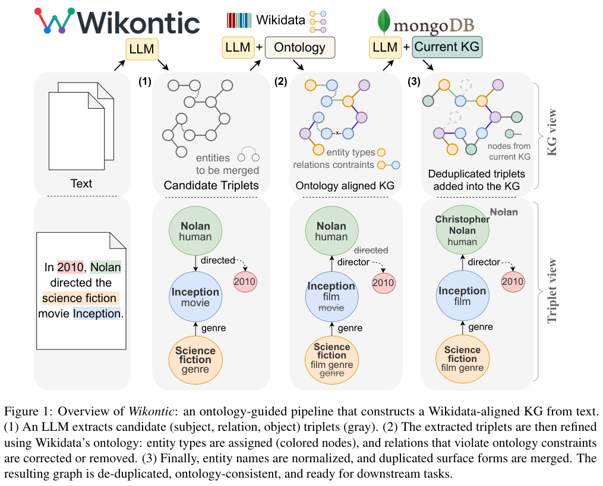
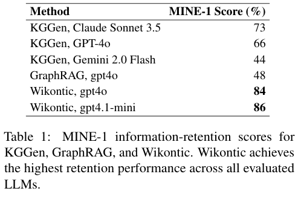
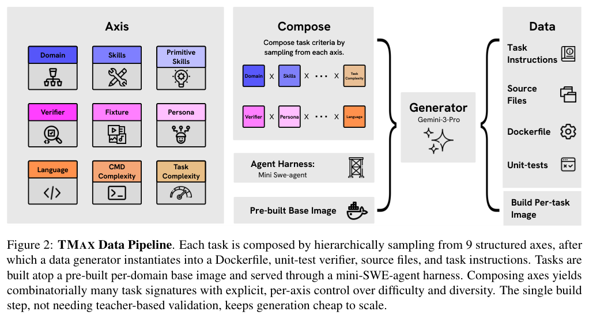
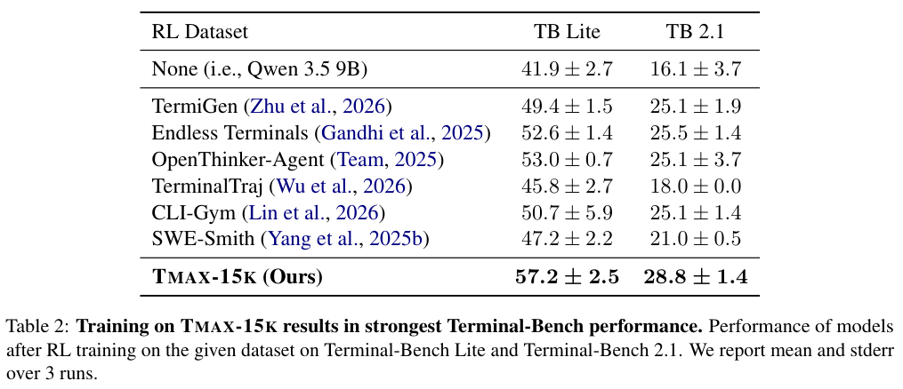
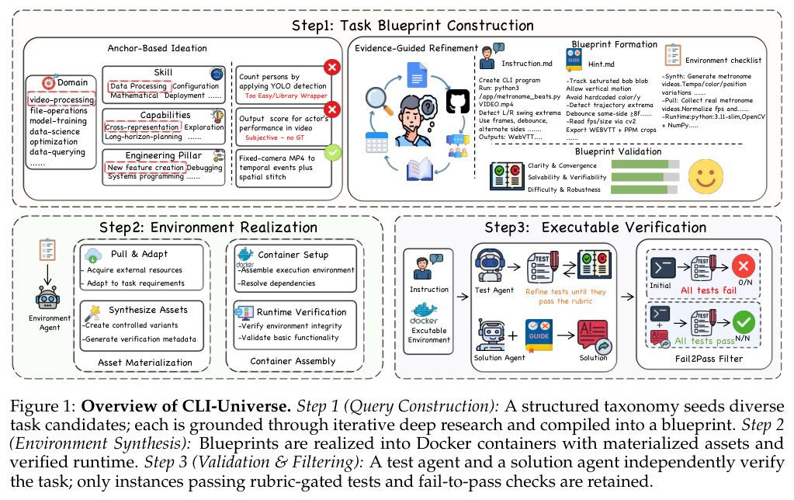
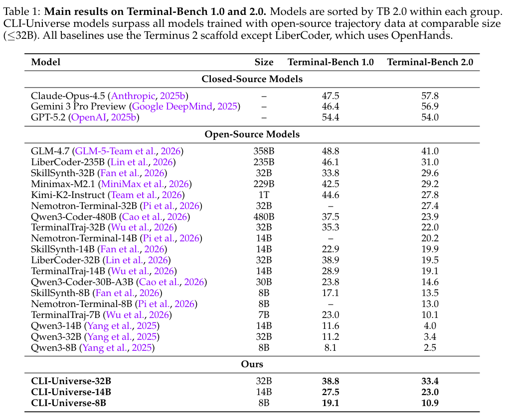
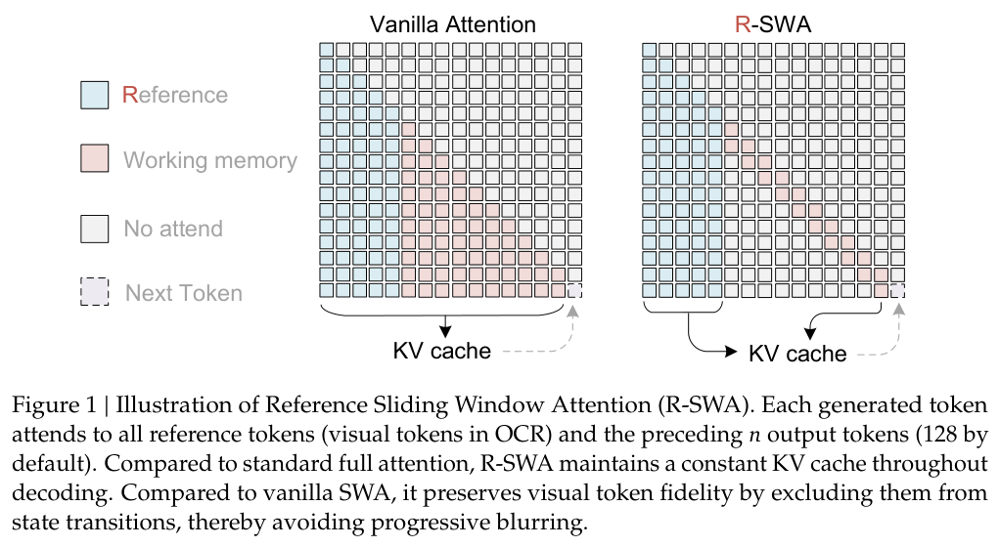
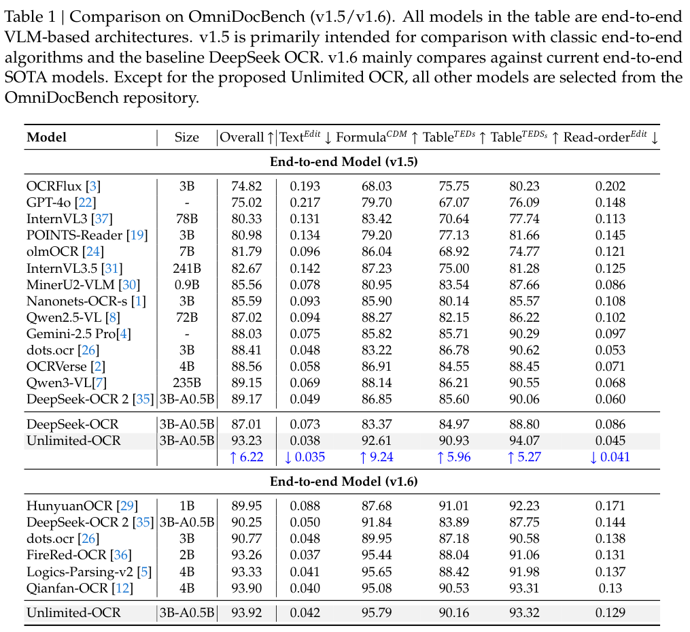
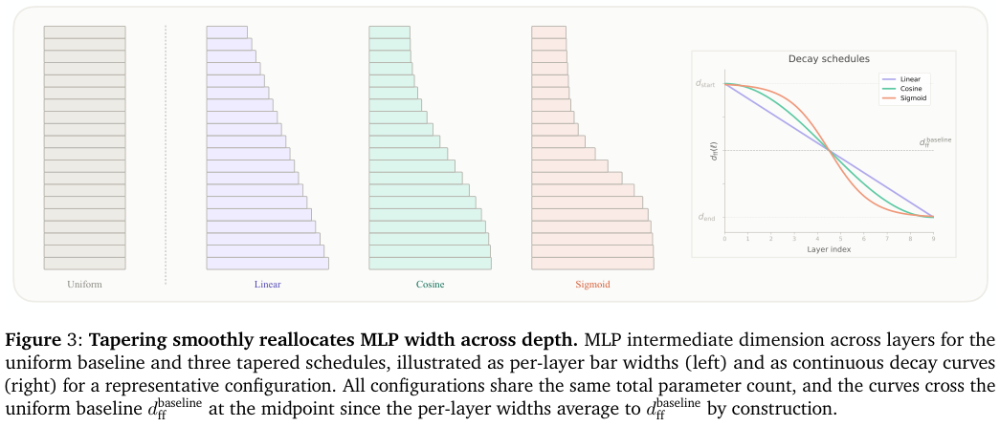
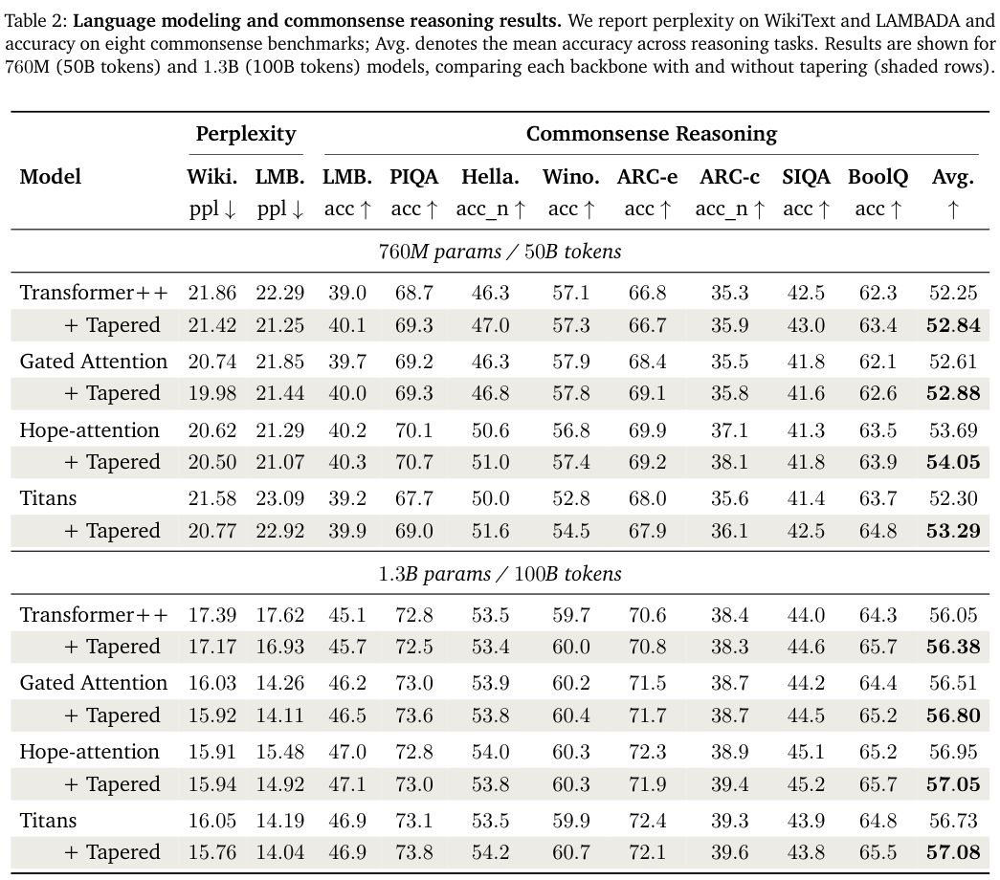

本期十项研究介绍事件本体扩展、机器人语义、文本建图、终端 Agent、多 GPU 内核、长文 OCR、策略优化、深度容量分配与多 Agent 提示词。

## 1. ConceptE：用概念中间层扩展事件本体

[Event Ontology Expansion via LLM-Based Conceptualization](https://arxiv.org/abs/2606.21048v1) · v1 提交 2026-06-19 · [全文](https://arxiv.org/html/2606.21048v1) · [PDF](https://arxiv.org/pdf/2606.21048v1)

ConceptE 先让语言模型根据句子与触发词产生事件概念名和解释，再联合编码概念与原触发词，进行聚类、定向父子挂接和新类型命名。它尝试区分句子表面相似与事件概念相同，避免公司语境相近就把 launch 与 merge 混为一类。

ACE、ERE 以最常见 10 类为已知类，MAVEN 使用 20 已知、40 未知类。编码器为 BERT-base-uncased，概念化和命名用 Qwen3-32B。事件聚类 BCubed-F1：ACE 为 83.25%，HALTON 为 75.06%；MAVEN 为 51.72% 对 39.35%，差 12.37 个百分点。ACE 金标准聚类下的 Taxo-F1 为 51.16%，HALTON 为 44.68%；换成系统预测聚类，ConceptE 为 43.48%。上游错误会传到本体位置。

我认为概念中间层给维护者提供了可审查对象，但描述由模型生成，偏见或幻觉也会被后续聚类、挂接和命名继承。论文为单次运行，缺少多种子波动；开放领域还需要人工检查概念边界和父子关系。

**原图入口：**[Figure 2，PDF 第 3 页](https://arxiv.org/pdf/2606.21048v1#page=3)。

## 2. URDF 到本体：让机器人结构获得语义角色

流水线从 URDF 的连杆、关节与运动链提取结构，再让 LLM 在已有机器人本体中逐层分类，组合多次查询投票、格式检查和 schema 验证，将传感器与末端执行器聚合成有语义的组件。模型提供名称解释，本体约束输出类别，原有运动学关系提供物理结构依据。

gpt-oss:20b 在 TIAGo、PR2、Pepper 三个平台上分别划分出 10、12、26 个传感功能单元，也能将两侧夹爪或手部汇成独立组件。但 TIAGo 麦克风未合并为阵列，多个虚拟工具坐标系被误判为实体外壳或结构部件。这是三个机器人描述的初步案例分析，没有给出统一端到端准确率；URDF 命名和挂接拓扑会影响语义抽象。

[Extracting Semantics: LLM-Guided Automatic Population of Robot Ontology from URDF](https://arxiv.org/abs/2606.17073v1) · v1。

## 3. Wikontic：用 Wikidata 本体约束文本建图

Wikontic 先由 LLM 从文本抽取三元组，再借 Wikidata 本体为实体赋类型、纠正或删除类型不相容的关系，最后规范化名称并合并重复实体。它把事实抽取、语义约束和消歧分开，使构建结果既可查询，又保留较多文本信息。

*图｜Alla Chepurova 等，[Figure 1（PDF 第 3 页）](https://aclanthology.org/2026.eacl-long.388.pdf#page=3)，[CC BY 4.0](http://creativecommons.org/licenses/by/4.0/)。裁剪自原文。*

MINE-1 信息保留评估中，GPT-4o 版本为 84%，相同骨干的 KGGen 为 66%；GPT-4.1-mini 版本为 86%。MuSiQue 和 HotpotQA 上还测试了仅用图三元组的问答。信息保留分数并非每条三元组的真实性，也不代表本体约束能纠正原文或抽取模型的一切错误；图谱密度、覆盖与下游问答应分别评价。

*图｜Alla Chepurova 等，[Table 1（PDF 第 6 页）](https://aclanthology.org/2026.eacl-long.388.pdf#page=6)，[CC BY 4.0](http://creativecommons.org/licenses/by/4.0/)。裁剪自原文。*

[Wikontic: Constructing Wikidata-Aligned, Ontology-Aware Knowledge Graphs with Large Language Models](https://aclanthology.org/2026.eacl-long.388/) · 正式出版版本。

## 4. Tmax：以难度控制和结果奖励训练终端 Agent

Tmax 用领域、技能、任务复杂度和命令复杂度组织任务合成，并引入角色设定、难度校准与多样 verifier，生成 14,600 个 RL 环境。训练先做监督暖启动，再采用以任务结果为主的强化学习，执行接口基于简化的 mini-SWE-agent。

*图｜Ivison, Hamish 等，[Figure 2（PDF 第 4 页）](https://arxiv.org/pdf/2606.23321v1#page=4)，[CC BY 4.0](http://creativecommons.org/licenses/by/4.0/)。裁剪自原文。*

Tmax-9B 在 Terminal-Bench 2.0 上达到约 27%。用 Gemini-3-Flash-Preview 对每个训练集抽取 250 题、每题八次 rollout 时，Tmax 数据的 Pass@1 为 42%，Pass@8 为 53%，说明增加采样仍有不少难题。任务难度测量、训练后模型成绩与不同 harness 下的排行榜是不同口径，开放配方的收益仍受环境覆盖和验证器质量约束。

*图｜Ivison, Hamish 等，[Table 2（PDF 第 8 页）](https://arxiv.org/pdf/2606.23321v1#page=8)，[CC BY 4.0](http://creativecommons.org/licenses/by/4.0/)。裁剪自原文。*

[Tmax: A simple recipe for terminal agents](https://arxiv.org/abs/2606.23321v1) · v1。

## 5. CLI-Universe：先研究任务，再验证环境和测试

CLI-Universe 从多维能力分类采样任务，检索真实技术材料形成蓝图，再构建 Docker 环境。测试由 rubric 约束，并经过带提示条件的筛选与严格 fail-to-pass 检查，以排除模糊、过浅或不能执行的任务；整个流程淘汰约三分之二候选。

*图｜Hua, Zhanbo 等，[Figure 1（PDF 第 3 页）](https://arxiv.org/pdf/2606.22883v1#page=3)，[CC BY-SA 4.0](http://creativecommons.org/licenses/by-sa/4.0/)。裁剪自原文。*

六千条轨迹微调的 Qwen3-32B 在 Terminal-Bench 2.0 上为 33.4%，主结果采用四次试验平均。对照多数使用 Terminus 2，但也存在使用原生 harness 的例外。任务筛选和教师轨迹共同影响数据质量，六千条不能直接与其他工作未筛选的原始任务数比较；测试通过也只验证编码的行为。

*图｜Hua, Zhanbo 等，[Table 1（PDF 第 6 页）](https://arxiv.org/pdf/2606.22883v1#page=6)，[CC BY-SA 4.0](http://creativecommons.org/licenses/by-sa/4.0/)。裁剪自原文。*

[CLI-Universe: Towards Verifiable Task Synthesis Engine for Terminal Agents](https://arxiv.org/abs/2606.22883v1) · v1。

## 6. ParallelKernelBench：多 GPU 内核难在通信与并行正确性

ParallelKernelBench 提供 87 项跨数据、张量、序列、专家与流水线并行的任务。模型收到系统拓扑与 PyTorch/NCCL 参考程序，生成分布式 CUDA 实现；评价既检查正确性和速度，又用考虑通信的 roofline 分析硬件利用率。

零样本最佳模型约有 32% 任务正确、25% 比未重叠通信的参考程序更快。超过九成参考程序的利用率不足峰值一半，说明优化空间很大，但不能把更快比例直接当作相对已充分优化工业内核的胜率。给 Agent 测试与迭代机会能提高结果，代价则是额外执行和搜索预算。

[ParallelKernelBench: Can LLMs Write Fast Multi-GPU Kernels?](https://www.alphaxiv.org/abs/2606.parallel-kernel-bench) · 正式出版版本。

[Figure 1（原文）](https://www.alphaxiv.org/abs/2606.parallel-kernel-bench.pdf#page=3)。

## 7. Unlimited OCR：固定输出窗口，保留视觉参照

Unlimited OCR 将 DeepSeek OCR 解码器的注意力换成 Reference Sliding Window Attention：生成 token 始终读取全部视觉参照，只保留最近 128 个输出 token。循环使用输出缓存，让历史输出的信息通过窗口传递，同时避免丢弃仍需查看的图像证据。

*图｜Yin, Youyang 等，[Figure 1（PDF 第 1 页）](https://arxiv.org/pdf/2606.23050v1#page=1)，[CC BY 4.0](http://creativecommons.org/licenses/by/4.0/)。裁剪自原文。*

在两百万份 PDF 文档数据继续训练后，OmniDocBench v1.5 综合分为 93.23，DeepSeek-OCR 对照为 87.01；v1.6 为 93.92。长文测试从两页的编辑距离 0.0362 到四十余页的 0.1069，长程仍有退化。固定的是给定视觉输入下的输出缓存，视觉 prefill 和 32K 总上下文仍会限制页数；理论 TPS 上限也不是完整文档服务的实测吞吐。

*图｜Yin, Youyang 等，[Table 1（PDF 第 9 页）](https://arxiv.org/pdf/2606.23050v1#page=9)，[CC BY 4.0](http://creativecommons.org/licenses/by/4.0/)。裁剪自原文。*

[Unlimited OCR Works](https://arxiv.org/abs/2606.23050v1) · v1。

## 8. VIMPO：从策略隐含价值获得逐 token 信号

VIMPO 从 KL 正则化 RL 的最优条件推导策略隐含价值，用策略相对冻结参考模型的 log-ratio 与终止边界构造价值递推。结果奖励通过 value loss 注入，再用 PPO 式 actor 更新改进策略，避免另外训练一个 critic。

Qwen3-4B-Base 上，四项数学基准均值为 39.5，GRPO 为 37.4；AIME 2025 为 20.8 对 17.6。25% 奖励翻转、训练两百步的另一组测试为 35.9 对 32.2，评价仍用干净 verifier。AIME 用三十二次采样均值，其余两项用单次采样；噪声实验与完整训练结果不应混为同一比较。

[VIMPO: Value-Implicit Policy Optimization for LLMs](https://arxiv.org/abs/2606.20008v1) · v1。

[Figure 1（原文）](https://arxiv.org/pdf/2606.20008v1#page=3)。

## 9. Tapered Language Models：把更多 MLP 容量放在前层

Tapered Language Models 保持总体参数预算，用余弦曲线让 MLP 中间宽度随层深逐渐减小，而非每层一样宽。控制实验比较前宽后窄、均匀和反向分配，并将同样设计应用于 Transformer、Gated Attention、Hope-attention 和 Titans。

*图｜Bayat, Reza 等，[Figure 3（PDF 第 5 页）](https://arxiv.org/pdf/2606.23670v1#page=5)，[CC BY 4.0](http://creativecommons.org/licenses/by/4.0/)。裁剪自原文。*

1.3B、训练一千亿 token 的 Transformer++ 中，WikiText 困惑度从 17.39 降至 17.17，常识任务平均准确率从 56.05 到 56.38；760M、五百亿 token 配置为 52.25 到 52.84。收益幅度并不大，单项也可能下降，例如 1.3B Hope-attention 的 WikiText 困惑度略差。预算重新分配改善模型质量，不意味着所有推理硬件都能直接获得延迟收益。

*图｜Bayat, Reza 等，[Table 2（PDF 第 8 页）](https://arxiv.org/pdf/2606.23670v1#page=8)，[CC BY 4.0](http://creativecommons.org/licenses/by/4.0/)。裁剪自原文。*

[Tapered Language Models](https://arxiv.org/abs/2606.23670v1) · v1。

## 10. MAS-PromptBench：提示词优化的收益取决于协作结构

MAS-PromptBench 固定任务执行模型，改变提示词优化器、工作流、通信协议与团队规模。实验用 Qwen3.5-9B 执行任务、122B-A10B 模型反思并提出提示更新，比较 MAS-GEPA 与 MAS-MIPRO，使局部提示改动能在整体任务成绩上接受检验。

跨拓扑平均的 APPS 成绩由 64.8 到 74.8，增加 10 个百分点，但 SWE-bench Verified 由 32.0 到 30.0，MATH 由 62.4 到 61.6。两项任务的团队规模实验中，平均收益从两 Agent 的 +2.4 点到十 Agent 的 −2.1 点。更多成员增加了信息交接与协调，局部提示优化并不保证整体收益；不同框架与拓扑的比较也需要保留配置条件。

[MAS-PromptBench: When Does Prompt Optimization Improve Multi-Agent LLM Systems?](https://arxiv.org/abs/2606.23664v1) · v1。

[Figure 1（原文）](https://arxiv.org/pdf/2606.23664v1#page=2)。
