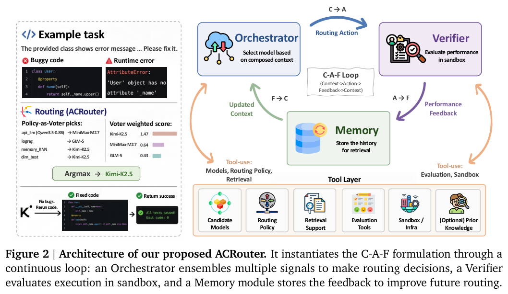
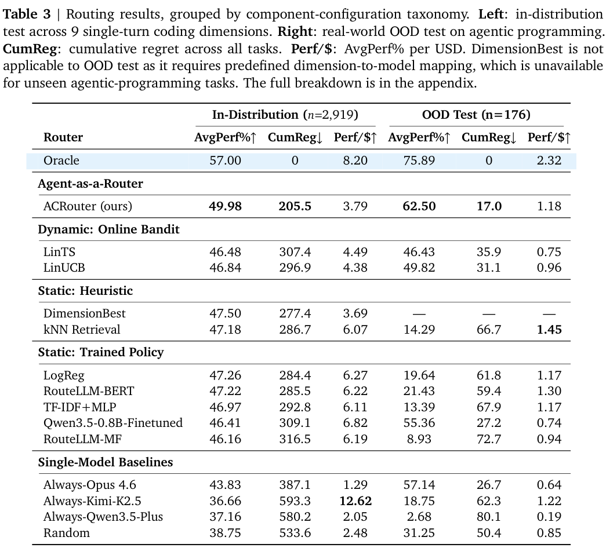
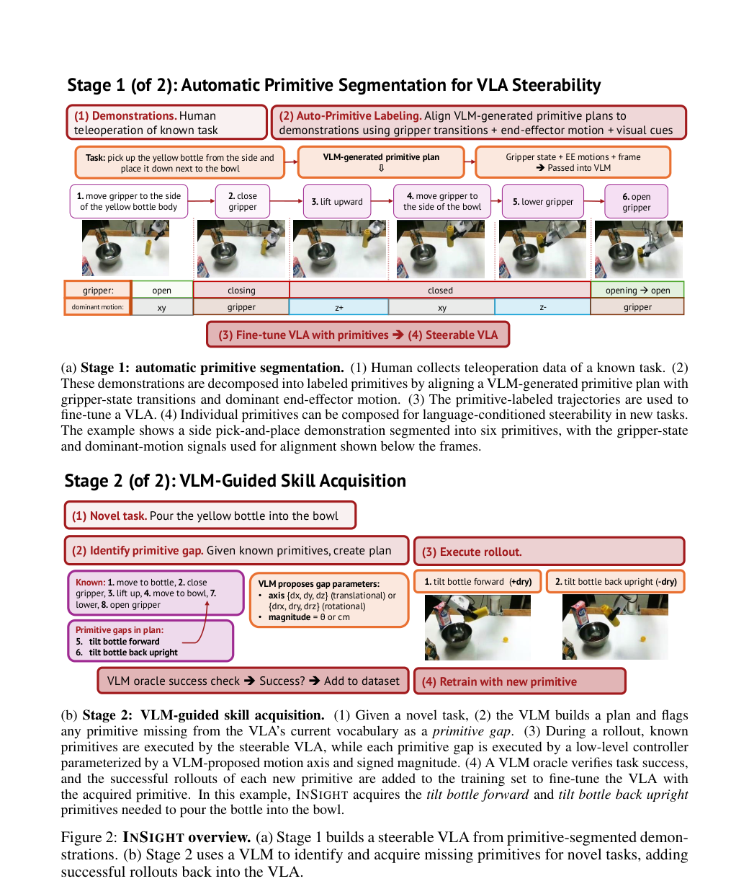
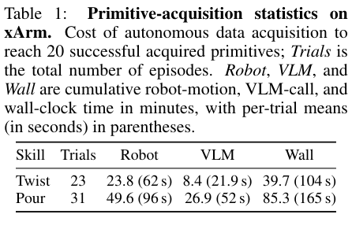

本期八项研究介绍查询抽象、语言世界模型、Agent 数据、科研评测、模型路由、技能获取、三维记忆与扩散评测。

## 1. OBDA 查询抽象：完备、可靠与精确的表达边界

[Abstractions of Queries in Ontology-Based Data Access](https://arxiv.org/abs/2606.24618v1) · v1 提交 2026-06-23 · [全文](https://arxiv.org/html/2606.24618v1) · [PDF](https://arxiv.org/pdf/2606.24618v1)

OBDA 通常将本体查询下推到数据源，这篇论文反过来研究源查询怎样抽象为本体查询。完美抽象要求确定答案恰好一致，但未必存在；最小完备抽象尽量少引入多余答案，最大可靠抽象则在不误报的前提下尽量找全。作者将 UCQ 扩展为带受限不等式和常量标记 C 的语言；C 区分源端常量与未知对象，不是任意关闭开放世界假设。

这是理论研究，没有准确率或吞吐实验。在映射抽象的 GLAV 设置中，映射规则的 frontier（体与头共享变量）大小有界时，判断完美抽象存在性为 Π₂ᴾ-complete；一般情形给出 Co-NExpTime 上界。候选是否完美的验证仍为 Π₂ᴾ-complete。复杂度类不增加不代表现实计算便宜，表 1 讨论的映射条件也不能直接推广为任意本体规则。

最大可靠抽象与数据交换的 maximum recovery 建立联系，FO 可重写本体下还可进一步构造，但一般存在性和构造并未全部解决。我的判断是，工程上先要明确完备、可靠与精确的语义目标是否能表达，再选择改写器。这是 KR 2025 论文的 2026 年扩展报告。

**原图入口：**[Table 1，PDF 第 2 页](https://arxiv.org/pdf/2606.24618v1#page=2)。

## 2. Qwen-AgentWorld：用语言模型学习工具环境的状态转移

Qwen-AgentWorld 用超过一千万条交互轨迹学习七类工具环境，经历持续预训练、下一状态监督与规则—rubric 混合奖励 RL。模型既可作为独立环境模拟器训练 Agent，也可将世界建模作为 Agent 模型的预热阶段。

作者分别检验模拟保真、模拟环境中的 RL 和统一 Agent 的迁移收益。35B-A3B 训练的事实性 rubric 相对改善 11.3%，却始终是较低的一维，说明环境常识仍是难点。逐步模拟分数、下游任务完成与训练成本是不同指标；会生成可信工具回复不保证长轨迹状态一直自洽。

[Qwen-AgentWorld: Language World Models for General Agents](https://arxiv.org/abs/2606.24597v1) · v1。

[Figure 1（原文）](https://arxiv.org/pdf/2606.24597v1#page=1)。

## 3. OpenThoughts-Agent：系统比较任务来源和轨迹配方

OT-Agent 用一百余组受控消融研究任务来源、轨迹生成与筛选，组合十万条数据微调 Qwen3-32B。开发阶段的核心评测与之后才使用的分布外任务分开，以检验数据是否只针对一个 benchmark。

七项 Agent 任务平均为 44.8%，Nemotron-Terminal-32B 为 40.9%；但 MedAgentBench 为 47.8%，低于后者的 62.6%。主表对每个模型分别选择 Terminus-2 和原生 harness 中的较高成绩，因此不能当作单一固定接口的纯模型比较；平均收益也掩盖了任务间取舍。

[OpenThoughts-Agent: Data Recipes for Agentic Models](https://arxiv.org/abs/2606.24855v1) · v1。

[Figure 1（原文）](https://arxiv.org/pdf/2606.24855v1#page=2)。

## 4. NatureBench：让科研 Agent 以论文最优结果为参照

NatureGym 从 Nature 系列论文构建九十个科研任务，将任务可见数据与隐藏评价分开，并用容器统一环境。Agent 可以优化方法与实现，但评测关闭网页搜索，检验能否在给定问题和预算下超过已发表结果。

十组前沿 Agent 配置中，最强系统只有 17.8% 的任务达到 g>0.1 的超越标准。分析显示成功往往来自把问题转成熟悉的监督学习形式，失败常与方法选择和计算预算有关。超越某个数据集上的论文分数并不等于完成新的科学解释；任务构造、指标和可用预算决定比较范围。

[NatureBench: Can Coding Agents Match the Published SOTA of Nature-Family Papers?](https://arxiv.org/abs/2606.24530v1) · v1。

[Figure 1（原文）](https://arxiv.org/pdf/2606.24530v1#page=1)。

## 5. ACRouter：在执行反馈中学习选择代码模型

ACRouter 把路由组织为 Context→Action→Feedback 循环，以 Orchestrator、Verifier 与记忆累积不同模型的实际表现。CodeRouterBench 收集约一万项代码任务及八种前沿模型的验证成绩，比较持续到来的任务上的累计遗憾。

*图｜Zhou, Pengfei 等，[Figure 2（PDF 第 6 页）](https://arxiv.org/pdf/2606.22902v2#page=6)，[CC BY 4.0](http://creativecommons.org/licenses/by/4.0/)。裁剪自原文。*

v2 的 2,919 项分布内测试中，平均性能为 49.98%，LinUCB 为 46.84%；176 项分布外 Agent 编程为 62.50% 对 49.82%。但分布内每美元性能为 3.79，低于 LinUCB 的 4.38，质量收益有额外成本。Oracle 只是已知各模型结果后的参照，不能作为可部署路由器。

*图｜Zhou, Pengfei 等，[Table 3（PDF 第 9 页）](https://arxiv.org/pdf/2606.22902v2#page=9)，[CC BY 4.0](http://creativecommons.org/licenses/by/4.0/)。裁剪自原文。*

[Agent-as-a-Router: Agentic Model Routing for Coding Tasks](https://arxiv.org/abs/2606.22902v2) · v2。

## 6. InSight：用可转向动作原语形成技能数据飞轮

InSight 先由 VLM 计划分解与末端位姿把演示划为带标签的原语，使 VLA 能按低层语言指令执行。面对新任务，VLM 找到缺失原语、提出低层控制并尝试采集，将成功演示回填训练，再组合已经学会的技能。

*图｜Wang, Maggie 等，[Figure 2（PDF 第 4 页）](https://arxiv.org/pdf/2606.24884v1#page=4)，[CC BY 4.0](http://creativecommons.org/licenses/by/4.0/)。裁剪自原文。*

关抽屉实验增加七十条闭合原语后，重训模型在二十五次评估中全部成功，并保留开抽屉能力；旋盖再倾倒则组合十四个原语，没有整段组合任务的人类演示。小样本全成功不是通用可靠性保证，VLM 完成判定也可能与真实动作边界不完全一致；基础技能和新数据采集仍不可省略。

*图｜Wang, Maggie 等，[Table 1（PDF 第 8 页）](https://arxiv.org/pdf/2606.24884v1#page=8)，[CC BY 4.0](http://creativecommons.org/licenses/by/4.0/)。裁剪自原文。*

[InSight: Self-Guided Skill Acquisition via Steerable VLAs](https://arxiv.org/abs/2606.24884v1) · v1。

## 7. HoloAgent-0：用技能图与三维记忆组织机器人执行

HoloAgent-0 通过 Embodied AgentOS 将语言任务转换为技能图，调度机器人资源，并依据执行反馈重规划或澄清。三维记忆维持对象身份，按楼层、房间、视角与物体分层检索，让路径选择保留空间结构与可复查的视觉证据。

HM3D-ObjNav 中，完整导航栈 SR 为 82.6%、SPL 为 42.8%，FSR-VLN 慢推理版本为 80.8%、41.0%；真机 Top-1、距离一米阈值为 97.70%，FSR-VLN 为 91.95%。模拟路径效率、真机到达与多候选检索并非同一指标，导航成绩也不能代表全部操作或跨机器人协作任务。

[HoloAgent-0: A Unified Embodied Agent Framework with 3D Spatial Memory](https://arxiv.org/abs/2606.23565v1) · v1。

[Figure 1（原文）](https://arxiv.org/pdf/2606.23565v1#page=1)。

## 8. DiffusionBench：ImageNet 排名不能代替文生图表现

NanoGen 用统一训练与评价框架支持 RAE、VAE、像素空间及 MeanFlow，同时运行类别条件 ImageNet 和文字条件生成。DiffusionBench 将两条评测轴放在一起，检查同一方法的改进能否跨任务成立。

二十一个潜在扩散模型的比较中，ImageNet 与文生图在三种指标下的 Pearson 相关系数为 −0.377 到 −0.580。统一实现还能匹配多项已有 ImageNet 结果，但部分模型尺寸作了近似调整。负相关说明单一榜单的收益不能直接外推，仍不是对任意架构和数据规模的永久排序。

[DiffusionBench: On Holistic Evaluation of Diffusion Transformers](https://arxiv.org/abs/2606.24888v1) · v1。

[Figure 1（原文）](https://arxiv.org/pdf/2606.24888v1#page=2)。

阅读链接：[公开来源 1](https://openreview.net/forum?id=oWt34iSOKK)。
