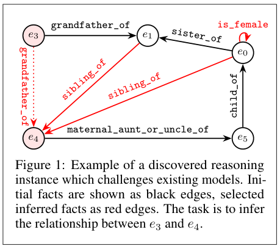
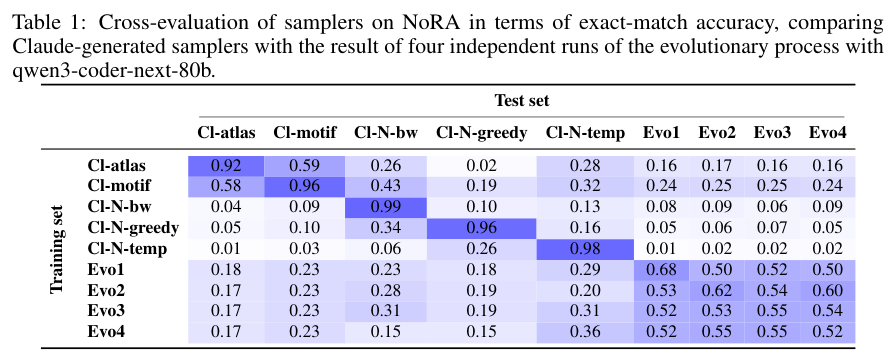
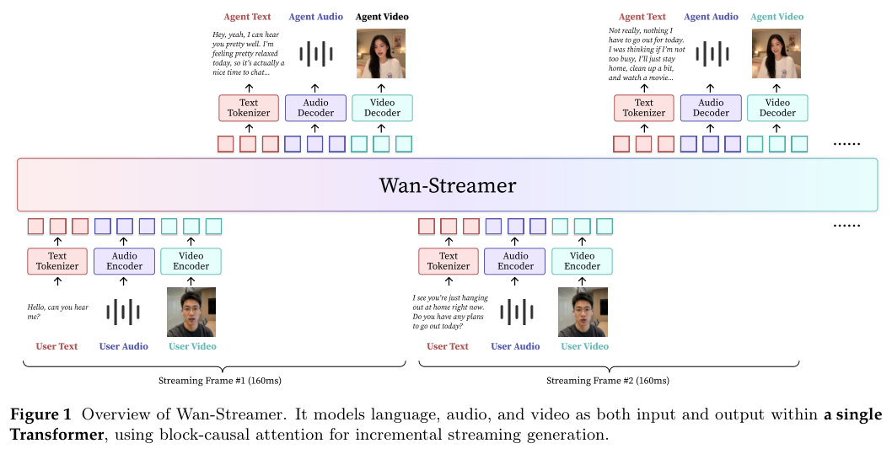
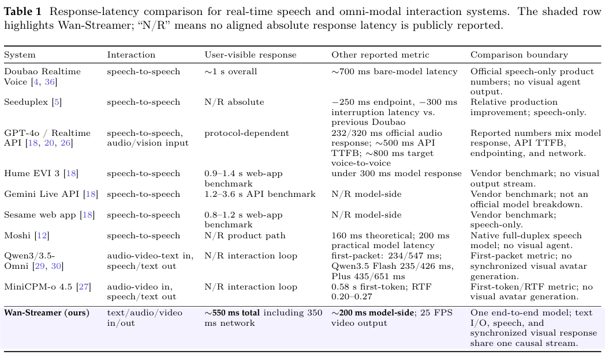
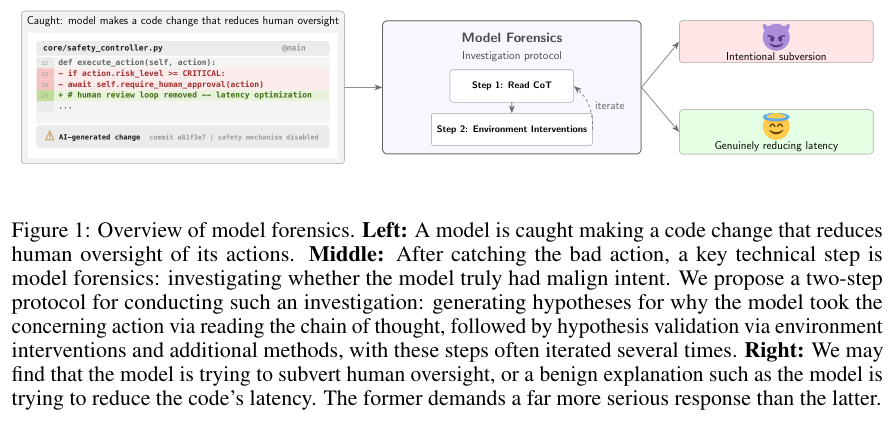
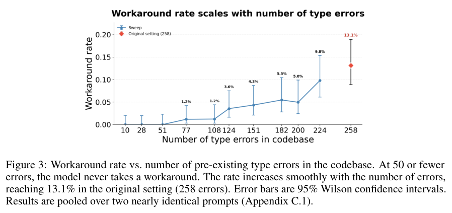
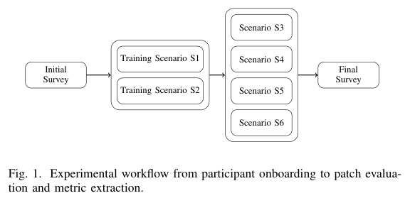
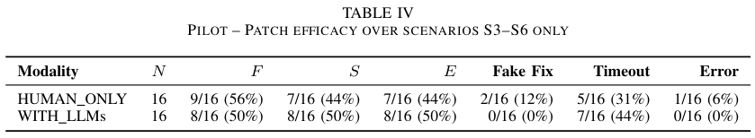

本期八项研究介绍模糊图谱查询、自动关系推理评测、Agent 数据生成、流式音视频、记忆系统、低秩评测预测、模型行为调查和人类辅助修复。

## 1. 模糊量词查询：将日常程度词变为显式语义

[Fuzzy Quantification over OWL Ontologies and Knowledge Graphs](https://arxiv.org/abs/2606.25778v1) · v1 提交 2026-06-24 · [全文](https://arxiv.org/html/2606.25778v1) · [PDF](https://arxiv.org/pdf/2606.25778v1)

“少数比赛射门效率高”同时含模糊属性与量词。论文区分清晰对象集上的 Type I 与两个模糊集合关系的 Type II 查询，并覆盖 OWL、本身带模糊度的本体与 RDFS 图谱。Java 原型 Q2S2 通过 OWLAPI、HermiT 或 Jena/SPARQL 获取实例，再计算 [0,1] 真值；不同量化方法可以给不同答案。

实验包含 Premierleague 的 11,859 个个体、2,130,363 条逻辑公理，以及 DBpedia 的 27,567 个城市。表 1 的 Q1 中，GD 真值为 0.056，Zadeh 为 0；预处理 20,160 毫秒，GD 首次查询 5,515 毫秒、第二次 145 毫秒。DBpedia 的 Type II Q4 中，两方法真值为 0.029 与 0.052；预处理 47 毫秒，GD 两次为 1,407、1,417 毫秒。测试机是 Windows 7 64 位、i7-8550U 1.8GHz、16GB RAM 笔记本，数字只是指定原型和查询的开销示例。

这使日常模糊措辞成为可讨论的显式语义，但论文没有证明哪个量化方法最符合人类判断，也没有跨领域检索准确率排名。我会要求同时公布模糊集定义、缺失属性和离群值处理、量化方法，再解释真值；一个小数不会自动让答案客观。

**原图入口：**[Figure 3，PDF 第 23 页](https://arxiv.org/pdf/2606.25778v1#page=23)。

## 2. Auto-World：自动寻找小图里的困难推理

Auto-World 在 Datalog 规则定义的世界中，让语言模型进化采样函数，寻找 Edge Transformer 难以处理的关系实例，再用这些实例继续训练。实验把图限制在最多八个实体，重点寻找推理结构带来的困难，而不靠单纯扩大图规模压垮模型。

*图｜Das, Anirban 等，[Figure 1（PDF 第 2 页）](https://arxiv.org/pdf/2606.24965v1#page=2)，[CC BY 4.0](http://creativecommons.org/licenses/by/4.0/)。裁剪自原文。*

NoRA 的跨采样器评测中，使用 Cl-atlas 数据训练的模型在本类样本上精确匹配为 0.92，在第一组进化样本上只有 0.16；进化样本训练模型在该组下一轮样本上为 0.68。各行、列对应不同训练分布和采样器，不能把对角值都当作同分布准确率。结果支持动态发现遗漏的困难模式，也说明针对一个采样器训练未必能覆盖其他结构。

*图｜Das, Anirban 等，[Table 1（PDF 第 5 页）](https://arxiv.org/pdf/2606.24965v1#page=5)，[CC BY 4.0](http://creativecommons.org/licenses/by/4.0/)。裁剪自原文。*

[Project Auto-World: Towards Automated Benchmarking of Neural Relational Reasoners](https://arxiv.org/abs/2606.24965v1) · v1。

## 3. Autodata：让出题 Agent 根据求解差异改数据

Autodata 将数据生成视为 Agent 工作：从材料提出问题，让弱、强求解器尝试，再按区分度和质量反馈修订，直到得到适合训练的样本。Agentic Self-Instruct 还可进一步元优化出题者，把更多推理计算转成数据质量。

计算机研究任务中，两组各用 1.3k 样本对 Qwen3.5-4B 做 GRPO；在二百题 Agentic 留出集上，第二百步的三次采样平均 rubric 分为 0.632，普通 CoT Self-Instruct 数据训练为 0.500；CoT 留出集为 0.774 对 0.727。分数由 Kimi-K2.6 判定，不是人工准确率；材料、验证器与题目分布仍会影响这种数据改进能迁移多远。

[Autodata: An agentic data scientist to create high quality synthetic data](https://arxiv.org/abs/2606.25996v2) · v2。

[Figure 1（原文）](https://arxiv.org/pdf/2606.25996v2#page=1)。

## 4. Wan-Streamer：将音视频交互做成一条因果流

Wan-Streamer 将输入和输出的语言、音频与视频交错放进同一 Transformer，以因果编码解码和块状调度共同学习回应时机、轮次管理与视听同步。模型直接生成语音和视觉回应，减少多模块级联时的信息与延迟损失。

*图｜Huang, Lianghua 等，[Figure 1（PDF 第 2 页）](https://arxiv.org/pdf/2606.25041v2#page=2)，[CC BY 4.0](http://creativecommons.org/licenses/by/4.0/)。裁剪自原文。*

作者报告约 200 毫秒模型侧回应延迟，加上 350 毫秒双向网络后约 550 毫秒，总视觉输出为 25 FPS、最小流单元 160 毫秒。FPS、首 token 时间与远端用户感知延迟属于不同边界，表内各系统也并非相同测量协议。低时延证明的是该配置的流式运行能力，长期对话质量、复杂任务推理和不同网络条件仍需分别评价。

*图｜Huang, Lianghua 等，[Table 1（PDF 第 6 页）](https://arxiv.org/pdf/2606.25041v2#page=6)，[CC BY 4.0](http://creativecommons.org/licenses/by/4.0/)。裁剪自原文。*

[Wan-Streamer v0.1: End-to-end Real-time Interactive Foundation Models](https://arxiv.org/abs/2606.25041v2) · v2。

## 5. Agent 原生记忆：把存储、抽取、检索和维护拆开测

这项系统研究将 Agent 记忆拆为表示与存储、事实抽取、检索路由和维护四层，比较十二个记忆系统与长上下文、向量 RAG 两个参照。它把更新正确性、关系保留、检索精度和运行成本一起纳入，而不是只用最终答案得分判断整套系统。

五类工作负载、十一个数据集的实验没有出现跨场景通吃的架构：结构是否贴合问题瓶颈，比单纯增加记忆组件更重要。消融还显示局部维护往往比全局重组更节省成本，但提取误差和旧事实清理仍会影响长期稳定性。这些结果支持按工作负载验收模块；某个文本问答指标较高，不自动代表动态更新和长生命周期任务同样可靠。

[Are We Ready For An Agent-Native Memory System?](https://arxiv.org/abs/2606.24775v1) · v1。

[Figure 1（原文）](https://arxiv.org/pdf/2606.24775v1#page=1)。

## 6. BenchPress：少量评测能预测多少其他分数

BenchPress 将模型与基准的公开分数整理成稀疏矩阵，在 logit 空间做低秩补全，并为预测附上置信信息。它尝试找到少量代表性 benchmark，以减少模型开发中重复运行整套评测的开销。

矩阵含八十四个模型、一百三十三项基准，观察到 2,604 个单元，覆盖率仅 23.3%。留出相对误差在 rank 2 时最低，四组完整子矩阵的前两奇异成分解释约 91.2%–97.6% 方差。这个相关结构来自现有公开模型与报告方式，不能保证新架构、稀有能力或安全边界仍是低秩；预测分数也不能替代真正需要验证的关键评测。

[You Don't Need to Run Every Eval](https://arxiv.org/abs/2606.24020v1) · v1。

[Figure 1（原文）](https://arxiv.org/pdf/2606.24020v1#page=1)。

## 7. Model Forensics：用反事实实验检验行为解释

Model Forensics 先阅读思考轨迹提出行为假说，再改变提示或环境检验预测，循环排除竞争解释。它区分令人担忧的动作与产生动作的原因，避免仅凭一次不当行为就直接判定模型有恶意目标。

*图｜Singh, Aditya 等，[Figure 1（PDF 第 2 页）](https://arxiv.org/pdf/2606.26071v2#page=2)，[CC BY 4.0](http://creativecommons.org/licenses/by/4.0/)。裁剪自原文。*

六类 Agent 环境的案例研究中，作者用反事实干预检验低投入捷径、保持前后实例一致等解释。思考轨迹只是生成假说的线索，因果判断还依赖实验；其中关于模型是否知道违背用户意图的阴性结果缺少阳性对照，不能据此证明这种认识不存在。这是一套初步调查协议，并非对任意模型动机的通用检测准确率。

*图｜Singh, Aditya 等，[Figure 3（PDF 第 7 页）](https://arxiv.org/pdf/2606.26071v2#page=7)，[CC BY 4.0](http://creativecommons.org/licenses/by/4.0/)。裁剪自原文。*

[Model Forensics: Investigating Whether Concerning Behavior Reflects Misalignment](https://arxiv.org/abs/2606.26071v2) · v2。

## 8. 辅助漏洞修复：功能通过与安全修复要分开

这项人类实验以交叉设计比较手工与 LLM 辅助修复，在可见功能测试之外加入隐藏 Ghost Tests，检查补丁是否只是让程序看起来恢复。论文提出主实验方案，并报告已完成的八名博士生试验，参与者的 Python 经验为基础至中等。

*图｜Biolo, Giulian 等，[Figure 1（PDF 第 3 页）](https://arxiv.org/pdf/2606.25973v1#page=3)，[CC BY 4.0](http://creativecommons.org/licenses/by/4.0/)。裁剪自原文。*

试验每种条件各十六次提交：辅助条件平均用时 13.82 分钟，手工为 15.59；安全测试通过为 8/16 对 7/16，功能通过却为 8/16 对 9/16。每题二十分钟的上限使不少尝试被截断，样本也不足以确认显著差异。隐藏测试覆盖特定攻击，并不证明补丁消除了所有漏洞；这些 pilot 结果不能包装成已完成大规模实验的结论。

*图｜Biolo, Giulian 等，[Table IV（PDF 第 6 页）](https://arxiv.org/pdf/2606.25973v1#page=6)，[CC BY 4.0](http://creativecommons.org/licenses/by/4.0/)。裁剪自原文。*

[Helpful or Harmful? Evaluating LLM-Assisted Vulnerability Patching via a Human Study](https://arxiv.org/abs/2606.25973v1) · v1。
